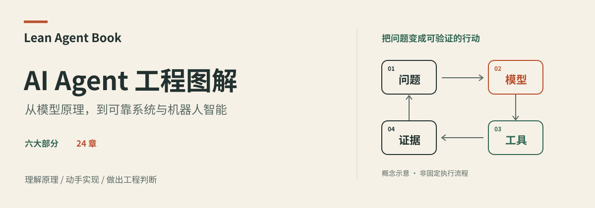
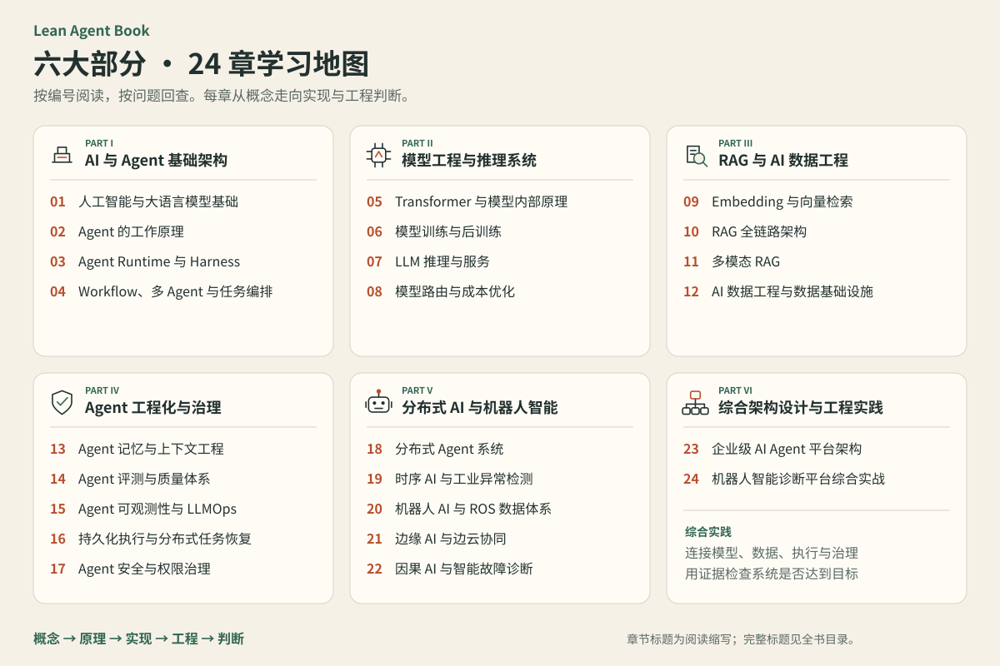
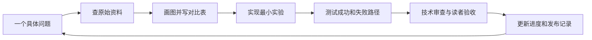

<p align="center"></p>

# AI Agent 工程图解 · Lean Agent Book

**从一次面试里的追问出发，把“听过概念”变成“能解释、能实现、能验证”。**

一套持续更新的中文开源课程。以企业助手和机器人诊断为主线，覆盖 6 个部分、24 章。先看图，再看表，最后运行实验。

[在线读书（持续更新）](https://cfrs2005.github.io/leanagentbook/) · [开始学习](chapters/00-start-here.md) · [课程进度](ROADMAP.md) · [参与编写](CONTRIBUTING.md) · [原始课程方案](ai-agent-engineering-book-kit/README.md) · [MIT 许可](LICENSE)

> **24 章教学首版已完成核对，持续更新。** 正文、图表、实验与来源均可阅读和复查，详见 [逐章核对记录](ACCEPTANCE.md)。真实模型与脚本模型分开标注；合成数据结果不能证明现场效果。



## 先选一个问题

| 你想弄清什么 | 阅读入口 | 学完交付什么 |
|---|---|---|
| 面试里追问的到底是什么能力？ | [00 · 从问题开始](chapters/00-start-here.md) | 一份有证据的能力自查表 |
| Token、上下文和结构化输出是什么？ | [01 · 模型基础](chapters/01-model-foundations.md) | 预算边界与输出校验实验 |
| Agent 为什么会一直调用工具？ | [02 · Agent 工作原理](chapters/02-agent-loop.md) | 能终止、能处理失败的最小循环 |
| Runtime、Harness、MCP 怎么分工？ | [03 · Runtime 与 Harness](chapters/03-runtime-harness.md) | 职责图和运行约束 |
| 什么时候应该用多个 Agent？ | [04 · 工作流与多 Agent](chapters/04-workflow-orchestration.md) | 并行执行、有限重试与审批实验 |
| 怎样减少调用而不掩盖错误？ | [08 · 路由与成本](chapters/08-model-routing.md) | 双模型真实记录、策略回放和缓存边界 |
| 图片与文字怎样一起提供证据？ | [11 · 多模态检索](chapters/11-multimodal-rag.md) | 真实 CLIP、融合、拒答阈值与原图校验 |
| 重复、迟到和坏数据怎样处理？ | [12 · 数据流水线](chapters/12-data-engineering.md) | 持久进度、崩溃恢复与真实 Parquet |
| Worker 退出后谁接着做？ | [18 · 分布式 Agent](chapters/18-distributed-agents.md) | 多进程、心跳、租约与故障转移 |
| 注意力到底在计算什么？ | [05 · 模型内部原理](chapters/05-transformer-internals.md) | 真实张量、因果遮罩和 KV 等价检查 |
| 小模型怎样学会一个任务？ | [06 · 训练与后训练](chapters/06-training-post-training.md) | 真实 LoRA、独立评测与重载验证 |
| 模型服务怎样测快慢？ | [07 · 推理与服务](chapters/07-inference-serving.md) | 真实 HTTP 服务、逐 token 时间和压测 |
| 传感器异常是否真的报准了？ | [19 · 时间序列](chapters/19-time-series.md) | 时间切分、三种方法、误报漏报和提前量 |
| 关键词和向量检索怎样互补？ | [09 · 向量检索](chapters/09-vector-retrieval.md) | 标注集、双路召回、融合和重排比较 |
| 答案能追溯到哪份文档？ | [10 · RAG 全链路](chapters/10-rag-pipeline.md) | 文档摄取、引用回答、更新与删除 |
| Agent 记错了，怎样更正和删除？ | [13 · 记忆与上下文](chapters/13-memory-context.md) | 版本化记忆、冲突处理和上下文预算 |
| 模型建议了一个动作，谁决定能不能执行？ | [17 · 权限与安全](chapters/17-security-governance.md) | 授权、一次性审批和审计网关 |
| 改了 Agent，怎样知道有没有退步？ | [14 · 评测与质量](chapters/14-evaluation.md) | 有标注样本、回放报告与发布门禁 |
| 一次任务为什么失败或变慢？ | [15 · 运行观测](chapters/15-observability.md) | 脱敏轨迹、离线报告与只读回放 |
| 进程突然退出，任务还能继续吗？ | [16 · 持久化与恢复](chapters/16-durable-execution.md) | 崩溃恢复、租约与幂等实验 |
| 多个部门怎样共用 Agent 平台？ | [23 · 平台架构设计](chapters/23-platform-architecture.md) | 身份与数据边界、部署图、故障推演表 |
| Bag 时间戳怎样校正与切片？ | [20 · ROS 数据体系](chapters/20-robotics-ros.md) | 真实 Bag、时间真值与可独立读取的事件片段 |
| INT8 是否更快，更新失败怎样恢复？ | [21 · 边云协同](chapters/21-edge-cloud.md) | x86/M4 推理、签名升级与回滚证据 |
| 相关信号能否说明故障原因？ | [22 · 因果诊断](chapters/22-causal-diagnosis.md) | 贝叶斯推断、干预、反事实与校准 |
| 设备断网后怎样上传并复核？ | [24 · 机器人诊断实战](chapters/24-robot-diagnosis.md) | HTTP、缓存恢复、证据报告与检查审批 |

## 六条学习主线

| 图标 | 部分 | 章节 | 核心问题 |
|---|---|---|---|
|  | I · Agent 基础 | 01–04 | 谁决定下一步，谁执行，谁叫停？ |
|  | II · 模型工程 | 05–08 | 质量、速度、成本怎样取舍？ |
|  | III · 检索与数据 | 09–12 | 答案背后的证据从哪来？ |
|  | IV · 工程与治理 | 13–17 | 如何记忆、评测、恢复和授权？ |
|  | V · 分布式与机器人 | 18–22 | 数据和计算应放在哪里？ |
|  | VI · 综合设计 | 23–24 | 怎样从业务目标走到可验收系统？ |

## 十分钟运行首批实验

全套默认实验推荐 Python 3.12；CI 覆盖 Python 3.11 / 3.13。仅运行标准库实验时可用 Python 3.11+。不需要模型密钥、GPU 或机器人。

```bash
git clone https://github.com/cfrs2005/leanagentbook.git
cd leanagentbook
python3 scripts/check_book.py
python3.12 -m venv .lab-venv
.lab-venv/bin/python -m pip install -r labs/rag_pipeline/requirements-pdf.txt -r labs/data_engineering/requirements.txt
.lab-venv/bin/python scripts/test_labs.py
```

实验运行入口、输入和预期输出见各章。测试验证各实验声明的行为；真实模型与硬件的可选检查及已保存证据见各章。

## 怎样持续构建



每次 push / PR 自动检查本地链接、SVG 和离线实验，并保存可下载的课程包。CI 不会自动代写后续章节；后续编写按 [路线图](ROADMAP.md) 逐批推进。

## 内容边界

- 面试只提供问题线索。课程不公开原始录音、逐字稿、姓名或公司内部数据。
- 示例、图表和实验为本项目编写；外部事实引用官方资料。来源状态见 [引用记录](references/README.md)。
- 本仓库自有内容采用 MIT 许可；引用的第三方项目仍适用各自许可。
- 保留解压后的原始项目包，便于追溯课程目标。原始 ZIP 不纳入 Git。
