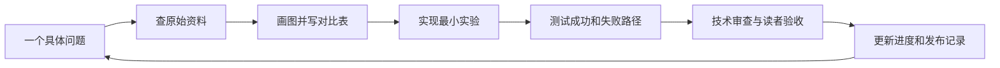

<p align="center"></p>

# AI Agent 工程图解 · Lean Agent Book

**从一次面试里的追问出发，把“听过概念”变成“能解释、能实现、能验证”。**

一套持续编写的中文开源课程。以企业助手和机器人诊断为主线，覆盖 6 个部分、24 章。先看图，再看表，最后运行实验。

[在线阅读全书](https://cfrs2005.github.io/leanagentbook/) · [开始学习](chapters/00-start-here.md) · [课程进度](ROADMAP.md) · [参与编写](CONTRIBUTING.md) · [原始课程方案](ai-agent-engineering-book-kit/README.md) · [MIT 许可](LICENSE)

> 当前为 **v0.1 首批学习切片**：导读、02/03/24 章首版及离线实验。不是已完成的 24 章教材。模拟结果不能证明真实模型质量或机器人现场效果。


## 先选一个问题

| 你想弄清什么 | 阅读入口 | 学完交付什么 |
|---|---|---|
| 面试里追问的到底是什么能力？ | [00 · 从问题开始](chapters/00-start-here.md) | 一份有证据的能力自查表 |
| Agent 为什么会一直调用工具？ | [02 · Agent 工作原理](chapters/02-agent-loop.md) | 能终止、能处理失败的最小循环 |
| Runtime、Harness、MCP 怎么分工？ | [03 · Runtime 与 Harness](chapters/03-runtime-harness.md) | 职责图和运行约束 |
| 设备数据上不了云，怎么诊断？ | [24 · 机器人诊断首个切片](chapters/24-robot-diagnosis.md) | 业务图、系统图、事件证据报告 |

## 六条学习主线

| 图标 | 部分 | 章节 | 核心问题 |
|---|---|---|---|
|  | I · Agent 基础 | 01–04 | 谁决定下一步，谁执行，谁叫停？ |
|  | II · 模型工程 | 05–08 | 质量、速度、成本怎样取舍？ |
|  | III · 检索与数据 | 09–12 | 答案背后的证据从哪来？ |
|  | IV · 工程与治理 | 13–17 | 如何记忆、评测、恢复和授权？ |
|  | V · 分布式与机器人 | 18–22 | 数据和计算应放在哪里？ |
|  | VI · 综合设计 | 23–24 | 怎样从业务目标走到可验收系统？ |

## 十分钟运行首批实验

需要 Python 3.11 或更新版本。不需要模型密钥、GPU 或机器人。

```bash
git clone https://github.com/cfrs2005/leanagentbook.git
cd leanagentbook
python3 scripts/check_book.py
python3 -m unittest discover -s labs/agent_loop -p 'test_*.py'
python3 -m unittest discover -s labs/robot_diagnosis -p 'test_*.py'
```

实验运行入口、输入和预期输出见各章。测试通过只说明离线实验符合断言，不代表全书已经完成。

## 怎样持续构建



每次 push / PR 自动检查本地链接、SVG 和离线实验，并保存可下载的课程包。CI 不会自动代写后续章节；后续编写按 [路线图](ROADMAP.md) 逐批推进。

## 内容边界

- 面试只提供问题线索。课程不公开原始录音、逐字稿、姓名或公司内部数据。
- 示例、图表和实验为本项目编写；外部事实引用官方资料。来源状态见 [引用记录](references/README.md)。
- 本仓库自有内容采用 MIT 许可；引用的第三方项目仍适用各自许可。
- 保留解压后的原始项目包，便于追溯课程目标。原始 ZIP 不纳入 Git。
