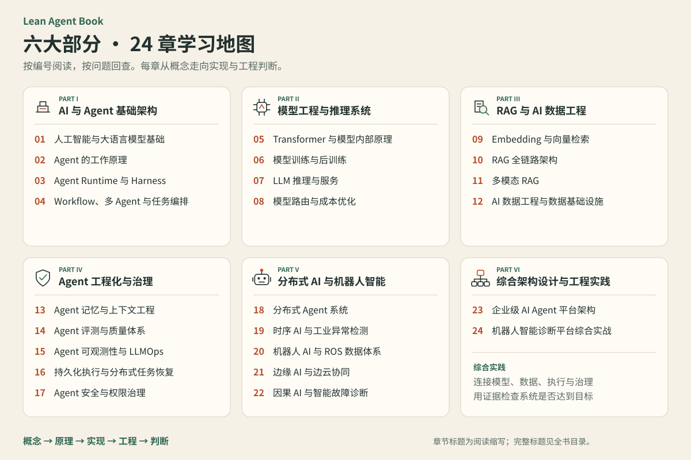
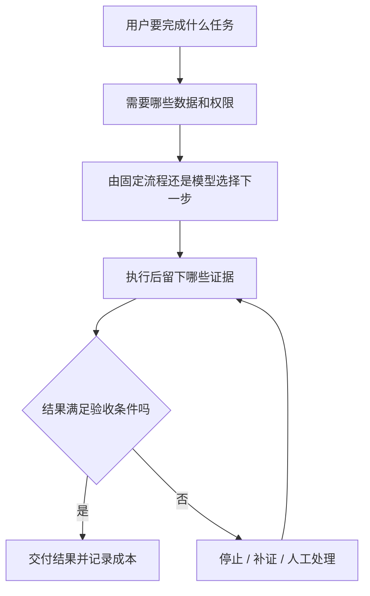

# 00｜从面试追问到工程能力

[返回课程首页](../README.md) · [完整进度](../ROADMAP.md)

> 目标：把一个模糊的技术回答拆成可检查的工程证据。难度：入门。预计 30 分钟。前置：能读懂 API、日志和简单 Python。
>
> 这是课程导读。问题来自一次交流的主题整理，已去除身份、公司和业务数字。转写可能有误，因此不能把谈话里的技术说法当成事实。



## 1. 先抓住五个问题

“用了什么框架”只是起点。能说清输入、执行、证据、失败和成本，才有办法判断方案是否适用。



图中的人工处理也需要截止时间。不能用无限等待代替失败处理。

## 2. 把追问变成学习任务

| 追问 | 容易停留的回答 | 应交付的证据 | 对应章节 |
|---|---|---|---|
| 为什么既有 Runtime 又有图编排？ | “它们都很强大” | 模块职责、状态归属、恢复边界 | 03、04、16 |
| 一次任务要调用多少工具？ | 只报一个平均数 | 任务类别、模型轮数、工具次数、分位数 | 02、08、15 |
| 回答快是因为模型还是缓存？ | “做了优化” | 命中与未命中分组；首字和完成耗时 | 07、08 |
| 怎样证明检索结果好？ | “用了向量库” | 查询集、相关性标注、Recall@K | 09、10、14 |
| 图片里的数字是否可信？ | “相似度高” | 原图区域、抽取值、人工标签与错误分布 | 11 |
| 常见失败到底有哪些？ | 罗列术语 | 失败分类、数量、代表轨迹与修复回归 | 14、15 |
| 一台机器能承载多少任务？ | 只给 CPU 核数 | 到达率、并发、耗时、资源与压测条件 | 07、18、23 |
| 数据太大、设备太弱怎么办？ | “全部传云端” | 采集预算、事件片段、现场计算和补传流程 | 19–24 |
| 该不该训练模型？ | 直接选 LoRA 或强化学习 | 任务定义、基线、标签、独立测试集 | 06、19、22 |

这张表是作者的学习任务设计，不是对任何受访者能力的评分。

## 3. 四个需要拆开的概念

| 不要混为一谈 | 正确的检查方法 |
|---|---|
| MCP 接通数据 = 结果必定真实 | 继续检查工具权限、数据版本、字段校验和回答是否忠于证据 |
| 向量相似度 = 内容正确概率 | 相似度用于匹配；数值是否正确要用带标签的数据单独验证 |
| 保存状态 = 外部动作恰好执行一次 | 检查崩溃发生在写入前还是后，以及外部服务是否接受幂等键 |
| 发现异常 = 找到根因 | 列出支持和反对证据，设计下一步验证；缺证时保留不确定性 |

MCP 的官方定位是上下文交换协议，不规定应用怎样管理模型和上下文。上述第一行是在这个边界上作出的工程判断。[官方架构说明](https://modelcontextprotocol.io/docs/learn/architecture)

## 4. 用一个小例子练习量化

假设某离线模拟任务进行了 3 次模型调用，每次 800 ms；随后串行运行 2 次工具，每次 200 ms；其他开销 100 ms。

```text
假设的串行总耗时 = 3 × 800 + 2 × 200 + 100 = 2900 ms
```

这些数字是教学输入，不是某平台的性能报告。工具并行后要按关键路径计算，不能把所有耗时直接相加。首字出现不代表任务已经完成，缓存命中的请求也不能代表完整工具链的耗时。

| 记录字段 | 示例值 | 用途 |
|---|---|---|
| case_id | sample-001 | 找回输入与预期结果 |
| model_calls / tool_calls | 3 / 2 | 分开统计决策和执行 |
| cache_hit | false | 防止混合不同路径 |
| first_token_ms / total_ms | 未测 / 2900（计算值） | 区分体验和完成速度 |
| success / failure_reason | true / null | 计算任务成功率 |
| model_version / data_version | scripted-v1 / fixture-v1 | 明确复现条件 |

## 5. 三条学习路线

| 你现在的目标 | 推荐次序 | 阶段验收 |
|---|---|---|
| 先跑通一个 Agent | 00 → 02 → 03 → 04 | 能演示成功、工具失败和主动终止 |
| 补齐生产工程 | 02 → 08 → 14 → 15 → 16 → 17 | 能找到失败原因并防止重复副作用 |
| 做设备诊断方案 | 00 → 24 首个切片 → 19 → 20 → 21 → 22 → 24 完整版 | 业务闭环、证据流和实机验收分别成立 |

尚未完成的章节见路线图。不要把计划中的内容当成已经交付的实验。

## 6. 动手：写一张工程证据卡

选择“查询设备最近一次异常”，填下表。先用文件或普通函数做基线，再判断是否需要模型自主选择工具。

| 项目 | 你需要填的内容 |
|---|---|
| 用户与目标 | 谁在什么时候需要什么结果？ |
| 输入与约束 | 设备编号、时间范围、权限、网络与数据量 |
| 最小方案 | 哪些步骤可以固定下来？ |
| 成功标准 | 输出必须包含哪些来源、时间和字段？ |
| 失败策略 | 缺数据、超时、越权时分别怎么办？ |
| 验证方法 | 一条正常样本、一条缺数据样本、一条越权样本 |
| 尚不知道 | 哪些数据必须去现场测？ |

**验收标准：** 每项至少一个具体值；有三个可执行用例；未知项明确标记；不以“效果不错”替代判断条件。

**常见错误：** 先画十个服务再找需求；把框架名当成职责；用一条成功演示证明整体可靠。

**扩展练习：** 删除你的方案中的一个组件。若验收仍通过，解释为什么暂时不需要它。

## 7. 参考资料

核验日期：2026-11-20。这里只引用概念边界，没有依赖外部 SDK API。

| 来源 | 支持的内容 | 使用边界 |
|---|---|---|
| [Anthropic：Building effective agents](https://www.anthropic.com/research/building-effective-agents) | 固定工作流与模型自主决策的区别 | 概念参考；不照抄其框架选型 |
| [MCP：Architecture overview](https://modelcontextprotocol.io/docs/learn/architecture) | 协议与应用运行逻辑的边界 | 不构成数据真实性保证 |
| [LangGraph：Persistence](https://docs.langchain.com/oss/python/langgraph/persistence) | Checkpointer 与 Store 的不同作用域 | 不据此宣称外部副作用 exactly-once |
