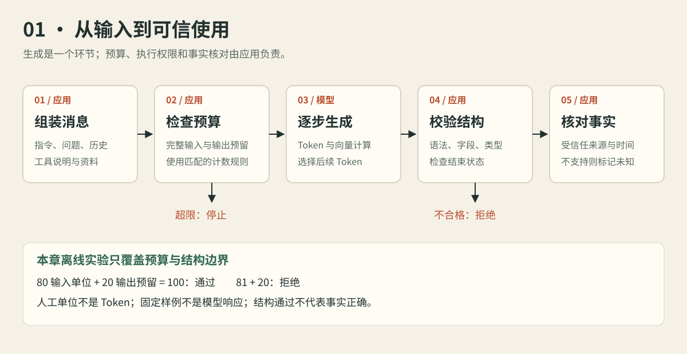
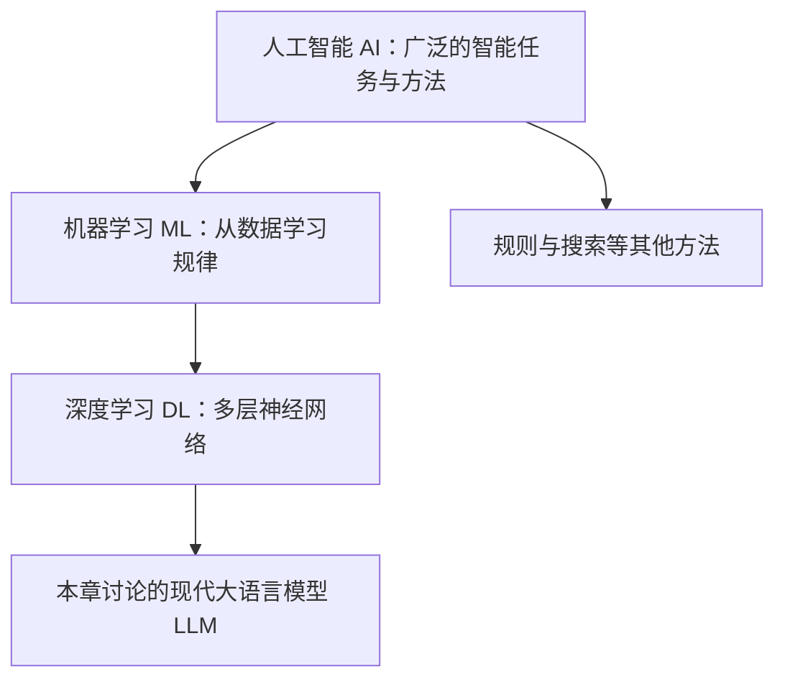
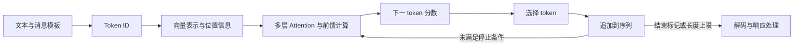
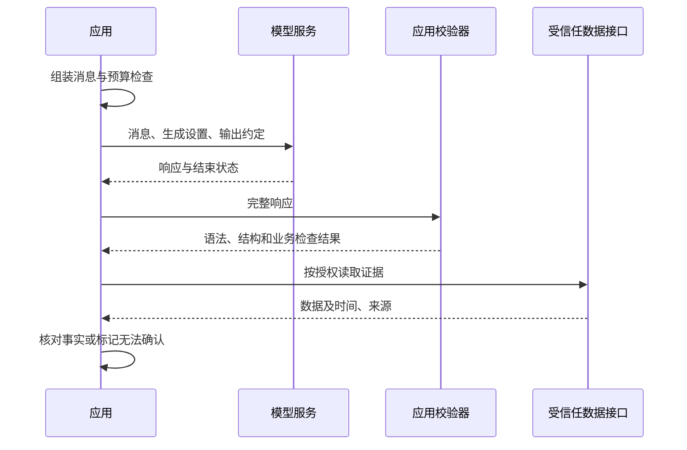
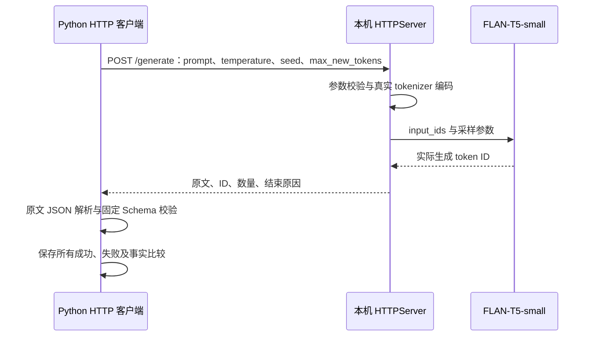

# 第 01 章｜人工智能与大语言模型基础

> 本章目标：解释一次模型请求的输入、计算和输出边界，并用代码拒绝超限输入及不合格输出。  
> 难度等级：L1–L3；生产部分只提供设计检查项。  
> 预计学习时间：60–90 分钟（安排估计，非实测）。  
> 前置条件：会运行 Python，了解 JSON；无机器学习前置要求。

**本版范围：** 基础概念和标准库边界实验之外，增加固定 FLAN-T5-small 的真实本机 HTTP API、实际 tokenizer 统计、JSON Schema 契约校验和温度对照。保留自由生成36次和受限生成18次的全部原始输出，包括格式失败与错误答案。本机服务不是云厂商 API；自由生成使用事后校验；另提供有限 enum 对象的真实约束解码和显式标点编码，不是通用 Schema 服务。

## 1. 本章解决什么问题



| 工程问题 | 常见误解 | 本章要建立的判断 |
|---|---|---|
| 一份长文档能否直接提交？ | 字数小于窗口数字就能放下 | 需要模型对应的 token 计数及输出预留 |
| 返回了 JSON，能否入库？ | 能解析就可信 | 语法、结构、业务约束和事实要分开验证 |
| 模型说温度是 42 度，数据从哪里来？ | 模型会自动查设备 | 生成与外部查询是不同操作 |
| 提高温度是否更聪明？ | 随机性越大，能力越强 | 采样设置改变输出分布，不保证正确率 |

设想一个维修记录摘要功能：员工提供记录，系统返回摘要及来源编号。模型适合处理措辞不同的文本；设备温度的最新值则应从受信任的数据接口取得。如果输入本来就是固定字段，直接用程序生成报告通常更简单，也更容易验收。

学完后应能画出请求生命周期，解释 token、context window、embedding 和 attention，分清生成与事实查询，并复现“结构正确但事实错误”的反例。

## 2. 先用大白话理解

生成式语言模型可以类比为一个根据已有文字继续写作的系统。它从训练中学习规律，再根据当前输入逐步选择后续内容。这比“查找一条现成答案”更接近本章讨论的自回归生成过程，但仍是简化：模型内部处理向量，训练及后训练目标也不只有一种；类比不说明模型有人的记忆或判断方式。



这是一张教学范围图，不是所有研究方向的完整分类。AI 不等于聊天机器人，深度学习也不限于语言模型。判别式模型通常学习类别或条件判断，例如把记录分为“告警”和“正常”；生成式模型学习数据分布并生成样本，例如生成记录摘要。生成式模型也能用来分类，任务名称不能单独决定模型类别。

## 3. 核心术语

| 术语 | 直观解释 | 准确边界 |
|---|---|---|
| Token / Tokenizer | 模型使用的片段 / 切分与编号器 | 片段可对应字节、字符、子词或特殊标记；不是固定一个字或一个词 |
| Token ID | 词表中的编号 | 编号大小不表示含义远近 |
| Embedding | 用一组数表示对象 | 向量的几何关系依赖训练目标；不是事实数据库 |
| Attention | 按当前表示汇集其他位置的信息 | 是可学习的加权计算，不等于人类注意或可验证推理证据 |
| Context Window | 一次计算可使用的上下文容量 | 长窗口不保证每处信息都被正确使用，也不是永久记忆 |
| Logits | 各候选 token 的未归一化分数 | 经处理和归一化可形成采样分布；不是答案真实概率 |
| Hallucination | 输出与证据或事实不一致、或缺乏支持 | 判断需指定任务、证据及事实标准；流畅度不能代替核验 |

### Tokenization：不要用字数算账

BPE（Byte Pair Encoding，字节对编码）在训练时逐步合并常见相邻符号，得到子词单元；具体实现可从字符或字节开始。SentencePiece 是分词工具，不是 BPE 的别名；它支持 BPE 和 Unigram 等方法，能从原始句子学习切分。[官方仓库](https://github.com/google/sentencepiece)

“设备 A-17”在不同词表下可能得到不同切分。不要在没有 tokenizer 的情况下写出看似真实的 token ID 或数量。Python `len(text)` 统计 Unicode 码点，`len(text.encode('utf-8'))` 统计字节，两者都不是通用 token 计数。实际预算需要匹配模型、tokenizer 和消息模板；对账还要检查服务返回的 usage 口径。

成本通常与输入和输出用量有关，但不能只算用户问题。历史消息、工具说明、引用资料及模板开销也可能计入输入。价格、缓存计费和内部推理用量因服务而异，本章不提供实时价格或通用换算率。

### 两种 embedding 不要混用

| 比较项 | 模型内部 token embedding | 检索用文本 embedding |
|---|---|---|
| 输入 | token ID 序列 | 查询、句子或文档片段 |
| 输出 | 每个位置的初始向量，后续层继续变换 | 用于检索比较的向量表示 |
| 目的 | 支撑模型内部计算 | 让相关文本在指定度量下容易匹配 |
| 误用 | 把内部某个 token 的向量当成整段含义 | 把高相似度当作内容正确或来源可信 |

可以把检索向量想成地图坐标，但坐标轴通常没有“温度”“故障”等人工命名含义。不同 embedding 模型的空间不能默认混合使用。Sentence-BERT 是专门学习句子表示以支持相似度比较的例子，不能据此推断任意语言模型的初始 token 向量都适合检索。[原始论文](https://arxiv.org/abs/1908.10084)

## 4. 工作原理



原始 Transformer 包含编码器和解码器，层内还有残差连接、归一化和前馈网络。上图聚焦常见的自回归解码式文本生成，不表示所有 LLM 都有同一结构。Attention 通过 query、key 的匹配给 value 分配权重并汇集信息；因果掩码限制当前预测读取未来位置。位置关系也需要编码。详细张量计算留给第 05 章。[Transformer 原始论文](https://arxiv.org/abs/1706.03762)

### 消息角色与上下文预算

| 消息角色 | 常见用途 | 工程边界 |
|---|---|---|
| system | 应用设置的行为说明 | 不是权限系统或沙箱 |
| user | 本次问题与用户提供内容 | 内容可以错误或夹带指令 |
| assistant | 模型回复或工具调用请求 | 历史回复不是自动可信的证据 |
| tool | 外部执行器返回的结果 | 仍需处理错误、来源及访问权限 |

聊天接口的角色最终由模型对应的模板编码成序列，具体角色、控制标记和模板由模型或服务定义，不能把任意模板直接套到另一模型上。[Hugging Face 聊天模板文档](https://huggingface.co/docs/transformers/chat_templating)

对共享输入输出窗口的自回归模型，可先建立以下预算检查：

```text
完整输入 token 数 + 预留生成 token 数 ≤ 上下文容量
预留生成 token 数 ≤ 模型或服务允许的输出上限
```

这不是所有 API 的统一配额公式。接入时还要核对内部推理 token、多模态输入及服务附加开销的规则。超限时先拒绝请求或明确选择删减、检索和摘要策略，不要默默裁掉关键证据。对话历史必须重新提供或由服务状态机制保留；普通推理请求不会自动把当前对话写入模型权重。

本实验只演示第一条不等式，使用人工整数单位：80 输入 + 20 输出预留恰好占满 100；81 + 20 必须拒绝。这些数字不是任何模型的容量或 token 统计结果。

### 生成参数改变什么

| 参数 | 作用 | 不保证什么 |
|---|---|---|
| Temperature | 对 logits 做温度缩放；正温度下较低值通常使分布更集中 | 不保证正确、稳定复现或更强推理 |
| Top-p | 保留累计概率达到阈值的高概率候选集合 | 不是答案置信度阈值 |
| Top-k | 保留分数最高的 k 个候选 | 不是检索文档数量，也不表示看 k 步未来 |
| Max tokens / Max new tokens | 限制生成长度，名称和计数范围依接口而定 | 不保证 JSON 已闭合、任务已完成 |

参数是否支持、取值范围、默认值及组合顺序都需查所用接口。以 Transformers 为例，`max_new_tokens` 不计提示长度；采样选项也要结合 `do_sample` 理解。不要假设每个接口都接受 `temperature=0`，或用同一随机种子就能跨版本复现。本章第 6.3 节提供固定模型的温度对比，结果只适用于所测样本与环境。[Hugging Face 生成配置文档](https://huggingface.co/docs/transformers/main_classes/text_generation)

输入越长通常需要更多计算与存储，输出越长通常需要更多生成步骤。具体时延还取决于模型、硬件、缓存和服务队列，本章不把某个复杂度公式当成实际速度结论。

## 5. 架构与流程



这是应用设计图；第 6.3 节实际实现本机 HTTP 模型请求和本地校验，外部事实接口仍仅作设计说明。若输出是工具调用，模型只是生成名称和参数。应用必须校验参数和权限，再执行工具，并把结果提供给后续生成。工具调用文本本身不证明工具已执行。

结构化输出也要分层：JSON 可解析，只说明语法成立；满足 schema，只说明字段符合约束；满足业务规则，仍不说明外部事实正确。服务端约束生成和本地事后校验是不同机制。本章固定样例与自由生成使用后者；第 6.4 节另提供有限 enum 的生成约束，明确其能力边界。JSON Schema 的 `properties` 不自动要求字段存在，需要 `required`；拒绝额外字段要明确设置 `additionalProperties`。[JSON Schema 对象参考](https://json-schema.org/understanding-json-schema/reference/object)

## 6. 工程实现

### 6.1 选型与完整代码

选择 Python 3.11+ 标准库，以便不接入模型也能验证边界。完整实现见 [foundations.py](../labs/model_foundations/foundations.py)，完整测试见 [test_foundations.py](../labs/model_foundations/test_foundations.py)。无需安装依赖。

```text
labs/model_foundations/
  foundations.py       # Offline fixtures and validation
  test_foundations.py  # Boundary tests
  README.md           # Commands and recorded results
```

| 函数 | 输入与输出 | 限制 |
|---|---|---|
| `check_budget` | 人工输入量、输出预留、容量 → 剩余量或异常 | 不估算 token，不处理消息 |
| `validate_output` | JSON 文本 → 已验证对象或异常 | 只检查固定 schema，不是通用 JSON Schema 引擎 |
| `main` | CLI 参数 → JSON 报告和退出码 | 读取固定样例，没有调用模型 |

固定 schema 要求 `answer` 是非空字符串，`source_ids` 是字符串数组，两个字段必须存在，不允许其他字段。空来源数组和只有空格的回答仍能满足此 schema，这是结构约束的明确边界。代码额外拒绝重复键、非标准数字常量、超过 4096 码点的响应。长度限制是实验本地策略，不是模型 token 上限。

### 6.2 安装和运行

在仓库根目录执行：

```bash
python3 labs/model_foundations/foundations.py
python3 labs/model_foundations/foundations.py --input-units 81
python3 labs/model_foundations/foundations.py --scenario invalid
python3 labs/model_foundations/foundations.py --scenario truncated
python3 labs/model_foundations/foundations.py --scenario wrong-fact
python3 -m unittest discover -s labs/model_foundations -p 'test_*.py'
```

| 场景 | 预期状态 | 退出码 | 说明 |
|---|---|---|---|
| 默认 | `structure_valid` | 0 | 80 + 20 = 100，结构通过 |
| 输入 81 | `rejected` | 1 | 预算超限，`fixture_read` 为 false |
| invalid | `rejected` | 1 | answer 错误地使用数字 |
| truncated | `rejected` | 1 | JSON 未闭合 |
| wrong-fact | `structure_valid` | 0 | 写成 99 度仍符合结构 |

所有场景都显示 `mode: offline_fixture`、`budget_unit: synthetic_unit` 和 `fact_check: not_performed`。最后一个场景成功退出是教学反例：成功只表示结构通过。测试把这一边界固定下来，不把它伪装成事实核验成功。


### 6.3 真实模型 HTTP API、Token 与温度实验

完整实现见 [http_model.py](../labs/model_foundations/http_model.py)、[collect_model.py](../labs/model_foundations/collect_model.py)。客户端用 `urllib.request` 发送 JSON，标准库 `HTTPServer` 在 `127.0.0.1` 的临时端口接收 `POST /generate`，随后执行真实 `model.generate()`。服务与客户端在同一 Python 进程的不同线程中，但确实经过 HTTP 套接字；不是直接把固定样例当响应。程序结束时关闭服务。此接口是本课程协议，不兼容任何云厂商聊天 API。



模型为 `google/flan-t5-small`，固定 revision `0fc9ddf78a1e988dac52e2dac162b0ede4fd74ab`，只从本地快照加载。它是 encoder-decoder 模型，不是聊天角色模型；这里发送单段 prompt，不虚构 System/User 模板。输入分别为 18 与 50 个实际 token（含特殊 token）。输出计数去掉 decoder 起始 token，保留生成的 EOS；报告同时保存 ID，可重新解码核对。这不是云厂商的 usage 或计费口径。

编码器输入超过本实验的 512 token 限制就拒绝，不静默截断；解码最多生成 64 token。两个限制分别检查，不能把前文 decoder-only 的共享窗口公式直接套到 T5。512 是本实验入口策略，不是对所有 T5 配置的硬件容量承诺。

实验固定两条原创英文合成提示：要求计算 `2+3` 并只输出 JSON 整数；要求依据 `record-1` 的 42℃记录输出含 `answer`、`source_ids` 的 JSON 对象。英文用于减少这个小模型上的语言因素，不用于推断中文任务表现。两个 schema 分别为 `{"type":"integer"}` 和第 6.1 节对象契约。校验器仅实现这两项契约，不是任意 JSON Schema 引擎。原文不去代码围栏、不补括号、不替换答案，结构错误不会触发隐藏重试。

对每条提示，依次使用温度 0.2、0.8、1.3；每种使用种子 7、17、27，各重复两次。固定 `do_sample=True, top_k=0, top_p=1.0, max_new_tokens=64`。这样只有温度和指定种子变化。重复同一随机种子是复现检查，不是新增独立样本。

| 任务 | 温度 | 请求数 | Schema 合格数 | 不同原文数 | 算术正确数 |
|---|---:|---:|---:|---:|---:|
| JSON 整数 | 0.2 | 6 | 0 | 2 | 0 |
| JSON 整数 | 0.8 | 6 | 0 | 2 | 0 |
| JSON 整数 | 1.3 | 6 | 2 | 3 | 0 |
| JSON 对象 | 0.2 | 6 | 0 | 1 | 不评分 |
| JSON 对象 | 0.8 | 6 | 0 | 2 | 不评分 |
| JSON 对象 | 1.3 | 6 | 0 | 3 | 不评分 |

实际输出例子：低温整数任务生成 `2 plus 3`，不是 JSON；温度 1.3、种子 17 两次生成 `2`，符合整数 schema，但正确答案应为 5；对象任务低温生成 `answer`，不能解析为所需对象。温度 1.3、种子 27 的整数任务两次达到 64 token 上限，结束原因为 `length`。本次所有同种子配对的 token ID 都相同；不保证换硬件、库版本或模型后仍然相同。更多不同文本也不等于更高质量。

完整 [报告](../labs/model_foundations/results/local-model-20261120/report.json) 和 [36 条原始记录](../labs/model_foundations/results/local-model-20261120/responses.jsonl)包含请求、所有原文、结束状态、token ID、Schema 错误、源码/模型 SHA-256、版本及环境。已实测 Python 3.12.14、torch 2.6.0、transformers 4.48.3、CPU 两线程。36 次 HTTP 均为 200，只说明服务请求成功；34 次结构失败不会被改写成 HTTP 服务故障。另有 2 次结构成功但事实错误，必须分开看。

复现使用已有独立环境，不修改共享依赖：

```sh
/tmp/leanagentbook-routing-py312/bin/python labs/model_foundations/collect_model.py --model-path /tmp/leanagentbook-routing-models/hub/models--google--flan-t5-small/snapshots/0fc9ddf78a1e988dac52e2dac162b0ede4fd74ab --out labs/model_foundations/output/run-001
/tmp/leanagentbook-routing-py312/bin/python labs/model_foundations/verify_model.py --model-path /tmp/leanagentbook-routing-models/hub/models--google--flan-t5-small/snapshots/0fc9ddf78a1e988dac52e2dac162b0ede4fd74ab --evidence labs/model_foundations/results/local-model-20261120
```

输出目录必须不存在。新实验写 `output/`，不得覆盖发布结果。`verify_model.py` 是显式执行的依赖型检查，不以 `test_` 开头；默认测试不会加载模型。其他机器的独立安装步骤见[实验说明](../labs/model_foundations/README.md)。


### 6.4 有限对象 Schema 的真实约束生成

自由生成失败不能代替一个可运行的结构化输出成功路径。补充实验固定一个非常小的对象枚举：`{"answer":"42","source_ids":["record-1"]}` 或同结构的 `"99"` 答案。两个对象构成 JSON Schema 的 `enum`。模型必须选择其中一个，但正确答案取决于输入记录。

这里有一个必须公开的 tokenizer 限制：固定 T5 词表不能直接表示 ASCII 左右大括号，编码会得到未知 token。实验不改权重、不增加词表，而用已有 `<extra_id_0>` 与 `<extra_id_1>` 编码左右括号。模型生成带这些标记的原生文本；一个固定可逆标点转换器再得到 JSON。**原生文本不是 JSON；最终 JSON 是受限生成与显式编码器共同的产物。** 转换器不选择答案，也不依据输入替换错误值。

[constrained_model.py](../labs/model_foundations/constrained_model.py)为两条候选 token 序列提供前缀过滤：每步只允许仍能到达合法对象的下一 token；答案分叉处同时允许多个候选。真实 `model.generate()` 仍执行网络计算，使用模型 logits 和温度采样选择分支。`prefix_allowed_tokens_fn` 的接口见本章新增官方生成配置参考。共有标点被限制，不能把它解读为模型自主掌握全部 JSON 语法。

[collect_constrained.py](../labs/model_foundations/collect_constrained.py)通过同一本机 HTTP API 运行18次：42℃与99℃输入各9次，使用前节三种温度和三个种子。全部18次通过对象 enum 与原对象字段校验，14次语义正确，**4次仍选错温度**。每条证据保存原生文本、转换后JSON、token路径、分叉处候选概率和所选token；没有直接返回脚本预设答案。输入为42℃的9次与自由对象任务的首次重复使用相同提示和参数，格式通过数由0/9变成9/9；其余99℃样本单独分析，不混作同提示对照。

[受限报告](../labs/model_foundations/results/constrained-20261120/report.json)和[全部18次结果](../labs/model_foundations/results/constrained-20261120/responses.jsonl)保留了所有错误。此方法只支持枚举中的完整对象，不支持任意字段值或任意 JSON Schema。它保证有限输出语言的结构，不能保证事实正确，更不能证明开放生成质量提升。

```sh
/tmp/leanagentbook-routing-py312/bin/python labs/model_foundations/collect_constrained.py --model-path /tmp/leanagentbook-routing-models/hub/models--google--flan-t5-small/snapshots/0fc9ddf78a1e988dac52e2dac162b0ede4fd74ab --out labs/model_foundations/output/constrained-001
/tmp/leanagentbook-routing-py312/bin/python labs/model_foundations/verify_constrained.py --model-path /tmp/leanagentbook-routing-models/hub/models--google--flan-t5-small/snapshots/0fc9ddf78a1e988dac52e2dac162b0ede4fd74ab --evidence labs/model_foundations/results/constrained-20261120
```

可选检查复核全部18条的 token、标点转换、Schema 与分叉概率，再对两条输入重新执行真实生成。命令记录见[核查记录](../labs/model_foundations/verification.md)。

## 7. 工程案例：记录摘要中的错误数字

以下完全是合成案例：来源 `record-1` 写明设备温度是 42 摄氏度。两个固定响应分别写成 42 和 99，且都引用 `record-1`。程序对两者都给出结构通过，因为来源编号存在于文本中不表示内容支持该结论。

若投入业务，需要另外验证来源是否可访问、是否对应当前设备和时间，以及引用内容是否支持回答。数据库中有明确温度字段时，可用确定性比较；自然语言摘要可能需要人工标注集和语义核验。机器人场景中，摘要不能直接触发温控或停机动作，控制规则应由独立系统执行。

## 8. 方案对比与设计取舍

| 方案 | 优点 | 代价 | 适用 / 不适用 |
|---|---|---|---|
| 固定模板与规则 | 行为明确、易验证 | 难处理开放表达 | 固定字段报告 / 不适合任意语言总结 |
| 提示词要求 JSON + 本地校验 | 易接入，失败可见 | 模型仍可能输出坏格式 | 可容忍拒绝或有限重试 / 不保证首次成功 |
| 服务端 schema 约束 + 本地业务校验 | 可减少格式偏差 | 依赖模型支持和 schema 子集 | 支持该能力的服务 / 不保证事实正确 |
| 外部证据 + 生成 + 核验 | 可追踪事实依据 | 增加检索、权限和评测工作 | 需要新事实的回答 / 不自动消除幻觉 |

## 9. 生产环境注意事项

模型可能给出不受来源支持或与事实矛盾的内容，这类问题不能只靠合法格式发现。[幻觉研究综述](https://arxiv.org/abs/2202.03629) 说明了多个生成任务中的此类风险与评测问题。本章的工程建议是分开记录结构错误与事实错误，准备失败样例，并明确拒答或转人工条件。

接入真实服务时还需要：设置网络截止时间；对可恢复错误使用有限重试；检查拒绝、截断和结束状态；固定模型标识及提示版本；记录脱敏后的用量和失败原因。流式片段尚未结束时不要当作完整 JSON 使用。日志不能直接保留密钥或原始敏感记录。本章真实实验记录结束状态、HTTP 往返耗时及原始生成，但未验证云服务、流式响应、自动重试和生产权限，也没有生产性能结论。

## 10. 动手实践与验收

**目标：** 分别验证预算、结构和事实三个边界。前置条件是 Python 3.11+ 与仓库代码，无需联网。

1. 运行默认场景，再把输入量设为 79、80、81，比较剩余量和是否读取样例。
2. 运行 invalid 与 truncated，说明类型错误和语法错误的区别。
3. 对照合成来源的 42 度，运行 wrong-fact，解释为何仍通过。
4. 阅读测试中的空来源数组案例；提出一条业务规则，但不要声称原程序已经实现它。
5. 画出模型请求生命周期，标出模型生成、工具执行及事实核对的位置。
6. 运行测试。扩展练习：加入受信任的来源映射，拒绝不存在的 ID，并测试“来源存在但不支持回答”。该扩展未包含在本版。

**验收标准：** 22 个标准库测试通过；真实模型记录包含自由路径36次、有限enum路径18次，全部保存输入及输出token ID和Schema结果；自由路径核对固定种子重复，有限enum路径核对语义错误；两项可选检查各完成两次重新推理；五种 CLI 场景符合上表；能解释预算单位不是 token；能指出 token embedding 与检索 embedding 的区别；能解释低温度、合法 JSON、存在引用为何都不足以证明正确；能区分固定样例、自由生成、有限枚举约束与通用结构化生成。

常见错误包括把 `len` 当 tokenizer、只预算用户问题、把输出上限当完整性保证、把 role 当权限、把结构验证当事实验证。本章对这些错误给出概念或反例，不声称已实现生产防护。

## 11. 本章总结与后续范围

| 已交付 | 仍不覆盖的边界 |
|---|---|
| 请求生命周期、离线边界与真实本机 HTTP 模型请求 | 云厂商 SDK、云账单和生产鉴权 |
| 固定 tokenizer 的输入/输出 ID 与数量 | 任意模型的通用 token 换算 |
| 自由生成契约校验与有限 enum 约束输出，包含全部失败 | 通用 Schema 解码与开放任务可靠生成 |
| 三种温度、三个种子、各两次生成 | 大规模质量评测、跨硬件完全复现 |

本章原工程实践已有真实模型执行证据；自由对象生成失败全部保留，有限枚举约束路径通过结构验收，但仍有语义错误。模型生成与外部事实查询仍是不同过程。

## 12. 参考资料

访问日期统一为 **2026-11-20**。基础边界实验无需第三方库；新增真实模型路径已实测 torch 2.6.0、transformers 4.48.3。其他引用仍仅支持各自概念，不能据此推断都已运行验证。图表与实验代码为本课程原创。

| 来源 | 支持的结论 | 版本与边界 |
|---|---|---|
| [SentencePiece 官方仓库](https://github.com/google/sentencepiece) | BPE / Unigram、原始文本分词 | 当日 README；未使用其性能数据 |
| [Attention Is All You Need](https://arxiv.org/abs/1706.03762) | Transformer、attention 与编码器/解码器 | arXiv v7；原始架构不代表所有现代 LLM |
| [Sentence-BERT](https://arxiv.org/abs/1908.10084) | 专门学习句子 embedding 以支持相似度比较 | 2019 原始论文；不引用性能结论 |
| [Transformers 聊天模板](https://huggingface.co/docs/transformers/chat_templating) | 角色消息需要模型对应的序列模板 | 动态文档，当日访问；未接入库 |
| [Transformers 生成参数](https://huggingface.co/docs/transformers/main_classes/text_generation) | 温度、top-p、top-k、max_new_tokens 的含义 | 动态文档，当日访问；不假设跨服务同名同义 |
| [JSON Schema 对象参考](https://json-schema.org/understanding-json-schema/reference/object) | properties、required、additionalProperties | 当日文档；手写实验不是通用实现 |
| [Survey of Hallucination in Natural Language Generation](https://arxiv.org/abs/2202.03629) | 生成内容缺乏支持或与事实矛盾的风险 | 论文页面，当日访问；不引用幻觉发生率 |

实际执行结果及环境见[实验记录](../labs/model_foundations/README.md)。

新增真实实验来源，访问日期 **2026-11-20**：

- [Transformers 4.48.2 生成配置](https://huggingface.co/docs/transformers/v4.48.2/en/main_classes/text_generation)：支持采样、温度、top-k/top-p 与最大新增 token 的含义；实际运行补丁版本为 4.48.3，精确行为另由产物验证。
- [Transformers 4.48.2 T5 文档](https://huggingface.co/docs/transformers/v4.48.2/en/model_doc/t5)：支持 encoder-decoder 与 text-to-text 架构说明；具体快照文件哈希见实验报告。
- [JSON Schema 数值类型](https://json-schema.org/understanding-json-schema/reference/numeric)：支持整数 schema 可接受数值为整数的 `5.0`，不接受字符串 `"5"` 或布尔值。
