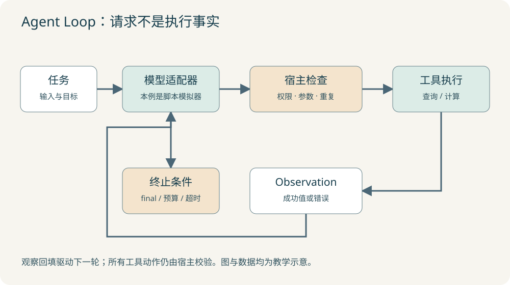
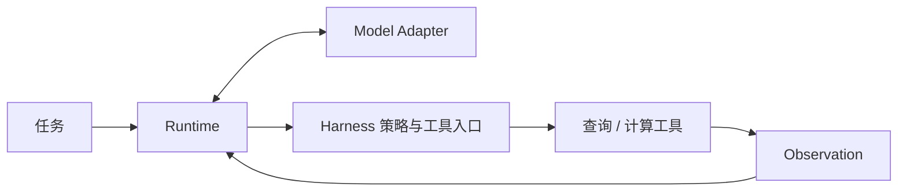
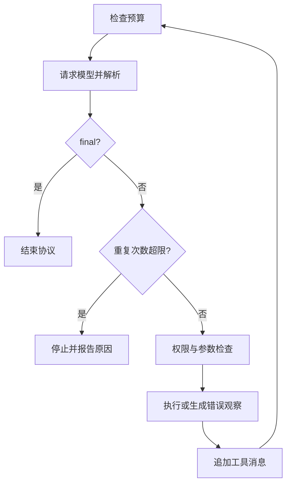
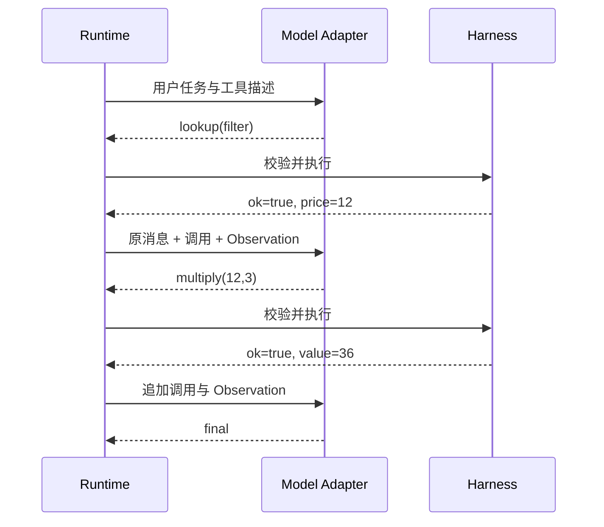

# 第 02 章｜Agent 的工作原理

> 本章目标：运行并解释一个带工具、参数校验、权限检查和终止保护的最小 Agent 闭环。  
> 难度等级：L1–L3，附 L4/L5 设计边界。  
> 预计学习时间：90–120 分钟（学习安排估计，不是实测）。  
> 前置章节：第 01 章；会使用 Python 函数、字典和异常。

**首版范围：** 实现标准库离线实验，包含两种工具、结构化决策、错误回填、重复检测、步数上限和超时。模型是脚本化模拟器，**不是 LLM**。它不理解任意自然语言，也不评估推理能力。原规格要求的最小循环、两个工具、错误回填和日志已实现。真实模型接入、完整 JSON Schema 引擎，以及多种决策方法的实现对比是后续扩展；概念讲解不等于这些扩展已运行。

## 1. 本章解决什么问题

假设采购人员需要查询耗材价格，再计算三件耗材的总价。只生成文字的聊天程序可能给出一个看似合理的数字，但没有访问价格表。直接写一个固定程序也能完成这个需求，而且在流程固定时通常更容易验证。

只有当任务需要根据中途取得的信息选择下一步时，才需要考虑 Agent。工程问题随之变化：谁允许调用工具？参数错误怎么办？工具失败后模型能否看到失败？什么时候必须停下来？本章先把这些问题变成可以检查的程序行为。

## 2. 先用大白话理解

可以把模型看作提出工作请求的助理，把工具看作查询和计算设备，把运行程序看作值班负责人。助理提出“查滤芯价格”，负责人检查权限和参数后执行，再把结果交回。助理据此提出“乘以三”，最后整理结果。

类比的边界是：模型没有天然的账户权限，也不能因为说了“已查询”就证明查询发生。**Agent Loop（智能体循环）**在本章指：程序重复调用决策组件，解析其动作请求，执行受控工具，把可观察结果加入上下文，并根据明确条件终止。模型负责建议动作，宿主程序负责实际执行。

## 3. 核心术语

| 术语 | 中文解释 | 准确定义 | 容易混淆的概念 |
|---|---|---|---|
| Chatbot | 聊天程序 | 主要通过消息提供回复的交互形式 | 聊天界面也可以承载 Agent，界面不是执行架构 |
| Workflow | 固定工作流 | 控制路径由程序预先定义，允许条件分支 | 有分支不一定是自主 Agent |
| Agent | 根据结果决定下一步的程序 | 模型在受控循环内选择动作或结束 | 不等于无限自主权限 |
| Tool Call | 工具调用请求 | 包含工具名和参数的结构化数据 | 不是已经执行的事实 |
| Observation | 执行观察 | 工具返回值或规范化错误 | 不是可信指令，不能覆盖宿主策略 |
| State | 运行状态 | 当前消息、步数、状态、结果和事件 | 不等于长期记忆 |
| JSON Schema | JSON 数据约束 | 描述对象字段、类型、必填项等约束 | 结构合法不等于业务合法或有权限 |
| Completion | 执行结束 | 本实验收到合法 final 决策后的状态 | 不等于结果正确或业务成功 |

## 4. 工作原理

输入包括任务文本、工具注册表和固定策略。每一轮先检查上下文预算，再把已有消息和工具描述传给模型适配器。模型返回以下两种结构之一：

```json
{"type":"tool","name":"lookup","args":{"item":"filter"}}
```

```json
{"type":"final","text":"Total: 36 CNY"}
```

程序解析决策外壳，拒绝缺字段、多字段或错误类型。工具调用随后经过重复检查、工具查找、权限检查和参数检查。工具执行成功与失败都生成 Observation。下一轮可见此前的请求和观察。

| 轮次 | 模型能看到的新增输入 | 模型输出 | 宿主实际行为 |
|---|---|---|---|
| 1 | 用户任务 | lookup(filter) | 返回模拟目录中的单价 12 CNY |
| 2 | lookup 请求及单价观察 | multiply(12, 3) | 返回 36 |
| 3 | multiply 请求及数值观察 | final | 保存答案并结束 |

这里的脚本模型会读取 Observation 内的价格，而不是直接写死总价；但它把商品和数量固定为 filter 与 3。修改用户文本不会改变这项任务。这是验证循环的数据流，不是语言理解实验。

工具注册表将名称映射到 schema、权限标识和异步函数。实验只实现所用 schema 的小子集：对象、固定必填字段、禁止额外字段、字符串长度、有限数值和范围。Python 的 `bool` 是 `int` 子类，所以数值验证显式排除布尔值。完整 JSON Schema 兼容性不在本实验范围内。

重复调用用“工具名 + 排序后的参数 JSON”计数。同一调用默认允许两次，第三次在执行前终止。它能发现完全相同的请求，不能发现换一种参数表达的语义循环。因此还需要最大步数。最大步数按模型请求计数，最终回答也占一轮；用满最后一轮执行工具后，没有额外的免费回答机会。

若消息累计长度为 C、执行步数为 S，每轮复制和序列化上下文的工作量与当轮 C 成正比，累计约为 O(SC)，并非固定开销。实验没有网络、模型费用或 token 计量。接入真实服务后，还要累计每轮模型输入、输出和工具调用的时间及费用。

### 决策方法的区别

| 方法 | 做法 | 适用条件 | 主要风险 |
|---|---|---|---|
| ReAct | 交替推理与行动，用观察更新下一步 | 外部信息会改变执行路径 | 错误观察和多轮成本累积 |
| Plan-and-Execute | 先列计划，再执行各步，必要时重新规划 | 任务能分解，计划有可验证中间目标 | 初始计划可能过时 |
| Reflection | 根据反馈检查此前产物，再尝试修正 | 有独立反馈或判定标准 | 自我评价可能重复原错误 |

ReAct 的原论文讨论了推理与行动交替的方式。本实验仅演示动作与观察闭环，没有实现论文方法或展示模型内部思考。Reflection 也不是要求保存模型的隐藏推理；可以检查外部答案、工具轨迹和测试结果。

## 5. 架构与流程



以下 Mermaid 是可编辑的架构和控制流源码。







## 6. 工程实现

### 6.1 技术选型

Python 3.11+、`asyncio`、`dataclasses`、`json` 和 `unittest`，无需安装第三方包。使用可协作取消的异步工具，使超时路径可以直接观察。这里不接外部模型，不持有密钥，不进行网络操作。

### 6.2 项目结构

```text
labs/agent_loop/
  mini_agent.py       # Runtime, Harness, tools, scripted models and CLI
  test_mini_agent.py  # Behavior and fault tests
  README.md          # Reproduction guide
```

### 6.3 完整代码

完整可运行实现见 [mini_agent.py](../labs/agent_loop/mini_agent.py)，完整行为测试见 [test_mini_agent.py](../labs/agent_loop/test_mini_agent.py)。这两个本地文件是本节代码正文的组成部分；关键逻辑没有以省略号替代。`ModelAdapter` 中的 `...` 仅声明协议方法，没有省略实现；具体实现是 `ScriptedModel` 和 `SequenceModel`。

### 6.4 安装和运行

在仓库根目录运行，无需环境变量：

```bash
python3 --version
python3 labs/agent_loop/mini_agent.py --scenario success
python3 labs/agent_loop/mini_agent.py --scenario failure
python3 labs/agent_loop/mini_agent.py --scenario denied
python3 labs/agent_loop/mini_agent.py --scenario loop
python3 labs/agent_loop/mini_agent.py --scenario timeout
python3 -m unittest discover -s labs/agent_loop -p 'test_*.py'
```

success 的结果应包含 `status: completed`、`answer: Total: 36 CNY`，以及两条 `tool_result` 事件。价格是虚构实验数据，不是报价。failure 的工具观察是 `tool_failed`；denied 是 `permission_denied`；loop 的终态是 `repeat_limit`；timeout 的观察是 `tool_timeout`。错误场景中的 final 可以让协议正常结束，务必同时检查观察和答案。

### 6.5 关键代码解释

`Runtime.parse()` 检查决策外壳；`Harness.execute()` 在调用工具之前完成权限与参数校验；`Runtime._loop()` 将请求和观察成对保存，并发出事件。`ScriptedModel.next()` 使用上一轮观察构造下一步。`SequenceModel` 用于注入失败路径，不代表模型的真实概率行为。

| 错误类别 | 本实验行为 | 自动重试判断 |
|---|---|---|
| 不合法模型结构 | 终止 invalid_model_output | 本实验不重试；真实系统可有限重新请求 |
| 未知工具、参数错误、拒绝授权 | 回填规范化错误 | 先纠正请求；不能靠重复调用取得权限 |
| 工具异常 | 回填 tool_failed，不暴露原始异常 | 先分类；副作用未知时不能盲目重试 |
| 工具超时 | 回填 tool_timeout | 读操作可按预算重试；写操作需幂等标识与结果查询 |
| 模型超时、总时限 | 终止对应状态 | 应由上层决定是否重新开始 |

## 7. 工程案例

企业耗材助手可把 `lookup` 换为只读商品目录服务。业务层须固定币种、数量单位、目录时间，并检查最终总价是否等于单价乘数量。若要创建采购单，必须新增独立权限、确认规则和幂等键，不能从“用户想查价格”推导出下单授权。

设备场景可以查询故障码说明，再计算某个统计量。本实验没有设备接口。Agent 不应直接替代机器人实时控制、安全联锁或确定性控制程序。把建议交给独立审批或控制系统，是另一项需要验证的工程工作。

## 8. 方案对比与设计取舍

| 方案 | 优点 | 缺点 | 适用场景 | 不适用场景 |
|---|---|---|---|---|
| 固定函数 | 简单、输出可预测 | 路径固定 | 已知查询与计算 | 多种未知证据路径 |
| Workflow | 分支明确，容易审计 | 分支增加后维护成本上升 | 业务流程稳定 | 输入开放且需不断探索 |
| 受限 Agent Loop | 可按观察选择动作 | 需预算、评测与权限层 | 开放调查、证据收集 | 硬实时控制、无需决策的简单计算 |

如果业务只需要本章的固定采购计算，选择固定函数即可。引入 Agent 的理由应是需要动态决策，不能只是界面中有对话框。

## 9. 生产环境注意事项

先定义业务成功条件，再设置终态。用模型的“完成了”作为唯一依据会漏掉错误答案。对外部写操作记录请求标识和结果，避免重试产生重复副作用。日志按字段脱敏；本实验事件不记录参数，但消息记录含有输入与返回值，生产中不能直接全部打印。

同时设置总时限与单次时限。`asyncio.timeout()` 依靠任务取消；同步阻塞代码、吞掉取消信号的协程或已提交到远端的操作，不会因此自动停止。高风险工具需要单独进程、服务端截止时间和隔离机制。这里没有实现这些能力。

## 10. 动手实践

### 目标

看懂每轮的输入输出，用故障观察解释停止原因。

### 前置条件

Python 3.11+；在仓库根目录运行；不需要网络和密钥。

### 实践步骤

1. 运行 success，把三轮模型请求、两次工具执行和 final 对齐。
2. 运行 denied，确认没有成功的工具观察，答案包含权限失败。
3. 运行 failure 与 timeout，比较两种错误代码，说明为何不能只看 completed。
4. 运行 loop，确认工具执行两次，第三个相同请求被阻断。
5. 执行测试。阅读 spy 工具测试，确认越权时工具函数完全没有执行。

### 验收标准

测试全部通过；能说明 36 的来源；能找到失败观察；能解释步数和重复限制的区别；能明确“脚本通过”不能证明真实模型正确。

### 常见错误

把布尔值当数值；让模型决定权限；失败时返回空字符串；无限重试；只检查最终文本；误以为超时等于撤销副作用。

### 扩展挑战

新增只读工具并给它独立权限。设计一个会改变参数的循环，确认重复检测不能覆盖它而步数限制能停止它。后续接入真实模型时，另建输入集，保留模型版本、工具选择、参数正确率和业务成功率；本版不提供这些评测结果。

## 11. 本章总结

- 工具请求只是数据，宿主检查后才可执行。
- 观察必须包含失败，模型才能依据失败调整。
- 参数合法、权限合法和业务正确是三件不同的事。
- 步数、重复检测和超时分别覆盖不同风险。
- 模型 final 表示协议结束，不保证任务成功。
- 脚本模型适合验证宿主流程，不能证明 LLM 的决策质量。

下一章把同一套代码拆成 Runtime 与 Harness 的责任边界。第 14、16、17 章再展开评测、持久化和安全。

## 12. 参考资料

访问日期统一为 **2026-11-20**。

1. [ReAct 原论文，arXiv v3（2023-03-10）](https://arxiv.org/abs/2210.03629v3)：支持推理与行动交替、利用观察更新行为的概念。本文没有复现论文指标。
2. [JSON Schema 官方 object 参考](https://json-schema.org/understanding-json-schema/reference/object)：支持 properties、required 与 additionalProperties 的区分。实验只实现声明的小子集，不声称符合完整规范。
3. [Python 3.11 asyncio：Coroutines and Tasks](https://docs.python.org/3.11/library/asyncio-task.html)：支持异步任务、超时与取消语义。实验的超时限制由此而来。

图表和实验代码为本课程原创；术语对比为教学整理，不是上述论文的性能结论。
