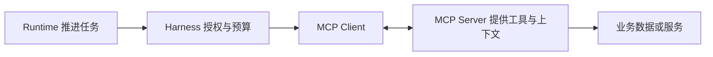
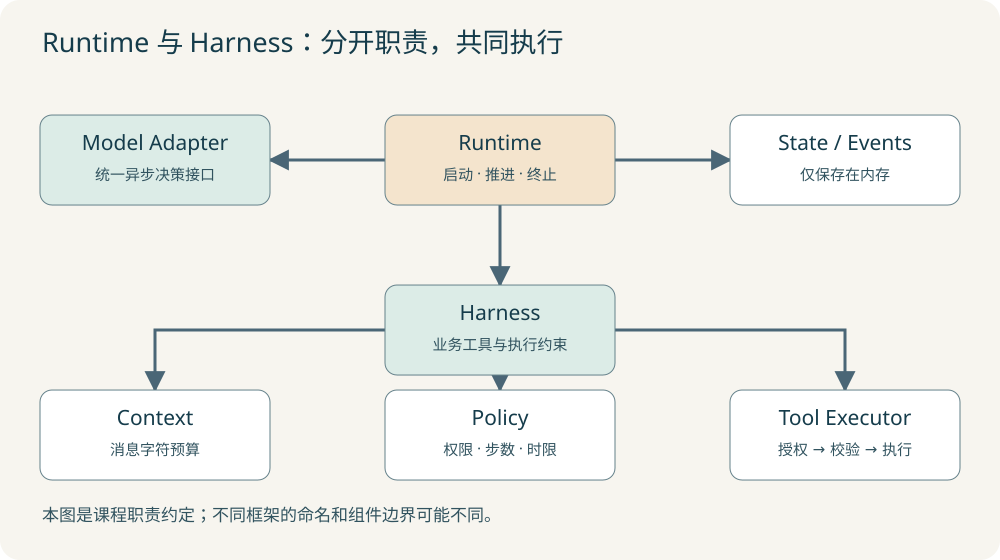
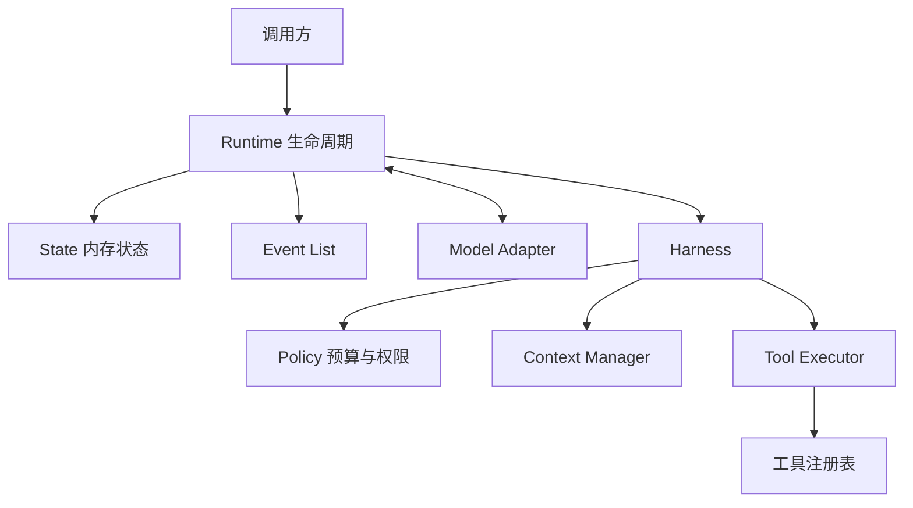
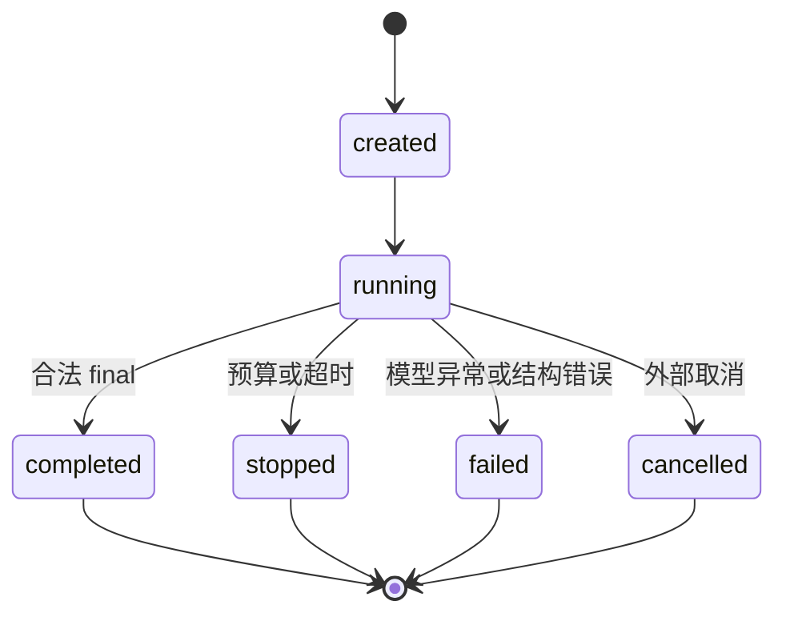
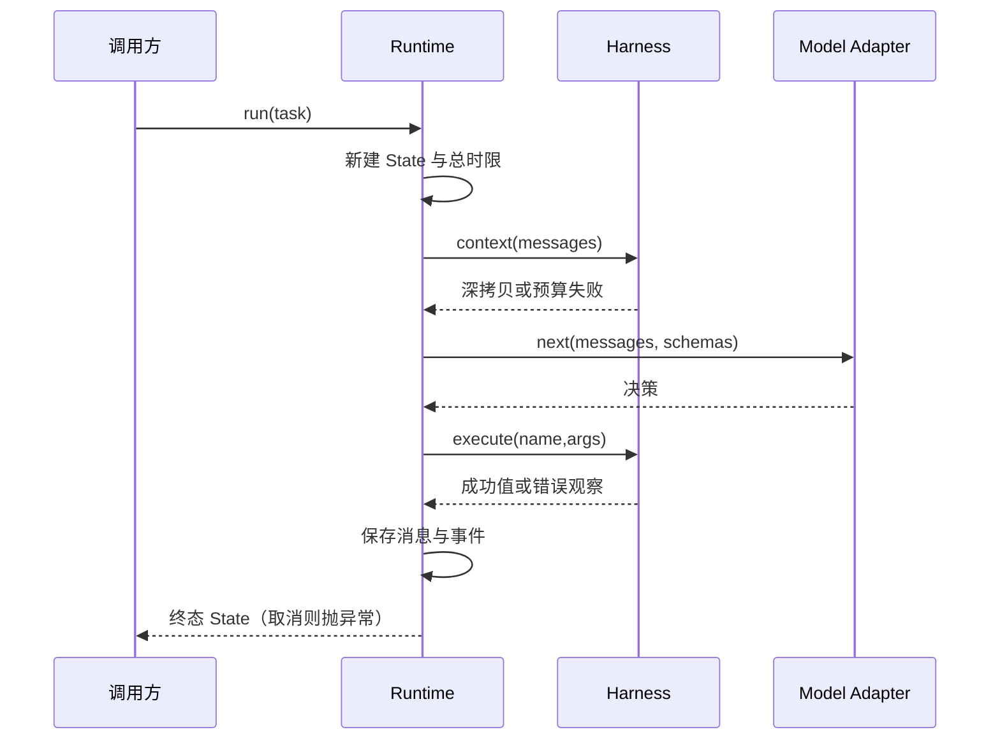

# 第 03 章｜Agent Runtime 与 Harness

> 本章目标：分清执行引擎与业务护栏，运行一个有预算、工具和事件的 Mini-Harness。  
> 难度等级：L1–L3，附 L4/L5 设计取舍。  
> 预计学习时间：90 分钟（学习安排估计，不是实测）。  
> 前置章节：第 02 章；了解 Python 异步函数与异常。

**首版范围：** 复用第 02 章的标准库实验，提供模型适配接口、工具注册、字符预算、执行事件、单次与总超时、内存状态和取消传播。原任务中的自动重试、熔断器、可配置并发调度、真实 token 预算及真实框架集成尚未实现。持久化、恢复和生产隔离也不在本版内。文中的扩展设计不是已运行功能。

## 1. 本章解决什么问题

一个循环能运行，不代表它容易维护。若提示词、工具权限、预算和事件都写进同一个业务函数，新增业务时很容易复制出不同版本的执行规则。

本章把问题分为两部分：通用执行程序如何推进任务，具体业务允许它做什么。这样换模型、换工具或收紧权限时，可以保持生命周期逻辑稳定。对于只有一次固定计算的程序，无需拆成复杂平台；几个普通函数即可。

## 2. 先用大白话理解

Runtime（运行时）像车间的运转系统：启动任务、推进工序、记录状态、停止任务。Harness（执行配套与约束层）像给这项任务配置的操作台：提供可用工具、上下文和限制。

这只是帮助理解的类比，不是行业统一命名标准。不同框架可能把两者放进同一组件。本章采用以下责任定义：Runtime 管理执行生命周期、状态与事件；Harness 提供上下文、工具入口和运行策略。**职责可分，代码不一定要分成微服务。**

## 3. 核心术语

| 术语 | 中文解释 | 准确定义 | 容易混淆的概念 |
|---|---|---|---|
| Model Adapter | 模型适配器 | 把统一请求接口接到具体决策组件 | 不保证模型输出合法 |
| Tool Executor | 工具执行入口 | 在执行前统一做校验与授权 | 不是模型自我约束 |
| Context Manager | 上下文管理器 | 控制提交给模型的内容与预算 | 本例只限制字符，不做摘要 |
| State Manager | 状态管理器 | 持有本次运行的进度与结果 | 内存状态不是持久化执行 |
| Event Dispatcher | 事件分发器 | 将有顺序的运行事件交给观察者 | 本例仅追加内存列表，不是可靠消息总线 |
| Deadline | 总截止时间 | 限制一次运行的累计等待时间 | 不同于单工具超时 |
| Circuit Breaker | 熔断器 | 故障达到阈值后暂时拒绝访问依赖 | 不同于每次调用重试 |

### MCP 放在哪里？

MCP（Model Context Protocol，模型上下文协议）定义应用与上下文服务之间的交换方式。它不规定 Agent 如何决定下一步，也不替应用管理运行预算。[官方架构说明](https://modelcontextprotocol.io/docs/learn/architecture)



| 层 | 回答的问题 | 仍需另外验证 |
|---|---|---|
| Runtime | 当前执行到哪里，什么时候结束？ | 状态恢复与失败语义 |
| Harness | 本次任务可以用什么，允许花多少资源？ | 真实身份、权限和预算 |
| MCP | 应用怎样发现并调用服务能力？ | 服务端授权、数据版本与结果真实性 |

图是本课程的集成建议，不是唯一实现。当前实验调用本地 Python 函数，没有实现 MCP Client 或 Server；不能把本例称为 MCP 接入实测。

## 4. 工作原理

输入为模型适配器、Harness 和任务。Runtime 为每次运行创建新的 State，在总时限中推进循环。每轮通过 Harness 取得上下文，并请求模型。每个工具动作都回到 Harness 校验执行。终止时 Runtime 保存状态并发出 `run_finished`。

| 组件 | 本实验对应位置 | 输入与输出 | 不负责什么 |
|---|---|---|---|
| 模型适配器 | ModelAdapter.next | 消息、schema → 决策字典 | 授权与执行 |
| 工具执行入口 | Harness.execute | 名称、参数 → 观察字典 | 自动重试与事务 |
| 上下文管理器 | Harness.context | 消息 → 深拷贝或预算失败 | token 计算、压缩与记忆 |
| 状态管理器 | State 与 Runtime | 维护 messages/events/status | 磁盘保存与恢复 |
| 事件分发器 | Runtime.emit | 事件类型及字段 → 有序事件列表 | 跨进程投递与订阅 |

### 预算为什么要分层

步数预算限制模型调用次数；上下文预算限制单次提交的消息规模；单次时限限制一次模型或工具调用；总时限限制整个运行。只设置其中一个通常不够。不同参数的循环可以绕过精确重复检测，却绕不过步数限制。

实验字符预算按消息的 JSON 序列化长度计算，超限直接停止，不删除历史消息。它不包含工具 schema，也不是模型 token 数。选择直接停止，是为了避免教学代码悄悄移除工具调用与结果之间的联系。真实服务必须把系统提示、schema、历史消息和预留输出一起计入所用模型的预算。

### 状态与成本

终态包括 completed、step_limit、repeat_limit、context_limit、model_timeout、run_timeout、model_failed 和 invalid_model_output。工具失败一般进入 Observation，再由模型继续或结束。外部取消会记录 cancelled 并继续抛出 `CancelledError`，调用方不会拿到普通 State 返回值。

事件保存在内存，包含递增 seq、事件类型、步骤、工具名、成功标记及规范化错误。不含运行 ID、时间戳和耗时，所以不能据此计算生产时延或跨任务追踪。消息与事件都随运行增长；本例有步数限制，但没有持久化或独立的工具输出大小限制。

## 5. 架构与流程









## 6. 工程实现

### 6.1 技术选型

选择 Python 3.11 的 `asyncio.timeout()` 来表达两个嵌套时限。模型和工具统一使用异步接口，使测试能够注入可取消等待。没有框架依赖，目的是看清职责，不是证明自研比框架更好。

### 6.2 项目结构

```text
labs/agent_loop/
  mini_agent.py
  test_mini_agent.py
  README.md
```

同一个实现支撑两章，避免第二章和第三章的错误处理行为不一致。

### 6.3 完整代码与接口

完整代码位于 [mini_agent.py](../labs/agent_loop/mini_agent.py)。核心接口如下；以下是接口摘要，实现请读完整文件。

```python
class ModelAdapter(Protocol):
    async def next(self, messages: list[dict], tools: dict) -> dict: ...
```

| 接口 | 契约 |
|---|---|
| Runtime.run(task) | 为本次调用创建 State，返回终态或传播外部取消 |
| Harness.context(messages) | 返回消息副本；超过字符预算时抛 ValueError |
| Harness.schemas() | 返回工具 schema 副本 |
| Harness.execute(name, args) | 先授权和验证，再执行；失败返回规范化错误 |
| Runtime.emit(state, kind, fields) | 追加事件，分配单次运行内的递增序号 |

`Policy` 是冻结的数据类。它控制预算与权限，不从模型消息中读取配置。`State` 每次运行新建。`SequenceModel` 自带可变游标，因此需要每次新建，不能把同一个实例用于多个并发运行。Harness 的工具注册表仍然可变，只适合本例的受信任初始化代码，不构成安全隔离。

### 6.4 安装和运行

无需安装包或设置环境变量，在仓库根目录执行：

```bash
python3 labs/agent_loop/mini_agent.py --scenario success
python3 labs/agent_loop/mini_agent.py --scenario timeout
python3 -m unittest discover -s labs/agent_loop -p 'test_*.py'
```

success 应产生三次 `model_requested`、两次 `tool_requested`、两次 `tool_result`，最后是 `run_finished`。timeout 应在工具结果中显示 `tool_timeout`，然后脚本模型给出失败说明。测试还检查模型超时、总时限、取消传播和上下文预算。

### 6.5 关键代码解释

外层 `asyncio.timeout(run_timeout)` 包住整个循环，内层包住一次模型或工具调用。工具的局部超时转换为 Observation；外层总时限触发时，取消信号穿过工具层，由运行入口转换为 `run_timeout`。代码不捕获吞掉 `CancelledError`，因此调用方取消仍能传播。

这依赖协作式异步代码。若工具运行同步死循环，事件循环无法调度超时；若远端已接收写请求，本地取消也不能撤销远端动作。把超时等同于安全终止是本实验最需要避免的误解。

## 7. 工程案例

两个部门共享运行引擎：采购部门可查耗材价格，维修部门只可读故障文档。可以保留 Runtime，分别提供工具表和权限 Policy。工具执行入口必须根据调用者的受信任身份生成权限，不能让用户输入或模型文本直接设置 permissions。

接入设备诊断时，读数据和发控制指令应采用不同工具及授权规则。本章只提供只读模拟目录和纯计算函数。设备动作、服务账户、审批和审计需要独立设计；本例不声称完成设备安全验证。

## 8. 方案对比与设计取舍

| 方案 | 优点 | 缺点 | 适用场景 | 不适用场景 |
|---|---|---|---|---|
| 单文件教学实现 | 可以完整检查控制流 | 缺少生产能力 | 学习、验证协议 | 多租户生产平台 |
| 框架执行层 + 业务 Harness | 可复用适配、调度等现成功能 | 需确认版本契约和故障语义 | 多工具、多模型业务 | 对依赖行为完全不了解时直接上线 |
| 独立执行服务 | 可统一策略和资源管理 | 运维、身份和网络复杂度高 | 多团队共享执行能力 | 单个轻量脚本 |

框架可能提供模型适配、图调度、检查点和事件扩展点，具体能力必须按选定版本核实。业务通常仍需负责用户身份、工具授权、数据范围、业务成功条件和敏感信息处理。不要在未检查框架现有能力前再写一套调度器，也不要假设“接了框架”就已经有业务权限控制。本章没有选择或实测任何第三方框架。

## 9. 生产环境注意事项

| 策略 | 本例状态 | 生产扩展需要明确什么 |
|---|---|---|
| 预算 | 步数、字符、重复次数 | token、货币、工具配额和输出预留 |
| 超时 | 单次与总时限 | 网络客户端截止时间、远端任务状态 |
| 并发 | 单次运行串行 | 每租户配额、信号量、排队与公平性 |
| 取消 | 异步取消传播 | 子任务终止与副作用核对 |
| 重试 | 未实现 | 只对可恢复错误重试，退避、上限与幂等键 |
| 熔断 | 未实现 | 失败阈值、打开时长、半开探测与依赖分组 |
| 恢复 | 未实现 | 检查点、版本迁移、崩溃后幂等恢复 |
| 可观测性 | 内存事件列表 | run_id、时间、耗时、脱敏、持久化和采样 |

重试会消耗总预算，不能独立于截止时间无限执行。熔断在依赖连续失败时减少无效请求，不能代替权限拒绝或参数校验。并发可降低等待时间，但也增加外部负载和共享状态风险。这些是设计检查项，不是本例已验证的吞吐量或可靠性指标。

## 10. 动手实践

### 目标

不改变 Runtime，使用不同策略观察可解释的终止行为。

### 前置条件

完成第 02 章实验；Python 3.11+；不需要网络、模型服务或密钥。

### 实践步骤

1. 运行默认实验，按 seq 检查事件顺序。
2. 阅读测试 `test_context_budget`，理解为何未请求模型就停止。
3. 阅读 `test_step_limit_for_different_calls`，理解重复限制为何不能单独代替步数限制。
4. 比较工具、模型和总时限测试，找到不同的错误转换位置。
5. 阅读取消测试，确认 `CancelledError` 传播给调用方，而不是伪装成正常返回。
6. 执行全部测试，再将一项保护移除并重跑，确认相应测试能发现退化；学习结束时恢复改动。

### 验收标准

能指出五类组件所在位置；能区分字符和 token 预算；能解释 `completed` 的边界；测试全部通过；不把内存事件称为持久化审计，不把 asyncio 超时称为沙箱。

### 常见错误

在模型提示词中代替真正授权；把所有异常转换为成功文本；吞掉取消；为重试设置独立无限预算；将带游标的模型实例跨任务共享；未限制工具输出就假设内存安全。

### 扩展挑战

设计一个只读工具重试器，分别测试可恢复与永久错误，并使退避受总时限约束。再为事件添加运行 ID 和单调时间，测试并发运行时事件互不混淆。上述扩展尚未实现，不纳入本版通过项。

## 11. 本章总结

- Runtime 负责推进与结束，Harness 提供工具与约束；命名可以因框架不同而变化。
- 模型适配器不能绕过工具执行入口。
- 单次预算与总预算需要同时存在。
- 取消必须传播，但不保证撤销外部副作用。
- 内存 State 和事件列表不能替代持久化恢复与可靠审计。
- 优先复用已验证的基础能力，把业务成功判定和权限留在清晰的业务层。

下一步在第 04 章学习编排，再在第 15–17 章扩展可观测性、可靠恢复和权限治理。

## 12. 参考资料

访问日期统一为 **2026-11-20**。

1. [Python 3.11 asyncio 官方文档](https://docs.python.org/3.11/library/asyncio-task.html)：支持异步任务、timeout 与任务取消语义；本章嵌套时限采用这一接口。
2. [JSON Schema 官方 object 参考](https://json-schema.org/understanding-json-schema/reference/object)：支持工具对象的字段约束。实验的验证器只覆盖自身用到的小子集。
3. [MCP 官方架构](https://modelcontextprotocol.io/docs/learn/architecture)：支持协议与模型运行逻辑的职责边界；本例未接入 MCP SDK。
4. [第 02 章及同仓库实验](02-agent-loop.md)：本章的 Runtime/Harness 分工、策略表和事件契约是课程自身的设计约定，可直接对照代码与测试核查，不引用为行业统一标准。

图表为原创可编辑 SVG 和 Mermaid。未提供真实模型、真实框架或生产服务性能结论。
