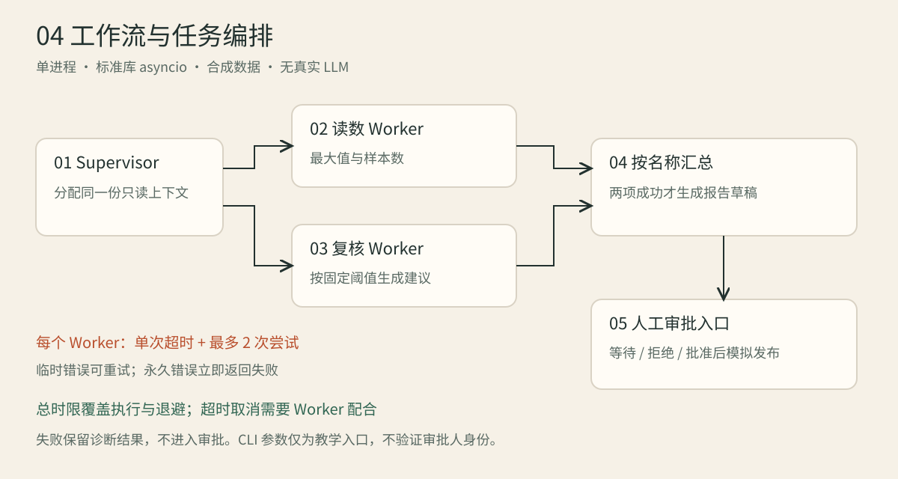
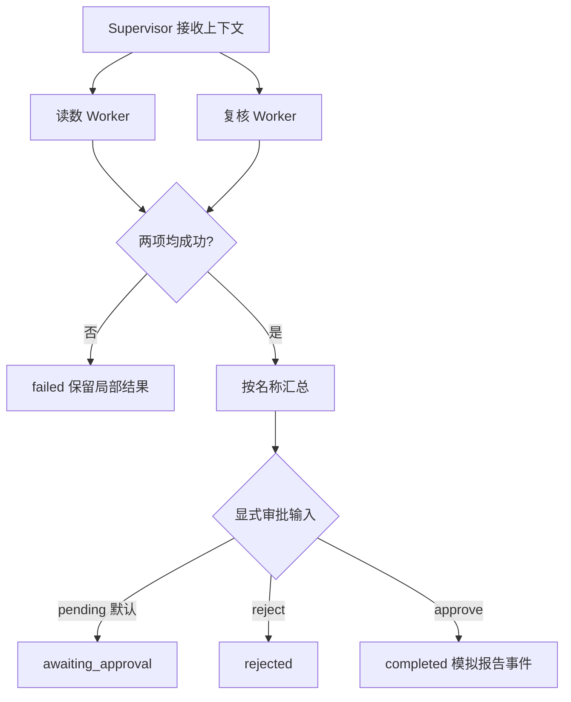
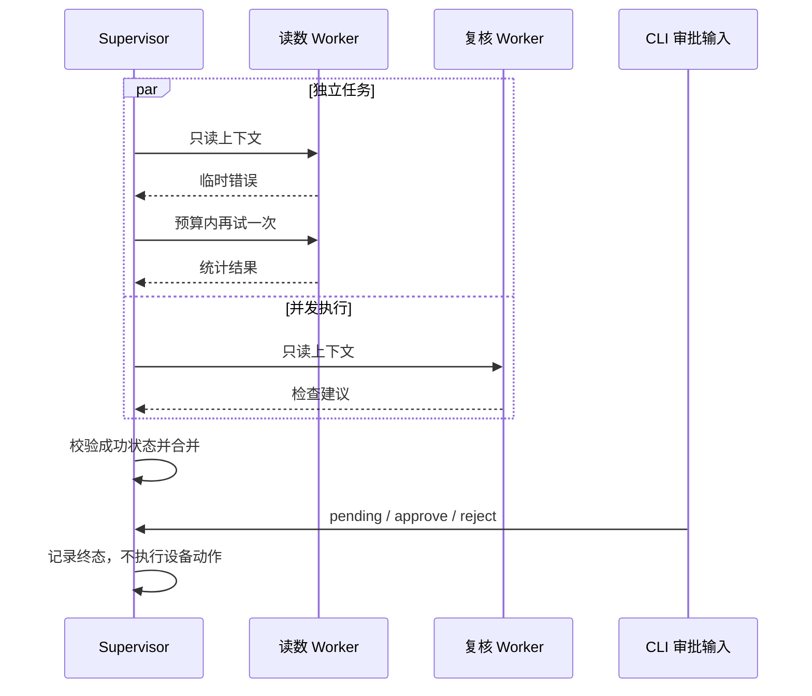

# 第 04 章｜Workflow、Multi-Agent 与任务编排

> 本章目标：选择合适的执行方式，运行 Supervisor + 两个 Worker，并验证失败、超时、重试和人工审批。  
> 难度等级：L1–L3，附工程取舍。  
> 预计学习时间：90 分钟（学习安排估计）。  
> 前置条件：完成第 02、03 章；了解 Python 函数、异常与 async/await；Python 3.11+。

**本版是可运行切片，不是原章完整交付。** 两个 Worker 都是固定脚本，输入是合成读数，没有模型调用，也没有真实 Agent 协商。已实现并行、串行对照、结果汇总、协作式超时、有限重试和 CLI 审批状态入口。原任务中的动态任务拆解、自治 Agent 上下文策略、语义冲突仲裁、其余编排模式的实现、MCP/A2A 互操作尚未完成。文中的概念比较不代表这些能力已经实现。

## 1. 本章解决什么问题

处理一份设备巡检报告时，可以同时计算读数统计与生成检查建议，但必须等两份结果都有效，才能提交审核。串行代码容易写，却会累加等待时间；直接并发容易遗漏失败与取消。Supervisor（监督调度者）统一负责分配任务和判断是否可以进入下一步。

本章完成后，你应能区分固定流程与自主决策，读懂任务状态，检查重试是否有上限，并解释为什么两个并行函数不等于两个智能 Agent。

## 2. 先用大白话理解

把 Supervisor 当作协调员，Worker 当作办事人员。协调员先划清职责，再收集结果。人员多不保证结论更好：他们可能依赖同一份错误资料，沟通也会增加开销。

严格地说，Workflow（工作流）按预先定义的节点与转移条件执行；Agent 可以使用模型在运行时选择行动；Multi-Agent（多智能体）让多个决策单元协作。工作流可以包含 Agent 节点。它们不是互斥的产品类别。本实验只有执行拓扑，没有自主决策单元。

## 3. 核心术语

| 术语 | 含义 | 边界 |
|---|---|---|
| DAG，有向无环图 | 用依赖边连接任务，不能形成回路 | 重试需要额外策略，或展开为有限节点 |
| State Machine，状态机 | 根据状态和事件选择下一状态 | 有状态不等于能跨进程恢复 |
| Graph，图 | 表达节点和边，可含条件与循环 | 每个循环都需退出条件和预算 |
| 条件边 | 根据结果选择后续节点 | 本例失败不能进入审批 |
| 并行 | 让独立任务的等待时间重叠 | asyncio 不自动提供 CPU 并行 |
| 结果合并 | 形成符合契约的统一输出 | 拼接文本不是冲突仲裁 |
| 人工节点 | 由外部人员决定是否继续 | CLI 开关不等于身份验证 |

## 4. 工作原理

输入是冻结的 `Context`：任务标识和三个合成读数 `(42, 56, 71)`。读数 Worker 返回最大值和样本数；复核 Worker 按固定阈值返回 `inspect` 或 `observe`。两者只读上下文，不修改共享业务数据。

每个 Worker 默认最多尝试两次，每次最多等待 0.1 秒。只有临时错误和单次超时可以重试，退避为 `0.01 × 已执行次数` 秒。永久输入错误立即结束。外层 1 秒总时限覆盖任务与退避。一个 Worker 已完成、另一个失败时，保存局部结果用于诊断，整个运行仍为失败。

汇总按 Worker 名称分区，不采用“最后一个写入者覆盖前一个”的方式。它能避免键覆盖，不能解决两个结论互相矛盾的问题。本例两项结果都来自同一份合成数据，不能视为独立证据。

## 5. 架构与流程







图中的审批输入来自启动时的参数，在结果生成后才被应用。默认等待状态只输出到 JSON；程序会退出，不会后台等待点击。再次带参数启动会重新计算，没有从检查点恢复。

## 6. 工程实现

### 技术选型与文件

Python 3.11 标准库的 `TaskGroup` 管理两个子任务，`asyncio.timeout()` 管理时限。退出任务组前会等待子任务结束；取消信号必须继续传播。参考 [Python 官方文档](https://docs.python.org/3.11/library/asyncio-task.html)。

```text
labs/workflow_orchestration/
  workflow.py        # Supervisor, workers and CLI
  test_workflow.py   # Failure and cancellation tests
  README.md
  VALIDATION.md
  requirements.txt
```

完整可运行代码见 [workflow.py](../labs/workflow_orchestration/workflow.py)，没有省略核心实现。`execute_worker()` 分类处理已知错误；`supervise()` 控制全局状态与审批。未预期的程序错误由任务组向外传播，不伪装成成功。`Run.events` 记录本次运行内的顺序事件，`Run.attempts` 记录总尝试数。

### 运行命令

在仓库根目录执行，不需要密钥或网络：

```bash
python3 labs/workflow_orchestration/workflow.py --approval approve
python3 labs/workflow_orchestration/workflow.py --scenario retry --approval approve
python3 labs/workflow_orchestration/workflow.py --approval reject
python3 labs/workflow_orchestration/workflow.py --scenario timeout --approval approve
python3 -m unittest discover -s labs/workflow_orchestration -p 'test_*.py'
```

| 输入 | 预期状态 | 尝试数（默认策略） | 退出码 |
|---|---|---|---|
| 不传参数 | awaiting_approval | 2 | 3 |
| approve | completed | 2 | 0 |
| retry + approve | completed | 3 | 0 |
| reject | rejected | 2 | 4 |
| failure + approve | failed | 2 | 1 |
| exhausted + approve | failed | 3 | 1 |
| timeout + approve | failed | 3 | 1 |
| 总时限 0.01 秒 | timed_out | 2（并行） | 1 |

非零退出码有明确含义，拒绝与待审批并不是程序崩溃。`completed` 只表示批准了一份模拟报告；不存在真实发布或设备控制。

## 7. 工程案例与协作成本

在巡检草稿流程中，统计任务和建议任务可以独立读取同一快照，Supervisor 等待两份结果，再交人工确认。若建议必须使用统计任务的输出，就需要先后依赖，不能照搬并行图。

通过 `--mode serial` 与 `--mode parallel` 使用同一输入、同一 Worker、同一审批条件比较。每个正常 Worker 注入 0.03 秒异步等待，用来演示等待重叠，**不是模型时延或生产数据**。

| 成本 | 本实验如何观察 | 不能由此推断什么 |
|---|---|---|
| 等待时间 | JSON 的 elapsed_seconds | 不能推断真实模型加速比 |
| 工作量 | 正常两次尝试，单次重试后三次 | 并行不会自动减少调用次数 |
| 协调成本 | Supervisor 分发、合并和事件记录 | 没有测出协调逻辑的独立耗时 |
| 上下文成本 | 两个 Worker 共享不可变快照 | 没有网络传输或 token 费用 |
| 质量成本 | 两份固定结果按名称合并 | 没有模型质量评测或独立审稿 |

实际样本、环境和执行结果见 [验证记录](../labs/workflow_orchestration/VALIDATION.md)。串行与并行分别重复 5 次，记录中位数，不把一次快慢差异称为性能保证。

## 8. 方案对比与设计取舍

以下为本课程的设计判断，不是某个框架的能力承诺。

| 方式 | 适用条件 | 代价 | 不宜采用的情况 |
|---|---|---|---|
| 普通函数或固定工作流 | 步骤和判断条件明确 | 需事先定义分支 | 任务必须动态探索且无法枚举 |
| 单 Agent | 下一步需要模型根据观察选择 | 需限制循环、工具与成本 | 固定公式就能完成 |
| 多 Agent | 有可分离的职责、上下文或权限边界 | 协调、重复上下文、冲突合并 | 只是想让两个模型互相赞同 |

| 编排模式 | 谁决定下一步 | 合适用途 | 主要风险 |
|---|---|---|---|
| Supervisor | 中央协调者 | 分工、汇总与统一验收 | 中央决策错误影响全局 |
| Router | 路由规则或决策器 | 按任务类型选择执行者 | 分类错误、兜底不明确 |
| Hierarchical | 多级协调者 | 大任务按层次拆分 | 层级增加延迟与信息损失 |
| Peer-to-Peer | 对等执行者协商 | 去中心化协作 | 循环讨论、退出与归责复杂 |
| Agent-as-a-Tool | 上级调用专用 Agent | 把子能力包装成调用接口 | 接口看似简单，内部成本不透明 |

本例只实现 Supervisor 的固定拓扑。不要为了使用多个 Agent，先把一个容易测试的函数拆成多个不稳定的决策者。

### MCP 与 A2A 的边界

[MCP 2025-06-18 架构](https://modelcontextprotocol.io/specification/2025-06-18/architecture)采用 host/client/server 分工，服务提供工具、资源和提示等能力。[A2A v0.3.0 规范](https://a2a-protocol.org/v0.3.0/specification/)面向 Agent 之间的互操作，包含任务、消息和产物等对象。

它们解决接口约定，不能代替业务拆解、授权与结果判定。上述为固定版本参考，不声称是最新版本。本实验调用本地 Python 函数，不实现任何一项协议。

## 9. 生产环境注意事项

- 超时是协作式取消。同步阻塞或吞掉取消的代码可能突破时限；本地取消也不能撤销远端已完成的写操作。
- 重试只适合可安全重复的操作。本实验无外部副作用；生产写入需设计幂等键和结果核对。
- CLI 参数由操作者自行设置，没有审批人身份、权限、签名或审计存储，不可用作生产审批门禁。
- 输入固定且很小。没有验证大文件、内存不足、拥塞、公平调度或多租户隔离。
- 事件和状态都在内存中。崩溃后没有恢复入口；总时限不包括人等待审批的时间。
- Supervisor 只检查已知 Worker 的成功字段。接入模型或远端服务前，还需校验结构、证据和冲突，不能直接信任文本。

## 10. 动手实践

**目标：** 用结果和事件证明每条分支受到控制。

**前置条件：** Python 3.11+，从仓库根目录执行；无需安装第三方包。

1. 运行默认命令，确认等待审批且没有 `report_released`。
2. 运行 approve 与 reject，比较状态和事件；确认拒绝时没有模拟发布。
3. 运行 retry、exhausted、failure，比较尝试数；永久错误不得重试。
4. 运行 timeout，确认局部超时导致失败；再用 `--run-timeout 0.01`，确认总超时返回 timed_out。
5. 比较 serial 与 parallel，确认报告一致，并记录各 5 次耗时。
6. 运行测试。阅读并行屏障测试：它检查两个任务均已启动，避免只靠秒表判断并发。

**验收标准：** 12 项测试全部通过；报告最大值为 71、样本数为 3、建议为 inspect；默认与拒绝路径无发布事件；临时错误最多执行配置次数；总超时会结束两个可取消 Worker；外部取消继续向调用者传播；能够说明本实验不是实际 LLM 协作。

**常见错误：** 把两次尝试理解为额外重试两次；将局部结果当作完整报告；把 awaiting_approval 当作持久化等待；用时间快慢证明质量提高。

**扩展练习（未实现）：** 给两个 Worker 注入互相矛盾的建议，增加 `needs_review` 状态和冲突测试。不得直接以最后返回的建议覆盖前者。

## 11. 本章总结

固定任务优先使用明确流程。并行只重叠独立任务的等待。重试与退避必须受总预算限制。汇总必须有成功和冲突规则。人工节点需要真实身份和存储才能成为生产审批。下一步可在后续可靠执行章节补充持久化、恢复与幂等。

## 12. 参考资料

官方来源核验日期：**2026-11-20**。

| 资料与版本 | 支持的结论 | 本版使用范围 |
|---|---|---|
| [Python 3.11 Coroutines and Tasks](https://docs.python.org/3.11/library/asyncio-task.html)，Python Software Foundation | TaskGroup、timeout、取消与异步等待语义；页面含并发任务和任务组官方示例 | 标准库实现与异常边界 |
| [MCP 架构，2025-06-18](https://modelcontextprotocol.io/specification/2025-06-18/architecture)，MCP 项目 | host/client/server 与工具、资源、提示的责任 | 仅概念对比，未实现协议 |
| [A2A Specification，v0.3.0](https://a2a-protocol.org/v0.3.0/specification/)，A2A 项目 | Agent 互操作及任务、消息、产物对象 | 仅概念对比，未实现协议 |
| [本地实验与复现说明](../labs/workflow_orchestration/README.md) | 本课程固定拓扑、错误策略和状态定义 | 原创教学设计，不是通用行业标准 |

SVG 与 Mermaid 均为原创可编辑图。未引用真实企业内部数据，未进行真实设备或模型测试。
