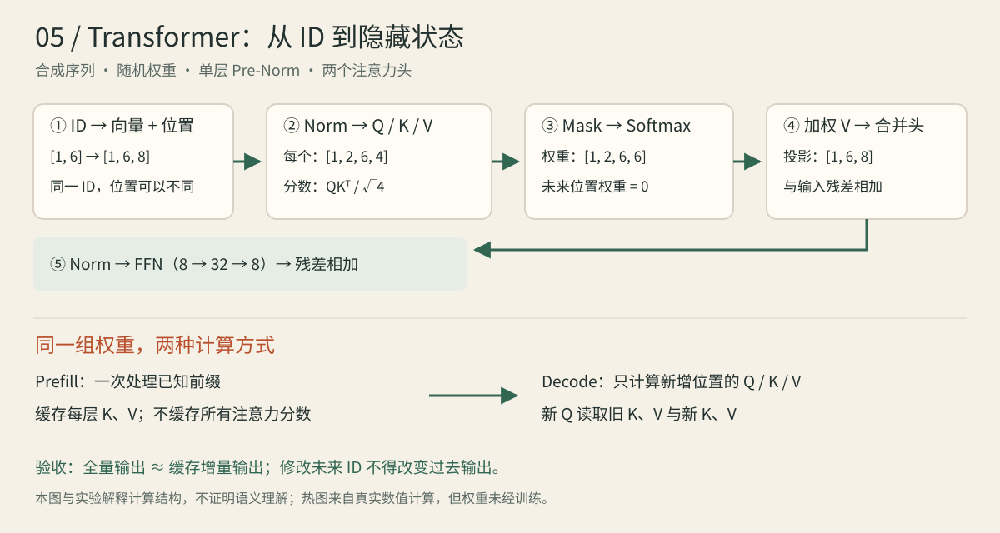
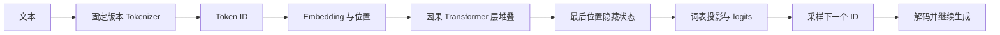
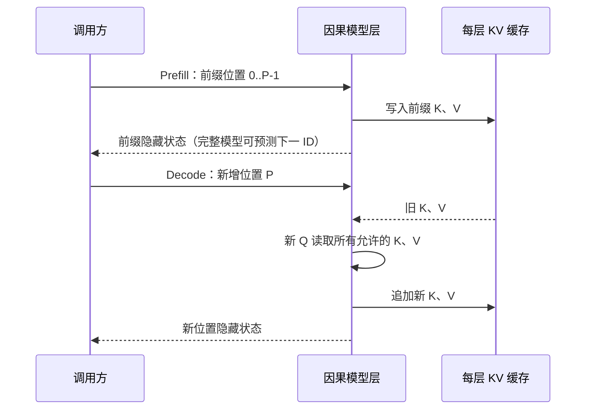
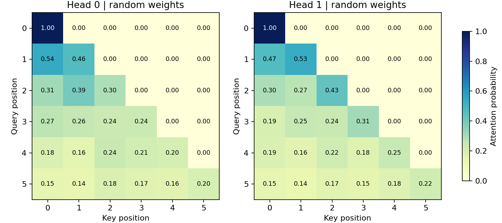

# 第 05 章｜Transformer 与模型内部原理

> **本章目标**：读懂一次注意力计算中的张量，运行真实 PyTorch 实验，并检查因果遮罩与 KV 缓存是否正确。  
> **难度**：L2–L3；预计 3–4 小时。  
> **前置**：第 01 章；会运行 Python，知道矩阵乘法、向量和概率。无需 GPU。  
> **范围**：Tokenizer 到隐藏状态的计算；单层因果 Self-Attention；推理缓存和长度成本。训练、采样与服务压测分别放在后续章节。  
> **学习成果**：标出 B/T/D/H 的含义；手算一行遮罩；解释缓存为什么成立；用数值证据区分实现正确与模型有能力。

## 1. 本章解决什么问题

Agent 请求中，长工具日志会增加输入长度。服务可能变慢或耗尽内存。只有“模型很大”这一解释不够。工程师还需知道：哪些输入变成了 token，哪些张量随长度平方增长，哪些计算可以复用。

本章使用确定性自造 ID 序列，不调用外部 API，不下载语言模型。PyTorch 执行真实的矩阵运算。随机权重只用于验证计算结构，不能回答业务问题。没有实验条件时，可先阅读保存的 JSON 和热图；这不等于在自己的环境重跑实验。

## 2. 先看整条计算链





可以把每个位置看作一个读资料的人。Q 表示本次查询，K 表示资料的索引，V 表示可汇总的内容。每个人先算匹配分数，再按权重汇总 V。这个类比不表示每个头有固定职业，也不表示高权重就是可靠证据。Q/K/V 是可训练线性变换的结果，不是人写的检索字段。

实验只实现图中 Embedding、位置和一个 Transformer 层；没有词表输出头、采样或语言训练。用外部模型 API 是另一条可行路线，但不能从 API 的文字输出直接验证内部遮罩和缓存实现。

## 3. 核心术语与输入边界

| 术语 | 含义 | 不要混淆 |
|---|---|---|
| 字节 | 编码后的存储单位 | UTF-8 汉字通常不止一个字节 |
| 字符 | 此处指 Unicode 码点 | 用户看到的一个字形可能由多个码点组成 |
| Token | Tokenizer 定义的离散单位 | 不是固定一个字，也不是固定一个词 |
| Token ID | 词表中的整数编号 | 编号大小没有语义距离 |
| Embedding | 用 ID 查询可训练向量表 | 不等于检索系统的整段文本向量 |
| Q/K/V | 查询、键、值向量 | 来自同一层输入的不同投影；Cross-Attention 除外 |
| Mask | 限定允许读取的位置 | 不等于内容安全过滤 |
| Hidden state | 每个位置的连续表示 | 不是最终文字，也不是概率 |
| KV cache | 保存每层已计算的 K/V | 不是聊天历史数据库或答案缓存 |

Tokenizer 通常包含规范化、切分和 ID 映射。BPE 通过合并单位形成词表；SentencePiece 支持 BPE 和 unigram 等子词方案，可以直接从原始文本学习。规范化、词表、特殊 token 和模型权重必须匹配。[SentencePiece 官方仓库](https://github.com/google/sentencepiece)支持这些算法与输入方式说明。

例如“中A”有 2 个 Unicode 码点、4 个 UTF-8 字节；token 数只有指定 tokenizer 后才能确定。不要用字符数代替账单 token 数。聊天模板还可能加入角色和边界 token。

为避免把任意手工切词误认为真实 tokenizer，本实验**直接提供合成 ID** `[1, 4, 2, 4, 7, 3]`，不演示文本 tokenization。词表大小为 16。ID 4 重复出现只说明它查询相同的基础向量，不说明它代表哪个汉字。实际系统若替换为 tokenizer，应记录公开许可、精确版本、词表文件和校验值，不能随意套用这些 ID。

## 4. 从向量到注意力

### 4.1 Embedding 与位置

令 B 为批次大小，T 为序列长度，D 为隐藏宽度。Embedding 表形状为 `[Vocab,D]`，输入 ID 是 `[B,T]`，查表后为 `[B,T,D]`。本实验为 `[1,6,8]`。

没有位置信息的普通 Self-Attention 无法单独表达输入排列。本实验将正弦位置向量加到 Embedding 上：偶数维取 `sin(pos / 10000^(2i/D))`，奇数维取对应 `cos`。位置张量 `[T,D]` 在批次维广播。增量计算必须延续位置编号，不能每次从零开始。

可学习绝对位置向量是另一种方法。RoPE 则作用于 Q/K 的位置相关旋转；它不是本实验所用的加法位置向量。不能只把位置函数替换掉，就认定缓存、训练长度和长上下文行为完全等价。

### 4.2 Q/K/V、缩放点积和 Mask

本实验采用 Pre-Norm：先对输入最后一维做 LayerNorm，再进行投影。三个投影合并在一个 Linear 中，输出 `[B,T,3D]`，随后拆为 Q、K、V。各头宽度 `d=D/H`，每个张量重排为 `[B,H,T,d]`。

```text
S = Q @ transpose(K, -2, -1) / sqrt(d)
A = softmax(S + M, dim=-1)
C = A @ V
```

`M[i,j]` 在允许读取时是 0，禁止读取时是负无穷。Softmax 沿 key 位置做归一化。缩放项可限制大维度点积的幅度；它不是对最终概率再除一次。

在因果计算中，位置 i 只能读 `j <= i`。例如第 2 行（从 0 开始）允许 `[0,1,2]`，禁止 `[3,4,5]`。注意力权重的上三角应为 0，每行和应为 1。若输入含 padding，还必须叠加 padding mask；本实验无 padding，不能直接当作批量服务实现。

允许读取自己与下一 token 预测并不矛盾：位置 i 的输入是当前已知 token，其输出用于预测位置 i+1。训练时标签需右移对应；若把当前 token 当同位置预测目标，会造成另一类标签泄漏。

### 4.3 Multi-Head、残差、LayerNorm、FFN

| 部件 | 本实验做什么 | 作用边界 |
|---|---|---|
| Multi-Head | 2 个头分别算权重，再合并为 8 维并投影 | 头不是独立模型，也不保证可解释分工 |
| Residual | 将子层结果加回原输入 | 维度必须一致，不是把两份向量串联 |
| LayerNorm | 每个位置在 D 维上归一化并做可学习缩放/偏移 | 不沿时间或整个 batch 归一化 |
| FFN | 每个位置独立执行 `8 → 32 → ReLU → 8` | 共享权重；不直接混合不同位置 |

本层输出为 `r = x + Attention(LN(x))`，`y = r + FFN(LN(r))`。原论文示例采用 Post-Norm；本实验选 Pre-Norm 以清楚分离残差路径。不要把两者的参数直接互换。论文还给出了点积注意力、多头拼接与位置编码的定义；本节采用这些结构概念，实验的尺寸和权重为独立教学设计。[原始论文](https://arxiv.org/html/1706.03762v7)

### 4.4 Encoder 与 Decoder

| 架构 | Self-Attention 可见范围 | 其他注意力 | 常见任务 |
|---|---|---|---|
| Encoder | 通常双向；仍可屏蔽 padding | 无必需 Cross-Attention | 文本编码、分类 |
| Decoder-only | 因果可见 | 无必需 Cross-Attention | 自回归文本生成 |
| Encoder–Decoder | Encoder 双向；Decoder 因果 | Decoder 的 Q 读取 Encoder 的 K/V | 翻译、条件生成 |

Decoder-only 不是“把完整原始 Decoder 原封不动拿来”：通常没有读取 Encoder 输出的 Cross-Attention。双向 Encoder 中，追加文本可能改变旧位置的表示，不能直接套用本实验的因果缓存等价结论。

## 5. Prefill、Decode 与长度成本



Prefill 可同时计算已知前缀的多个位置。Decode 通常每步只处理新 token。缓存成立的前提是：因果结构、相同前缀、相同权重、相同位置规则、相同数值设置，且处于确定性的推理模式。旧 token 不会读取未来输入，所以旧层状态和 K/V 无需重新计算。

缓存保存 K 和 V，不必保存旧 Q：新步骤只需要新 Q 去查询旧 K/V。多层模型需要每层独立缓存。本实验仅一层；没有跨请求缓存共享、淘汰、分页、滑窗或 GQA。[Transformers v4.48.3 缓存说明源码](https://github.com/huggingface/transformers/blob/v4.48.3/docs/source/en/kv_cache.md)说明了追加 K/V、注意力长度和 cache position 的配合要求。

| 对象 | 普通多头注意力的近似量级 | 长度翻倍的影响 |
|---|---|---|
| 全量注意力点积与加权 | 每层 `O(B*T²*D)` | 这部分计算约 4 倍 |
| 显式分数/权重张量 | 每个 `B*H*T²` 元素 | 元素数 4 倍 |
| QKV 和输出投影、FFN | 固定扩展比时 `O(B*T*D²)` | 约 2 倍 |
| 单步 Decode 注意力 | 已缓存 T 个位置时 `O(B*T*D)` | 约 2 倍 |
| KV cache | `2*L*B*T*Hkv*d*s` 字节 | 约 2 倍 |

其中 L 为层数，Hkv 为 KV 头数，s 为每元素字节数。普通 MHA 的 Hkv=H；GQA/MQA 可以减少 KV 头数。上述是结构估算，不是端到端延迟承诺。缓存不消除新 Q 读取历史 K/V 的成本；连续生成很多 token，累计读取成本仍会增长。

例：L=32、B=1、T=4096、Hkv=32、d=128、s=2 时，缓存约 `2,147,483,648` 字节，即 2 GiB。它不包含模型权重、临时工作区、分配器和请求队列。单层 B=1、H=32、T=4096 的一个 FP16 注意力矩阵已占 1 GiB；分数和概率若同时保存，会更多。本实验为可观察性显式创建矩阵，生产融合内核可以避免完整物化；不能据此断言所有实现都需要二次方的注意力工作区。

## 6. 工程实现：真实 PyTorch 小实验

### 6.1 技术选型与文件

选择 CPU、float64、固定种子和无 dropout，以便把舍入误差与逻辑错误分开。它不是速度基准，也不是训练配方。固定验证环境为 Python 3.12.14、PyTorch 2.6.0、Matplotlib 3.10.1、NumPy 2.5.5；精确实际 Python 版本以结果配置为准。标准库证据检查可用 Python 3.11+。

| 文件 | 用途 |
|---|---|
| [attention.py](../labs/transformer_internals/attention.py) | 完整可运行模型、维度输出、数值检查、热图生成 |
| [torch_checks.py](../labs/transformer_internals/torch_checks.py) | 6 个真实 PyTorch 测试 |
| [test_artifacts.py](../labs/transformer_internals/test_artifacts.py) | 3 个标准库证据一致性测试 |
| [requirements.txt](../labs/transformer_internals/requirements.txt) | 固定直接依赖版本 |
| [配置](../labs/transformer_internals/results/config.json) | ID、种子、架构、版本、精度 |
| [原始张量](../labs/transformer_internals/results/tensors.json) | 全量计算的实际数值 |
| [数值报告](../labs/transformer_internals/results/report.json) | 误差、断言结果、每步 Decode 形状 |
| [增量输出](../labs/transformer_internals/results/incremental_output.json) | 逐位置缓存计算结果 |

代码不省略关键运算。`TinyBlock.forward` 完成查表、位置、QKV、遮罩、注意力、残差与 FFN；`verify` 比较全量、增量、未来扰动与官方算子；`main` 输出可读 JSON 和 PNG。输入为空或宽度不能整除头数时明确报错。它是固定 CPU 教具，不提供完整的缓存形状校验、padding 或设备迁移接口。

### 6.2 安装与运行

从仓库根目录运行，创建独立环境，不修改项目根环境：

```sh
python3.12 -m venv /tmp/ch05-attention-env
/tmp/ch05-attention-env/bin/python -m pip install -r labs/transformer_internals/requirements.txt
/tmp/ch05-attention-env/bin/python labs/transformer_internals/attention.py
/tmp/ch05-attention-env/bin/python labs/transformer_internals/torch_checks.py -v
python3 -m unittest discover -s labs/transformer_internals -p 'test_artifacts.py' -v
python3 scripts/check_book.py
```

安装需要网络和适用平台的 wheel；安装完成后运行不联网。已有匹配环境可直接使用。默认新结果写到 `output/transformer_internals/`，也可传 `--output /tmp/ch05-run`。程序拒绝写入本章已发布的 `results/`，避免重跑悄悄改掉证据。仓库不保存模型权重，固定种子在记录环境中重新初始化。跨 PyTorch 版本或硬件不承诺逐位一致。

### 6.3 每个张量的形状

| 打印名称 | 形状 | 含义 |
|---|---|---|
| ids | `[1,6]` | 一个批次的六个 ID |
| embedding / x / norm1 | `[1,6,8]` | 查表、加位置、归一化 |
| positions | `[6,8]` | 位置向量，在 B 维广播 |
| packed_qkv | `[1,6,24]` | 三组 8 维投影 |
| q / k / v | `[1,2,6,4]` | B、H、T、每头宽度 |
| scores / weights | `[1,2,6,6]` | 每个头的 query × key |
| allowed | `[6,6]` | True 表示允许，广播到 B/H |
| context | `[1,2,6,4]` | 各头汇总后的 V |
| merged / projected | `[1,6,8]` | 拼接头、输出投影 |
| residual / norm2 | `[1,6,8]` | 第一个残差、第二次归一化 |
| ffn_hidden | `[1,6,32]` | FFN 中间层 |
| ffn_output / output | `[1,6,8]` | FFN 输出、第二个残差 |

Decode 到位置 5 时，Q 为 `[1,2,1,4]`，K/V 为 `[1,2,6,4]`，权重为 `[1,2,1,6]`。若一次新增两个 token，遮罩不是简单的方阵：query 的全局位置必须加缓存长度。代码用 `key_position <= offset + query_position` 构造它。

PyTorch 2.6 的 `scaled_dot_product_attention` 中布尔遮罩 True 表示允许；其 `dropout_p` 需显式设为 0 才能禁用 dropout。本实验使用显式遮罩比较官方算子，避免对非方阵缓存错误使用从左上角对齐的因果遮罩。[PyTorch 2.6 官方文档](https://docs.pytorch.org/docs/2.6/generated/torch.nn.functional.scaled_dot_product_attention.html)

### 6.4 实际热图与数值报告



这是实际执行 `softmax(QKᵀ/√d + M)` 得到的权重，不是手绘概率。每格显示四舍五入值，完整精度见 JSON；不要从显示的两位小数重新推算高精度行和。第一行只有位置 0 可见，权重必为 1。后面行的非均匀分布来自随机参数和位置，不代表模型学到了语法。

| 检查 | 本次结果 | 意义 |
|---|---:|---|
| 全量与逐 token KV 输出最大绝对误差 | `2.220446049250313e-16` | 小于 `1e-12` 容差 |
| 改动未来三个 ID 后，前三个输出变化 | `0.0` | 因果前缀不泄漏 |
| 未来位置最大权重 | `0.0` | 禁止位置未被读取 |
| 每行权重和与 1 的最大误差 | `1.1102230246251565e-16` | 归一化正确 |
| 与 PyTorch SDPA 的最大误差 | `1.1102230246251565e-16` | 手写算子与参考算子一致 |
| 关闭遮罩后前缀变化（反例） | `0.12282722862095896` | 测试输入确实能暴露泄漏 |

单测还覆盖“先 Prefill 四个位置，再一次 Decode 两个位置”、batch=2、单 token、空输入和非法维度。默认 `test_*.py` 发现仅运行 3 个标准库测试；`torch_checks.py` 必须单独运行，执行 6 个真实 PyTorch 测试。标准库测试只检查已保存证据，不能替代真实 torch 执行。测试数与运行环境记录在实验说明中。

## 7. 工程案例与取舍

**企业工单助手**：一次请求带入完整历史工单后首字延迟升高。先记录实际 token 数和 Prefill 时间，再检查是否有无关历史。减少输入可降低 Prefill 和 KV 成本；不能只减少输出上限，就期待长输入成本消失。若改写前缀，原缓存不再直接可用。

**机器人诊断助手**：设备日志可能含大量重复状态。先在模型外聚合并保留时间、单位和异常窗口，再送入上下文。模型内部注意力不是故障因果关系。热图里某条错误码被关注，不足以授权设备控制；诊断仍需数据和工具证据。这是设计案例，未连接真实设备。

| 方案 | 优点 | 代价 | 适用条件 |
|---|---|---|---|
| 每步重算完整前缀 | 简单，容易作为正确性基线 | 重复投影和注意力计算 | 小规模调试 |
| 缓存 K/V | 避免重复处理旧位置 | 占用内存，位置与生命周期更复杂 | 因果推理 |
| 显式注意力矩阵 | 便于打印和画图 | 长序列内存开销大 | 本章教学 |
| 融合注意力算子 | 可降低中间存储与执行开销 | 不一定暴露完整权重，需核对后端 | 实际推理与训练 |

## 8. 生产环境注意事项

- **稳定性**：缓存属于特定模型、请求和位置状态；请求重试时要防止重复追加。修改前缀后重新 Prefill，或使用明确验证过的缓存截断规则。
- **隔离**：缓存和原始张量可能含用户输入信息。不要跨租户错误复用，也不要默认记录所有生产张量。本章数据全部自造。
- **性能**：分别测 Prefill、每步 Decode、峰值内存和并发；本章 CPU float64 误差不是 GPU 服务性能数据。
- **兼容性**：固定依赖只固定直接依赖，不是全平台二进制锁。升级后重跑全量/增量等价测试，并检查 bool mask、位置与精度。
- **故障恢复**：内存不足时降低批次或长度，释放请求缓存。不能丢掉历史 K/V 后继续沿用旧位置，并声称结果仍与完整上下文相同。
- **可观测性**：记录长度、层数、头数、精度、缓存字节数与错误分类；不把 attention 大小当成模型可信度。

## 9. 动手实践

**目标**：独立证明一个因果注意力层的缓存实现正确。

1. 运行实验，找到 ID 4 对应的两个位置。基础 Embedding 应相同，加位置后的 x 应不同。
2. 打开 `tensors.json`，手算 head 0、query 2 的三个允许分数的 Softmax。核对权重和及禁止列。
3. 运行真实单测，确认 6 个测试通过。记录自己的 Python/torch 版本与误差。
4. 将 `forward` 中的 offset 故意改为 0，在临时副本中运行缓存测试，观察失败；随后恢复并重跑。不要修改已发布结果。
5. 将序列长度扩展到 12，输出到另一个临时目录。调整当前固定 6×6 的绘图坐标后，对比权重元素数和缓存元素数，而不是只看运行时间。

**验收标准**：能逐项解释维度表；提供两头真实热图；六项数值断言均通过；全量与两种增量路径误差不超过 `1e-12`；去掉遮罩的反例会改变前缀；明确声明随机权重没有语言能力。若换 float32，需说明为何选择新的容差，不能放宽到掩盖逻辑错误。

**常见错误**：在 Softmax 后才置零但未重新归一化；把 H 当 T；合并头时漏掉 transpose；每步重置位置；遗漏新 K/V；用错误方向的 bool mask；误把所有位置屏蔽，导致 Softmax 非有限值。遇到错误先看形状和允许位置，再看误差，不要只改阈值。

**扩展挑战**：加入 padding mask，验证有效位置在不同补齐长度下的输出一致；增加第二层并为每层保存缓存；给输出加词表投影，再在合成任务上训练。每项都需新测试。训练后才讨论任务能力，不能用随机热图替代准确率。

## 10. 本章总结

1. Token ID 是词表索引，Embedding 是向量；字符数、字节数和 token 数不同。
2. Q/K/V 由输入投影得到，缩放点积产生分数，Mask 决定可见位置。
3. 多头先分别计算再拼接，FFN 在每个位置共享同一变换。
4. Residual 与 LayerNorm 有不同作用，Pre-Norm 与 Post-Norm 不是同一个结构。
5. 因果结构使旧 K/V 可复用，正确的位置编号和遮罩是缓存等价的前提。
6. 长度影响计算和内存；缓存能减少重复计算，但不是免费上下文。
7. 数值检查验证计算正确，不能证明语言理解、事实可靠或诊断能力。

下一步在第 06 章研究参数如何训练，在第 07 章研究实际服务如何测量首字延迟、吞吐和内存。本章不替代这两类验收。

## 11. 参考资料与证据范围

访问日期均为 **2026-11-20**。外部结论限定于下表；实验数值来自本仓库代码执行。

| 一手来源 | 版本或固定位置 | 支持的陈述 |
|---|---|---|
| [Attention Is All You Need](https://arxiv.org/html/1706.03762v7) | arXiv 1706.03762v7，§3 | 点积缩放、多头、位置向量、原始 Encoder/Decoder 与 Post-Norm 结构 |
| [PyTorch SDPA](https://docs.pytorch.org/docs/2.6/generated/torch.nn.functional.scaled_dot_product_attention.html) | PyTorch 2.6 | 布尔遮罩语义、dropout 参数、非方阵因果对齐与后端实现差异 |
| [Transformers 缓存文档源码](https://github.com/huggingface/transformers/blob/v4.48.3/docs/source/en/kv_cache.md) | v4.48.3；通过原始 Markdown 核验 | 追加 K/V、注意力长度、缓存位置；不声称覆盖后续版本 API |
| [SentencePiece](https://github.com/google/sentencepiece) | README，访问时内容 | 子词分词、BPE/unigram、原始文本训练；本实验未加载其 tokenizer 或词表 |

本章架构图为原创 SVG，热图来自合成输入与未训练权重。没有使用公司内部资料、个人信息或模型下载权重。
