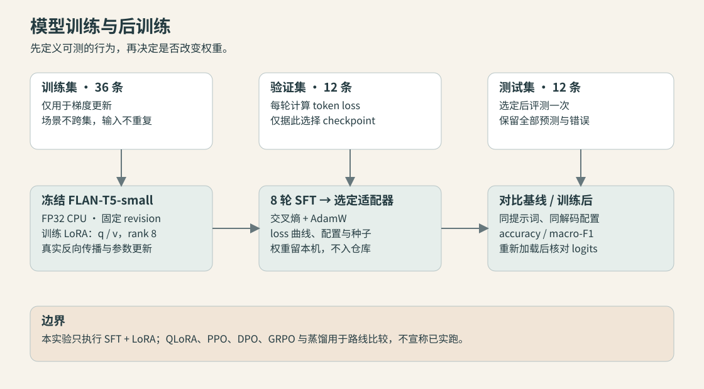
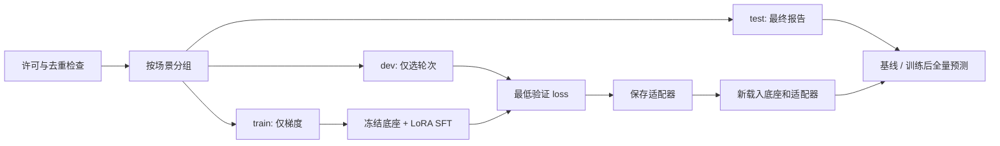
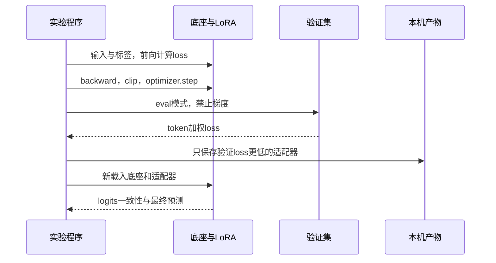
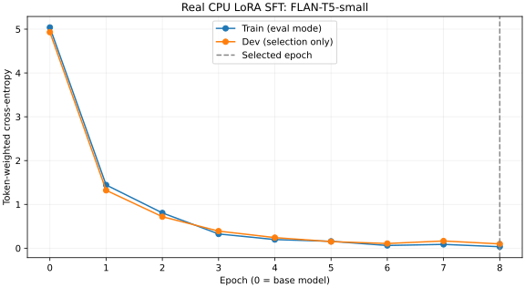

# 第 06 章｜模型训练与后训练

> **目标**：判断是否需要微调，选择 SFT、LoRA、偏好优化或蒸馏，并用独立评测检查收益。  
> **难度**：L3。**预计时间**：阅读 90 分钟，实验 30–60 分钟（首次下载另计）。  
> **前置**：理解 token、Transformer、概率与矩阵；能运行 Python、创建虚拟环境；先读第 01 章与第 05 章的模型基础。  
> **范围**：解释训练与主要后训练路线；实跑 Transformers + PEFT 的 CPU LoRA/SFT。本文不把路线介绍当作 PPO、DPO、GRPO、QLoRA 或蒸馏的实测。  
> **学习成果**：能解释 loss 与梯度，设计无直接泄漏的数据划分，复现训练曲线，比较基线与训练后结果，并写出有边界的结论。



## 1. 本章解决什么问题

企业工单已有标准类别，但模型经常输出一段解释，导致下游接口无法解析。设备服务也有类似问题：模型需要把“轮子卡住”和“无法登录”分到不同团队。我们希望稳定输出类别，不希望模型自行操作设备。

先试清晰提示词和合法输出约束；简单分类还可使用规则或传统分类器。只有当目标行为稳定、数据足够、提示方式的收益有限时，才考虑微调。不能因为需要最新产品价格就直接训练模型：可更新的知识通常应放进检索或业务 API。

## 2. 先用大白话理解

预训练像广泛阅读，SFT 像按参考答案练习，偏好优化像比较两个回答哪个更好，蒸馏像用教师的输出帮助较小的学生练习。类比只帮助区分数据来源：模型没有人的理解保证，答案偏好也不等于事实真伪。

训练的严格定义是：给定数据和目标函数，计算参数对误差的影响，再更新允许训练的参数。SFT 是目标与数据形式；LoRA 是参数更新方式。因此“用 LoRA 做 SFT”成立，“SFT 与 LoRA 二选一”不成立。

## 3. 核心术语

| 术语 | 中文解释与准确定义 | 不要混淆 |
|---|---|---|
| train / dev / test | 更新参数 / 选择方案 / 最终估计未见样本表现 | test 不能反复用于调参 |
| loss | 可求导的优化目标，例如正确 token 的负对数概率 | loss 降低不保证任务准确率提高 |
| gradient | loss 对参数的偏导数组成的向量 | 不是样本标签，也不是生成概率 |
| backward | 用链式法则计算梯度 | 本身不更新参数；optimizer.step 才更新 |
| epoch / step | 遍历训练集一轮 / 执行一次参数更新 | 梯度累积时两者更不能混算 |
| overfitting | 模型适应训练数据中的偶然细节，未见数据表现变差 | 训练 loss 很低不等于可上线 |
| SFT | 用输入及目标回答做监督微调 | 不等于从头预训练 |
| LoRA | 冻结底座，用低秩增量表示权重变化 | PEFT 的 adapter 文件不一定是瓶颈 Adapter 算法 |
| reward model | 对回答或回答过程输出奖励分数的模型 | 不是客观真理判定器 |
| teacher / student | 提供学习信号的教师 / 接收学习信号的学生 | 教师输出仍需质量与许可检查 |

## 4. 工作原理

### 4.1 数据、loss、反向传播

对自回归语言模型，next-token 目标常写成：

```text
L(theta) = -mean_t log p_theta(x_t | x_1, ..., x_(t-1))
g = gradient_theta L(theta)
theta_next = theta - learning_rate * g
```

最后一行是最简单的梯度下降。实验使用 AdamW，它还维护梯度的一阶、二阶统计量并施加权重衰减。过大的学习率可能破坏已有能力；过小则可能在预算内学不到目标。批次降低每步计算量，也使梯度有噪声。随机种子、批次顺序、dropout、精度和硬件都会影响复现。

训练时通常把真实前缀喂给模型，称为 teacher forcing。推理时模型接收自己生成的前缀，错误可能累积。因此要同时测生成结果，不能只测 loss。padding 标签设为 `-100`，不参与交叉熵；本实验 loss 按有效目标 token 数加权，包含 EOS，不把每批平均值再无权平均。

### 4.2 预训练与 SFT

next-token prediction 从文本自身得到监督信号，适合大规模预训练。它学到统计规律，不保证事实、时效或权限正确。不是所有模型都用同一预训练目标：T5 使用编码器—解码器结构，并研究跨度破坏后恢复等目标；FLAN-T5 还经过指令微调。[T5 论文](https://arxiv.org/abs/1910.10683) 支持这个区别。

SFT 数据描述“在这个输入下，期望回答什么”。常见 decoder-only 格式是 messages，训练时要明确是否只对 assistant token 算 loss。本实验采用 seq2seq：编码器读工单与任务说明，解码器预测类别及结束符。模型库负责 decoder 输入右移，不能把目标完整泄漏到输入中。

```json
{"id":"train-00","scenario":"duplicate_charge","text":"My card was charged twice for one subscription.","label":"billing"}
```

规范化、许可检查、去重与按来源分组应早于随机划分。真实数据常应按客户、设备、事件或时间分组。同一事故的聊天、摘要和改写必须留在同一组。仅全文不同不代表没有模板泄漏。本实验先固定独立场景，再写不同句子；详见[数据集卡](../labs/training_post_training/DATASET_CARD.md)。

### 4.3 LoRA、QLoRA、Adapter

设底座矩阵 `W` 为 `d_out × d_in`。LoRA 使用 `W' = W + (alpha/r) B A`，其中 `A` 为 `r × d_in`，`B` 为 `d_out × r`。冻结 W，只训练 A、B；参数增量为 `r(d_in+d_out)`。低秩限制减少优化器状态，但底座前向、激活与反向传播仍需内存，不等于整个训练只占适配器文件那么大。

| 方法 | 更新内容 | 主要收益 | 代价与边界 |
|---|---|---|---|
| 全量微调 | 底座全部或大量参数 | 更新能力灵活 | 梯度与优化器状态大；遗忘风险 |
| LoRA | 目标线性层的低秩矩阵 | 小任务权重，易切换 | rank 与目标模块影响能力；合并权重需核验 |
| QLoRA | 冻结量化底座 + LoRA | 降低底座存储，论文含 NF4、双重量化等设计 | 仍有激活和优化器开销；量化内核和硬件需兼容 |
| 瓶颈 Adapter | 层间新增的下投影、非线性、上投影模块 | 每任务保存少量参数 | 改变计算路径，可能增加推理延迟 |

本实验不加载 4-bit 底座，不使用 bitsandbytes，因此是 FP32 LoRA，不能称为 QLoRA。`q`、`v` 是 T5 实际模块名，不应直接复制到所有模型。LoRA 通常可合并到线性权重，但多适配器服务和量化合并仍需单独验证。[LoRA](https://arxiv.org/abs/2106.09685)、[QLoRA](https://arxiv.org/abs/2305.14314) 和 [Adapter](https://arxiv.org/abs/1902.00751) 是不同机制。

### 4.4 RLHF、奖励模型、PPO、DPO、GRPO

RLHF 是利用人类反馈改进行为的流程类别，不是某一个优化器。经典路线先 SFT，再收集回答偏好，拟合 reward model，最后用强化学习优化策略。偏好可用 `(prompt, chosen, rejected)` 表示；标注者需要固定规则，否则模型只会学到混杂偏好。

| 名称 | 学习信号与目标 | 是否需要独立奖励/价值模型 | 关键风险 |
|---|---|---|---|
| Reward Model | 让优选回答得分高于被拒回答，常用成对排序损失 | 本身就是奖励模型 | 评分偏差、长度偏好、分布漂移 |
| PPO | 用采样回答的优势估计优化策略；裁剪概率比限制单次更新 | 经典 RLHF 通常有奖励模型、value/critic 与参考策略 | 在线采样成本；奖励投机；训练不稳定 |
| DPO | 从偏好对直接提高 chosen 相对 rejected 的策略对数概率优势 | 原始方法不单独训练奖励模型或 critic；有冻结参考策略 | 离线偏好覆盖不足；差的偏好仍会误导 |
| GRPO | 对同一问题采样一组回答，以组内奖励构造相对优势，做裁剪更新 | 不需要独立 value 模型；奖励可来自模型或可验证规则 | 多样本成本；整组同奖时信号弱；可验证奖励不等于万能 |

DPO 常用目标：`-log sigmoid(beta * [(log pi(chosen)-log pi_ref(chosen)) - (log pi(rejected)-log pi_ref(rejected))])`。它不是“直接把 chosen 做一遍 SFT”；rejected 和参考策略都影响目标。GRPO 的简单组归一化优势是 `(reward-mean(group))/(std(group)+epsilon)`，具体实现和 KL 项可有变化。PPO 的裁剪及常见 KL 约束都不保证绝对安全。不能把它们统称为“奖励模型训练”。相关原始论文见本章参考资料。

### 4.5 三类蒸馏

| 路线 | 教师提供什么 | 学生怎么学 | 代价与限制 |
|---|---|---|---|
| logits 蒸馏 | 每个位置的分数或概率分布 | 用温度 softmax 后的 KL 等损失拟合软目标，可混合标签交叉熵 | 需要访问分布；词表与 token 对齐困难；存储大 |
| response 蒸馏 | 教师完整回答 | 把回答作监督目标做 SFT | 丢失未选 token 的概率信息；会继承错误 |
| 数据蒸馏/合成数据 | 教师生成、筛选、改写的题目或标注 | 清洗后训练，再独立评估 | 名称宽泛，必须写明生成与筛选过程；不是自动正确 |

经典 logits 蒸馏可写为 `T² * KL(p_teacher^T || p_student^T)`，T 调整软目标温度。response 蒸馏不要求教师开放 logits。这里“数据蒸馏”指教师辅助生成训练资料；另有将数据集压缩成少量优化样本的 dataset distillation，不能混用定义。本实验数据不是教师生成，不能声称完成蒸馏。教师和学生都不能看到盲测答案；教师 API 的数据使用和再训练条款必须另行核查。

## 5. 架构、流程与数据流





这些图可以编辑。顶部 SVG 的生成源码是 [make_diagram.py](../labs/training_post_training/make_diagram.py)。只有报告与小型配置进入版本库；权重保留在本机输出目录。

## 6. 工程实现

### 6.1 选型与完整代码

选用 `google/flan-t5-small`，固定 revision `0fc9ddf78a1e988dac52e2dac162b0ede4fd74ab`，模型卡许可 Apache-2.0。它能在 CPU 上进行小规模真实训练。它不是随机模型，也不是模拟生成器，但规模与本实验数据都不足以代表大型 Agent。

完整实现位于 [train.py](../labs/training_post_training/train.py)，数据与指标定义位于 [contracts.py](../labs/training_post_training/contracts.py)，没有用伪训练替换模型调用。可直接打开源码跟读，无需拼接正文代码片段。

```text
labs/training_post_training/
  config.json                 # Model revision and training choices
  requirements.txt            # Direct dependencies
  requirements-lock.txt       # Exact observed environment
  DATASET_CARD.md
  data/{train,dev,test}.jsonl
  contracts.py
  train.py
  test_contracts.py
  plot.py
  make_diagram.py
  results/                    # Published read-only evidence, no weights
```

### 6.2 安装与运行

从仓库根目录执行。实验环境与其他章节隔离；网络仅用于首次安装与下载模型。离线契约检查只需 Python 3.11+，真实训练环境用 Python 3.12。

```bash
python3.12 -m venv /tmp/leanagentbook-ch06-venv
/tmp/leanagentbook-ch06-venv/bin/python -m pip install -r labs/training_post_training/requirements-lock.txt
OMP_NUM_THREADS=2 TOKENIZERS_PARALLELISM=false \
  /tmp/leanagentbook-ch06-venv/bin/python labs/training_post_training/train.py \
  --output output/training_post_training/run-01
/tmp/leanagentbook-ch06-venv/bin/python labs/training_post_training/plot.py \
  --report output/training_post_training/run-01/report.json \
  --output output/training_post_training/run-01/curve
python3 -m unittest discover -s labs/training_post_training -p 'test_*.py' -v
python3 scripts/check_book.py
```

已有该 revision 的本地快照时，可传 `--model-path /path/to/snapshots/0fc9ddf78a1e988dac52e2dac162b0ede4fd74ab`，只读载入。输出目录必须为空，且不能是发布的 results 目录。重新运行请选择新目录，避免覆盖证据。CPU 线程固定为 2；代码显式使用 CPU 和 FP32，不会自动切到 GPU 或 MPS。

### 6.3 训练设置与关键逻辑

| 设置 | 固定值 | 原因 |
|---|---|---|
| 随机种子 | 606 | 固定初始化、shuffle 与 dropout 的随机来源 |
| 轮次 / batch | 8 / 4 | 36 条训练数据，共 72 次更新 |
| 学习率 / 优化器 | 0.001 / AdamW | 教学预算内观察行为变化；不是普适最佳值 |
| LoRA | r=8, alpha=16, dropout=0.05 | 仅 q/v 模块更新 |
| 输入上限 / 生成上限 | 128 / 8 token | 输入超限直接报错，不静默截断 |
| 推理 | greedy，num_beams=1 | 基线与训练后配置一致 |
| 选择规则 | 训练轮次中最低 dev token loss | 不使用 test，也不以最好测试准确率选模型 |

`batch()` 负责动态 padding 与目标 mask。`loss()` 按有效目标 token 加权。`evaluate()` 保存每条原始预测并计算指标，非法类别记错，不能偷偷映射为“最像的类别”。训练循环只给可训练参数建立优化器，检查 loss 有限，裁剪梯度范数为 1。每轮关闭 dropout 测 train/dev loss，这与每步带 dropout 的训练 loss 不同。

选择完成后先保存全部评测，再新载入底座与适配器，比较验证集 logits（绝对差 ≤ 1e-6）和测试集预测。配置错误、超长输入、非有限 loss、空输出目录冲突和重载不一致都会中止。端到端脚本确实执行前向、反向和优化器更新；离线单元测试只验证数据与已发布报告契约，不能替代这次真实训练。

## 7. 实测结果与案例

本机使用 **Apple M4 / macOS arm64 / Python 3.12.14**，只运行 CPU、FP32、2 个计算线程。底座与适配器合计 **77,305,216** 个参数，可训练 **344,064** 个（约 **0.445%**）。验证 loss 最低的是第 **8** 轮。配置在训练前固定，发布的是第二次复跑结果；第二次只调整内存采样顺序与失败报告字段，没有修改数据、提示词或训练参数。



曲线使用 [plot.py](../labs/training_post_training/plot.py) 和真实报告绘制，SVG 文字可编辑，同时保留 PNG。epoch 0 是底座基线，之后每点均为 eval 模式、无梯度的全量 token 加权 loss。图中没有 test 曲线，避免用测试走势选轮次。

| 划分 | 样本数 | 基线准确率 | LoRA 准确率 | LoRA macro-F1 | token loss：基线 → LoRA |
|---|---:|---:|---:|---:|---:|
| train | 36 | 0.00% | 97.22% | 0.9722 | 5.0394 → 0.0345 |
| dev | 12 | 0.00% | 83.33% | 0.8333 | 4.9310 → 0.0987 |
| test | 12 | 0.00% | 100.00% | 1.0000 | 4.9900 → 0.0403 |

准确率是标签完全相同的条数除以总数；仅做去首尾空格与小写转换。macro-F1 对三个类别的 F1 等权平均，非法类别作为对应真实类别的漏判。完整混淆矩阵、逐条输入/标签/预测见[报告](../labs/training_post_training/results/report.json)，不是只挑成功例子。基线三组的 macro-F1 都是 0；test 12 个基线输出均不属于合法标签。

**失败案例说明**：基线把银行转账请求回答为 `no`，把滞纳金问题回答为 `a late-payment fee was charged.`，反映了输出契约失败。训练后 test 没有错误，但 train 仍把“优惠券未降低金额”误判为 access；dev 把“承包商仍能看到保密项目”误判为 hardware，把“设备没有声音提示”误判为 access。三条都保留在全量预测里，不能用 test 100% 掩盖这些问题。

**过拟合如何看**：持续下降的 train loss 与持续上升的 dev loss，是过拟合信号，应检查样本规模、重复数据、轮次、正则化与学习率。第 7 轮这里两条曲线都回升，第 8 轮又下降，不能仅凭一处波动宣称过拟合；也不能因为最后 dev loss 很低就忽略生成错误。验证 loss 选择与生成准确率并不完全一致。

| 实测成本 | 数值与口径 |
|---|---|
| 训练 + 每轮 train/dev 验证 | 7.41 秒；含 checkpoint 保存，不含初始基线与最终报告评测 |
| 全过程 | 14.75 秒；从程序启动到最终评测重载，含载入，不含安装与首次下载 |
| 进程峰值 RSS | 945815552 bytes，约 902.00 MiB；`getrusage(RUSAGE_SELF).ru_maxrss`，macOS 原值为 bytes |
| 结束时 RSS | 939229184 bytes；psutil 独立采样，采样时刻与峰值 API 不同 |
| GPU 显存 | 不适用；没有使用 GPU/MPS，不能把统一内存写成显存 |
| 重载验证 | dev logits 最大绝对差 0.0；全部 test 预测一致 |

模型文件校验和、CPU 型号与总物理内存见[来源记录](../labs/training_post_training/results/provenance.json)。峰值包括载入、训练、生成和重新加载底座，不是纯训练分配器峰值，也不是机器总内存。吞吐和峰值会受系统负载、缓存及版本影响；本实验没有测 GPU、能耗或生产并发。

**结论**：这次真实训练在固定的微型合成数据上学会了三分类输出，且适配器可重载。12 条测试每条对应 8.33 个百分点；测试正确率高于验证集并不矛盾，只说明小样本方差很大。不能据此推断中文工单、未知类、多意图或真实客户的质量，也不能证明微调优于更强的提示词基线。


## 8. Prompt、RAG、微调的边界

| 需求 | 优先方案 | 优点 | 不适用或需补充 |
|---|---|---|---|
| 改回答结构、语气、任务说明 | Prompt / 受约束输出 | 成本低、便于立即迭代 | 长提示成本；复杂行为可能不稳 |
| 当前价格、设备手册、客户专属知识 | RAG / 业务 API | 可更新、可引用、可按权限隔离 | 检索漏召回；文档注入与权限仍需防护 |
| 稳定格式、专业标签、重复技能 | SFT，可配 LoRA | 学习固定行为，减少提示长度 | 需训练数据、评测、版本与回滚；知识更新不方便 |
| 同题回答的质量偏好 | DPO 或适合的 RL 路线 | 学习排序或可验证奖励 | 偏好质量、奖励漏洞、计算预算 |
| 大模型行为迁移到小模型 | 蒸馏 | 可能降低推理成本 | 学生能力上限、教师错误与授权 |

可组合 RAG 与微调：RAG 提供当前资料，微调学习如何引用与输出。微调不是权限系统、事实数据库或设备安全控制器。本实验基线很弱，所以收益不能证明 LoRA 比精心设计的 few-shot prompt、受约束解码或普通分类器更经济。

## 9. 生产注意事项

- **稳定性与恢复**：保存底座 revision、tokenizer、适配器、配置和数据版本。服务启动校验一致性；发布失败可切回上一版本。本实验只做适配器保存与重载，不提供优化器中断续训。
- **成本与性能**：分别测训练时长、适配器文件大小、推理延迟与进程内存。LoRA 参数少不代表零训练成本；本次测量含模型载入、评测与重载，不能当作纯训练内存。
- **安全**：微调不会取消越权风险。模型输出经白名单与权限层检查；设备控制必须保留独立授权。数据要可追溯、可删除，不能把真实访谈直接作为公开数据。
- **监控**：跟踪无效输出率、每类召回率、真实工单回退率和分布变化。新类别不能硬塞到旧三分类标签里。
- **兼容性**：固定环境仅证明本次组合；更新 Transformers、PEFT 或切换加速器后重新执行重载与回归。不要将上游弃用提醒解释为训练失败，也不要忽略未来版本可能变化。

## 10. 动手实践与验收

**目标**：复现一次真实 SFT，并能说明收益来自哪里。

**前置条件**：可安装固定 Python 包，有足够内存和模型下载空间；准备独立输出目录。CPU 路径不要求 CUDA。

**步骤**：先阅读数据集卡和划分，运行离线契约检查；用固定配置执行真实训练；从报告读取 train/dev 曲线和全部 test 预测；生成曲线；核对适配器参数确实改变与重载一致性；最后写一段保留限制的结论。不要为了“曲线好看”改动已冻结 test。

**验收标准**：

- 数据集卡写明人工合成、许可、标注、三组用途与泄漏限制，跨集无重复 ID、场景和规范化全文。
- 日志包含 8 轮、72 次真实梯度更新；保存种子、版本、数据哈希、参数数目、train/dev loss 和选择规则。
- 基线和训练后对所有划分保存逐条结果、accuracy、macro-F1、混淆矩阵、无效输出和失败案例；无失败也明确报告。
- 测试集从不用于选择轮次或调整参数；没有提升也诚实报告。
- 用真实进程内存和运行时长记录成本；CPU 显存写“不适用”。
- 新载入底座与适配器后 logits 与预测一致；离线测试与章节检查通过。
- 不提交模型权重，不发布本机用户名路径、凭据或真实访谈。

**常见错误**：把 LoRA 与 SFT 当替代方案；把 teacher forcing loss 当任务成功率；把量化推理叫 QLoRA；按重复模板随机切分；看过测试错误后重新调参却继续称“盲测”；把 CPU RSS 当显存；用模拟训练输出冒充训练证据。

**扩展挑战**：另建一个尚未用于设计的盲测集，加入中文、混合意图和无关请求。用新的验证集比较 few-shot、普通分类器与 SFT；记录质量、延迟和人工回退成本。若开展偏好训练，先写偏好标注准则，再选择 DPO 或 RL，不把本实验三类标签机械转成偏好对。

## 11. 本章总结

1. 训练目标、参数更新方式和数据来源是三个维度：SFT + LoRA 可同时成立。
2. train 更新参数，dev 选方案，test 留作最终检验；按场景分组先于随机划分。
3. 反向传播计算梯度，优化器更新参数；低 loss 不保证正确生成。
4. next-token 预训练常见但不是全部；本实验的 T5 有独立编码器与解码器。
5. PPO、DPO、GRPO 的信号与组件不同，RLHF 不是它们的共同算法名。
6. 蒸馏可能转移教师的错误；RAG 和微调不能替代权限与事实核查。
7. 12 条合成测试只能证明小实验行为，不能证明生产泛化。
8. 下一步结合第 07 章测推理成本、第 14 章建立更可靠的评测，再决定是否值得发布新模型。

## 12. 参考资料与核验范围

以下一手来源核验日期均为 **2026-11-20**。论文结论只用于解释机制，不把论文的硬件或指标当成本机实测。

| 来源 | 支持的正文内容 / 版本边界 |
|---|---|
| [固定 revision 模型卡](https://huggingface.co/google/flan-t5-small/blob/0fc9ddf78a1e988dac52e2dac162b0ede4fd74ab/README.md) | FLAN-T5-small 身份、使用方式、Apache-2.0 许可；实验固定该 revision |
| [T5 论文](https://arxiv.org/abs/1910.10683) | text-to-text 与预训练目标，不等同纯 decoder-only next-token |
| [LoRA 论文](https://arxiv.org/abs/2106.09685) | 冻结底座、低秩更新 |
| [QLoRA 论文](https://arxiv.org/abs/2305.14314) | 冻结 4-bit 底座与 LoRA、NF4 和双重量化 |
| [Adapter 论文](https://arxiv.org/abs/1902.00751) | 参数高效迁移与新增模块 |
| [InstructGPT 论文](https://arxiv.org/abs/2203.02155) | 示范数据、偏好排序与 RLHF 流程 |
| [PPO 论文](https://arxiv.org/abs/1707.06347) | 概率比裁剪的策略优化 |
| [DPO 论文](https://arxiv.org/abs/2305.18290) | 偏好对直接优化，无单独奖励模型拟合 |
| [DeepSeekMath 论文](https://arxiv.org/abs/2402.03300) | GRPO 的组相对奖励与免独立 critic 思路 |
| [知识蒸馏论文](https://arxiv.org/abs/1503.02531) | 温度与软目标蒸馏；不用于支持所有“数据蒸馏”含义 |
| [PEFT v0.13.0 LoRA API](https://huggingface.co/docs/peft/v0.13.0/en/package_reference/lora) | 配置字段；实跑 patch 版本为 0.13.2，不能假定最新版 API 相同 |

完整环境、数据哈希与运行成本以[发布报告](../labs/training_post_training/results/report.json)为准；图表生成脚本与报告一同保留。
