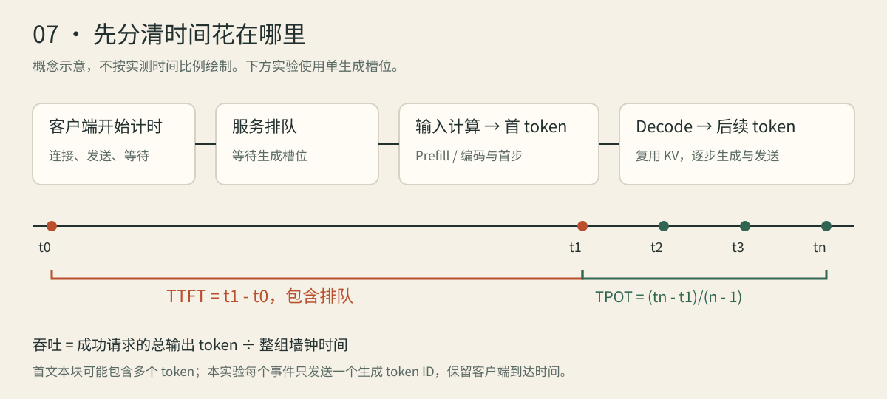
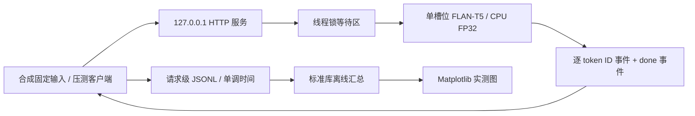
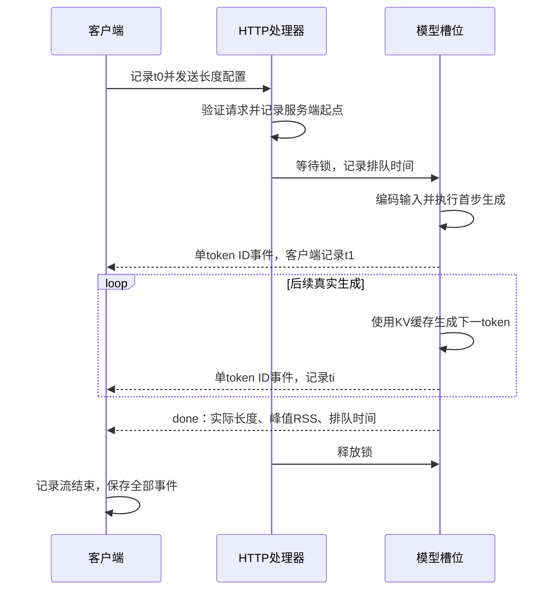
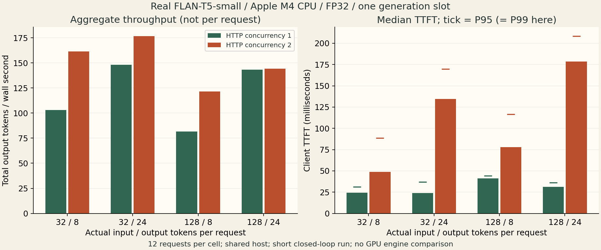
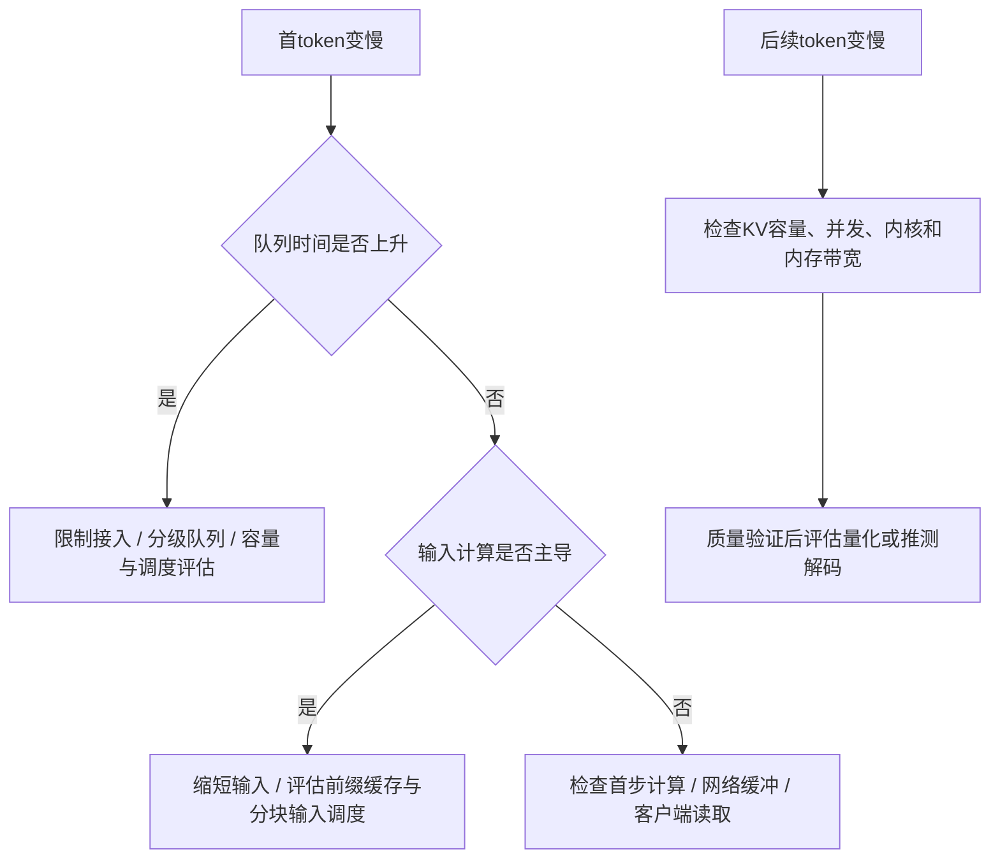

# 第 07 章｜LLM Inference 与 Serving

> **目标：** 部署真实模型服务，测清首 token、逐 token 延迟和总吞吐，再根据证据选择优化方向。  
> **难度：** L2–L3。**预计时间：** 3–5 小时，首次下载模型另计。  
> **前置：** 第 01 章的 token、自回归与模型结构；能运行 Python，理解 HTTP 和线程。  
> **范围：** 服务指标、缓存、调度、量化和框架选型；完成一个 CPU 本地服务与三维压测。没有复现 GPU 框架性能，也没有实现全部生产优化。

**学习结果：** 你能写出指标的计时边界；区分请求并发与模型同时生成数；解释 KV、分页、批处理和量化解决的不同问题；用请求级事件复算结果；指出短实验不能支持的结论。

## 1. 本章解决什么问题

客服助手在单人试用时很快，多人同时提问却迟迟不出第一个字。增加模型副本之前，应先判断时间花在排队、输入计算、生成还是传输。只记录“接口耗时”无法定位原因；只展示某个请求的 token/s 也无法说明系统承载能力。

本章用一个小而真实的模型服务建立测量基线。不使用专门服务框架时，普通 Transformers 足够验证输入、输出和计时链路，但需要自己处理请求、队列、超时和资源。生产服务应根据模型、硬件和负载选用合适的调度与推理框架。

## 2. 先理解时间线



可以把生成理解为“先读题，再逐字写答案”。这个比喻只用于解释时间顺序：模型处理的是 token，不是字；输入通常能并行计算，输出还依赖前一步结果；编码器—解码器与纯解码器的计算路径也不同。

```text
客户端 ── 请求 ──> 等待槽位 ──> 输入计算 ──> 首 token ──> token 2 ──> token n
   |<---------------- TTFT ----------------->|
                                             |<------- 后续生成 ------->|
```

## 3. 指标必须带口径

令 `t0` 为客户端发起 HTTP 请求前的单调时钟，`t1…tn` 为每个生成 token 事件在客户端被读完的时间，`tdone` 为流读完时间。

| 指标 | 本章定义 | 不能混用的值 |
|---|---|---|
| Prefill | 纯解码器处理输入 token 并建立其 KV 的阶段 | 不等于包含排队的 TTFT |
| Decode | 基于已知 token 和缓存，逐步生成后续 token | 不等于整段请求时间 |
| TTFT | `t1 - t0`；含连接、传输、排队与首步计算 | 首 HTTP 头、整段输出完成时间 |
| ITL | `ti - t(i-1)`，从第 2 个输出 token 起 | 首文本块间隔，除非每块恰好一个 token |
| TPOT | 单请求 `(tn - t1)/(n - 1)`；`n=1` 时无定义 | `总请求时间/n`；不同请求平均数混为总体 ITL |
| 端到端延迟 | `tdone - t0`，含流结束等开销 | 最后一个 token 的到达时间 |
| 输出吞吐 | 整组成功请求输出 token 总数 / 整组墙钟秒数 | 各请求 token/s 的求和或平均 |
| 请求吞吐 | 成功请求数 / 整组墙钟秒数 | 请求并发 |
| 并发 | 同时在途的请求数；还要报告实际峰值 | 模型同时生成数；本实验始终只有 1 个生成槽位 |
| P95/P99 | 排序后的第 `ceil(p × N)` 个样本，使用 nearest-rank | 平均值或可靠性保证；必须同时报告 N |

同一套事件中，TPOT 等于该请求 ITL 的算术平均。但“各请求 TPOT 的 P95”和“所有 token 间隔的 P95”不同，长输出会为后者提供更多样本。本章汇总同时保留它们。服务端与客户端时钟各自起算，不直接相减；跨机器测量还需处理时钟同步问题。[vLLM 指标文档](https://docs.vllm.ai/en/latest/usage/metrics/)可用于对照生产指标名称，不能假设所有框架都与本章边界一致。

## 4. 优化手段分别解决什么

### 4.1 KV、分页与调度

| 手段 | 输入与内部工作 | 主要收益 | 代价与边界 |
|---|---|---|---|
| KV Cache | 为已处理 token 保存各层 Key、Value，新 token 复用它们 | 避免重复计算历史 K/V | 长上下文、多并发增加缓存；仍需读取历史缓存 |
| PagedAttention | 将逻辑 KV 块映射到物理块，用块表访问，支持按需分配和共享 | 减少连续分配浪费，改善 KV 管理 | 块表与调度有开销；不减少模型参数，也不保证任何负载都更快 |
| Continuous Batching | 在生成迭代边界移出已完成请求、加入新请求 | 让空出的批次位置继续工作 | 需要 token 预算、公平性与排队策略；吞吐与单请求延迟需同时看 |
| Prefix Cache | 对相同前缀 token 复用已算好的 KV | 减少重复输入计算 | 不直接减少新输出的 decode；前缀必须匹配，受缓存容量、驱逐和隔离约束 |
| Speculative Decoding | 草稿模型或其他提案器给出多个候选，目标模型验证 | 接受率高时可减少目标模型逐步调用 | 草稿开销、额外内存与拒绝率会抵消收益；需正确验证算法 |

分页不是把 KV 自动换到磁盘。连续批处理也不是“等待一批请求全部结束”。前缀缓存不等于答案缓存：相同前缀后仍需生成答案。带校正的推测采样可保持目标分布；不能把随意接受草稿的近似方案也称为无损。[PagedAttention 原论文](https://arxiv.org/abs/2309.06180)、[vLLM 前缀缓存示例](https://docs.vllm.ai/en/latest/examples/features/automatic_prefix_caching/)和[推测解码原论文](https://arxiv.org/abs/2211.17192)分别支持这些机制；论文中的加速倍数不作为本机实测结论。

对普通解码器的 KV，粗略估算为：

```text
KV bytes ≈ 2 × layers × kv_heads × head_dim × cached_tokens × bytes_per_element
```

对每个活跃序列求和，再考虑共享块、对齐、碎片和元数据。GQA/MQA 使用 KV 头数，不是查询头数。这个式子不直接覆盖本章 T5 的编码器状态、交叉注意力缓存，不能拿它替代进程内存测量。总内存还包含权重、激活、临时张量、运行时与缓存。

### 4.2 精度、算法、格式不能放在同一层比较

| 名称 | 所属层 | 选择时检查什么 |
|---|---|---|
| FP16 | 16 位浮点；1 符号、5 指数、10 尾数位 | 数值范围、算子与硬件支持；可能溢出 |
| BF16 | 16 位浮点；1 符号、8 指数、7 尾数位 | 范围较大，但有效精度较低；不能只看位宽 |
| INT8 | 8 位整数表示，通常配缩放等元数据 | 只量化权重还是也量化激活/KV；内核是否支持 |
| INT4 | 4 位整数表示，通常分组存储 | 质量损失、缩放开销、解包与矩阵计算开销 |
| AWQ | 利用激活统计的权重量化方法 | 校准样本、分组配置、目标内核；不是浮点格式 |
| GPTQ | 利用近似二阶信息的训练后权重量化方法 | 校准、误差补偿、打包格式和服务框架兼容性 |
| GGUF | 模型与元数据文件格式 | 内部张量类型与具体量化方案；扩展名不等于 INT4 |

仅按权重理论体积估计，FP16/BF16 约 2 字节/参数，INT8 约 1 字节，INT4 约 0.5 字节；实际文件与运行内存有元数据和其他开销。低位宽也不保证低延迟：转换、反量化、算子实现和内存访问可能主导性能。先在代表性任务上检查正确率，再在同等输入、输出长度和并发下比较性能。[AWQ](https://arxiv.org/abs/2306.00978)、[GPTQ](https://arxiv.org/abs/2210.17323)与[GGUF 规范](https://github.com/ggml-org/ggml/blob/master/docs/gguf.md)支持这里的分类。

## 5. 架构与流程





服务启动只加载一次模型。一个不计入网格的预热请求走完整 HTTP 路径。每个单元使用固定数量工作线程；一个线程在收到结束后立即发下一个请求。这是**闭环负载**，不是固定到达率的开放负载。变慢时客户端也会少发请求，所以它不能完整显示真实流量峰值下的排队风险。

## 6. 工程实现

### 6.1 选型边界

以下是截至 **2026-11-20** 的官方文档核查，不是本章对这些框架的性能测试。安装前必须按具体版本再查模型、硬件、量化与功能组合。

| 方案 | 优点 / 适用边界 | 代价 / 不适用边界 | 官方依据 |
|---|---|---|---|
| vLLM | 面向多请求服务，提供分页 KV、连续批处理与缓存；安装文档分列 GPU、CPU、TPU 路线 | 不代表每个模型、量化、后端都有同等支持；不能把 CUDA 配置直接搬到任意 Mac | [官方首页与安装入口](https://docs.vllm.ai/en/latest/) |
| SGLang | 提供 RadixAttention、前缀缓存与多 GPU 服务；官方列有 NVIDIA、AMD、Intel Xeon、TPU 等硬件路线 | 需逐平台核对模型、内核和安装方式；硬件被列出不代表所有特性可用 | [官方说明](https://docs.sglang.io/)、[硬件入口](https://docs.sglang.io/docs/hardware-platforms/overview) |
| TensorRT-LLM | 适合支持矩阵内的 NVIDIA GPU 部署，可结合量化和调度优化 | 与 GPU 架构、模型、后端、驱动和版本关联紧密；不作为本机 Apple CPU/Metal 的服务方案 | [支持矩阵](https://nvidia.github.io/TensorRT-LLM/reference/support-matrix.html) |
| llama.cpp | 适合本地、桌面和边缘部署；支持 CPU 与 Apple Metal 等后端，使用 GGUF 生态 | 仍需核对模型转换与张量类型；不能据此保证任何设备上的长上下文或高并发能力 | [官方仓库](https://github.com/ggml-org/llama.cpp)、[量化说明](https://github.com/ggml-org/llama.cpp/blob/master/tools/quantize/README.md) |
| 本章 Transformers + 标准库 HTTP | 依赖少，容易观察真实 token 回调与队列 | 无连续批处理、分页 KV、跨请求前缀缓存或推测解码；只用于本地教学 | [固定版本生成源码](https://github.com/huggingface/transformers/blob/v4.48.3/src/transformers/generation/utils.py) |

### 6.2 完整可运行代码

完整代码放在独立文件中，直接运行，不需要补全省略逻辑：

```text
labs/inference_serving/
  server.py              # Real model server
  benchmark.py           # Child lifecycle and bounded HTTP client
  report.py              # Standard-library offline replay
  plot.py                # Editable Matplotlib figure source
  test_metrics.py        # Offline metric and recorded-grid checks
  requirements-real.txt  # Separate real-model dependencies
  results/               # Recorded evidence; never a new run's output
```

阅读顺序：[服务端](../labs/inference_serving/server.py) → [压测客户端](../labs/inference_serving/benchmark.py) → [指标计算](../labs/inference_serving/report.py) → [绘图源码](../labs/inference_serving/plot.py)。复现命令、下载方式和故障处理见[实验说明](../labs/inference_serving/README.md)。

`TokenStreamer.put()` 跳过生成开始时的 decoder 起始 token，之后检查每次回调恰好一个生成 token ID。它立即写出并 flush 一行 JSON。客户端收到完整行后打时间戳，所以这里测的是**token 事件到达延迟**，仍含协议、Python 调度和读取开销，不是 GPU kernel 时间，也不是用户看到首个可读字的时间。普通文本 streamer 可能攒够单词才吐文本块，不能直接照搬为逐 token 指标。

T5 是编码器—解码器模型。TTFT 含编码器计算与解码首步。本实验没有单独测量纯解码器的 Prefill 时间。输入为固定合成句子的 token 前缀，额外计入一个 EOS；输出使用 greedy、KV cache，令 `min_new_tokens=max_new_tokens` 得到固定长度，抑制提前 EOS。它适合测量长度影响，不代表自然结束的真实问答质量。

服务限制输入 2–256 token、输出 1–64 token、请求体 1024 字节。客户端并发仅取 1、2，模型计算线程为 1，生成槽位为 1。等待锁不保证 FIFO。该 HTTP 服务没有生产级鉴权、取消传播或有界接入队列，故只绑定回环地址，由受控客户端使用。

## 7. 真实实验与工程案例

### 7.1 固定条件

| 项目 | 本次记录 |
|---|---|
| 硬件 | Apple M4，10 逻辑 CPU，16 GiB 主机内存 |
| 系统 / Python | macOS 26.3 arm64 / Python 3.12.14 |
| 模型 | google/flan-t5-small，76,961,152 参数；Apache-2.0 模型卡 |
| 模型 revision | `0fc9ddf78a1e988dac52e2dac162b0ede4fd74ab`；文件 SHA-256 在 metadata 中 |
| 软件 | torch 2.6.0、transformers 4.48.3、tokenizers 0.21.4、sentencepiece 0.2.0 |
| 精度 / 设备 | FP32，未量化，CPU；GPU 显存：**不适用** |
| 负载 | 并发 1/2 × 实际输入 32/128 × 实际输出 8/24 token |
| 样本 | 每格 12 请求，共 96；额外 1 次预热单独保存 |
| 控制 | 随机种子 7 打乱单元执行顺序；无跨请求前缀缓存 |
| 干扰 | 同机可能有其他任务，未隔离温度、功耗和系统负载 |
| 内存口径 | 服务进程自启动以来峰值 RSS 为 678.5–680.6 MiB，含加载/预热；不是单请求增量内存 |

[元数据](../labs/inference_serving/results/metadata.json)、[原始请求事件](../labs/inference_serving/results/requests.jsonl)、[每格墙钟与实际并发](../labs/inference_serving/results/cells.jsonl)和[进程终止记录](../labs/inference_serving/results/shutdown.json)可供复算。原始记录用 UTC 时间，实验发生在 America/Los_Angeles 的 2026-11-20。

| 并发 | 输入/输出 token | 成功/错误 | 输出 token/s | TTFT P50/P95/P99 ms | TPOT P50 ms | 排队 P50 ms |
|---|---|---|---|---|---|---|
| 1 | 32/8 | 12/0 | 102.9 | 24.2/31.4/31.4 | 5.1 | 0.0 |
| 1 | 32/24 | 12/0 | 148.2 | 24.0/37.0/37.0 | 5.0 | 0.0 |
| 1 | 128/8 | 12/0 | 81.7 | 41.2/44.1/44.1 | 5.9 | 0.1 |
| 1 | 128/24 | 12/0 | 143.2 | 31.3/36.3/36.3 | 5.2 | 0.0 |
| 2 | 32/8 | 12/0 | 161.6 | 48.8/88.7/88.7 | 4.5 | 24.6 |
| 2 | 32/24 | 12/0 | 176.8 | 134.5/169.6/169.6 | 5.0 | 103.1 |
| 2 | 128/8 | 12/0 | 121.6 | 77.9/116.4/116.4 | 5.4 | 41.5 |
| 2 | 128/24 | 12/0 | 144.2 | 178.4/208.5/208.5 | 5.8 | 138.0 |




图的左轴是整组输出 token/s，右轴是 TTFT 毫秒；数字表保留中文说明，图内英文标签可由[绘图源码](../labs/inference_serving/plot.py)修改。保留[矢量图](../labs/inference_serving/results/performance.svg)用于放大与编辑。

**样本限制：** TTFT、TPOT、排队与端到端分位数每格均为 12 个请求；ITL 每格分别为 84 个（输出 8）或 276 个（输出 24）间隔。nearest-rank 的 P95、P99 在 N=12 时都是最大值。这些值只描述样本，不估计稳定生产尾延迟；同一请求内的 token 间隔也并非独立样本。完整的 P50/P95/P99、ITL、输入吞吐和内存见[离线汇总](../labs/inference_serving/results/summary.json)。

可以观察到，并发 2 时排队增加，TTFT 变长；输出较长时等待槽位的请求更受影响。总吞吐变化包含流水衔接、请求处理和共享负载影响；本实验不能把变化归因于连续批处理，因为服务根本没有实现它。输入长度变化也只说明本模型和这批固定输入的现象。

### 7.2 如何用于客服与设备诊断

这是**教学假设案例**：客服助手同时接收短问候与长文档查询。先分别给短、长请求建负载单元，再约束排队上限；不能让一批长输出占住所有槽位后只看平均吞吐。下一步在真实业务样本上测自然结束长度、质量和超时率。

机器人诊断助手可使用同样的测量方法处理遥测摘要；停止动作和安全控制应走独立确定性链路，不能等待语言模型完成。这里没有连接机器人、生产用户或任何真实公司数据。

## 8. 方案取舍与生产注意事项



| 设计动作 | 收益 | 需要新增的证据 |
|---|---|---|
| 缩短输入与输出预算 | 直接减少工作量 | 任务质量是否下降，是否截断必要证据 |
| 增加批次或并发 | 可能提高硬件利用率 | TTFT、ITL、超时与队列长度，不能只看吞吐 |
| 开启前缀缓存 | 降低重复输入成本 | 冷/热缓存分开测试，报告命中率与驱逐 |
| 量化权重/KV | 节省内存，某些硬件上加速 | 同任务质量、内核支持、内存峰值与实际延迟 |
| 增加副本 | 增加容量与故障余量 | 成本、负载均衡、预热和节点故障时的表现 |

生产环境至少还需有界排队、超时与取消、过载拒绝、模型版本回滚、健康与就绪探针、流式代理缓冲检查、租户隔离及敏感日志控制。跨租户复用缓存需评估数据与时序泄露风险。每次比较固定模型 revision、输入分布、输出策略、精度、硬件、并发、缓存冷热、统计窗口和错误口径。重启后的加载时间单独报告，不能混进热服务 TTFT。

若使用 GPU，再分别记录设备峰值显存、框架 allocated/reserved 口径和主机 RSS。主机统一内存或进程 RSS 不能伪装成“GPU 显存”。本章未测 GPU，也未测四个框架的相对优劣。

## 9. 动手实践

### 目标与步骤

1. 先用 Python 3.11+ 标准库回放保存的记录，核对表格；该步骤不运行模型，也不是新的性能测试。
2. 在单独 Python 3.12 环境安装固定依赖，下载固定 revision；权重留在外部缓存。
3. 运行真实压测，输出到新的 `output` 或 `/tmp` 目录。不要覆盖教材 `results`。
4. 比较同输入/输出下的并发 1、2。说明 TTFT、排队与总吞吐为何要一起读。
5. 用自己的记录生成图表，检查异常、实际长度、样本数、实际在途并发和进程退出。

### 验收标准

- [ ] 8 个网格单元都有真实请求记录；明确成功/错误数，不能丢掉超时请求。
- [ ] 逐 token 事件有顺序和真实时间，跳过 decoder 起始 token；实际输入/输出长度与配置一致。
- [ ] TTFT 从请求前开始，不用整段耗时代替；输出仅一个 token 时 TPOT 为空。
- [ ] 吞吐用整格墙钟，报告请求并发峰值与模型生成槽位，两者不混淆。
- [ ] 保存硬件、revision、精度、依赖、队列、缓存、预热、内存与样本数；无 GPU 时写不适用。
- [ ] 离线指标测试通过，真实服务退出；不向仓库提交权重、凭据或机器用户名。
- [ ] 解释小样本 P99、闭环负载和共享主机限制，不声称复现 GPU 框架加速。

### 常见错误与扩展挑战

“端口启动但没有 token”应先看服务日志与完整事件，不把 HTTP 200 当成功；记录断流错误。模型下载失败时先确认固定 revision 与联网环境，不用脚本答案冒充真实生成。重复运行需换输出目录，工具故意拒绝覆盖已有实验目录。

扩展时先增加独立重复轮次和样本，再研究固定到达率、突发流量、取消与长短请求混排。最后才在兼容硬件上比较量化、前缀缓存、连续批处理或推测解码；每次只改变一个配置，重新做质量评测。扩展未在本章执行。

## 10. 本章总结

- 先记录计时起点，再讨论快慢；TTFT 包含排队，TPOT 不包含首 token 之前的时间。
- token 事件与可读文本块不同，不能用块间隔冒充逐 token 延迟。
- 请求并发不等于模型同时生成数，总吞吐不等于单请求速度。
- KV 管理、调度、前缀复用、推测生成和量化作用在不同环节。
- 性能结论必须带模型、硬件、长度、缓存、精度、错误数和样本数。
- 本章完成了真实 CPU 服务与长度/并发网格；生产容量和 GPU 优化仍需独立验证。

下一章将把质量、时延与成本一起用于模型路由；先保留本章测量口径，避免换了模型后比较不一致的数字。

## 11. 参考资料与核查范围

以下资料均在 **2026-11-20** 核查。`latest`、`main`、`master` 页面会变化，复现代码只使用表中固定版本。来源支持机制或支持范围；实验数字只来自本章保存的记录。

| 来源 | 支持的陈述 / 版本边界 |
|---|---|
| [FLAN-T5-small 固定 revision 模型卡](https://huggingface.co/google/flan-t5-small/blob/0fc9ddf78a1e988dac52e2dac162b0ede4fd74ab/README.md) | 模型身份、text-to-text 使用方式与 Apache-2.0 标记；本次通过官方 raw 内容核查 |
| [Transformers 4.48.3 生成源码](https://github.com/huggingface/transformers/blob/v4.48.3/src/transformers/generation/utils.py) | 本实验生成、缓存和 streamer token 回调路径；版本与安装环境一致 |
| [vLLM 官方文档](https://docs.vllm.ai/en/latest/)、[生产指标](https://docs.vllm.ai/en/latest/usage/metrics/) | 服务能力、硬件安装入口及指标对照；非框架实测 |
| [vLLM 前缀缓存示例](https://docs.vllm.ai/en/latest/examples/features/automatic_prefix_caching/) | 相同前缀的计算复用 |
| [PagedAttention，SOSP 2023](https://arxiv.org/abs/2309.06180) | 分页式 KV 管理与共享的机制 |
| [Speculative Decoding，ICML 2023](https://arxiv.org/abs/2211.17192) | 候选、验证和保持目标分布的算法条件 |
| [AWQ 原论文](https://arxiv.org/abs/2306.00978)、[GPTQ 原论文](https://arxiv.org/abs/2210.17323) | 两种训练后权重量化方法的定位；不引用论文速度为本机结果 |
| [GGUF 规范](https://github.com/ggml-org/ggml/blob/master/docs/gguf.md) | GGUF 是包含张量与元数据的格式，非单一量化算法 |
| [SGLang 官方文档](https://docs.sglang.io/) | RadixAttention、缓存、多 GPU 与硬件入口 |
| [TensorRT-LLM 支持矩阵](https://nvidia.github.io/TensorRT-LLM/reference/support-matrix.html) | NVIDIA GPU、模型与功能组合的支持边界 |
| [llama.cpp 官方仓库](https://github.com/ggml-org/llama.cpp) | CPU、Metal 等后端与本地推理定位；本章未安装或压测 |
