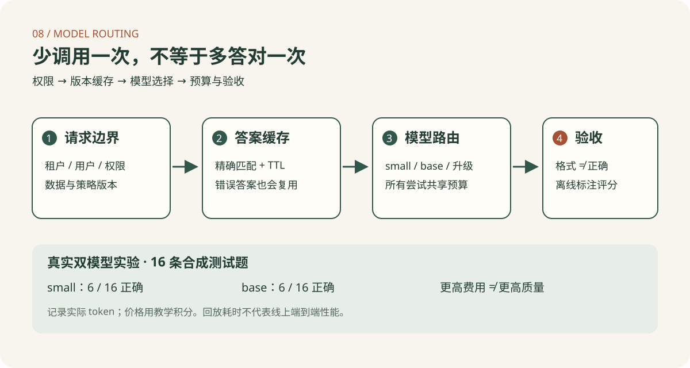
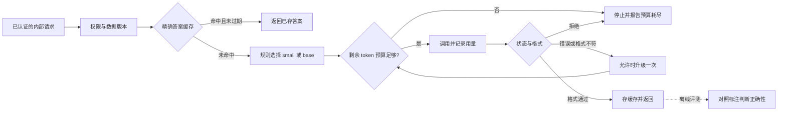
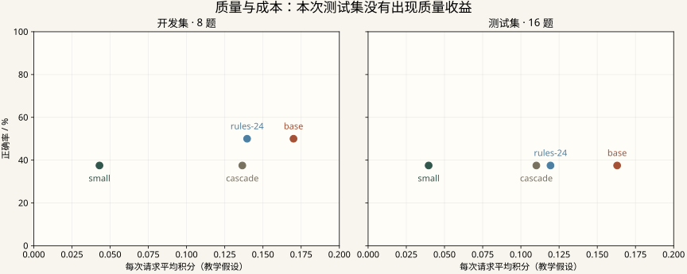

# 第 08 章 · 模型路由与成本优化



## 范围与学习目标

本章面向已经能调用模型的工程师。先读 [模型基础](01-model-foundations.md) 和 [评测与质量](14-evaluation.md)，会运行 Python 命令即可开始。完成后，你应能：

- 按任务与权限选择模型，说明何时升级、停止或拒绝。
- 区分答案缓存、语义缓存、前缀复用和 KV cache。
- 按所有尝试的成本计算“每个成功任务成本”，保留失败样本。
- 用开发集选择规则，用独立测试集报告结果，不把规则判断当成真实能力评估。

交付范围是双模型真实生成记录与标准库策略回放。没有部署商业 API、语义缓存、学习型路由器或多机服务。本章为首版，生产负载与质量验收仍待补齐。

## 先看一次请求怎样走



图中的“格式通过”不等于“答案正确”。本实验不会拿标准答案决定是否升级。否则路由器会提前知道考试答案，评测就失去意义。

### 先建能力表，再选路线

| 请求特征 | 先检查什么 | 路由决策 |
| --- | --- | --- |
| 简单分类、固定格式抽取 | 本任务的质量下限、输入长度 | 满足下限时考虑较低成本模型 |
| 多步推理、长文比较 | 真实样本正确率、上下文上限 | 在开发集证明收益后再升级 |
| 图像、音频、工具调用 | 模型是否支持所需输入和输出 | 能力不匹配时直接排除 |
| 含内部数据 | 部署位置、权限、保留规则 | 先限制候选集，再比较成本 |
| 临近超时或预算不足 | 剩余总预算、已发生的费用 | 缩小任务或停止，不能无限重试 |

较大模型并不在每个任务上都更强。长度只是本实验的教学特征，不是可靠的难度指标。

| 路由方式 | 决策依据 | 额外成本与风险 |
| --- | --- | --- |
| 固定模型 | 所有请求走同一模型 | 简单基线；可能浪费能力或达不到质量 |
| 规则 | 类型、长度、能力与权限 | 易解释；规则会随数据分布失效 |
| 学习型分类器 | 用开发数据训练成功概率或偏好 | 需要标签、校准与漂移检测；本实验未训练 |
| LLM 路由器 | 另一模型判断任务 | 路由本身也收费且会出错；本实验未实现 |
| 级联 | 先低成本模型，再按可观测信号升级 | 两次调用都计费；错误答案可能通过格式检查 |

[RouteLLM 论文](https://arxiv.org/abs/2406.18665v4)研究了利用偏好数据学习模型路由。本实验是手写规则，不是该论文的复现，也不继承论文报告的收益。

## 四种缓存不要混用概念

| 类型 | 复用对象 | 命中条件 | 主要风险 |
| --- | --- | --- | --- |
| 精确答案缓存 | 整个旧答案 | 请求、权限、数据、模型和策略版本一致 | 会复用错误或过期答案；本实验已实现 |
| 语义答案缓存 | 意义接近的旧问答 | 向量近邻后再做权限与语义检查 | 相似问题不一定同一答案；本实验未实现 |
| 前缀复用 | 重复输入前缀的计算 | 服务支持且前缀匹配 | 仍需生成后续输出；具体条件依服务版本 |
| KV cache | 注意力的 key/value 状态 | 同一生成过程中的可复用状态 | 占用内存；不是问答数据库 |

KV cache 的对象可见 [Transformers 4.48 文档](https://huggingface.co/docs/transformers/v4.48.0/en/kv_cache)。不能用“答案缓存命中率”替代推理引擎的 KV 内存测量。

本实验缓存键包含租户、用户、权限版本、数据版本、模型 revision、策略版本、输出格式、预算和完整问题。TTL 到期会失效；版本变化也会失效。调用者传入的 scope 是可信内部上下文，代码没有实现登录认证。对外服务必须从已验证身份构造它，不能相信客户端自报的租户。

## 成本先计全，再讨论优化

```text
任务总费用 = 所有尝试的输入费用 + 输出费用 + 路由/检索费用
每个成功任务成本 = 全部任务的总费用 / 成功任务数
任务总延迟 = 排队 + 路由 + 各串行阶段 + 返回开销
```

失败尝试、升级尝试和重试都要计入分子。零成功时该比值没有定义，程序返回 null，不写成 0。课程用假设积分比较策略：small 每千输入 token 为 1 积分，base 为 4；输出权重均为输入的 2 倍。**这是教学价格，不是账单，也不是本机电费。**

| 优化 | 可以降低什么 | 必须复查什么 |
| --- | --- | --- |
| 删除无关上下文 | 输入 token 与部分计算量 | 不能删掉约束、权限或关键证据 |
| 摘要与压缩 | 后续输入长度 | 摘要生成成本、遗漏与版本更新 |
| 限制输出与总预算 | 最坏调用量 | 输出截断、共享预算、升级可用额度 |
| 并行独立调用 | 等待时间 | 总调用数可能不变或更多；限制并发 |
| 批处理 | 设备利用率 | 队列等待、吞吐与尾延迟；本实验未测 |
| 缓存 | 重复请求的后端调用 | 冷启动成本、失效、隐私、错误复用 |

这里预算单位是真实 tokenizer token；路由特征单位是空白分词后的词数。二者不能互换。每次调用前先预留输入 token 加最大输出 token，调用后按实际生成量结算。升级沿用剩余预算。

## 实测：多花钱没有自动答得更好

在本机 CPU 上运行固定 revision 的 FLAN-T5 small 和 base，每个模型生成 24 次。题目为课程原创英文合成数据：8 条开发集、16 条测试集。输入包含简单算术、逻辑与情感分类。数据很小，不能代表中文、企业业务或现代大型模型能力。

| 策略 | 开发集答对 | 测试集答对 | 测试总积分 | 每次成功积分 | 记录后端 p95 / ms |
| --- | --- | --- | --- | --- | --- |
| 全 small | 3/8 | 6/16 | 0.634 | 0.106 | 134.52 |
| 全 base | 4/8 | 6/16 | 2.608 | 0.435 | 397.30 |
| small，格式失败再升级 | 3/8 | 6/16 | 1.762 | 0.294 | 531.64 |
| 超过 24 词选 base，允许格式升级 | 4/8 | 6/16 | 1.910 | 0.318 | 531.64 |



图中横轴越左，平均每个请求积分越少；纵轴越高，正确率越高。一个点若更贵且正确率不高于另一个点，就在这两个指标上被支配。实际选型还需加入延迟与能力约束。散点只展示已测试策略，不对点之间作连续性能保证。

全部阈值 8/16/24/32 的结果都保留在实验目录。若规则族以“开发集正确率最高，再选总积分最低”为预设选择规则，会选 24 词。它在测试集没有胜过固定 small。不要再用测试集调阈值后继续把同一测试集称为独立验证。

这些 p95 是每条请求所需的**已记录后端耗时之和**的最近秩分位数。每个模型每题只测一次，冷加载另列；回放不等待模型，不测网络、排队和服务端到端延迟。级联路径的两段记录不是同一实际在线请求，不能拿它当生产 SLA。

第二次完全相同的请求，在测试集有 13/16 命中答案缓存。格式失败的三条不会缓存。正确率仍为 6/16：错误但格式合法的答案同样会被缓存。热缓存报告只计算第二次调用，未计第一次填充费用，因此不能据此宣称总费用降低到零。

## 动手练习

实验入口：[模型路由实验](../labs/model_routing/README.md)。先用标准库回放，再按需下载模型重新采样。

1. 复现固定 small、固定 base、规则和级联的报告，比较失败成本。
2. 找一条“数字格式合法但计算错误”的结果，解释为什么没有升级。
3. 改权限版本和数据版本，确认缓存失效；等 TTL 到期再查一次。
4. 把总预算设为不足两次调用，确认升级不会绕过预算。
5. 新建至少 30 条同业务域题目，先锁定开发/测试划分。只用开发集选规则，再记录测试结果。

## 验收标准

- [ ] 17 个离线测试通过，覆盖缓存隔离、TTL、共享预算、拒绝停止与失败计费。
- [ ] 用已提交记录复现两份报告；确认两个固定模型测试正确数都是 6。
- [ ] 实际生成与策略回放分别标明；48 条输出、token 用量、模型 revision 和环境可追溯。
- [ ] 不以格式校验代替正确性，不以假设积分代替商业价格。
- [ ] 扩展业务集、在线延迟、学习型路由与负载验证完成前，不声明生产优化有效。

## 参考与核对记录

| 来源 | 支持的陈述 | 核对日期 |
| --- | --- | --- |
| [RouteLLM v4](https://arxiv.org/abs/2406.18665v4) | 利用偏好数据学习强弱模型路由 | 2026-11-20 |
| [FLAN-T5 small 模型卡](https://huggingface.co/google/flan-t5-small) | 模型身份、Transformers 加载方式、Apache-2.0 标注 | 2026-11-20 |
| [Transformers 4.48 KV cache](https://huggingface.co/docs/transformers/v4.48.0/en/kv_cache) | 缓存注意力 key/value 状态 | 2026-11-20 |
| [实验原始观测](../labs/model_routing/observations.json) | 本章本机生成、token 和耗时数字 | 2026-11-20 |

[返回首页](../README.md) · [完整进度](../ROADMAP.md)
