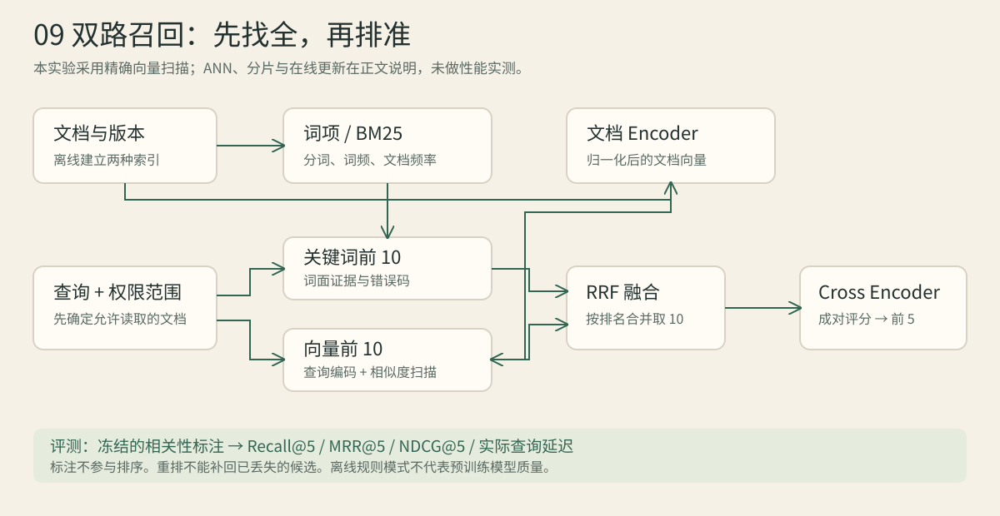
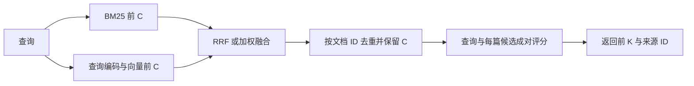
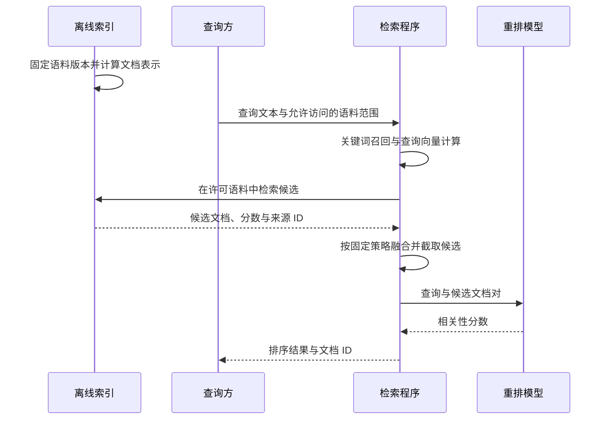

# 第 09 章｜Embedding 与向量检索

> 本章目标：用同一份标注集比较关键词召回、向量召回、融合与重排，解释分数变化和延迟代价。  
> 难度：L2–L3。预计学习时间：阅读 90 分钟，实验 90–150 分钟，首次模型下载另计。  
> 前置：Python 字典与列表、向量点积、训练与推理的区别；建议先学第 05、06 章的模型基础。  
> 范围：文本检索到排序结果，不包含回答生成、文档解析服务或生产向量数据库。实验为英文合成语料，正文为中文。

## 1. 本章解决什么问题

用户说“机器人回到座上却充不进电”，文档写“检查充电触点”。单靠完全相同的词，可能漏掉文档。反过来，用户输入错误码 E104，语义相近的 E140 文档并不能代替正确记录。检索系统要同时保留精确线索和表达变化。

本章把问题拆成两步：召回先形成一个较小的候选集合；重排再判断候选之间的先后。你会建立 BM25 与 Dense 两条路径，用 RRF 合并，用 Cross Encoder 重排，并对每条路径计分。没有任何一种方法保证逐查询改进。若语料只有几十篇，人工分类或精确扫描就是合理替代；不必为“用了向量库”增加服务。

学完后，你应能：解释稀疏与稠密表示的生成方式；计算三种相似度；识别归一化导致的排序变化；设置候选深度与融合规则；区分召回丢失和重排失误；报告有明确口径的质量与延迟。

## 2. 先看整条路径



图中的权限范围是生产约束；本实验仅含一个公开的合成语料集合，没有模拟租户权限系统。两个文档索引从同一版本文档独立建立，不是先过 BM25 再生成向量。

| 方法 | 表示从哪里来 | 擅长什么 | 主要代价或风险 |
| --- | --- | --- | --- |
| TF-IDF | 词频与文档频率 | 简单、可解释的词面匹配 | 同义词不自动对齐；常见词权重与分词有关 |
| BM25 | 词频饱和、长度归一化、逆文档频率 | 错误码、术语、明确关键词 | 词不重叠时容易漏召回 |
| SPLADE | 语言模型生成词表维度权重，训练约束稀疏度 | 学得的词项扩展与倒排检索 | 需要推理与稀疏索引，扩展词不等于事实 |
| 单向量 Dense | Encoder 将文本映射到固定维向量 | 同义改写、概念近似 | 可能忽略否定、数字和版本；需领域评测 |
| Cross Encoder | 查询和候选一起进入模型 | 成对比较细节 | 每个候选都要推理，不能预存一个通用相关分数 |
| ColBERT | 分别保留查询与文档的多个 token 向量 | 更细粒度的延迟交互 | 向量数量、存储和检索实现更复杂 |

生活类比是：关键词检索查目录词，Dense 按描述找相似材料，重排再逐份阅读。但模型并不“理解正确答案”；它输出的是训练目标下的表示或分数，仍可能把“取消未来扣费”与“退还已付款项”混淆。

## 3. 核心术语与表示

| 术语 | 准确定义 | 不要混淆 |
| --- | --- | --- |
| Embedding | 输入对象到向量空间的映射及其结果 | 不是每个数值数组都来自训练 |
| Sparse，稀疏表示 | 大部分坐标为零，常见坐标对应词表项 | 稀疏不表示必须没有神经网络 |
| Dense，稠密表示 | 较低维的分布式表示，通常多数坐标非零 | “维度小”不自动意味着语义有效 |
| Bi-Encoder，双塔 | 分别编码查询和文档，再计算相似度 | 两塔可共享参数，也可不共享 |
| ANN | 近似最近邻搜索，允许错过部分真正近邻来换资源 | 不是业务相关性本身的判断 |
| 候选深度 C | 每路召回或进入重排的最大文档数 | 最终展示 K 通常更小 |
| 相关性标注 | 对查询与文档是否满足信息需求给出的等级 | 不能作为排序器的输入 |

### 3.1 TF-IDF、BM25 与 SPLADE

TF-IDF 的常见形式是 `tf(t,d) × log(N/df(t))`；也可对词频取对数或平滑 IDF。公式变体与向量归一化必须写进配置。相同查询在不同分词器、停用词策略下并不是同一项实验。本章的英文分词不能直接用于中文连续文本。

本实验 BM25 使用以下明确变体，查询中重复词只计一次：

```text
IDF(t) = ln(1 + (N - df(t) + 0.5) / (df(t) + 0.5))
score(q,d) = sum over unique t in q:
  IDF(t) * tf(t,d)*(k1+1)
  / (tf(t,d) + k1*(1-b+b*len(d)/avglen))
k1 = 1.2, b = 0.75
```

词出现更多次会加分，但增幅逐渐减小。`b=0` 关闭长度归一化，`b=1` 使用完整相对长度。长度修正不是“长文必然更差”，而是防止长文仅靠更多词获得优势。实验使用标准库遍历全文计分；生产倒排索引只访问命中词项的文档，时延不可直接类比。参数默认值可参见 Elastic 官方资料 [1]。

SPLADE 仍把词表作为坐标，却通过语言模型给原词或扩展词分配权重，再通过稀疏正则约束激活数量 [2]。所以“Sparse=传统规则，Dense=神经模型”是错误分类。SPLADE 的训练、推理与索引在本章只解释，不伪装成已运行实验。

### 3.2 双塔如何得到向量

文档经过 tokenizer、Encoder 与池化，得到向量；查询走同一套或配对的流程。训练可将正例对拉近、将负例对拉远，难负例帮助模型区分主题接近但意图错误的材料。推理时文档可提前编码；查询到来时只新增一次查询编码，再搜索已存向量。Sentence-BERT 给出了这种独立句子编码的实践 [3]。

共享参数不等于可以忽略模型输入约定。有些模型要求不同查询/文档前缀，有些支持专门的 query/document 方法。上线必须按模型卡固定 tokenizer、池化、截断长度、归一化与 revision。换了其中任一项，旧向量可能不再与查询向量处于同一空间，应重建或迁移索引。本实验 MiniLM 使用模型自带池化与 `normalize_embeddings=True`，不自创前缀。

## 4. 三种距离，三种排序含义

对相同维度向量 `q`、`d`：

```text
dot(q,d) = sum(q_i*d_i)                         越大越近
cos(q,d) = dot(q,d) / (||q||*||d||)             越大越近
L2(q,d)  = sqrt(sum((q_i-d_i)^2))               越小越近
若 ||q||=||d||=1：L2(q,d)^2 = 2 - 2*dot(q,d)
```

`q=(1,0)`、`a=(1,0)`、`b=(2,2)` 时，点积把 b 排在 a 前，余弦把 a 排在 b 前。向量长度可能包含模型学到的信息；随意归一化会丢掉这部分信息。只有两边都归一化后，余弦、点积和 L2 的排序才按上式等价。某些接口返回平方 L2，数值不可直接当欧氏距离；Faiss 官方说明了该区别 [4]。

零向量没有余弦方向。本实验明确报错，不把除零结果填成 1。维度不一致、NaN、无穷值也应尽早拒绝。离线规则模式使用一个常数分量避免未知文本变成零向量；这只是让算法可运行，未知词仍没有语义信息，不能据高相似度宣称匹配可靠。

## 5. 从精确扫描走向 ANN

精确扫描 N 个 D 维向量的打分成本约为 `O(ND)`，向量存储约为 `N×D×每坐标字节数`，还未包含索引、元数据和副本。32 篇实验语料不需要 ANN，也不能证明 ANN 在千万级数据下的表现。

| 索引路线 | 如何少做工作 | 需要控制什么 | 适合做的验证 |
| --- | --- | --- | --- |
| Flat | 不省略向量，精确扫描 | 内存、矩阵计算批次 | 作为 ANN 近邻召回的基准 |
| HNSW | 沿图遍历少量节点 | 图连接、构建质量、搜索预算 | 相同语料下调预算观察召回与时延 |
| IVF | 先定位少数簇，再扫描簇内向量 | 簇数量、探测簇数、训练样本 | 聚类漂移和小簇偏差 |
| PQ 压缩 | 用码本近似子向量 | 压缩率与距离误差 | 比较压缩前后的排序变化 |

这些是索引族的原理，具体类名和内存形式见 Faiss 索引文档 [5]。ANN 的近邻 Recall 是“相对精确向量结果找回多少”，本章的业务 Recall 是“相对人工标注找回多少”，两者必须分开。完美近邻召回也会返回模型认为相似但业务无关的文档。

**过滤。** 先查全库再做租户过滤，可能把前 K 条全滤空；扩大召回预算只能缓解，不能修复权限设计。预过滤或搜索中约束也会影响搜索图的可达性与性能，行为随实现变化。权限必须在文本进入重排器之前检查，不能只在最终展示时隐藏。

**分片。** 每片取候选再合并，不等于全局精确 Top-K；局部候选过少会漏掉全局竞争者。跨片 BM25 的局部 IDF 也可能不可直接比较。记录各片命中数、超时和版本；缺片返回必须标明结果不完整。实验没有分片服务，不能把串行扫描延迟作为分片延迟。

**更新。** 用稳定文档 ID、版本号和删除标记关联两种索引。先建立新版本并验证，再切换读取；删除同时覆盖关键词与向量索引。模型更换时双写或离线重建，读请求固定一个兼容版本。回滚要回滚模型、tokenizer、索引及相关阈值，而不只回滚服务二进制。

## 6. 融合与重排



### 6.1 RRF：只比较名次

`RRF(d)=Σ 1/(c+rank_i(d))`。排名从 1 开始，某路没召回该文档就不贡献分数；先确保单路没有重复 ID。原论文使用 `c=60` [6]，它是平滑常数，不是输出数量 K。本实验保持这个默认值，不声称它对所有业务最优。同分按 ID 排序，使结果可复现。

RRF 不需要让 BM25 分数和余弦分数处于同一尺度。代价是丢掉绝对分差：一路第 1 名远胜第 2 名，与二者几乎相同，都按名次处理。相关性高但只出现在一路的记录，也可能被两路均出现的普通记录压住。扩大 C 会改变融合结果，不能只报告 c。

### 6.2 加权融合：先定义尺度

本实验先分别在每路候选中做逐查询 min-max，再计算 `w*sparse + (1-w)*dense`。某路缺失文档贡献 0；整路同分时归一化结果全部为 0，避免除零。`w=0.5` 只是固定比较点，并未用测试集调参。

逐查询 min-max 容易受离群点和候选深度影响；原始余弦甚至可能为负，因此不能直接与未校准 BM25 相加后说是“各占一半”。真实系统可在开发集上做分数校准、学习融合或选择 RRF，最终只在保留测试集上报告一次选择后的效果。

### 6.3 Cross Encoder 与 ColBERT

Cross Encoder 把查询和候选组成一对输入，允许它们在编码时发生交互；它输出相关分数或 logit，通常不能当成校准概率。C 个候选需要 C 对输入，批处理能提高吞吐，但重排仍增加成本。候选里没有正确文档时，重排不能凭空找回来。

ColBERT 不是“每篇文档只有一个向量”的双塔，也不是完整成对重新编码的 Cross Encoder。它先独立编码 token 向量，再用查询 token 对文档 token 的最大相似度等晚交互操作汇总 [7]。它可用于重排，也可支持检索；本章未运行 ColBERT。将这三类统称为“embedding 重排”会隐藏不同的存储与推理成本。

### 请求与索引的时序



本实验的范围过滤是固定语料选择，不是生产身份认证。重排只处理召回候选，不能找回已经漏掉的文档；索引版本与语料 hash 必须一起保留。

## 7. 可运行工程实践

完整代码存放在 [实验目录](../labs/vector_retrieval/README.md)，没有需要读者补齐的核心省略项。

```text
labs/vector_retrieval/
  retrieval.py              相似度、BM25、融合、指标与明确标记的教学规则
  evaluate.py               两种模式，共用评测协议
  corpus.json               32 篇合成英文文档
  judgments.json            28 个查询与分级相关性
  test_retrieval.py          无网络边界测试
  requirements.txt          可选预训练模型依赖
  DATA_CARD.md              标注、划分、指标与局限
```

### 7.1 两层实现，各自回答不同问题

标准库层可以立即运行，证明公式、流程和测试可复现。其 Dense 分支使用 12 个手工概念词组加一个常数维度，重排器是词集重叠规则。它们**不是训练出的语义 embedding，也不是 Cross Encoder**。该层不读答案表，不使用文档 ID 生成得分，仅用于离线 CI 与机制演示。

预训练层替换两个接口：`encode(texts)` 使用 MiniLM 的真实权重；`rerank(query,candidates)` 使用 TinyBERT Cross Encoder 的真实权重。两者公开模型卡均声明 Apache-2.0，分别固定到完整 commit revision，详见实验 README 与结果 JSON [8][9]。模型与依赖放临时目录，不提交权重，不改根虚拟环境。

### 7.2 安装和运行

在仓库根目录执行，标准库路径不联网：

```sh
python3 -m unittest discover -s labs/vector_retrieval -p 'test_*.py' -v
python3 labs/vector_retrieval/evaluate.py --mode offline --output /tmp/vector-offline.json
```

预训练路径使用 Python 3.12；默认系统 Python 3.15 无法安装本次固定的 torch 2.6.0，不能通过省略版本假装复现相同环境：

```sh
python3.12 -m venv /tmp/leanagentbook-vector-py312
/tmp/leanagentbook-vector-py312/bin/pip install -r labs/vector_retrieval/requirements.txt
HF_HOME=/tmp/leanagentbook-vector-models HF_HUB_DISABLE_XET=1 \
  /tmp/leanagentbook-vector-py312/bin/python labs/vector_retrieval/evaluate.py \
  --mode pretrained --output /tmp/vector-pretrained.json
```

输出包含 dev/test 各方法的 Recall@5、MRR@5、NDCG@5、候选 Recall@10、p50/p95 毫秒时延，另保存逐查询排序、原始时延、模型版本和数据哈希。不要拿不同模式的 Dense 行当作同一个模型比较。

### 7.3 数据与关键实现

[数据卡](../labs/vector_retrieval/DATA_CARD.md) 给出冻结划分：10 个开发查询与 18 个测试查询；标签为 0/1/2，未列出文档视为 0。标注包含多正例、错误码干扰、否定条件与不同操作，不是每个查询只对应一个唯一标题。标注由课程作者制作，没有独立双人复核；这些数字用于教学，不能作为模型排行榜。

`BM25.scores` 在建索引时统计文档频率，查询时按公式评分。`dot/cosine/l2` 在计算前拒绝非法向量。`rrf` 拒绝单路重复 ID；`weighted_fusion` 处理常数分数。`metrics` 只在候选排序结束后读取标签，禁止重复结果虚增召回。无正例查询会报错，提醒读者另建拒答评测。

`evaluate.py` 为每种方法独立运行整条在线路径，包含查询编码和重排，避免用预计算查询向量冒充在线时延。模型加载与文档编码另外计时。测试标签不进入 Encoder、BM25 或重排函数；没有按查询 ID 查预设排名的逻辑。

### 7.4 结果如何阅读

实际运行记录、精确版本和缺陷样例集中在 [实验报告](../labs/vector_retrieval/README.md)。本次已真实运行固定 revision 的 MiniLM 与 TinyBERT；测试集 Dense 的 NDCG@5 为 0.9775，RRF 为 0.9365，重排为 0.9458，因此本次没有证明融合优于 Dense 单路。重排路径 p50 为 5.777 ms，包含查询编码、召回、融合与成对评分。先看候选 Recall@10，再看重排后的 NDCG@5：前者不足说明正确依据在进入重排前就丢失；前者高而后者低，才重点排查排序和标注。Recall、MRR、NDCG 不一定同向变化：把第一个弱相关结果提前，会提高 MRR，却可能把强相关文档挤出前五。

## 8. 工程案例与生产取舍

假设售后知识库同时含故障码、用户口语描述和修复步骤。错误码优先保留精确词面信号；口语描述靠 Dense 增加候选。融合前后保留每路排名、文档版本和原因，便于查出漏召回来源。证据返回给下一章的 RAG 时必须保留来源 ID，检索器不替下游确认诊断。

机器人场景还有安全边界：检索到“停机清障”只是展示人工指导，不能触发电机或充电动作。合成语料中的错误码不适用于真实设备；应使用经过批准的产品手册、型号和固件过滤条件。近似语义不能覆盖精确型号不匹配。

| 选择 | 收益 | 代价 | 何时避免 |
| --- | --- | --- | --- |
| BM25 单路 | 小成本、可解释、无需模型 | 表达差异时漏召回 | 用户大量口语改写且召回不达标 |
| Dense 单路 | 提供不同表达的候选 | 编码成本与精确条件失误 | 错误码、型号、版本为主要约束 |
| RRF 双路 | 不依赖原始分数校准 | 两路索引维护与候选预算 | 没有评测证明它有益时盲目上线 |
| 再加 Cross Encoder | 可改善候选内部排序 | 成对推理、截断、额外尾延迟 | 第一阶段召回很低，或时延预算不足 |

生产监控应包括：每路耗时、空候选率、候选重叠率、权限过滤后数量、模型与索引版本、跨分片缺失、最终相关性抽检。模型服务失效时可回退到 BM25，但应记录回退比例；不能把回退结果与正常双路结果混为一份质量统计。缓存键至少包含查询、租户权限范围和索引/模型版本。原始查询可能含个人信息，日志需脱敏与保留期限。

## 9. 动手练习与验收

**目标：** 用独立证据解释一次排序变化，而不是把“用了向量”当成完成标准。

1. 运行标准库测试与离线评测，手算两组向量和一个两路 RRF 例子，对照测试。
2. 在兼容解释器运行预训练模式。记录是否真实加载权重；失败时保留错误和复现命令，继续完成标准库部分。
3. 选一个 Dense 帮助、一个融合变差、一个重排错误的查询。对照完整文本和标签解释原因；若没有某类案例，写清本次样本未出现，不能编造。
4. 只用开发集选择 C 或权重。固定方案后在测试集报告结果，禁止反复观察测试分数再宣称独立测试。
5. 新增至少 6 个未见查询，包括否定、错误码、无答案各 2 个。先标注再运行；无答案查询单独统计错误返回率，不送入当前正例指标函数。

**验收标准：**

- 相似度、归一化、RRF 重复 ID、空列表、加权同分和指标手算测试通过；非法输入确实失败。
- 报告 BM25、Dense、RRF、加权融合、重排五条路径，明确真实模型还是教学规则。
- 同时报告 Recall@5、MRR@5、NDCG@5、候选深度与实际延迟；保留逐查询记录和环境版本。
- 保存至少一个真实缺陷样例，并说明是漏召回、排序错误还是标注争议；不得更改金标来抹平失败。
- 不声称本章已验证 ANN、中文质量、分布式吞吐、权限系统或真实机器人安全。

常见错误是把 cosine 当概率、在单路结果里保留重复 ID、把归一化后的向量与未归一化的新查询混用、忘记候选截断影响、只计分不计模型推理时间。遇到版本不兼容，应使用独立兼容环境，不修改全项目依赖去迁就一个实验。

扩展挑战：增加同义改写与相近错误码的独立测试集；用精确扫描作为基准比较 ANN；把租户过滤前后的召回分别记录；测试文档更新、删除与双索引切换时的一致性。扩展完成前应保持“待验证”标记。

## 10. 本章小结

检索表示决定候选范围，索引决定如何找候选，融合决定如何合并证据，重排决定候选顺序。Sparse 可以是学得的，Dense 不天然正确；归一化会改变长度信息，候选截断会丢失正确文档。模型、索引与参数的选择都应回到冻结标注、缺陷案例和成本。

下一章会把本章返回的文档 ID、内容与来源接入 RAG。生成答案之前，先确认正确依据是否已经进入候选；否则换一个更大的生成模型也不能补足缺失证据。

## 11. 参考资料与核验记录

以下访问日期均为 **2026-11-20**。论文支持算法原理；官方文档支持接口或模型特性。结果由本仓库实验生成，不抄用模型卡的基准数字。

| 编号 | 原始或官方来源 | 支持的具体结论与版本边界 |
| --- | --- | --- |
| [1] | [Elastic：Similarity settings](https://www.elastic.co/docs/reference/elasticsearch/index-settings/similarity) | BM25 的 k1、b 含义及文档默认 1.2/0.75；本实验自实现，不宣称与 Elasticsearch 的所有分词和评分细节等价 |
| [2] | [SPLADE 原论文，2021](https://arxiv.org/abs/2107.05720) | 学得稀疏表示、词项扩展与稀疏正则；未运行 SPLADE |
| [3] | [Sentence-BERT 原论文，2019](https://arxiv.org/abs/1908.10084) | 独立句子编码和相似度比较；不移用论文速度作为本实验速度 |
| [4] | [Faiss：MetricType and distances](https://github.com/facebookresearch/faiss/wiki/MetricType-and-distances) | 点积、平方 L2、归一化后与余弦的关系 |
| [5] | [Faiss：Faiss indexes](https://github.com/facebookresearch/faiss/wiki/Faiss-indexes) | Flat、HNSW、IVF、PQ 索引路线；未安装或压测 Faiss |
| [6] | [Cormack 等：RRF 原论文，2009](https://cormack.uwaterloo.ca/cormacksigir09-rrf.pdf) | 倒数排名融合公式、原论文常数 60；不保证本数据每条查询提升 |
| [7] | [ColBERT 原论文，2020，v2](https://arxiv.org/abs/2004.12832) | 独立 token 编码与晚交互，可用于重排和检索；未运行 ColBERT |
| [8] | [MiniLM 官方模型卡，固定 revision](https://huggingface.co/sentence-transformers/all-MiniLM-L6-v2/tree/1110a243fdf4706b3f48f1d95db1a4f5529b4d41) | 英语句向量模型、公开 Apache-2.0 许可；实际输入配置由实验记录限定 |
| [9] | [TinyBERT 官方模型卡，固定 revision](https://huggingface.co/cross-encoder/ms-marco-TinyBERT-L2-v2/tree/81d1926f67cb8eee2c2be17ca9f793c7c3bd20cc) | 英语查询文档成对评分、公开 Apache-2.0 许可；不是中文质量保证 |
