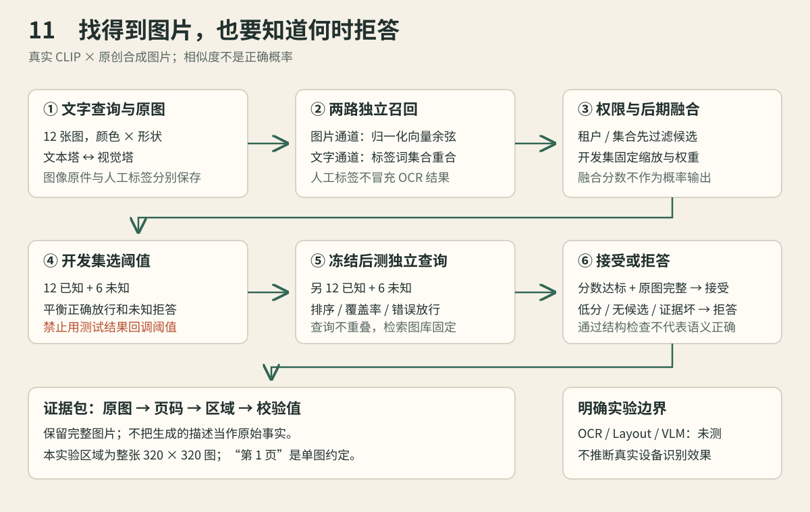
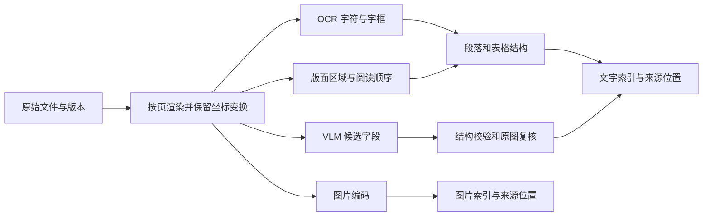
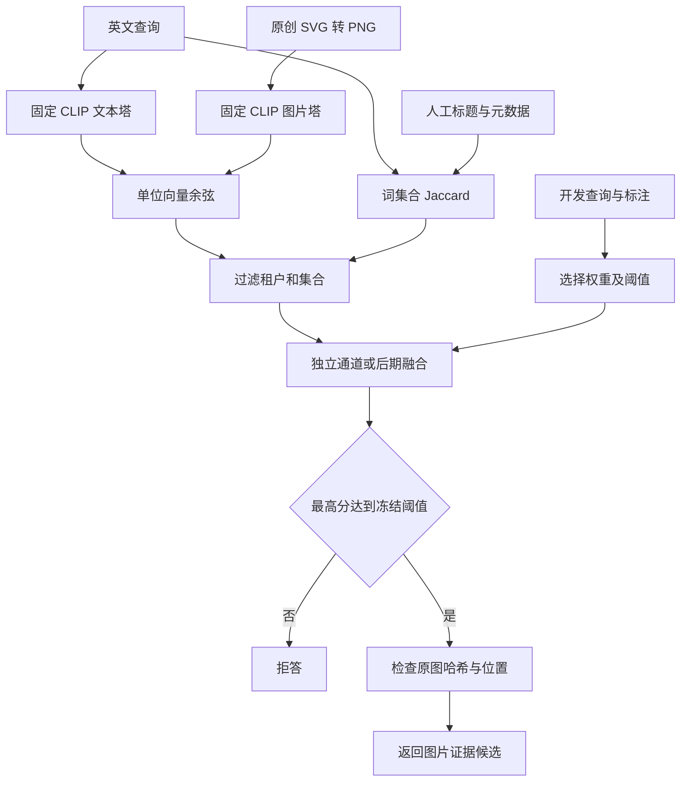
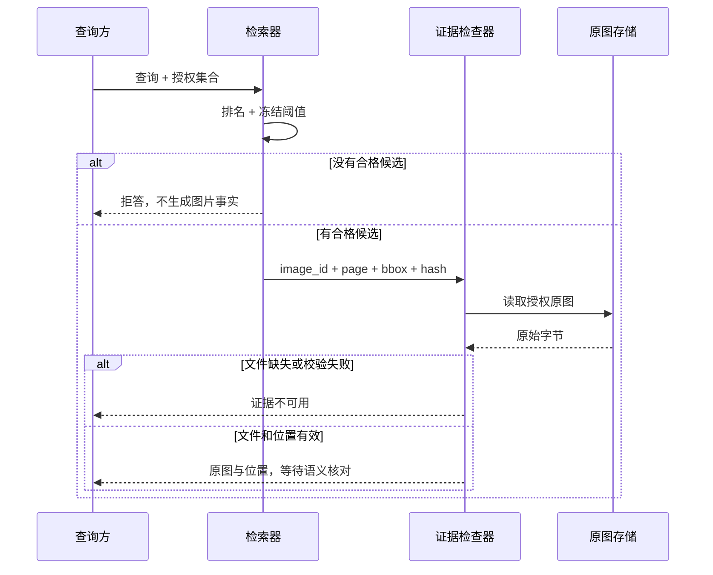

# 第 11 章｜多模态 RAG：从相似图片到可核对证据

> **本章目标：** 为文字查询找回图片，比较独立召回与融合，并用原图和拒答规则约束输出。  
> **难度等级：** L3。**预计学习时间：** 阅读约 60 分钟，实验约 60–120 分钟；不含依赖与权重下载。  
> **前置：** 第 09 章的向量、余弦相似度与召回指标，第 10 章的 RAG、来源引用与数据权限；会运行 Python。  
> **范围：** 讲解 CLIP、OCR、版面、表格、VLM、融合、校准与证据；实作是固定 CLIP 的**文搜图**与后期融合。OCR、Layout、VLM 抽取、图搜图和回答生成没有在本实验运行。  
> **学习成果：** 能画出双塔数据流，区分排序分数与概率，冻结开发集阈值，统计未知查询拒答，并给每个返回结果附原图位置。



## 1. 本章解决什么问题

设备说明书的接线图、报表中的曲线、工单中的照片，都可能包含正文检索找不到的证据。用户问“找一张这个部件的安装图”，答案不一定是一个段落。只索引文件名会漏掉没有标签的图片；把每张图片改写为文字，又可能丢失颜色、位置、结构或小字。

多模态 RAG 把不同形式的信息接入检索，再把证据交给回答环节。检索和回答必须分开验收：找到了相似图片，不代表找到了正确型号；能生成描述，不代表描述在图中存在。

| 输入资料 | 可以先做什么 | 主要遗漏 | 需要保留什么 |
|---|---|---|---|
| 有标题的产品图片 | 按标题或人工标签检索 | 同义表达与视觉细节 | 标签来源、原图 |
| 没有标题的图片 | 图片编码，与文字查询匹配 | 型号、小字、细微差别 | 编码器版本、原图 |
| 扫描说明书 | OCR 加版面分区 | 字符错误、阅读顺序错误 | 页码、字框、原始页面 |
| 表格和趋势图 | 提取结构，再做可核验计算 | 单位、轴、合并单元格 | 单元格或图表区域 |
| 多图多段复杂页面 | VLM 给候选结构化描述 | 生成图中不存在的细节 | 字段与原图区域的对应关系 |

如果数据很少，人工标注加目录浏览可能更可靠。本章不预设“多模态模型一定优于文字检索”，而是用同一组查询比较它们。

## 2. 先用大白话理解

可以把双塔看成两位图书管理员：一位读文字，一位看图片。两人把内容放到同一个坐标空间中，位置接近的内容可能相关。这是类比。真实坐标是模型训练得到的向量，不是“红色轴”“形状轴”这样的人类规则。

CLIP 用成对图片和文字进行对比学习，使对应图文的表示更接近。图片塔和文字塔独立编码，再投影到共同空间。该机制支持文字查图片，也支持用图片向量比较图片。它不自动返回物体框，不输出 OCR 字符，也不是会生成答案的聊天模型。双塔和对比训练的依据见 [CLIP 原论文](https://arxiv.org/abs/2103.00020v1)。

跨模态查询的关键是**表示对齐**。任意文本模型和任意图片模型即使输出同样长的向量，也不能直接点积后解释为相关性。图搜图可以使用同一图片塔；文搜图需要与图片塔共同对齐的文本塔。原始 CLIP 对特定场景、语言和细粒度任务的表现需要单独验证；本章只测试英文查询。

## 3. 核心术语

| 术语 | 中文解释与准确定义 | 容易混淆的概念 |
|---|---|---|
| 视觉 / 文本 Encoder | 将像素 / token 转成表示的编码器 | 不等于 OCR 或回答生成器 |
| 共同向量空间 | 经训练使跨模态相关内容可比较的表示空间 | 维度相同不代表语义对齐 |
| OCR | 从图像识别字符，通常伴随位置与识别分数 | 字符正确不代表阅读顺序正确 |
| Layout | 页内标题、正文、图、表的位置、层次与顺序 | 不等于把整页字串接起来 |
| VLM | 处理视觉与语言输入的模型；本章主要指可生成描述的视觉语言模型 | 生成 JSON 不等于事实正确 |
| Early Fusion | 在独立召回前融合不同模态的特征或 token | 不等于在结果排序后平均分数 |
| Late Fusion | 各路独立计算结果，再合并名次或分数 | 两路重复证据不能计作两次独立佐证 |
| 置信度校准 | 让预测概率与实际正确频率相符 | 分数缩放、阈值选择都不自动完成概率校准 |
| 原图证据 | 可定位、可读取且版本确定的原始图像区域 | 模型生成的图注不是原始事实 |

## 4. 工作原理

### 4.1 从输入到分数

文字查询先分词，经过文本塔与投影层，得到向量 `t`。原图按模型处理器要求缩放、裁剪、归一化，经过视觉塔与投影层，得到向量 `v`。将两个向量各自除以 L2 范数，得到单位向量。此时余弦相似度为：

```text
cosine(t, v) = dot(t / norm(t), v / norm(v))
```

本实验使用 `get_text_features()` 和 `get_image_features()`，然后显式做 L2 归一化。处理器随模型 revision 固定。接口与输出投影的定义见 [Transformers 4.48 的 CLIP 文档](https://huggingface.co/docs/transformers/v4.48.0/en/model_doc/clip)。原图是 320 × 320，模型配置使用 224 × 224 输入；模型读取处理后的像素，证据包仍保留原图坐标。

对 `N` 张已编码图片、`d` 维向量，精确点积扫描的计算量为 `O(Nd)`，向量存储量为 `O(Nd)`。本实验 `N=12`、`d=512`，不需要向量数据库。更大图库可以使用近似索引，但要额外验证近似召回损失、权限过滤和索引更新。推理开销还包括查询编码；首次下载和加载不能混入单次查询延迟的比较。

### 4.2 OCR、版面、表格与 VLM 怎样接入



这张图是工程扩展设计，**不是本实验已经运行的流水线**。

OCR 常见问题是把 `0` 读成 `O`、漏掉负号、拆开小数、把两栏文字串错。保留字符框和识别分数可帮助定位，但识别分数本身也不能证明字符正确。Layout 负责把标题、正文、图注、表格及顺序连起来。LayoutLMv3 展示了文字、图像和空间相关信息的联合建模方式，本章不训练或运行它。[LayoutLMv3 原论文](https://arxiv.org/abs/2204.08387v3)

表格不能仅存成无结构的句子。至少需要行列坐标、表头路径、合并单元格关系、数值、单位和来源框。趋势图还要记录横纵轴、刻度类型、图例和数据系列。把图表转成表格后再推理是一种可选路线，DePlot 原论文提出了这种分解；这不保证每张图表都能被正确还原。[DePlot 原论文](https://arxiv.org/abs/2212.10505v2)

VLM 可输出 `field/value/page/bbox` 等字段。接收端必须做三层检查：JSON 是否符合结构；字段值是否满足类型与单位要求；值是否能在指定原图区域确认。前两层通过也不能跳过第三层。LLaVA 给出了视觉编码器连接语言模型进行指令学习的路线；本章只引用其架构动机，不报告它的运行效果。[Visual Instruction Tuning 原论文](https://arxiv.org/abs/2304.08485v2)

例如图中只有“电压 24 V”，抽取器却生成“额定功率 240 W”，这就是无来源的补全。不要靠另一个生成模型的赞同直接放行。缺字段应返回空值或待复核；材料中的指令文字也只能作为资料，不能变成系统指令。

### 4.3 Early Fusion 与 Late Fusion

| 方式 | 融合位置 | 优点 | 代价和风险 | 本章是否运行 |
|---|---|---|---|---|
| 早期特征 / token 融合 | 独立召回之前 | 可学习文字与局部图像的细交互 | 需要匹配的模型；重编码与训练成本高 | 否 |
| 后期分数融合 | 各路打分之后 | 独立检查每路，容易退回单路 | 分数量纲不同，需要开发集验证 | 是 |
| 后期名次融合 | 各路排名之后 | 不直接相加不同量纲的分数 | 名次丢失分数间隔；仍需单独拒答依据 | 否 |
| 召回后联合重排 | 对候选图文再次建模 | 可只对少量候选做复杂交互 | 未召回的证据仍无法恢复 | 否 |

多模态领域对“早期”的边界并不完全一致。本章明确以“是否已完成独立召回”为分界。不要把普通标签检索加 CLIP 分数，称为训练了一个联合多模态模型。

本实验的文字路是人工标题的词集合 Jaccard，图片路是真实 CLIP。融合为：

```text
visual_scaled = clamp((visual_cosine - dev_min) / (dev_max - dev_min), 0, 1)
fused_score = alpha * visual_scaled + (1 - alpha) * lexical_score
```

`dev_min/dev_max` 只来自开发集查询对图库的余弦。`alpha` 只在开发集从 `0.25、0.5、0.75` 中选。这个缩放用于让两路分数可组合，**不是概率校准**。新增图片、换模型或换处理器可能改变分布，需要重新验证；不能每次按测试查询的最高分缩放后还沿用旧阈值。

### 4.4 相似度、阈值与校准

候选集合内 softmax 的值会随候选改变。即使所有候选都错，它仍会把概率质量分给这些候选。所以“最高候选 90%”不能直接解释为“答案有 90% 正确率”。CLIP 的 logit 缩放也不是业务正确率保证。

阈值开发集包含已知查询和图库外查询。对每路分别枚举阈值，使以下目标最大：

```text
objective = (known_correct_accept_rate + unknown_reject_rate) / 2
```

已知查询只有在首位相关、且分数达标时才算正确放行。未知查询只要没有返回结果就算拒答。并列规则、候选阈值和权重都在代码中固定；测试集只使用冻结参数。

如果产品需要概率，应另做校准：在开发数据上拟合温度缩放或其他校准器，用独立样本检查可靠性分箱、Brier 分数等，再观察不同模态、语言和来源下的偏差。校准论文研究的是预测概率与实际正确率的对应，不是给任意检索分数加一个百分号。本实验样本太少，**没有拟合或验证概率校准器**。[On Calibration of Modern Neural Networks](https://arxiv.org/abs/1706.04599v2)

## 5. 架构与流程

### 5.1 本实验实际执行的架构



实验先对整套小图库算分，再在排名前过滤候选。生产系统还应在读取对象和执行检索前限制可访问范围，避免越权图片进入缓存、日志或模型。过滤器不能代替认证；本实验的固定 `tenant=course` 只是逻辑示例。

### 5.2 从召回到原图的证据链



证据元数据至少包括：文档 ID、图片 ID、文件版本、原图路径或对象标识、页码、坐标系、区域、内容哈希、提取方式、模型版本、租户和授权范围。生产裁剪还需要记录从模型输入坐标到原始页面坐标的变换。

本实验约定单张图片是第 1 页，区域是整图 `[0,0,320,320]`，不是模型检测出的目标框。标签字段的来源写为 `author_annotation_not_ocr`。单图约定不能直接套到 PDF；PDF 要保留真正的页码与渲染尺寸。

## 6. 工程实现

### 6.1 选型与完整代码

完整可运行代码位于 [实验目录](../labs/multimodal_rag/README.md)，关键逻辑没有省略实现。标准库处理数据校验、排序、阈值和评测；真实 CLIP 才需要独立依赖。

```text
labs/multimodal_rag/
  generate_data.py        # Original SVGs and annotations
  render_data.cjs         # Pinned SVG renderer
  data/manifest.json
  data/queries.json
  data/images/            # Editable SVG and model-input PNG
  model-lock.json
  requirements.txt
  run_clip.py             # Real model inference, no fake fallback
  retrieval.py            # Ranking, thresholds, evidence checks
  test_retrieval.py       # Offline tests
  results/                # Scores, decisions, logs, report
```

模型是 LAION 的 OpenCLIP `CLIP-ViT-B-32-laion2B-s34B-b79K`，固定 revision `1a25a446712ba5ee05982a381eed697ef9b435cf`。权重约 605 MB，属于基础 CLIP，并非微型移动模型。权重未进入仓库。模型来源、用途限制见 [固定 revision 模型卡](https://huggingface.co/laion/CLIP-ViT-B-32-laion2B-s34B-b79K/blob/1a25a446712ba5ee05982a381eed697ef9b435cf/README.md)；同一 LAION 模型卡明确标注 MIT 许可。早期 OpenAI 权重实验保留在报告中，因其模型卡未单独声明权重许可，没有作为最终选型。

### 6.2 安装和运行

先运行默认离线测试。此路径不下载模型，也不使用网络：

```sh
python3 -m unittest discover -v -s labs/multimodal_rag -p 'test_*.py'
python3 labs/multimodal_rag/retrieval.py labs/multimodal_rag/results/raw_scores.json --output /tmp/multimodal-replay.json
```

运行真实模型需要 Python 3.12 独立环境；完整安装命令见实验 README。已有依赖时，本地模型命令如下：

```sh
HF_HUB_OFFLINE=1 TRANSFORMERS_OFFLINE=1 TOKENIZERS_PARALLELISM=false /tmp/leanagentbook-vector-py312/bin/python labs/multimodal_rag/run_clip.py --model-dir /tmp/leanagentbook-multimodal-laion-model --output /tmp/multimodal-new-run
```

这条路径是本次机器的环境位置，其他机器应换成自己创建的 `/tmp` 环境。首次下载要显式传 `--download`。默认失败时直接报错，不会换随机向量、哈希向量或其他模型继续生成报告。

### 6.3 数据与异常处理

[标注集](../labs/multimodal_rag/data/queries.json) 在推理前固定：开发集 18 条，测试集 18 条；每集 12 条已知、6 条未知。图片是原创合成数据，标签来自生成规则。所有已知查询只有一个正确图片；未知查询的相关列表为空。

这两组查询检索相同图库，测试的是固定图库上的查询表述变化。因许可可追溯性，正式模型从早期 OpenAI 权重切换为 LAION 权重；没有改查询或拟合规则。测试集已在早期模型上看过，所以不是完全盲测，详见实验报告。它不是按图片分组的独立测试，也没有验证新设备泛化。人工标题与标注都由同一生成规则产生，文字基线有明显便利条件，不能当作真实 OCR 效果。

`validate_queries()` 检查 ID、文本重复、空查询、划分和标注关系。`fit()` 拒绝把测试查询送进阈值拟合。`rank()` 拒绝非有限分数和维度不符。`verify_evidence()` 检查路径不能越过数据根目录，并检查文件、哈希、页码和区域。文件有效后，仍需核对图中是否真有查询所需内容。

### 6.4 实测结果：保留失败才有教学价值

2026-11-20 使用真实 LAION CLIP，CPU、FP32、两线程运行；包版本和全部逐项分数见 [原始记录](../labs/multimodal_rag/results/raw_scores.json)。开发集决定参数后，测试集结果如下：

| 通道 | Recall@1 | Recall@3 | 已知正确放行 / 12 | 已知错误放行 | 未知拒答 / 6 | 放行结果正确率 |
|---|---:|---:|---:|---:|---:|---:|
| 图片余弦 | 11/12 | 12/12 | 11/12 | 0 | 6/6 | 11/11 |
| 人工标题词集合 | 12/12 | 12/12 | 0/12 | 0 | 6/6 | 不适用：没有放行 |
| 后期融合 | 12/12 | 12/12 | 10/12 | 0 | 6/6 | 10/10 |

这里每个已知查询只有一个相关项，所以 Recall@K 等于相关图片进入前 K 名的查询比例。排序指标在阈值前计算；正确放行率在阈值后计算。不能把二者混为一谈。

开发集选出的图片阈值是 `0.31384522`，文字阈值是 `1/3`，融合权重 `alpha=0.75`，融合阈值是 `0.70065268`。这些值是这次数据的产物，不是 CLIP 通用阈值。

纯图片通道把绿色方形误排成绿色三角形，分数未达阈值，因而拒答。文字路排序全部正确，但测试表述变长且有同义替换，所有已知查询都落到开发集阈值以下。融合纠正了图片路这次排序错误，却仍拒绝绿色圆形和绿色方形；正确放行只有 10/12，少于图片路的 11/12。**这次融合的排序更好，但放行覆盖率更差，不能称为整体提升。**

未知拒答 6/6 只说明六个构造查询的结果。假设样本独立同分布，Wilson 95% 区间的下界约为 61%；而本样本是人工构造，连代表性也未建立。因此不能写成“能可靠拒绝所有未知图片”。完整失败列表见 [实验报告](../labs/multimodal_rag/results/REPORT.md)。

## 7. 工程案例

### 7.1 扫描说明书中的接线图

假设用户问“找出 A 型控制器的电源接线图”。先按型号、文档版本、授权集合过滤，再通过 OCR 标题、正文引用和图片向量召回。返回原页和图区域，并确认图注确实属于 A 型。图片很相似，但版本或型号不符时不能用来回答。

如果 OCR 把 `A-10` 读成 `A-IO`，文字路可能漏召回；图片路可能补到结构相似的图。但也可能补到不同电压型号。这时融合提高召回，不能代替型号与电压的原图复核。该案例是设计说明，未在本实验中运行。

### 7.2 设备照片中的疑似故障

用户上传一张表面裂纹照片，希望查维修案例。图搜图可以先找外观近邻；工单文字可补充部件、材料、工作条件。返回应是“相似案例及其证据”，不能仅凭外观宣布故障原因，更不能自动形成设备操作指令。

正式验证至少要按设备、拍摄批次和来源拆分数据，避免同一照片的裁剪版同时出现在开发集和测试集。还要加入正常部件、陌生设备、模糊照片和不同光照。这里的几何图实验没有覆盖这些条件。

## 8. 方案对比与设计取舍

| 方案 | 优点 | 缺点 | 合适场景 | 不合适场景 |
|---|---|---|---|---|
| 人工标签检索 | 便宜、可解释 | 标签维护成本，漏同义词 | 少量稳定图片 | 大量无标签图片 |
| CLIP 独立召回 | 不依赖每图写说明 | 细节与语言需要验证 | 视觉语义候选检索 | 精确数值与型号判定 |
| OCR 加文字 RAG | 能保留正文与数字 | 字符和顺序错误会传播 | 扫描资料 | 纯视觉关系 |
| 后期融合 | 易比较、易记录单路贡献 | 阈值和量纲会漂移 | 已有多条索引 | 没有标注集却宣称质量提升 |
| VLM 生成图注再索引 | 便于接入文字流程 | 图注丢信息或捏造细节 | 生成候选描述后复核 | 把生成描述当唯一原始证据 |

若一个通道失效，不能默默用另一通道并沿用融合阈值。可以返回证据不可用，或切换到**单独验证过**的降级通道。每个通道都应有自己的指标与版本。

## 9. 生产环境注意事项

**稳定性与更新。** 图片、处理器、模型、索引、阈值是一组配套版本。更新模型后重编码；替换原图后重做哈希和派生结果。删除原图要同步删除向量、图注和缓存，避免返回失效证据。实验没有实现完整增量更新服务。

**性能与成本。** 图片可离线编码；查询编码在线完成。OCR、VLM 和高分辨率页面处理常比简单索引更贵。按真实请求记录加载时间、编码时间、检索时间、证据读取时间和资源消耗。本次报告不是吞吐压测，也不代表尾延迟。

**安全与权限。** 来源文字可能含恶意指令。将其作为证据，不执行其中命令。授权信息不能由用户随意指定后直接相信；读取对象、召回候选、返回图片和日志记录都要遵循同一权限边界。

**可观测性。** 保留查询 ID、过滤条件、每路分数、融合参数、阈值版本、被拒原因、原图版本和耗时。不要只保存最终答案。日志也可能含敏感图片或个人信息；应按业务许可与最小必要范围留存。

**幻觉与证据。** VLM 可能生成无法在图中找到的内容，这一问题有专门的研究和评测；本章没有实测其发生率。[多模态幻觉研究](https://arxiv.org/abs/2309.14525v1) 原图存在、JSON 合法和模型之间意见一致，都不足以证明字段正确。关键字段应逐项核对，无法核对时保留不确定性。

## 10. 动手实践

### 目标与前置条件

复现三路结果，能指出“排序正确但被拒答”与“错误图片被放行”的区别。离线部分需要 Python 3.11+；真实推理需要模型依赖、足够磁盘空间和一次下载权限。

### 实践步骤

1. 打开原始 SVG 和 PNG，核对颜色、形状、页码与整图区域；这是原始图证据，不是应用 UI 验收。
2. 阅读查询标注，确认 dev/test 各有已知和未知。解释为什么“粉色三角形”在图库中没有答案。
3. 运行离线测试和回放。核对报告中的分母，特别是文字路没有放行时正确率为空，而不是 100%。
4. 在独立环境运行真实 CLIP，把新结果写 `/tmp`，比较模型与数据哈希。浮点细微差异要记录，不要改旧结果。
5. 找到绿色方形的错误首位图片，打开它与应返回图，解释阈值为什么拒答。再打开报告中的早期 OpenAI 实验，检查两次错误放行；不要混淆两个模型。
6. 另存一份实验数据，设计新的开发集表述和**全新保留测试集**，研究文字通道的长度敏感性。当前测试集已经曝光，不能再称为未见测试集。

### 验收标准

- 能从文字描述画出文本塔、视觉塔、归一化、候选过滤、融合和证据检查的数据流。
- 离线 12 项测试通过；证据损坏、越界路径、错误页码、非有限分数和划分泄漏都被拒绝。
- 模型 revision、文件校验值、真实分数、数据标注、冻结阈值和每条测试判定齐全。
- 同时报告排序、已知正确放行、已知错误放行、未知拒答与放行正确率，不用单一漂亮数字替代。
- 能说明每个返回结果的原图路径、页码、区域与哈希，并指出结构完整不代表语义正确。
- 明确标注合成数据、人工标签和未运行模块；不宣称真实设备、中文查询或完整多模态问答已经验收。

### 常见错误与扩展挑战

常见错误包括：混用不同模型的向量、忘记归一化、把人工标题叫作 OCR、在测试集调阈值、在没有候选时仍输出答案、把整图坐标叫作检测框，以及把图库中最像的图片当作“确定存在”的证据。

扩展时可加入真实许可可追溯的图像，采用分来源拆分；也可运行真实 OCR，比较人工标题和识别文字的质量。图搜图可复用图片塔，但必须新增独立查询图片与标注，不能用同一张图库图片查自身后宣称泛化优秀。完成扩展前，保持它们为未验证项。

## 11. 本章总结

CLIP 提供跨模态相关性表示，OCR、Layout 和 VLM 解决不同问题。融合需要数据支持，不能只凭演示判断更好。阈值选择和概率校准是两件事，原图检查与语义核对也是两件事。保留单路结果、未知查询和失败案例，才能知道系统在什么地方可用。

本章完成了真实模型文搜图、独立召回与融合、阈值开发、未知拒答统计及原图证据检查的教学实验；没有完成 OCR/VLM 抽取服务或生产多模态 RAG。第 12 章继续讨论数据管线，第 14 章进一步讨论评测设计。这里的章节交付不代表全书 24 章已经完成。

## 12. 参考资料与核验记录

下列资料均在 **2026-11-20** 通过官方文档、模型仓库或原始论文核验。支持结论限定如下；本章不复制论文中的准确率来代表本实验。

| 一手来源 | 版本 / 标识 | 支持的结论 |
|---|---|---|
| [CLIP 原论文](https://arxiv.org/abs/2103.00020v1) | arXiv v1，2021 | 图文对比学习、双编码器与跨模态表示 |
| [OpenAI CLIP 官方仓库](https://github.com/openai/CLIP) | 官方仓库核验日快照 | 双塔实现与使用入口；仅确认仓库代码 MIT 许可 |
| [固定 CLIP 模型卡](https://huggingface.co/laion/CLIP-ViT-B-32-laion2B-s34B-b79K/blob/1a25a446712ba5ee05982a381eed697ef9b435cf/README.md) | revision `1a25a446…` | LAION ViT-B/32 变体、MIT 许可与用途限制；完整 revision 见锁文件 |
| [CLIP API](https://huggingface.co/docs/transformers/v4.48.0/en/model_doc/clip) | 4.48 文档；实跑 4.48.3 | 两类 feature API 和投影输出；实验显式归一化 |
| [LayoutLMv3](https://arxiv.org/abs/2204.08387v3) | v3，2022 | 文档文字与图像联合预训练；仅用于设计解释 |
| [DePlot](https://arxiv.org/abs/2212.10505v2) | v2，2023 | 图表转表格再推理的任务分解；未在本实验运行 |
| [Visual Instruction Tuning](https://arxiv.org/abs/2304.08485v2) | v2，2023 | 视觉编码器与语言模型连接的指令学习路线 |
| [On Calibration of Modern Neural Networks](https://arxiv.org/abs/1706.04599v2) | v2，2017 | 概率校准问题和温度缩放；不提供本实验阈值 |
| [Aligning Large Multimodal Models with Factually Augmented RLHF](https://arxiv.org/abs/2309.14525v1) | v1，2023 | 多模态生成存在不受图像支持的内容，需独立评测 |
| [本地实验记录](../labs/multimodal_rag/results/REPORT.md) | 合成数据 v1，2026-11-20 | 本章表中结果、样本数量、失败案例与运行边界 |
