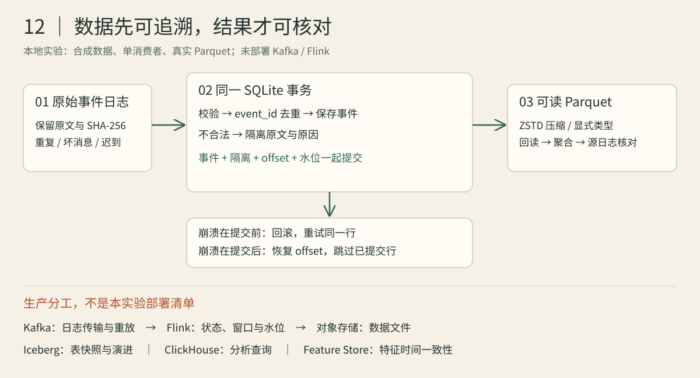
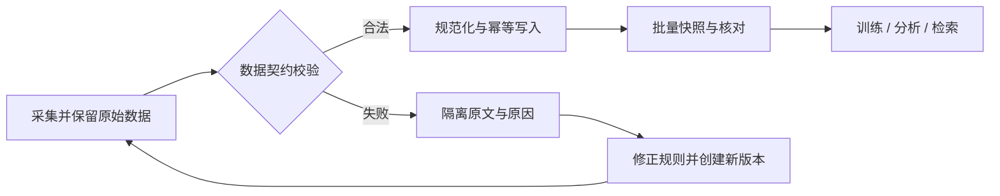
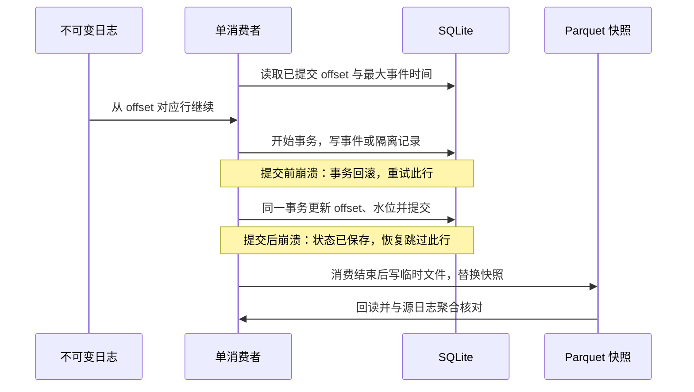
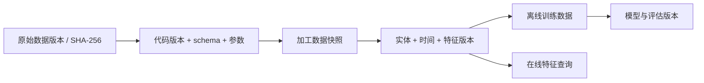

# 第 12 章｜AI 数据工程与数据基础设施

> 本章目标：把事件日志变成可追溯、可重放、可核对的数据集。  
> 难度：L2–L3。建议学习时间：3–5 小时，含故障实验。  
> 前置：Python 文件操作、JSON、SQL 事务；建议先读第 09–10 章。  
> 范围：数据质量、批流分工、存储与特征链路；实现单机流式模拟与真实 Parquet。没有模型调用，不部署 Kafka、Flink、Iceberg 或 ClickHouse。

学习成果：能写出事件契约；能解释 offset 与业务幂等键的差别；能在崩溃后恢复；能用源数据核对结果；能报告有计时边界的吞吐、延迟与文件大小。



## 1. 本章解决什么问题

设备在断网后补传昨天的事件，采集网关又重复发送了一批消息。分析页面显示任务量增加，训练集也多出重复样本。如果只检查“管道没有报错”，这两个错误都可能被遗漏。数据工程要回答三个问题：每条数据从哪里来，经过什么变换，失败后如何恢复。

可以把管道理解为收货、验货和入库。原始事件是运单，schema 是验收条款，offset 是收货进度，业务 ID 是货物身份。但运单类比不能表达分区顺序、事务隔离和事件时间。严格来说，数据管道是把输入记录映射为输出记录及状态的程序。恢复必须同时考虑这些输出和状态。

小数据可以先用文件和 SQLite。代价是单机容量、单消费者以及手工运维。本章先把正确性做成可检验的程序，再讨论何时需要分布式组件。

## 2. 数据契约与质量

| 类型或术语 | 准确定义 | 本章例子与常见混淆 |
| --- | --- | --- |
| 结构化数据 | 有明确列和类型的记录 | SQLite 表；有类型不等于值正确 |
| 半结构化数据 | 带键、层级或标签，但记录结构可变 | JSON 事件；能解析不等于符合业务 schema |
| 非结构化数据 | 没有直接可查询的统一记录结构 | 图片、音频、PDF；仍需对象 ID、来源、权限等元数据 |
| Schema | 字段、类型、可空性与兼容规则 | `event_time` 是 UTC 秒，不能突然改成毫秒 |
| 质量 | 完整性、合法性、唯一性、及时性与一致性 | 缺 ID、负值、重复 ID、迟到、总数不一致分别统计 |
| 血缘 | 输入、变换与输出之间可追溯的关系 | 源文件散列、代码散列、参数、结果快照 |

实验的版本 1 契约如下。所有事件均为程序生成的合成数据，不代表真实设备。

| 字段 | 约束 | 失败处理 |
| --- | --- | --- |
| `schema_version` | 整数 1，不接受布尔值 | 未支持的版本进隔离表 |
| `event_id`、`device` | 非空字符串，最长 80 字符 | 隔离并保存原文 |
| `event_time` | UTC 整数秒，落在生成器允许区间 | 超界隔离，避免未来时间污染水位 |
| `value` | 0–100 的整数，不接受布尔值 | 超界、类型错误隔离 |
| 额外字段 | 当前版本忽略 | 不自动赋予新含义 |

相同 ID 且规范化内容相同，视为重复投递。相同 ID 但内容不同，视为冲突，隔离后者。不要用 `INSERT OR IGNORE` 静默吞掉冲突。本章先查询已存内容再判断；这依赖单消费者假设，多写入者需要重新设计并发约束。

## 3. 从 ETL 到批流处理



| 方案 | 顺序 | 优点 | 代价与适用边界 |
| --- | --- | --- | --- |
| ETL | 抽取→变换→加载 | 输出契约集中管理 | 变换错误可能阻塞加载；适合确定的下游格式 |
| ELT | 抽取→加载→变换 | 保留原始数据，便于重算 | 原始层也要权限与保留策略；适合多种消费需求 |
| 批处理 | 对有界输入运行一次 | 容易核对整批结果 | 新数据要等待下一批；适合离线训练与日汇总 |
| 流处理 | 持续消费输入并维护状态 | 可以较快更新结果 | 乱序、迟到、状态恢复更复杂；适合告警与实时指标 |

这些不是互斥阵营。可以先保存原始日志，再实时更新视图，最后用批处理核对。本实验按行消费有限文件，模拟流式状态更新；所有事件提前生成，不模拟网络到达速率或消息队列积压。

Kafka 的核心职责是分区日志、传输、保留和重放；消费者用 offset 表示分区内位置。Flink 的核心职责是有状态计算、窗口与时间推进。Kafka 也有 Streams 等计算能力；这里按职责分工，不把产品能力压成绝对边界。跨外部数据库的正确性还取决于接收端协议，不能从“支持事务”直接推出所有副作用只发生一次。[Kafka 4.1 设计文档](https://kafka.apache.org/41/design/design/)

事件时间表示事情发生的时间，处理时间表示程序处理它的时间。水位用于表达事件时间的处理进展，不是“旧数据以后绝不会来”的自然定律。本实验将已见最大事件时间减 30 秒作为简化水位；落在它之前的记录标记 `late=1`，仍保留并进入离线聚合。没有关闭窗口、空闲分区检测或多分区水位协调。[Flink 2.1 时间概念](https://nightlies.apache.org/flink/flink-docs-release-2.1/docs/concepts/time/)

## 4. 文件、表与查询引擎各管什么

| 层次 | 负责什么 | 不能替代什么 |
| --- | --- | --- |
| Object Storage，对象存储 | 用键保存对象及元数据 | 不是关系数据库；本实验本地文件并未验证云存储语义 |
| Parquet | 列式文件、类型、行组与压缩 | 单个文件不提供跨文件事务或业务去重 |
| Data Lake，数据湖 | 保存多格式原始与加工数据的体系 | 单有文件目录不等于有质量和治理 |
| Lakehouse，湖仓架构 | 在湖上组合表管理、查询与治理能力 | 不是某一种文件扩展名 |
| Iceberg | 管理表元数据、快照和演进 | 不是对象存储，也不是独立查询引擎 |
| ClickHouse | 面向分析的数据库与查询执行 | 不等于 Parquet 文件或 Kafka 日志 |

Parquet 把文件组织为行组与列块，元数据帮助读取目标列。实验使用 PyArrow 20.0.0 写入 ZSTD 压缩文件，再用同一库解码全部字段；检查 `PAR1` 标记只是辅助证据，不能替代真正读取。[Parquet 文件结构](https://parquet.apache.org/docs/file-format/)；[Arrow 20.0 读写说明](https://arrow.apache.org/docs/20.0/python/parquet.html)

Iceberg 用字段 ID 跟踪列，支持添加、删除、重命名等 schema 演进，并支持分区演进。变更前仍要检查读写引擎兼容性，不能把业务含义变化当成简单改名。本实验没有创建 Iceberg 表。[Iceberg 1.10.0 演进文档](https://iceberg.apache.org/docs/1.10.0/evolution/)

ClickHouse 的 MergeTree 系列以数据 part 组织数据，并在后台合并。排序键影响数据布局和查询裁剪；不要照搬关系数据库中“主键必然唯一”的假设。本章只介绍选型职责，没有测量其性能。[MergeTree 官方文档](https://clickhouse.com/docs/reference/engines/table-engines/mergetree-family/mergetree)

## 5. 实验如何保持一致



关键不变量：offset 之前的每一行，都已在同一个事务里完成接受、重复判定或隔离。事件表以 `event_id` 为主键；隔离表以源行号为主键。进度持久化到 SQLite，重启不会从内存猜测进度。日志 SHA-256 必须匹配，否则拒绝复用状态，避免把旧 offset 应用到另一份文件。

测试用子进程 `os._exit` 在事务提交前和提交后强制退出。前一种退出后 offset 为 3，后一种为 4；恢复后全部行处理完成，与无故障运行逐行一致。随后把 offset 设回 0，重放全部原始行，业务结果仍不增加。

这个保证只覆盖一个 SQLite 数据库内的输出和状态，以及本地进程崩溃。它不覆盖磁盘损坏、断电、网络分区、多消费者、外部 HTTP 副作用或机器永久丢失。Parquet 是消费结束后生成的可重建快照，不参与消费事务。临时文件加替换避免正常读取看见半文件；未验证断电下目录项持久性，不声称跨文件事务。

## 6. 工程实现与复现

完整可执行代码在 [pipeline.py](../labs/data_engineering/pipeline.py)，测试在 [test_pipeline.py](../labs/data_engineering/test_pipeline.py)，不需要从正文拼接片段。

```text
labs/data_engineering/
  pipeline.py           # Generator, consumer, reconciliation, Parquet export
  test_pipeline.py      # Process crashes, replay, contract failures, real Parquet
  requirements.txt      # pyarrow==20.0.0
  README.md
  results/              # Published synthetic input, Parquet, metrics and test logs
```

先运行仅用标准库的恢复测试。缺少 PyArrow 时，只跳过真实 Parquet 用例：

```sh
python3 -m unittest discover -s labs/data_engineering -p 'test_*.py' -v
```

真实文件实验使用独立 Python 3.12 环境，不改项目根 `.venv`。标准库代码适用 Python 3.11+；固定 PyArrow 版本的安装另受该版本 wheel 支持范围约束。

```sh
python3.12 -m venv /tmp/leanagentbook-data-engineering-venv
/tmp/leanagentbook-data-engineering-venv/bin/pip install -r labs/data_engineering/requirements.txt
/tmp/leanagentbook-data-engineering-venv/bin/python -m unittest discover -s labs/data_engineering -p 'test_*.py' -v
/tmp/leanagentbook-data-engineering-venv/bin/python labs/data_engineering/pipeline.py --output /tmp/data-engineering-run-01 --count 2000 --parquet
```

输出目录必须不存在，避免覆盖已有证据。输出包含源 JSONL、SQLite、真实 Parquet 和 `metrics.json`。改变目录名即可重新运行。未安装 PyArrow 时可以不传 `--parquet`，但这只能完成标准库实验，不能据此宣称完成 Parquet 验收。

`decode` 执行契约；`consume` 每行提交一次，便于展示恢复边界；`oracle` 从源日志重新去重并聚合；`export_parquet` 用显式 Arrow schema 写入并回读。核对器与消费者共享契约函数，因此不是完全独立的第三方验证；测试另用固定数量与冲突样本断言，避免只比较两次相同错误。当前代码全量加载部分数据到内存，重启也扫描前面的行，不适合无限大日志。生产应采用分段源、检查点和分批导出。

## 7. 血缘、版本与特征



实验的 `metrics.json` 保存输入散列、代码散列、生成器版本、数量和运行环境。真实项目还要登记父数据集、转换作业 ID、负责人、权限、删除策略与输出散列。只记文件名不够：同名文件可能被改写。

增加可选字段通常比改变字段类型更容易兼容。旧事件缺少新字段时，明确使用空值还是默认值；不要将缺测量值默认为 0。把整数温度从摄氏度改为华氏度，即使类型没变，也必须建立新语义版本。先双读验证、回填新版本，再切换读者并保留回滚路径。

Feature Engineering 是把原始记录转成可供模型使用的特征，例如“某设备过去 10 分钟的告警数”。Feature Store 管理特征定义、离线历史与在线服务的协作，不自动保证模型有效。训练时应只连接预测时刻已可获得的特征，不能把未来信息加入过去样本。Feast 的 point-in-time join 按历史时刻重建特征值，但真实系统还要处理源数据到达时间与修订策略。本实验没有部署特征库。[Feast 时间点连接文档](https://docs.feast.dev/getting-started/concepts/point-in-time-joins)

## 8. 抽样、分区、压缩与冷热取舍

| 手段 | 适用方式 | 风险与验收办法 |
| --- | --- | --- |
| 抽稀 | 高频信号按时间窗口保留代表点 | 可能丢掉短暂峰值；同时保留窗口 min/max/count |
| 抽样 | 固定种子随机抽样，或按设备、异常类别分层 | 稀有故障可能消失；报告每层原始数量与采样比例 |
| 分区 | 按常见过滤条件，如日期，做粗粒度拆分 | 按每个事件 ID 分区会产生大量小文件；测文件数和扫描字节 |
| 列裁剪与行组 | 读取所需列，用统计信息减少扫描 | 效果依赖数据排列和查询；验证实际读取量 |
| 压缩 | 比较同一数据的无压缩、Snappy、ZSTD | 压缩省字节但消耗 CPU；报告编码耗时与读取耗时 |
| 冷热分层 | 热数据快速访问，历史转冷层 | 恢复延迟与费用上升；用真实回取演练验证服务目标 |

本实验输出一个 Parquet 文件，行组 512 行，ZSTD 压缩。没有实现分区湖、分层存储，也没有做多种压缩算法对比。JSONL 与 Parquet 的大小差异还包含字段名重复、去重和隔离的影响，不能把该比值称为纯压缩率。

## 9. 工程案例与生产检查

通用案例：客服系统把点击、检索、人工修订事件保存为原始日志。实时分支给出近时段查询量，离线分支构造评测与训练数据。去重规则、权限和时间边界一致，两个分支才能核对。机器人场景同理：断网补传的任务事件应按事件时间回补历史汇总，不能全部算作今天新发生的任务。

上线前把质量计数、隔离比例、消费滞后、处理时间、事件年龄、重试和存储增长分开监控。为隔离队列安排处理责任，否则只是把故障藏到另一张表。原文可能含敏感信息，生产隔离表需要最小权限、脱敏展示与保留期限；本实验只有合成字段。

数据恢复要联合验证源保留期限和检查点备份。源日志已过期时，光有 offset 无法重放。对外部服务的副作用采用幂等键或事务发件箱，并单独注入故障。不要把本章的单机一致性结果外推为端到端 exactly-once。

## 10. 动手实践与验收

练习目标：说明重复投递、坏消息和迟到各自怎样改变结果，亲自复现崩溃后的不丢失与不重复。前置条件是可用 Python 3.12、独立虚拟环境及本地写入权限。

1. 先跑标准库测试，再安装固定依赖跑全部测试。
2. 运行 2,000 个唯一事件的实验，打开 JSON 指标，核对 offset、隔离数与唯一事件数。
3. 运行两个崩溃窗口，阅读测试中的退出码与中间 offset 断言。
4. 查看 SQLite 的 `quarantine` 原因；比较迟到事件和源日志中相应时间。
5. 将样本扩大十倍，保存到新目录，比较吞吐与大小，不覆盖原结果。
6. 扩展一个可选字段，设计旧事件读取策略；然后故意改为不兼容版本，验证隔离而非静默转换。

| 验收项 | 必须见到的证据 |
| --- | --- |
| 实际格式 | PyArrow 成功回读所有字段，文件首尾 `PAR1`，行数与聚合一致 |
| 不丢失 | 两个崩溃窗口恢复后，与无故障结果一致；offset 覆盖所有源行 |
| 不重复 | 输入重复消息和全量重放都不增加唯一行数、计数与和 |
| 质量 | 坏 JSON、类型错误、未知 schema、冲突 ID 有隔离记录 |
| 迟到 | 迟到计数非零，事件仍进入正确事件时间分钟的离线聚合 |
| 性能 | 保存样本数、硬件、计时边界、原始秒数、吞吐、延迟和字节数 |

常见错误：用 `.parquet` 后缀伪装 JSON；写输出成功前提交 offset；把迟到当坏消息丢弃；用处理时间代替事件时间；重放后只看程序退出码。分别用真实读取、崩溃测试、迟到断言、时间分桶与数值核对发现问题。

扩展挑战：实现一个有界内存的分批 Parquet 导出器。以每批唯一文件名与清单发布快照，给“文件写完但清单未更新”注入崩溃。明确清理孤立文件的规则，而不是把新增文件数当成正确性证据。

## 11. 本次实测与限制

本次 2,030 行输入得到 2,000 条唯一事件、10 条隔离记录和 20 条迟到标记。消费耗时 0.429881 秒，吞吐 4,722.23 行/秒，单行提交延迟 p95 为 0.260291 毫秒。JSONL 为 196,728 字节，真实 Parquet 为 16,532 字节。环境为 Apple M4、10 逻辑 CPU、Python 3.12.14、PyArrow 20.0.0。

消费计时含文件遍历、解码和每行提交，不含初始化；延迟不含队列等待和事件年龄。只有一次样本，不报告为生产性能。

原始结果、测试输出和复现说明见 [实验 README](../labs/data_engineering/README.md) 与 [测量 JSON](../labs/data_engineering/results/run-2000/metrics.json)。这些结果只代表一次本地合成负载。逐行提交刻意强化可观察的故障边界，不是生产吞吐优化方案。没有负载发生器、排队延迟、网络、长期运行或多机基准。

必须掌握：先定义契约；原始数据要能追溯；offset 和业务 ID 各司其职；事件与进度共同提交；迟到要有明确政策；文件格式不等于表管理；性能数字必须带边界。第 09–10 章的检索质量依赖这里的来源与版本，第 14 章可以继续建立评估集，第 16 章将恢复问题扩展到长任务与外部副作用。

## 12. 参考资料

以下一手来源于 2026-11-20 核验。版本号表示本章使用的文档版本，不表示最新版本。只引用概念与契约，没有把文档能力写成实测结果。

| 来源 | 版本 / 日期 | 支持结论 |
| --- | --- | --- |
| [Kafka Design](https://kafka.apache.org/41/design/design/) | 4.1 文档 | 日志、消费位置、交付语义及接收端边界 |
| [Flink Timely Stream Processing](https://nightlies.apache.org/flink/flink-docs-release-2.1/docs/concepts/time/) | 2.1 文档，页面标识 2.1.1 | 事件时间、处理时间、水位与乱序 |
| [Apache Parquet File Format](https://parquet.apache.org/docs/file-format/) | 在线规范，核验当日 | 行组、列块、元数据与文件标记 |
| [Apache Arrow Python Parquet](https://arrow.apache.org/docs/20.0/python/parquet.html) | 20.0.0 | 实际读写、压缩、行组与类型 |
| [Iceberg Evolution](https://iceberg.apache.org/docs/1.10.0/evolution/) | 1.10.0 固定文档路径 | 字段 ID、schema 与分区演进 |
| [ClickHouse MergeTree](https://clickhouse.com/docs/reference/engines/table-engines/mergetree-family/mergetree) | 滚动文档，无固定服务版本 | 数据 part、后台合并、排序与索引 |
| [Feast Point-in-time joins](https://docs.feast.dev/getting-started/concepts/point-in-time-joins) | 滚动文档，无固定运行版本 | 历史特征连接与时间一致性 |
| [Akidau 等，The Dataflow Model](https://www.vldb.org/pvldb/vol8/p1792-Akidau.pdf) | PVLDB 8(12)，2015 原始论文 | 无界乱序数据中正确性、延迟和成本的权衡 |

Dataflow 论文提供设计框架：系统必须明确何时给出结果、如何处理后来的修订，以及愿意承担多少延迟与状态成本。它不证明本章实现具有分布式能力，也不替代本地测试。
