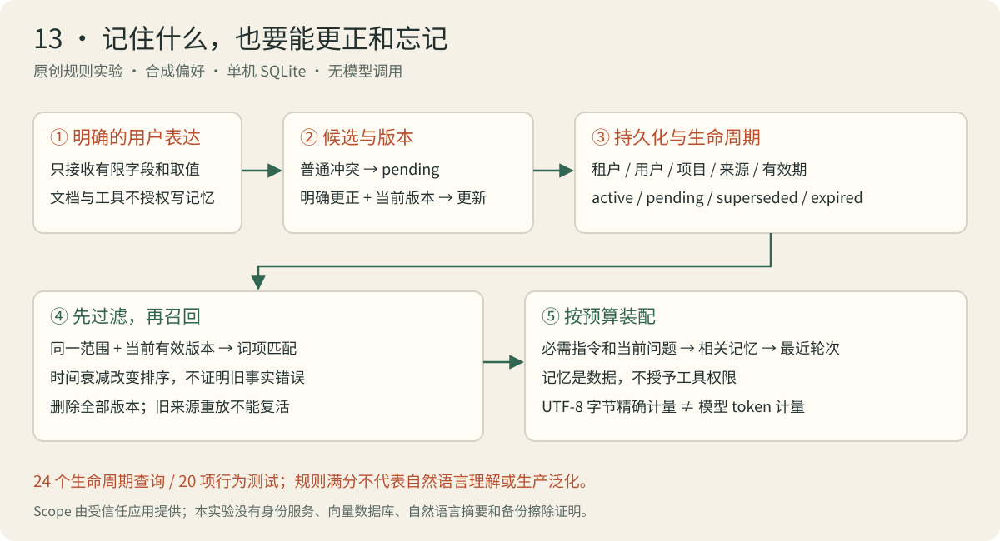
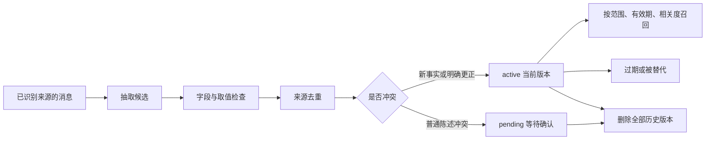
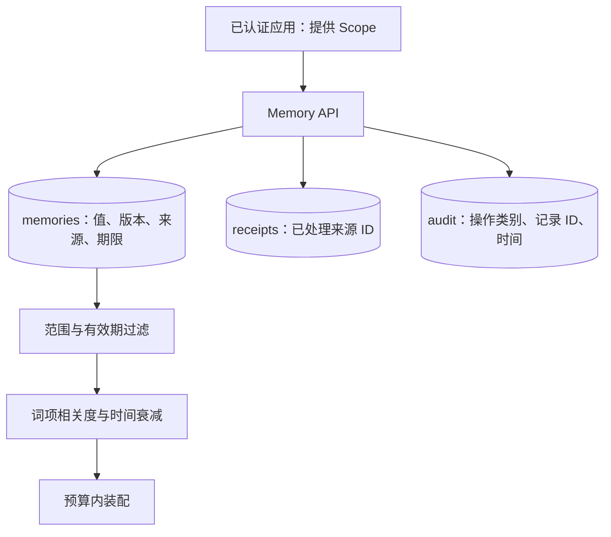
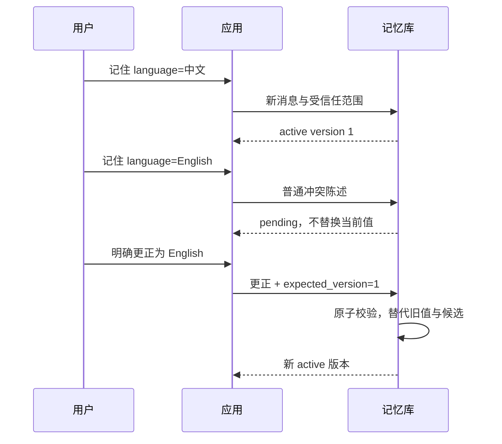

# 第 13 章｜Agent Memory 与 Context Engineering

[返回首页](../README.md) · [课程进度](../ROADMAP.md)

> 目标：选择性保留有用信息，并把当前任务真正需要的内容装入上下文。
> 前置：理解 Agent 循环、结构化数据和数据库事务；能运行 Python 3.11+。
> 学习结果：能区分上下文、状态与长期记忆；实现抽取、持久化、冲突处理、召回、过期、删除和预算；用带金标的查询检查错误记忆。
> 范围：原创标准库实验，用明确语法和有限取值抽取合成用户偏好。它不使用 LLM、语义向量或真实身份服务；预算单位为 UTF-8 字节，不是模型 token。

## 1. 先看一个会出错的助手

用户先说“报告用表格”，后来改成“用段落”。如果系统只不断追加聊天历史，两个要求会同时出现。如果系统只取语义相似度最高的一条，旧偏好可能因为文本更相似而胜出。如果删除只作用于原始记录，旧摘要或缓存仍可能把旧偏好带回来。

本章采用一个虚构巡检助手。它记住语言、报告格式、单位制和站点四类偏好；每条都属于特定租户、用户与项目。先限制记忆范围，再证明更新和删除成立。记录更多不自动等于回答更好。



| 系统需要回答的问题 | 最少需要的证据 |
|---|---|
| 这条记忆属于谁？ | 受信任的 tenant、subject、project |
| 为什么能把它当作候选？ | 来源消息标识、抽取规则、明确表达 |
| 和原有记忆矛盾怎么办？ | 当前版本、候选状态、更正依据 |
| 现在还能用吗？ | 有效期、状态、当前访问范围 |
| 删除真的生效了吗？ | 版本已移除、新召回为空、旧来源重放不能复活 |
| 放进上下文了吗？ | 本次装配的记录 ID、版本和预算测量 |

## 2. Context、State 和 Memory

可以把上下文想作桌面，长期记忆想作资料柜。桌面容量有限，每次工作只摆必要资料。这个比喻不表示资料柜里的内容一定正确，也不表示模型在读过一次后永久学会了它。

| 概念 | 本章定义 | 例子与限制 |
|---|---|---|
| Model context | 本次发送给模型的信息 | 指令、用户问题、工具契约、证据、历史；受上下文窗口限制 |
| Runtime context | 程序执行所需依赖与身份 | 数据库连接、已验证用户；不应把连接或密钥放进提示词 |
| State | 一次任务当前的运行状态 | 下一步、待审批请求、已获得工具结果 |
| Short-term memory | 当前会话的近期信息 | 最近完整轮次；与任务恢复检查点有联系，但不等于长期知识 |
| Long-term memory | 跨会话保留、按需读取的信息 | 偏好、经证实经验、可修正事实 |

LangGraph 将会话内状态与跨会话 store 区分；其运行上下文还包括不会直接进入模型的依赖。这是框架中的具体分工，不要求所有系统采用同名接口。[Memory 概念](https://docs.langchain.com/oss/python/concepts/memory)、[Context 概念](https://docs.langchain.com/oss/python/concepts/context)

| 长期记忆类型 | 保存什么 | 需要什么治理 |
|---|---|---|
| Semantic，语义记忆 | 事实和偏好，例如“报告用表格” | 来源、有效期、冲突和更正 |
| Episodic，情景记忆 | 某次任务的事件和结果 | 时间、环境、证据；不能把一次偶然成功写成普遍规律 |
| Procedural，程序记忆 | 经审查的操作方法或技能 | 版本、权限、测试和发布流程 |

“语义记忆”描述记什么，“语义检索”描述怎么找；两者不是同义词。本实验只实现有限偏好事实，不会从普通聊天自动生成可执行规则。用户偏好也不能改变工具授权。

## 3. 从候选到可用记忆



**Extraction，抽取：** 从信息中提出候选。候选不直接变成事实。真实 LLM 抽取应输出结构、来源位置与不确定性，然后经过应用规则校验；本章不用模型猜测用户意图。

**Consolidation，整理：** 去重、消解已确认的冲突、合并重复来源，保留可追踪的版本。摘要也属于派生产物，应能说明依据和覆盖时间。把十句话变短不等于消除了矛盾。

**Retrieval，召回：** 先确定可访问集合，再排序，最后装配。权限过滤不能等到私有文本已经进入模型之后才做。

**Update 与 Decay，更新与衰减：** 明确更正可替换旧版本；时间衰减只改变排序权重，不能证明旧事实已假。有效期是硬边界，过期后不参与召回。重要但很久没被问到的偏好，未必应该删除。

本实验采用 `active / pending / superseded / expired` 四种状态。普通冲突保留为 pending；明确更正同时提供所看到的当前版本，更新时再次检查，防止两个写入者相互覆盖。

## 4. 数据模型和存储分工



本章 `Scope` 是应用内部传入的范围，**不是认证令牌**。任意进程都能构造 Python 对象，因此不能把这个类当作登录或授权系统。对外 API 必须从验证后的会话映射 tenant、subject、project；本章测试证明查询按这些字段隔离，不证明身份提供方已接入。

| 存储 | 常见用途 | 权威性与取舍 |
|---|---|---|
| SQL | 记忆正文、版本、生命周期、删除事务、审计 | 适合明确约束；本实验用 SQLite 做单机持久化 |
| Redis | 会话缓存、短期工作集、限时条目 | TTL 可控制键到期；仍需定义持久化和缓存失效，不自动替代权威记录 |
| Vector store | 候选相似度检索 | 相似度不证明有效、授权或真实；结果应回查权威状态 |
| 对象存储 | 大型来源附件与归档 | 保留位置与访问范围；删除应联动派生索引 |

Redis `EXPIRE` 可以为键设定生存时间，但覆盖键等操作对期限的影响必须按具体命令核对。[官方 EXPIRE 文档](https://redis.io/docs/latest/commands/EXPIRE/)。本实验没有运行 Redis 或向量数据库。

SQLite 写入使用 `BEGIN IMMEDIATE`：版本检查、状态替换、来源回执和审计在一个事务中提交。SQLite 的单写事务语义使两个连接无法同时通过同一旧版本更新。[官方事务说明](https://www.sqlite.org/lang_transaction.html)

## 5. 原创实验：有意缩小抽取语言

完整实现：[memory.py](../labs/memory_context/memory.py)。输入必须是用户角色、整条消息匹配语法，并且 key/value 在白名单内：

```text
记住：language=中文
记住：format=表格
更正：language=English
```

| 字段 | 允许值 | 教学用途 |
|---|---|---|
| language | 中文 / English | 跨会话偏好 |
| format | 表格 / 段落 / 图解 | 冲突与更正 |
| units | metric / imperial | 短有效期与过期 |
| site | alpha / beta / gamma | 合成站点与范围隔离 |

“也许我喜欢表格”、工具返回的同样句子、文档引用和 `api_key` 字段都不进入记忆。白名单的代价是无法理解自由表达；它只证明确定规则下的生命周期，不证明自然语言抽取质量或通用敏感信息识别能力。

同一来源 ID 只处理一次。来源回执不含正文。删除正文后仍保留这个最小回执，从而阻止旧消息重放使记忆复活。新的明确消息可以建立新记忆。重复表达同一个值不延长有效期，避免重试意外让临时信息长期存在。



没有当前值时，更正需要 expected_version=0；存在当前值时必须使用其版本。pending 也占版本编号，所以后续有效版本可以从 1 跳到 3。版本是顺序标识，不是更新次数或置信度。

## 6. 召回、衰减和删除

本实验按字段别名匹配，例如“报告格式”匹配 format；这是一种可解释词项检索，不是 Dense Embedding。排序得分为：

`命中别名数 × 2^(-年龄秒数 / half_life)`

half_life 默认 86400 秒，只是教学参数。得分相同时按记录 ID 排序。先用 SQL 排除其他范围、非 active 和已到期条目，再计分。没有别名命中则返回空，不强行选一个“最近似”的记忆。

| 删除位置 | 本实验行为 | 更大系统必须追加的工作 |
|---|---|---|
| 当前和历史记录 | 同一范围同一 key 的全部版本删除 | 多数据存储事务或可重试删除任务 |
| 派生索引 | 没有独立向量索引 | 按源 ID 清除向量和检索缓存 |
| 新上下文 | 每次重新召回，不缓存正文 | 重建摘要，阻止旧缓存继续注入 |
| 来源回执 | 保留范围和来源 ID，避免旧事件复活 | 定义最小保留期及消息重放窗口 |
| 审计 | 不保留值、字段名或原文，只记录操作类别等 | 审计标识也需访问控制和保留策略 |
| 已交付内容和备份 | 不能撤回已构造的 Python 对象或外部副本 | 对导出、备份与已发送提示有单独保留和删除政策 |

代码启用 SQLite `secure_delete` 作为本地辅助措施，验收只检查逻辑记录与新召回结果；它没有验证 SSD 取证、系统快照或备份擦除。到期过滤也不等于物理清除过期行，需另配清理周期。本章不声称已经满足任何具体合规标准。

## 7. 上下文预算：先保留不可缺少的内容

```text
总预算
├─ 必须保留：system + 当前用户问题 + 固定结构
├─ 优先加入：本次相关、有效、获授权的记忆
├─ 剩余空间：最近完整对话轮次
└─ 预留空间：输出与后续处理的教学余量
```

本实验对最终 JSON 序列化后的 UTF-8 字节精确计数，包含引号、字段和转义开销；中文不是按一个字节计。函数返回 `used_bytes / reserve_bytes / budget_bytes`。**字节预算不能换名为 token 预算，也不能用于断言模型上下文没有超限。** 真实接入时应使用匹配模型的 tokenizer 或供应商输入计量接口，计入消息包装、工具 schema、图像等开销，并单独预留最大输出 token。

`context()` 先装 system 与 current_user。必需内容放不下就报错，不删除系统规则后继续。随后按召回顺序尝试完整记忆；放不下则跳过。最后从最新轮次向前加入完整 user/assistant 对；某个近期轮次过大时停止，不穿过它抽取更老片段。

| 控制手段 | 优点 | 损失与风险 |
|---|---|---|
| Sliding window | 结构简单，近期原文保持完整 | 更早约束可能丢失；不能切断 tool call/result 配对 |
| 摘录式摘要 | 保留原句，可定位来源 | 仍可能遗漏关键条件，长度压缩有限 |
| LLM 摘要 | 可压缩自然表达 | 会引入或遗漏事实，必须保留来源与版本 |
| Compaction | 将长会话重组为当前任务状态、约束、未完成项 | 需要证明新上下文能继续任务，而非只看摘要通顺 |
| 检索注入 | 按当前问题选择少量信息 | 依赖召回质量，不能把检索结果升级为系统指令 |

本代码实现的是白名单事实整理、相关记忆注入和最近完整轮次窗口。没有实现自然语言摘要器、tool 消息协议或 LLM compaction。记忆放在 `untrusted_memory` 字段；字段名只能表达数据边界，真正的工具权限仍由应用检查，不能指望一个标签消除所有提示注入。

## 8. 运行与质量评估

```sh
python3 -m unittest discover -s labs/memory_context -p 'test_*.py' -v
python3 labs/memory_context/memory.py
```

完整数据见 [dataset.json](../labs/memory_context/dataset.json)，实际结果见 [example-report.json](../labs/memory_context/example-report.json)。24 个查询贯穿空库、写入、冲突、更正、过期、跨用户/项目/租户、工具注入、删除；不是对一个静态问答复制 24 次。

| 指标 | 分母与判定 | 本次实际结果 |
|---|---|---:|
| 查询完全匹配 | 返回的 key=value 集合与金标完全相同 / 所有查询 | 24/24 |
| Precision | 正确返回记忆数 / 全部返回记忆数 | 16/16 = 1 |
| Recall | 正确返回记忆数 / 全部应返回记忆数 | 16/16 = 1 |
| 错误记忆率 | 错误返回记忆数 / 全部返回记忆数 | 0/16 = 0 |

零相关查询参与完全匹配率，但不增加 Recall 分母。任何返回的过期、跨范围或错误值都是 FP；遗漏当前正确值是 FN。上表是按所有查询的条目合并计算，重复查询出现的同一事实分别计数，不是“库中正确事实的比例”。无返回时 Precision 和错误记忆率为 null，不伪造满分。

标签只由评估器读取，Memory API 不接收 gold。测试还修改一个标签，确认分数下降。数据与规则来自同一作者且覆盖有限；满分不证明自由语言、未知用户或生产泛化。要比较真实抽取器，应增加独立标注的含否定、转述、条件变化和更正任务，并分别报告抽取、存储、召回及最终答案质量。

## 9. 工程取舍与生产边界

本实验每个范围最多四个有效字段，直接扫描后排序足够；复杂度近似 O(N log N)，N 是范围内有效条目数。历史记录、回执和审计会随写入增长，生产需要保留周期和索引，不应无限保留所有对话。

| 决策 | 本章选择 | 何时要更换 |
|---|---|---|
| 抽取 | 显式语法和有限取值 | 需要理解自由语言时接入经过独立评估的抽取器 |
| 冲突 | pending + 显式更正 + 版本比较 | 多来源事实需有效时间、来源优先级和人工争议处理 |
| 查询 | 字段别名 + 时间衰减 | 内容规模扩大、同义词不足时引入语义检索，再回查权限 |
| 持久化 | 单机 SQLite | 多主机并发、灾备与审计要求需要另选存储并测试 |
| 上下文 | 完整结构和字节上限 | 接真实模型时改为供应商实际 token 口径 |

身份、授权撤销、数据库加密、备份、并发删除、跨地域时间、索引一致性和真实模型安全都需要额外验证。此实现不提供任意文本记忆，也不执行由记忆给出的代码或工具指令。

## 10. 动手实践与验收

1. 运行数据集，解释为什么 24 个查询只产生 16 个应返回的记忆条目。
2. 插入“记住 language=中文”，再插入 English；确认第二条只是 pending，当前值不改变。
3. 使用旧版本更正，确认事务拒绝；使用当前版本更正，确认只有一个 active 值。
4. 推进测试时钟到有效期边界，确认刚好到期就不再召回，不依赖清理任务。
5. 删除字段，检查当前和历史版本均移除；重放旧 source_id 不能复活；新消息可再次明确记住。
6. 用包含中文与引号的输入验证完整 JSON 字节数，减小预算，确认不会截断一条事实或丢掉 system。
7. 修改一条测试金标为错误值，观察完全匹配率下降，再恢复数据。

**验收：** 20 项行为测试通过；实际 CLI 返回 24/24；修改金标能产生失败；不同范围互不召回；过期和删除生效；审计没有原文；字节预算包含序列化开销；未把脚本抽取称为真实语义理解。详见[验证记录](../labs/memory_context/VALIDATION.md)。

**常见错误：** 新消息总覆盖旧值；把相似度当事实置信度；重复读取延长所有有效期；删除正文却保留摘要；用缓存 TTL 替代权限检查；将字符数称为 token；无返回时报告 100% Precision。

## 11. 继续扩展

先引入独立的自然语言标注集，再接真实抽取器。比较多轮更正、否定、引用、条件生效和冲突仲裁；测 false memory 对最终答案的影响。之后增加有来源的摘要、token 计量、向量召回和删除传播。每一步保留现有生命周期测试，不能为提高召回率而放松权限或过期过滤。

## 12. 参考资料与证据状态

访问与核验日期：2026-11-20。正文设计、数据、状态机和代码为本书原创。

| 官方资料 | 支持的结论 | 本次验证边界 |
|---|---|---|
| [LangGraph Memory 概念](https://docs.langchain.com/oss/python/concepts/memory) | 会话与跨会话记忆；语义、情景、程序类型 | 滚动概念文档，未安装框架 |
| [LangGraph Context 概念](https://docs.langchain.com/oss/python/concepts/context) | 运行依赖与模型上下文的区别 | 不复制版本敏感的 SDK API |
| [SQLite Transaction](https://www.sqlite.org/lang_transaction.html) | 单写事务与 IMMEDIATE | 实际 SQLite 存取和多连接测试；未做机器断电验证 |
| [Redis EXPIRE](https://redis.io/docs/latest/commands/EXPIRE/) | 键期限与覆盖操作边界 | 概念比较，未运行 Redis |
| [本地实验与数据卡](../labs/memory_context/README.md) | 规则、样本、指标与复现契约 | 合成偏好与字节预算，不是真实模型质量结论 |
