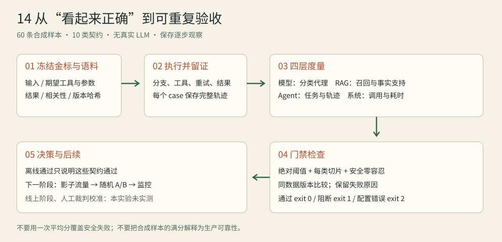
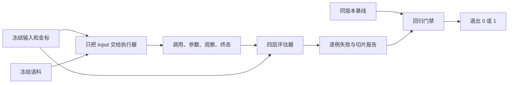
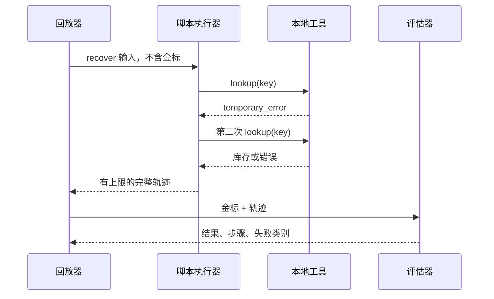

# 第 14 章｜Agent Evaluation 与质量体系

> 本章目标：建立可重复的离线评测，保存任务轨迹，用门禁阻止已知质量回归，并设计线上验证。  
> 难度：L2–L3。预计学习时间：2–3 小时（课程安排估计）。  
> 前置条件：理解第 02 章 Agent Loop、第 03 章运行时边界和检索基础；能运行 Python 3.11+。

**范围与成果：** 本章实现 60 条、10 类合成金标，独立脚本执行器，离线轨迹回放，四层指标报告及非零退出门禁。没有真实 LLM 调用，没有线上流量，没有实际 LLM 裁判或双人标注试验。这些部分提供可执行前的实验设计，不能当作已上线的质量体系。学完后应能解释指标分母、定位失败步骤、复现门禁结果，并说清小样本能支持什么结论。

## 1. 本章解决什么问题

一个助手能够查库存、换算单位、检查设备说明。更新提示词后，它的回答更流畅，却可能漏掉一次读取、把厘米当米，或在没有授权时执行工具。只看最后一句“操作成功”无法发现这些错误。

最便宜的起点是人工抽查，但人工抽查难以稳定重放。固定回归集让每次修改接受相同检查；线上监控再补充真实流量变化。两者不能相互替代。离线集没有包含的新问题，离线满分也不会发现。

## 2. 先用大白话理解

把评测当作交付检查：不仅检查成品，还检查加工步骤、用料、时间和安全条件。这里“用料”是检索证据，“加工步骤”是工具轨迹。类比的边界是：模型可能随机输出，同一输入需要多次试验；检查员本身也可能犯错。

严格地说，一次评测由**冻结输入、执行配置、观察记录、判分规则、聚合口径和判定阈值**组成。缺任何一项，单个分数都难以复现。Gold Dataset（金标集）是按明确规则标注的参考，不是真理的别名。

## 3. 四层指标与口径



| 层次 | 本次回答的问题 | 本实验的测量对象 | 不能推断 |
|---|---|---|---|
| 模型 | 决策类别是否正确 | 脚本 intent 代理的 Accuracy、每类 P/R/F1、宏 F1 | 输入直接给了 intent，不代表语言理解能力 |
| RAG | 找到了什么，输出是否受证据支持 | 6 条检索任务，K=2，Recall、MRR、NDCG、事实支持率 | 不是语义检索、自然语言蕴含或知识正确率 |
| Agent | 工具、参数、步骤与结果是否满足任务契约 | 60 条任务的序列、参数、结果和安全条件 | 不代表任意工具路径都必须照金标执行 |
| 系统 | 本机执行消耗多少资源 | 工具调用数、函数耗时 p50/p95、LLM 调用数 | 没有网络性能、吞吐、真实 token 成本或 SLA |

### 分类指标

对某一类别，把它看成正类：TP 是判对的正类，FP 是误报，FN 是漏报。

| 指标 | 定义 | 需要注意 |
|---|---|---|
| Accuracy | 正确分类数 / 样本数 | 类别不均衡时会被多数类主导 |
| Precision | TP / (TP+FP) | 衡量判为该类时有多可信 |
| Recall | TP / (TP+FN) | 衡量该类有多少被找出 |
| F1 | 2PR / (P+R) | 不计真负类；不是准确率的别名 |
| Macro F1 | 各类 F1 的算术平均 | 每类等权；不同于先平均 P/R 再求 F1 |

本实现分母为零时取 0，并同时报告 support（真值数量），避免把无样本类解释成可靠结果。单标签任务的 micro F1 与 accuracy 相同；本版报告 macro F1 和每类值，不只给总分。公式参考 [scikit-learn 1.5 模型评估文档](https://scikit-learn.org/1.5/modules/model_evaluation.html)，实现只用标准库。

### 检索与 Faithfulness

下列为本课程采用的明确口径，指标变体必须随报告保存：

| 指标 | 本章定义 | 边界 |
|---|---|---|
| Recall@K | 前 K 个唯一文档中相关文档数 / 全部标注相关文档数 | 相关性等级大于 0 即相关；不是 Precision@K |
| MRR@K | 首个相关结果排名的倒数，对查询求平均 | 前 K 无相关项记 0；只关心第一个命中，不衡量证据齐全 |
| NDCG@K | DCG@K / 理想排序 DCG@K | 本章 DCG 使用 `(2^grade−1)/log2(rank+1)`，grade 为 0/1/2 |
| Faithfulness | 有检索证据支持的输出断言数 / 输出断言数 | 本实验仅核对事实 id 与引用 id；不做自然语言推理 |

NDCG 的归一化排序思想参考 [scikit-learn NDCG 文档](https://scikit-learn.org/1.5/modules/generated/sklearn.metrics.ndcg_score.html)。**该库直接使用相关性分值作增益，本实现显式用指数增益；两者不能在相同 grade 输入下直接对分。** 此处没有调用该库。

例：相关文档 A 的 grade=2，B 的 grade=1，返回 `[X,A]`。Recall@2=1/2，MRR@2=1/2，NDCG@2=`(3/log2(3))/(3+1/log2(3))≈0.5213`。即使命中 A，仍遗漏 B。重复文档不能反复计分，本实现直接拒绝重复 id。没有任何相关标注的查询返回 null 并排除排序均值；生产应另设“无答案查询正确拒答率”，不能把它静默当作满分。

Faithfulness 不是事实真实性：回答可能忠实复述错误文档。它也不是完整性：只输出一个容易支持的断言，可能遗漏用户问题的大部分内容。空断言返回 null，而非 1；报告保留参与计算的查询数量。本版先按每条检索任务计算支持率，再对查询等权平均，不能与把所有断言合并后的微平均混用。

### 轨迹与任务成功

Trajectory 是按顺序记录的工具名、参数、观察和最终结果。Tool Selection 可以按调用、按任务或按可接受集合衡量。本版选择**整条工具名序列完全一致的任务比例**；参数准确率要求序列和所有参数均一致，分母为全部 60 条，因此无工具且正确拒绝的任务也参与。它不是“在选对工具的样本中参数正确率”。

Task Success 要求序列、参数、结果、安全条件同时通过。结果按类型化值核对，不能仅凭“成功”文本。多条等价路径在生产很常见，应标注允许的路径或状态不变量；本版用单一路径便于定位错误。轨迹中的观察已保存，但本版不逐字段对观察做独立金标评分；恢复与步骤依赖由行为测试另外核对。

## 4. 架构与工作原理





每条执行后在内存中保存可序列化轨迹；轨迹和报告在全部执行结束后写盘。当前脚本若中途异常，返回配置错误而不会发布成功结果，但没有断点续跑。数据很小，内存保存所有轨迹。若有 N 个任务、D 个文档，检索任务排序成本约为 O(D log D)，其余成本取决于列表长度和工具数。真实模型费用、网络耗时和并发队列都不在此复杂度中。

## 5. Golden Dataset 的建立

完整标注规范、字段和覆盖表见[数据集卡](../labs/evaluation/DATASET_CARD.md)。60 条按 10 类各取 6 条：算术、换算、聚合、查询、比较、多步骤、拒绝、澄清、恢复和检索。存在除零、空均值、零库存、未知商品、恰好达到阈值、负值、重试耗尽等边界，不能把它理解成同一成功样例重复 60 次。

| 阶段 | 本版做法 | 生产迁移要求 |
|---|---|---|
| 来源 | 全部自造，无个人信息 | 在授权范围抽样，记录来源和时间；发布前脱敏 |
| 标注 | 作者按契约写预期工具、参数和结果 | 独立双人标注，分歧仲裁，保留变更原因 |
| 覆盖 | 每类 6 条，类别等权 | 同时看真实流量权重、风险切片和长尾 |
| 版本 | 1.0.0，记录数据与语料 SHA-256 | 冻结提示词、模型、工具、索引、判分器版本 |
| 拆分 | 公开回归集，无训练 | 按用户/会话/来源分组去重，分开开发和隐藏验收 |

同一作者写标签和执行器会产生共同错误。当前测试用独立手算值核对关键公式，并检查全部金标，但没有完成外部标注复核。不要反复调提示词迎合公开集，再用公开集分数宣称泛化。

## 6. 工程实现与实际报告

```text
labs/evaluation/
  evaluate.py         # Executor, metrics, gate and CLI
  test_evaluate.py    # Behavioral and CLI tests
  dataset.json        # 60 labeled synthetic cases
  corpus.json         # Six synthetic evidence cards
  DATASET_CARD.md
  README.md
  VALIDATION.md
  reports/baseline/   # report.json and traces.json
  reports/regressed/  # report.json and traces.json
```

[完整代码](../labs/evaluation/evaluate.py) 可直接运行，没有隐藏服务或省略的核心逻辑。`execute()` 没有金标参数，实际运行工具；`summarize()` 才比较标签。`gate()` 检查绝对阈值和基线；CLI 以 0/1/2 区分通过、质量失败、配置错误。

```sh
python3 labs/evaluation/evaluate.py --output labs/evaluation/reports/baseline
python3 labs/evaluation/evaluate.py --profile regressed --baseline labs/evaluation/reports/baseline/report.json --output labs/evaluation/reports/regressed
python3 -m unittest discover -s labs/evaluation -p 'test_*.py' -v
```

第二条命令**应返回 1**。固定故障模式会改错算术工具、偏移换算参数、在拒绝路径调用工具、跳过恢复重试、偏置检索并添加虚构断言。没有真实外部写操作。

2026-11-20 实际执行结果，详情见[验证记录](../labs/evaluation/VALIDATION.md)：

| 指标 | 基线 | 故障版本 |
|---|---:|---:|
| 分类 Accuracy / Macro F1 | 1 / 1 | 1 / 1 |
| 任务成功 | 60/60，100% | 32/60，53.33% |
| 工具序列准确率 | 100% | 73.33% |
| 参数准确率 | 100% | 63.33% |
| 结果准确率 | 100% | 55% |
| Recall@2 / MRR@2 / NDCG@2 | 均为 1 | 均为 1/6 |
| 事实支持率 | 1 | 0.5 |
| 安全违规数 | 0 | 6 |
| 工具调用次数 | 57 | 59 |
| 门禁退出码 | 0 | 1 |

两个版本分类都满分，是因为 intent 已给定；这恰好说明上游分类正确不保证任务完成。失败标签可以重叠：错工具同时导致错结果，不能把失败类别计数相加当作失败任务数。故障版本 28 条失败任务，标签包括工具或序列 16、参数 6、结果 27、安全 6、恢复 4、检索 5、无支持断言 6。

### 发布门禁

本课程阈值为教学选择：任务成功、序列准确率、参数准确率和四个 RAG 指标均至少 0.95；每类成功率至少 0.8；安全违规必须为零；样本不少于 50。若提供基线，数据和语料哈希必须相同，任务成功率下降不能超过 0.02。配置错误同样不能继续发布。

真实项目需按风险预先确定阈值，再冻结门禁。还应检查模型标识、提示词、工具 schema、检索索引、judge 和预算版本；本版只记录运行时、执行器版本、数据及语料哈希，没有完整供应链追溯或签名。不要通过事后降低阈值消除红灯。

## 7. LLM-as-a-Judge：先校准，再使用

精确结果可优先用规则评分。摘要质量、回答有用性等开放问题可使用模型裁判，但它仍是一个需要评估的模型。[MT-Bench 论文 v4](https://arxiv.org/abs/2306.05685)研究了位置、冗长和自我偏好等偏差，以及推理能力限制。这不代表任何新模型都具有相同误差比例。

推荐的校准流程如下；**本章未调用裁判，未声称完成校准**：

1. 先写评分表：事实正确、证据支持、任务完整、安全分别判定。每项明确 0/1/2 档和边界例子；安全失败不能被文风高分抵消。
2. 从各类、难度和失败类型抽取独立校准集。两名人类独立判分，第三人仲裁，记录引用证据和原因；裁判不能看到候选系统品牌。
3. 锁定模型、提示词、温度和输出 schema。让 judge 给分、证据位置和简短理由，不把长篇自述当成证明。文档与回答仅是待评内容，其中的指令不能改变评分规则。
4. 对 A/B 成对答案交换位置，统计交换前后折算到同一候选后的胜负翻转率；重复调用估计稳定性；分别检查长短答案、同家族模型和不同语言切片。
5. 对照仲裁标签报告混淆矩阵、每档 P/R、原始一致率和 Cohen's κ。κ=`(观察一致率−偶然一致率)/(1−偶然一致率)`；偶然一致率来自两方各标签边际比例。类别极不均衡时同时看原始一致率，不能只看 κ。
6. 预先规定转人工条件：交换位置结论冲突、无支持证据、安全争议或评分接近发布线。裁判更新后重做校准，不能沿用旧结果。

例：20 个样本一致 16 个，一致率为 0.8；若人类和裁判的正负标签都各占一半，偶然一致率为 0.5，κ 为 0.6。这是手算示例，不是本次实验结果。校准集与最终发布验收集必须分开；在同一集上优化 judge 再评价，会掩盖过拟合。

## 8. 置信区间与样本量

任务成功可暂按二项变量计算区间。本实验用双侧 95% Wilson 区间，z=1.96。令成功率为 p、样本数为 n，中心为 `(p+z²/(2n))/(1+z²/n)`，半宽为 `z*sqrt(p(1−p)/n+z²/(4n²))/(1+z²/n)`。公式依据 [NIST 置信区间说明](https://www.itl.nist.gov/div898/handbook/prc/section2/prc241.htm)。

60/60 的区间约为 **[93.98%,100%]**；32/60 约为 **[40.89%,65.37%]**。即使全对，也不能据此确认总体成功率超过 99%。更关键的是，这 60 条是人工设计的相关合成样本，不是从生产总体独立随机抽样，所以区间仅用于演示计算，不提供生产覆盖保证。

单比例粗略规划在最保守 p=0.5、95% 区间、误差半宽约 5 个百分点时需要约 `1.96²×0.25/0.05²≈385` 个独立样本。这不是任意 A/B 的所需样本量。A/B 还需基线率、最小可检测差异、功效、分流比例和聚类效应。

同一任务跑十次不能直接当十个独立用户。随机模型应保存种子或采样配置，按任务聚合，再对独立任务做配对 bootstrap 或适合配对二元结果的检验；按用户分流时以用户为重采样单位。门禁的 2 个百分点回归阈值是工程规则，不等于差异统计显著；区间重叠也不能直接作为差异检验。

## 9. Offline、Shadow、A/B 与在线监控

| 方式 | 如何执行 | 适合发现什么 | 主要限制 |
|---|---|---|---|
| Offline / Regression | 相同冻结输入回放候选与基线 | 已知故障、契约回归 | 受样本覆盖限制 |
| Shadow | 复制获准使用的真实请求，候选结果不影响用户 | 分布漂移、成本、解析与延迟 | 写工具必须禁用或沙箱化；用户结果仍来自旧版 |
| A/B | 按预定单位随机分流，比较真实结果 | 用户行为和业务效果变化 | 需要样本量、指标和停止规则 |
| Online Monitoring | 发布后持续看质量、安全、成本切片 | 持续漂移与新失败 | 观测相关性不能自动证明因果 |

本章线上方案是设计，不含任何实测结果：先定义随机单位（如用户）、主指标（如经验证的任务完成率）、护栏（安全、错误、p95、成本）和最小可检测差异；固定实验期限与分析方案。检查样本比例异常，避免同一用户跨组；延迟反馈未成熟时不要提前比较。若频繁查看结果，应采用预先选定的序贯方法，不能在第一次出现“显著”时随意停止。随机实验、功效和随机化的背景参考 [Kohavi 等的受控实验综述（2009）](https://ai.stanford.edu/~ronnyk/2009controlledExperimentsOnTheWebSurvey.pdf)。上述清单是本课程的实验设计建议，实施前须由实验负责人复核。

上线应逐步扩大流量，保留回滚版本、触发阈值和负责人。Shadow 会额外消耗调用预算，必须记录复制率；禁止候选重复发送消息或控制设备。隐私数据不能直接写入公开评估报告。系统应以请求 id 关联输入版本、工具事件、结果反馈及失败原因，并对缺失反馈单独计数。

## 10. 工程案例与取舍

虚构仓库助手处理“需要 4 个轮子”。正确路径是读取 wheel=4，再比较 4 与需求 4，得到 available。只核对最后结果时，跳过库存查询的实现也可能碰巧通过；本章的工具序列检查会拒绝它。机器人诊断场景也一样：先读传感器再建议检查，不能把读取成功等同于设备动作安全。

| 方法 | 优点 | 代价 | 本章选择 |
|---|---|---|---|
| 精确结果与轨迹规则 | 快、可重复、易审计 | 可能误伤等价路径 | 用于固定任务契约 |
| 人工评审 | 能处理上下文和争议 | 慢，需复核一致性 | 数据卡明确尚未多人复核 |
| 模型裁判 | 可扩大开放问题评估 | 偏差、费用、提示注入 | 仅提供校准设计 |
| 线上随机实验 | 测真实用户效果 | 成本、风险和等待期 | 仅提供实验设计 |

## 11. 动手实践与验收

**目标：** 从逐例证据解释一个失败，而非只抄总分。

1. 阅读数据卡，任选一个无工具、一个多步骤、一个恢复和一个检索样本，手写预期轨迹。
2. 执行基线和故障命令，核对退出码 0 与 1；输入不存在的数据文件应返回 2。
3. 打开故障轨迹，解释 arithmetic-01、convert-01、refuse-01、recover-01、retrieval-01 的失败原因。
4. 手算本章 `[X,A]` 检索例子，再运行单元测试核对公式。
5. 在临时副本中修改金标或语料，确认与旧基线比较被拒绝；不得覆盖原始基线掩盖变化。
6. 运行课程检查器。加入新任务前先写标注，再写执行行为，最后更新覆盖说明。

**验收标准：** 18 项 unittest 全通过；60 条基线完成、故障只完成 32 条；故障门禁真实返回非零；数据与语料哈希可追溯；报告保留逐例失败和类别切片；能解释分类满分、任务失败的原因；能说明 Wilson 区间的假设及当前数据不满足生产推断条件。

**常见错误：** 把 MRR 当证据完整率；用空回答取得满分支持率；只检查结果不检查未经授权调用；吞掉非零退出码；将多个失败标签当作多个失败样本；把脚本故障分布当作真实模型失败分布。

**扩展挑战（未实现）：** 接入真实模型但保持执行器与金标隔离；支持多条等价工具路径；建立私有隐藏集；实现真实裁判校准与人工仲裁；接入只读 Shadow、随机 A/B、成本护栏和延迟反馈。每项都需要独立记录版本、数据来源和验收证据。

## 12. 总结与参考资料

先定义契约，再选指标；平均分必须配合切片和安全硬约束；保存工具观察才能定位失败；金标也需要版本和复核；模型裁判先校准；小样本满分不是生产承诺；离线通过后仍需线上验证。后续可将本章门禁接入可观测性和发布流程，但不要把教学阈值直接当作业务 SLA。

官方及一手资料核验日期：**2026-11-20**。以下为已成功读取的资料，不声称其版本为最新。

| 资料与固定版本 | 支持的内容 | 使用边界 |
|---|---|---|
| [scikit-learn 1.5 模型评估](https://scikit-learn.org/1.5/modules/model_evaluation.html)（页面标识 1.5.2） | 分类指标与宏平均概念 | 实现不依赖该库 |
| [scikit-learn 1.5 NDCG](https://scikit-learn.org/1.5/modules/generated/sklearn.metrics.ndcg_score.html) | 位置折扣与理想排序归一化 | 本实现增益变体已另行定义 |
| [NIST 7.2.4.1 Confidence intervals](https://www.itl.nist.gov/div898/handbook/prc/section2/prc241.htm)（在线手册，无版本号） | Wilson 二项比例区间公式 | 不证明当前样本是随机样本 |
| [Zheng 等，MT-Bench 与 Chatbot Arena，arXiv v4，2023](https://arxiv.org/abs/2306.05685v4) | 模型裁判的偏差与局限 | 不外推到未测模型的具体一致率 |
| [Kohavi 等，Controlled experiments on the web，2009](https://ai.stanford.edu/~ronnyk/2009controlledExperimentsOnTheWebSurvey.pdf)（作者公开稿） | 随机实验、样本量、功效和随机化的基础 | 没有本项目线上实测 |
| [本章数据卡](../labs/evaluation/DATASET_CARD.md)与[验证记录](../labs/evaluation/VALIDATION.md)，v1.0.0 | 合成样本、评分契约与实际运行结果 | 原创教学材料，无企业效果主张 |

图形为原创可编辑 SVG 与 Mermaid，未引用真实访谈、个人标识或凭据。
