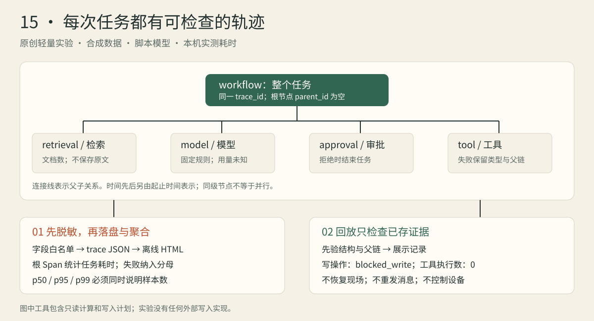
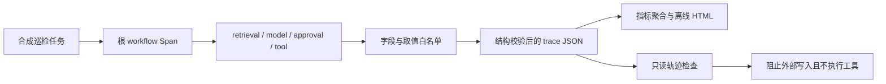
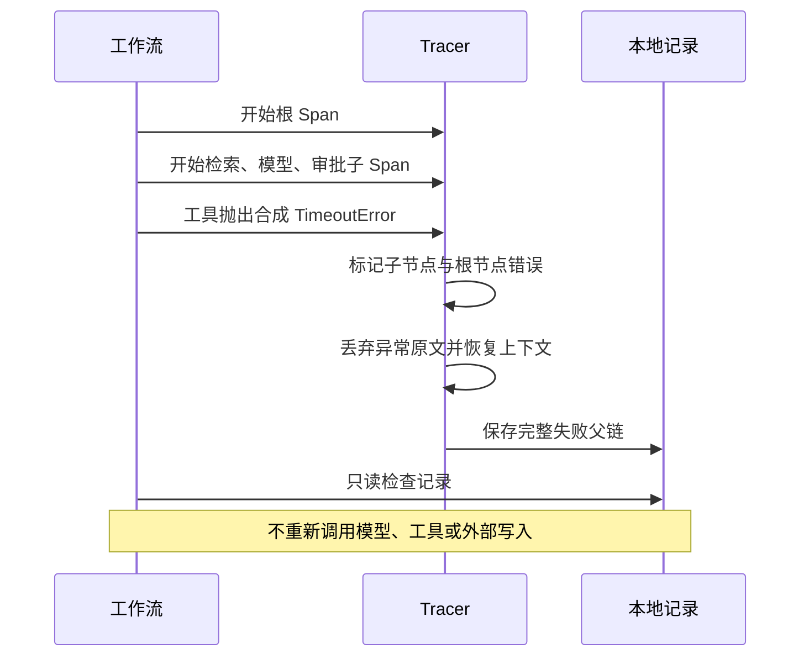

# 第 15 章｜Agent Observability 与 LLMOps

> 本章目标：把一次 Agent 任务串成可定位的轨迹，生成离线观测报告，并安全检查失败记录。  
> 难度等级：L2–L3。预计学习时间：120 分钟（教学安排估计）。  
> 前置条件：理解第 02、03、04 章的调用循环、运行时和工作流；会运行 Python 和 unittest；Python 3.11+。

**范围：** 本章交付完整的本地教学实验，包括五类 Span、父子关联、脱敏、失败轨迹、指标摘要和只读回放。模型采用确定性脚本，数据为合成数据。没有安装或接入第三方观测平台，没有真实模型 token 流、外部写入或真实审批身份验证。下文的生产建议不能视为这些能力已经实现。

学完后，你应能用 trace ID 找到失败步骤，说明任务延迟的统计口径，识别不能测量的指标，并证明回放没有触发外部操作。

## 1. 本章解决什么问题

某个巡检助手返回“处理失败”。只看结果，无法知道是检索为空、模型失败、人工拒绝，还是工具超时。如果日志没有关联标识，同一时间的多个任务会混在一起。把整段输入写进日志虽然方便调试，却可能泄露身份、密钥与业务文本。

本章使用与教学 Agent 相同的检索、模型、审批、工具边界，为每一步建立有父子关系的记录。一个任务失败后，开发者可以从根节点进入失败子节点，而不需要再次发送业务操作。

不使用追踪时，可以先用带 task ID 的结构化日志排查。这个办法适合很短的流程；多层调用与并发增加后，维护调用关系和耗时归属会更困难。

## 2. 先看结构，再理解概念



把 Trace 当作一次任务的案卷，Span 当作案卷中的一个步骤。案卷编号连接步骤；父节点标识说明谁调用了谁。类比只帮助理解结构：真实系统可以跨进程、跨机器，也可以包含异步关联，不能把所有关系都强行解释成同步函数嵌套。

| 信号或术语 | 回答的问题 | 本实验对应内容 | 不足 |
|---|---|---|---|
| Logs，日志 | 某时刻发生了什么？ | 每条 Span 的状态与错误类别可作为结构化事件线索 | 未额外实现日志采集管道 |
| Metrics，指标 | 一批任务整体怎样？ | 任务数、失败率、延迟分位数 | 聚合会失去具体任务上下文 |
| Traces，轨迹 | 一次任务经过哪些步骤？ | 一个 JSON 对应一个完整任务 | 一条轨迹不能代表整体质量 |
| Span | 一段操作何时开始、何时结束？ | workflow、retrieval、model、approval、tool | Span 数不是任务数 |
| Parent/Child | 哪个操作包含或发起哪个操作？ | `parent_id` 指向同一 trace 的父 Span | 同级关系不证明并行 |
| LLMOps | 怎样持续运行和改进模型应用？ | 以可观测记录支持排错与对比 | 还需评测、版本、发布和治理流程 |

本例 `kind` 是业务步骤类别，不是 OpenTelemetry 的 `SpanKind` 枚举；本地 `ok/error` 也不是完整的 OpenTelemetry 状态模型。接入正式 SDK 时需要明确映射，不能直接当作兼容格式导入。

Trace ID 在一个任务内不变；Span ID 在任务中唯一。根 Span 的父节点为空。检索、模型和工具必须继承当前上下文，不能通过一个全局可变“当前任务”字符串连接并发请求。

## 3. 指标先定口径

| 指标 | 本章采用的定义 | 实验输出与限制 |
|---|---|---|
| Task latency | 根 Span 结束减开始，包含子步骤与局部记录开销 | 单调时钟实测毫秒；不含导出和 HTML 生成 |
| Tool latency | 每个 tool Span 的结束减开始 | 含失败尝试与写入计划占位；不是远端工具性能 |
| 失败率 | 错误根 Span 数 / 全部根 Span 数 | 审批拒绝在本实验计入错误；业务系统可另设拒绝率 |
| Token | 供应商或匹配 tokenizer 返回的输入、输出用量 | 未调用模型，输出 `null`；字符数不能冒充 token 数 |
| Cost | 按版本化价格表分别计算各类可计费用量 | 未获取价格与用量，输出 `null`；未知不等于免费 |
| TTFT | 从发起模型请求到收到首个有效输出 token 的时间 | 无流式事件，输出 `null`；排队和网络是否纳入必须统一 |
| TPOT | 同一调用从首 token 到末 token 的间隔 / (输出 token 数 − 1) | 无 token 时间戳，输出 `null`；少于两个 token 时未定义 |

TTFT 和 TPOT 是本章选用的测量约定，不宣称所有供应商采用相同口径。网络 chunk 可能包含多个 token，不能把 chunk 数直接当作 token 数。工具调用参数流、推理 token、缓存命中也需要独立约定；比较前先校准边界。

**p50 / p95 / p99：** 本实验使用 nearest-rank。先排序 n 个样本，取第 `ceil(p × n)` 个值，序号从 1 开始，p 分别为 0.50、0.95、0.99。空集合返回 `null`。三个样本的 p95 与 p99 都等于最大值，这不是可靠的生产尾延迟估计。

统计窗口就是本次输入的全部 trace；默认三个任务、不采样，包含失败。根 Span 每个任务只计一次，不把所有子 Span 耗时相加，否则嵌套调用会重复计算。工具分位数按工具尝试计数，分母不同。聚合器拒绝重复 trace ID，避免重复导入抬高计数。对比不同版本时还需固定输入分布、机器负载、并发度、模型版本和失败定义。

## 4. 架构与流程





成功路径有六个 Span：根、检索、模型、审批、只读工具、写入计划。拒绝路径止于审批。超时路径止于只读工具。最后一个写入计划只有 `draft_only` 属性，没有外部执行器；它用于验证“记录里出现写操作也不能让回放执行它”。

## 5. 工程实现

完整代码位于 [observability.py](../labs/observability/observability.py)，没有第三方依赖；[测试文件](../labs/observability/test_observability.py)与[复现说明](../labs/observability/README.md)可以直接使用。

```text
labs/observability/
  observability.py
  test_observability.py
  README.md
  VALIDATION.md
  example-run/
    trace-1.json
    trace-2.json
    trace-3.json
    summary.json
    dashboard.html
```

`Tracer.span()` 是上下文管理器。进入时创建 ID、记录单调时钟起点，并从 `ContextVar` 获取父节点。离开时一定记录终点并恢复先前上下文；异常继续传播，避免“为了记录日志而吞掉业务失败”。任务函数仅捕获本例预设异常，然后保存轨迹。

`ContextVar` 支持独立异步任务的上下文隔离。本例禁止在另一 trace 的活动 Span 内启动子 Span。如果确需从任务 A 发起独立任务 B，应显式建立新上下文，并在正式系统用关联机制表达因果关系。单个 Tracer 对象不设计为多线程共享对象。

`validate()` 检查单一工作流根、唯一 ID、相同 trace、父节点存在、无环、子节点时间包含关系、状态与错误一致性，以及允许的属性。这个时间约束适用于本例同步嵌套结构；生产异步子任务可能晚于父 Span 结束，不能直接套用本校验器。

`redact()` 用字段和取值白名单删除信息。允许的数据只有固定版本枚举、受限计数、结果枚举和读写类别。提示词、文档、姓名、邮箱、令牌、异常消息、调用栈等任意文本都不导出。退出 Span 时再执行一次过滤，避免步骤内部修改属性绕过入口过滤。错误仅保留已知类别；其他异常统一为 `OtherError`。

本策略牺牲详细输入输出来降低泄露风险，比只替换某种邮箱或密钥格式更适合这个教学任务。它不是通用个人信息识别系统，也不保护进程内存与业务代码自己打印的日志。增加字段必须同时增加可接受取值规则和泄露测试。

存储复杂度为 O(S)，S 是 Span 数。父链校验最坏 O(S²)，适合小实验；生产可使用索引和单次图遍历。分位数需要排序，复杂度 O(N log N)。没有网络费和模型费用观测；本机计时包含追踪自身开销，微秒级差异不用于性能结论。

## 6. 运行并阅读报告

在仓库根目录运行：

```sh
python3 labs/observability/observability.py --output /tmp/observability-run
python3 -m unittest discover -s labs/observability -v
python3 labs/observability/observability.py --replay /tmp/observability-run/trace-1.json
```

打开 `/tmp/observability-run/dashboard.html`。页面可离线阅读，包含批次摘要、Span 表和可展开的只读回放结果；没有外部资源或脚本。所有值经过 HTML 转义，页面还设置限制资源加载的策略。视觉验收由读者执行，本章没有浏览器验证记录。

```text
┌ 第15章 · 离线观测报告 ─────────────────────┐
│ 3 个任务 / 2 个错误 / 分位数与样本口径      │
├ 任务 trace_id ────────────────────────────┤
│ Span | Parent | 类型 | 状态 | 耗时 | 错误 │
│ workflow                                 │
│   retrieval → model → approval → tool   │
│ [展开只读回放：executed_tools = 0]        │
└──────────────────────────────────────────┘
```

本仓库保留了一次[实际离线报告](../labs/observability/example-run/dashboard.html)、[摘要 JSON](../labs/observability/example-run/summary.json)和[验证记录](../labs/observability/VALIDATION.md)。默认运行应产生 3 个任务、2 个错误、3 个工具 Span；UUID 与耗时每次不同。CLI 退出码为 0 表示报告生成成功，不表示所有业务任务成功。

## 7. 失败定位与回放边界

| 观察到的证据 | 可得到的结论 | 不能得到的结论 |
|---|---|---|
| 根和 tool 都为 TimeoutError | 本实验工具异常传播到任务 | 真实网络一定超时；本例是主动注入异常 |
| approval 为 PermissionError 且没有 tool | 本例在审批阶段停止 | 审批人身份和权限已核验 |
| 写入计划存在且为 draft_only | 流程走到了写入计划节点 | 消息或设备命令已经发送 |
| 回放为 blocked_write | 此回放接口没有执行该写操作 | 外部系统过去没有副作用 |

本章“安全回放”准确说是**轨迹只读检查**。它恢复步骤顺序、关联和状态，不恢复已删除的敏感输入，也不重新生成答案。脱敏后的记录不能还原完整现场，这是一项有意的取舍。

进一步的离线再执行需要冻结模型输出、检索快照、工具返回值和代码版本，且用替身替换全部外部能力。线上重新执行还需要重新授权、幂等键、去重与结果核对；历史上的批准不能授权今天的新操作。本实验没有线上重新执行开关，也没有工具注册表或任意命令执行入口。即使把记录里的 `effect` 改为 `read`，回放仍然不会执行工具。

## 8. 方案比较与官方工具定位

| 方案 | 定位与用途 | 本章采用方式 | 需要另行完成的工作 |
|---|---|---|---|
| 原创标准库实现 | 解释上下文、记录和只读回放边界 | 本地运行、JSON 与 HTML | 无生产收集器、租户隔离、分布式传播 |
| OpenTelemetry | 标准化遥测接口与轨迹结构；Span 表示操作并有父子关系 | 参考其概念；本格式不是 OTLP | 选择 SDK、传播格式、导出器与后端 |
| Langfuse | 面向模型应用的追踪，可分析用量、成本和质量 | 官方能力定位比较 | 未安装、未验证接入与部署 |
| Phoenix | AI 观测与评测，基于 OpenTelemetry 与 OpenInference | 官方能力定位比较 | 未安装、未运行实验和平台集成 |

以上定位分别依据 [OpenTelemetry Traces](https://opentelemetry.io/docs/concepts/signals/traces/)、[Langfuse Observability](https://langfuse.com/docs/observability/overview) 和 [Phoenix 官方介绍](https://arize.com/docs/phoenix)。工具选择还应比较团队维护成本、数据驻留、保留期限与现有监控集成。选择一个平台不会自动解决脱敏或评测质量问题。

LLMOps 的改进闭环应是：观测发现问题 → 脱敏失败样本进入评测集 → 修改提示或工具 → 在固定集上比较 → 受控发布 → 再观察。模型回答是否正确需要第 14 章的评测方法；本章的“成功状态”只说明程序路径完成。

## 9. 生产环境注意事项

- 关联：跨服务传播上下文，并对外部传入标识做校验；不要把用户 ID、完整提示词或 trace ID 放进高基数指标标签。
- 采样：本例不采样。生产采样会改变可见失败比例；分别记录采样规则和原始计数，不直接把样本失败率当作全量失败率。
- 安全：脱敏必须发生在导出前。再配置访问权限、加密、保留期限和删除流程；结构合法不代表来源可信。
- 稳定性：遥测导出应有队列上限、超时和丢弃统计。业务不能无限等待观测后端；本例同步写本地文件，未模拟磁盘故障恢复。
- 版本：保存模型、提示、检索集、工具与流程版本。实验只记录 `scripted-v1` 和 `synthetic-v1`，没有完整发布管理。
- 指标：失败尝试也可能计费；重试必须独立记录。人工审批应区分等待时长和处理时长，本例只模拟即时结果。
- 运维：没有实现 Collector、跨机时钟、生产吞吐、告警、租户隔离或日志保留策略。不要把这份轻量实验直接当作生产遥测系统。

## 10. 动手实践与验收

**目标：** 用实际轨迹解释一次成功、一次工具失败与一次拒绝，并证明回放只读。

1. 运行 CLI，检查摘要有 3 个任务和 2 个错误；确认所有未知用量是 `null`。
2. 检查成功 trace 的 6 个 Span。用 Parent 列找根；不要只靠数组顺序判断关系。
3. 检查失败 trace，找到工具和根上的 TimeoutError，确认没有异常原文与写入计划。
4. 检查拒绝 trace，确认没有工具节点。说明为什么审批拒绝不应混同于基础设施故障。
5. 对成功 trace 运行 `--replay`，确认写操作显示 `blocked_write`，`executed_tools` 为 0。
6. 运行 18 项测试。测试包括跨 trace 父链拒绝、并发隔离、敏感属性过滤、异常传播、环路、重复记录、分位数、页面内容和 CLI。
7. 用 1 到 100 的合成样本解释 p50=50、p95=95、p99=99；再说明默认三个任务为何不足以估计生产 p99。

**验收标准：** 测试全部通过；实际 CLI 可生成离线文件；三种路径与记录一致；文件无本例注入的秘密文本；非法父链和篡改属性被拒绝；回放不运行任何业务工具；能清楚区分未知指标与零。

**常见错误：** 用字符数伪造 token；把写入计划标为已发布；把子 Span 求和当作端到端延迟；把脱敏记录当作完整现场；把拒绝率误报为系统故障率；没有记录样本数就比较 p99。

**扩展练习：** 加入只读工具重试，并增加每次尝试的 Span 和总尝试计数；测试失败尝试不会从指标中消失。该扩展未实现，不应改变回放不执行工具的约束。

## 11. 本章总结

任务关联依赖 Trace 和 Span 的结构，不能靠日志排列猜测。脱敏先于落盘。失败路径也必须闭合记录。指标必须说明范围、分母、单位和采样规则。未知用量保留未知。回放能力越强，越需要独立的授权与副作用控制。本章只读检查不执行外部能力，可靠恢复则由后续章节讨论。

## 12. 参考资料

官方文档访问与核验日期：**2026-11-20**。下列在线页面未锁定产品版本，本文只引用已核验的概念与定位，不承诺 SDK 参数、兼容性或最新发布版本。实验契约为原创 `lab-trace-v1`，要求 Python 3.11+。

| 来源 | 支持的正文结论 | 版本与核验范围 |
|---|---|---|
| [OpenTelemetry：Traces](https://opentelemetry.io/docs/concepts/signals/traces/) | Trace 组织请求路径，Span 表示操作及父子关系 | 在线概念文档；未实施 OTLP 导出 |
| [Langfuse：Observability overview](https://langfuse.com/docs/observability/overview) | 模型应用追踪、用量成本和质量分析定位 | 在线产品文档；未安装 SDK |
| [Phoenix：What is Arize Phoenix?](https://arize.com/docs/phoenix) | AI 观测、评测，基于 OpenTelemetry 与 OpenInference | 在线产品文档；未安装平台 |
| [实验代码与运行说明](../labs/observability/README.md) | 分位数口径、白名单、回放和本地实现边界 | 原创教学实现，以行为测试和运行产物为证 |

图和实验为原创。未使用真实企业业务数据、访谈、身份信息或设备控制结果。
