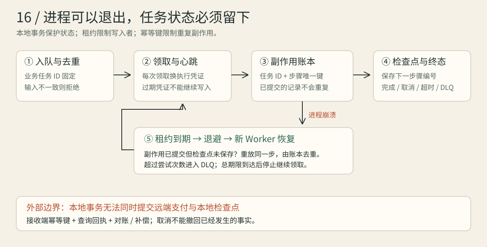
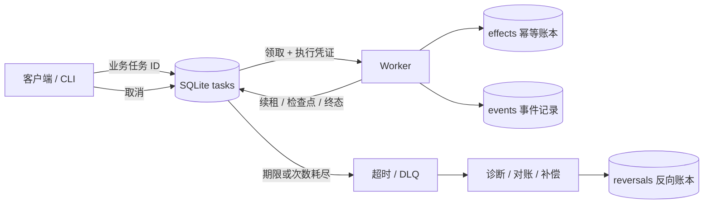
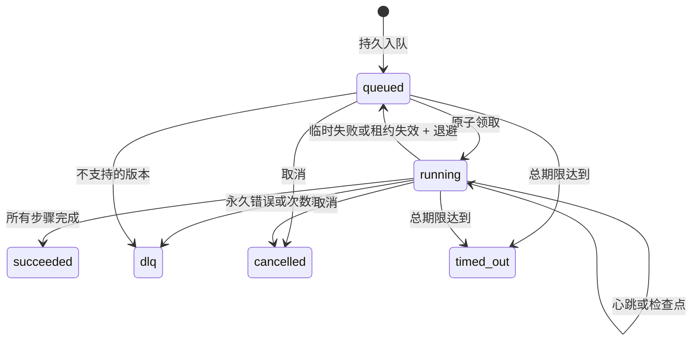
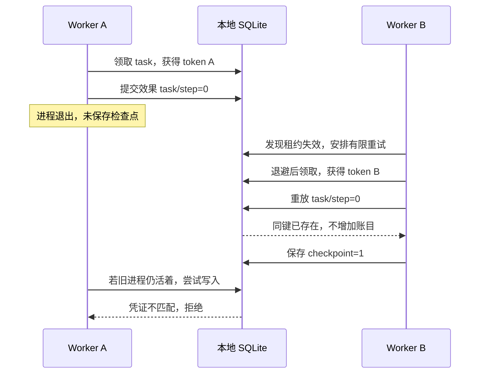
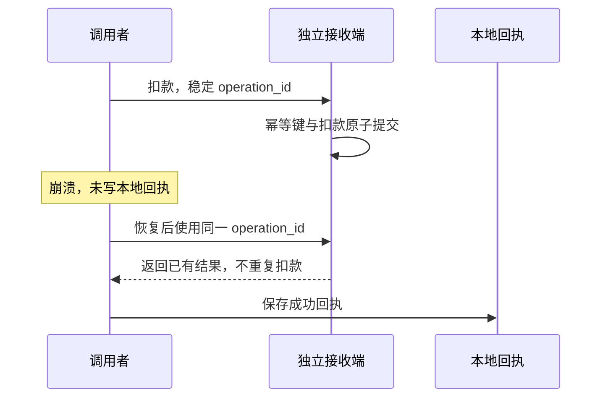

# 第 16 章｜Durable Execution 与分布式任务恢复

> 本章目标：让长任务在进程崩溃后恢复，并控制重复执行、超时、取消和补偿。  
> 难度等级：L2–L3。预计学习时间：150 分钟（课程安排估计）。  
> 前置条件：掌握第 03、04 章的状态机与有限重试；了解 Python 函数、SQL 事务和进程。实验需要 Python 3.11+。

**范围：** 本章提供完整的单机 SQLite 队列实验，包含真实子进程崩溃与重启、租约、心跳、两层期限、取消、有限重试、检查点、幂等副作用账本和本地补偿。另有两个独立数据库的确认丢失实验。概念部分覆盖事件历史、版本迁移、死信处理及框架边界。没有部署分布式工作流集群，没有把合成记账称为真实支付，也不承诺跨服务 exactly-once（恰好一次）。

**学习结果：** 你能画出每一步的提交边界；解释旧 Worker 为何不能继续写入；重现四种崩溃窗口；证明重放没有多记一笔；区分恢复、重试、取消和补偿；为在途任务选择版本策略。

## 1. 本章解决什么问题

假设巡检报告需要读取多份资料、等待审批、生成附件并登记结果。任务可能持续数分钟，也可能等待几天。HTTP 请求早已结束，执行进程可能因为升级或故障退出。如果任务只存在于函数栈里，重启后就无法知道哪些步骤已经成功。

普通请求通常把进度放在内存中，以一次响应结束。Durable Workflow（持久工作流）把必要状态放在可靠存储中，让请求、Worker 和业务任务具有不同生命周期。客户端先取得任务 ID，再查询状态；Worker 可以更换，任务身份保持不变。

对于一次只读、耗时很短、可安全重新计算的查询，重新发起请求可能已经足够。对于扣款、邮件发送或设备控制，简单“再跑一次”会带来重复效果。持久化的价值是让系统知道该继续哪里、哪些事实需要核对，以及何时必须停止自动执行。

## 2. 先用大白话理解

把任务想成一张工单。接班人要看工单上的进度，不能只问上一班的人。工单还应写清楚谁有权操作、授权何时失效、哪些事情已经发生。

严格定义是：系统在故障后，根据已提交的持久状态恢复执行，并维护业务约束。它保存的不是 CPU 指令位置，也不是任意 Python 调用栈。恢复通常从约定边界重新执行，因此边界之间的代码可能再次运行。



| 问题 | 普通请求的常见处理 | 持久任务需要补充 |
|---|---|---|
| 进程退出 | 请求失败，调用者重试 | 状态存储、接管与恢复入口 |
| 等待几天 | 不能一直占着连接 | 持久等待状态、唤醒条件和期限 |
| 返回超时 | 不知道对方是否成功 | 操作 ID、结果查询与对账 |
| 发布新版本 | 新请求使用新代码 | 旧状态和旧步骤仍可被解释 |
| 用户取消 | 关闭连接 | 停止未来动作，处理已发生的效果 |

## 3. 核心术语

| 术语 | 准确含义 | 本实验对应物与边界 |
|---|---|---|
| Checkpoint，检查点 | 已提交的恢复位置及所需数据 | `checkpoint` 是下一步骤编号；不保存步骤内的等待进度 |
| Snapshot，快照 | 某时刻的完整状态表示 | `tasks` 行保存最新任务状态；不是数据库备份 |
| Event History，事件历史 | 按顺序保留已发生的执行事件 | `events.seq` 定序；本例用于审计，不足以独立重建所有状态 |
| Resume，恢复 | 读取状态后继续未完成部分 | 新进程读取检查点，不重新创建任务 ID |
| Queue / Worker | 等待执行的任务 / 实际执行者 | 一个数据库、多个本机进程；不是网络消息中间件 |
| Lease，租约 | 有截止时间的执行授权 | `token` 与 `lease_until`；租约到期不代表旧进程消失 |
| Heartbeat，心跳 | 活跃执行者更新存活或进度信号 | 每隔租期三分之一尝试续租；不是业务已完成的证明 |
| Timeout，超时 | 达到期限后拒绝继续执行 | 总期限、单次尝试期限分别约束 |
| Cancellation，取消 | 请求停止后续执行 | 立即使本地凭证失效，不撤销已提交记录 |
| Idempotency Key，幂等键 | 同一业务操作重复提交仍只产生规定效果的身份 | 任务 ID 与 `(task, step)`；不能每次重试生成新业务键 |
| DLQ，死信区 | 不再自动尝试、等待诊断的任务集合 | `state='dlq'` 的记录；不是删除失败任务 |
| Saga / Compensation | 多个局部事务组成流程 / 用新动作抵消旧动作 | 本例用反向账目演示；真实退款不等于数据库回滚 |

## 4. 工作原理

### 输入、状态与事务边界

输入是任务 ID、步骤数、每步等待时间、最大尝试次数、总期限和单次期限。每步在合成账本中增加 10 个单位。输出为任务状态、下一步骤、尝试数、事件和账本。没有模型调用。

`enqueue()` 在事务中检查任务 ID：相同 ID 和配置返回原任务；同 ID 不同配置被拒绝。新任务先持久化为 `queued`，再允许 Worker 领取。成功和失败终态都保留身份，因此重复投递不会让已结束任务重新开始。

`claim()` 使用 `BEGIN IMMEDIATE` 将过期处理与领取放在同一写事务内。SQLite 在一个数据库上同时只允许一个写事务；这使两个本机 Worker 不能同时领取同一行。领取次数增加，并生成新的执行凭证。SQLite 的事务约束见[官方事务说明](https://www.sqlite.org/lang_transaction.html)。

每次心跳、副作用、检查点和成功确认，都要在事务内重新检查：状态是否仍为 `running`、凭证是否匹配、租约和两层期限是否仍有效。**先检查、离开事务、再写入是不够的**，因为另一 Worker 可能在中间接管。这里的随机凭证只由本地数据库验证；它不是可交给任意外部服务使用的单调 fencing token（隔离序号）。

### 两层期限与重试

总期限从入队时开始，覆盖排队、重试等待和执行。单次期限从本次领取开始。心跳只更新租约，不推迟任何一层期限。否则一个卡住但仍发心跳的任务可以永远占用资源。

单次失败或租约失效后，按 `min(30, 0.1 × 2^(attempts-1))` 秒退避；次数达到上限就进入 DLQ。永久错误立即进入 DLQ。总期限达到时进入 `timed_out`，不再重试。一次尝试包含在最大尝试数内，`max_attempts=2` 表示最多执行两次，不是再重试两次。

本实验由下一次 `claim()` 扫描并更新过期状态，没有后台计时服务。没有 Worker 轮询时，`inspect` 可能仍显示过期的 `running`，但该凭证已经无法通过写入检查。生产系统需要独立的回收调度与延迟指标。

### 检查点与副作用顺序

每一步先提交账本，再保存检查点。这样故意暴露确认窗口：账本已经完成，进程却没有来得及记录“已完成”。恢复后重放同一步，账本唯一键拒绝重复效果，然后补齐检查点。若把顺序反过来，检查点可能越过实际未执行的动作。

| 崩溃位置 | 存储事实 | 恢复动作 |
|---|---|---|
| 领取后，动作前 | 只有租约 | 到期、退避、重新领取 |
| 副作用事务提交前 | 未提交写入被回滚 | 重做同一步 |
| 副作用提交后，检查点前 | 账本有记录，检查点未前进 | 同键重放，去重，再推进检查点 |
| 检查点提交后 | 两者均存在 | 从下一步继续 |
| 所有步骤完成，终态前 | 检查点等于步骤数 | 不重做效果，直接写成功终态 |

### 成本

步骤数为 S、心跳数为 H 时，事件与账本空间约为 O(S+H)。本版每次领取扫描活跃任务，时间约为 O(N)，为便于阅读未加入生产索引与批量回收。每个步骤有两个短写事务，心跳也会写盘。等待发生在事务外，不得在持有 SQLite 写锁时调用网络或睡眠。队列规模与写吞吐必须单独压测；本章不提供容量承诺。

## 5. 架构与流程







最后两条消息描述“暂停后恢复的旧进程”，不是已退出的进程复活。测试分别覆盖真实退出和旧凭证继续写入。

## 6. 工程实现

### 6.1 技术选型与完整文件

Python 3.11+ 标准库提供 SQLite、子进程、JSON 和测试。SQLite 适合在一台主机上讲清事务边界；它不能在本实验中变成跨地域队列。`WAL` 和 `synchronous=FULL` 是本地配置，真实磁盘断电、文件系统损坏及网络文件系统未验证。

```text
labs/durable_execution/
  queue.py          # Queue, worker and CLI
  remote_gap.py     # Separate receiver commit / local receipt gap
  test_queue.py     # Database and subprocess tests
  README.md
  VALIDATION.md
```

完整代码见 [queue.py](../labs/durable_execution/queue.py)、[remote_gap.py](../labs/durable_execution/remote_gap.py) 和 [test_queue.py](../labs/durable_execution/test_queue.py)。关键实现没有省略号。`owned()` 是写入前的共同检查；`reap()` 处理期限；`retry()` 限制次数；`work_once()` 按检查点恢复。无法识别的异常向外抛出，进程退出后由租约回收处理，不将程序错误伪装成成功。

### 6.2 安装与复现

无需安装依赖，无密钥、网络或环境变量要求。从仓库根目录运行：

```sh
LAB_DIR=$(mktemp -d)
python3 labs/durable_execution/queue.py --db "$LAB_DIR/tasks.db" enqueue report-001
python3 labs/durable_execution/queue.py --db "$LAB_DIR/tasks.db" enqueue report-001
python3 labs/durable_execution/queue.py --db "$LAB_DIR/tasks.db" worker --lease 0.3 --crash after-effect
# Expected exit code: 73. Continue with a fresh worker without crash injection.
python3 labs/durable_execution/queue.py --db "$LAB_DIR/tasks.db" worker --lease 0.3 --run-for 1
python3 labs/durable_execution/queue.py --db "$LAB_DIR/tasks.db" inspect report-001
python3 -m unittest discover -s labs/durable_execution -p 'test_*.py' -v
```

恢复后应是 `succeeded`、`checkpoint=3`、`attempts=2`，三条效果合计 30。第二次提交的输出是 `inserted: false`。完整故障、取消、补偿、长任务和接收端命令见[实验说明](../labs/durable_execution/README.md)。

`--run-for` 仅限制领取循环，不强制打断正在执行的任务。任务期限另行配置。一个任务达到 DLQ 时，Worker 命令仍可正常返回 0；必须检查任务状态。故障注入退出码 73 和 74 则表示刻意立即终止子进程。

### 6.3 长任务并不等于长时间睡眠

实验支持 `--steps 120 --delay 30 --total-timeout 7200 --attempt-timeout 4000`。在真实业务中，应把等待外部结果转换成可恢复的等待状态或持久计时器，让 Worker 释放资源。本例用分片睡眠产生心跳，仅用于教学；步骤内等待没有检查点，崩溃后会重新等待这一步。

快速 CI 使用虚拟时钟推动租约和期限，**数据库读写、事务和权限判断仍是真逻辑**。另外用真实时钟运行子进程崩溃、并发、心跳、取消及超时测试。没有运行一小时或数天的耐久测试，不能从秒级测试推断长期稳定性。

## 7. 工程案例：确认丢失、Saga 与事件溯源

### 7.1 远端成功，本地却不知道

假设服务已经扣款，但返回消息丢失。客户端自己的“未完成”标志无法证明没扣款。将本地检查点与远端调用放在一起写，也不会自动获得跨服务事务。



`remote_gap.py` 用两个独立 SQLite 文件模拟这个边界。接收端先提交，再以退出码 74 杀死调用进程。恢复后，有键模式仍只有一笔 10；无键模式产生两笔共 20。没有共同事务。接收端只处理固定金额，因此该示例没有实现不同金额的冲突拒绝，也没有 HTTP 网络层。

生产写入需要接收端支持稳定业务键、输入指纹、持久去重结果及明确保存期限；调用者遇到未知结果要查询或对账。若接收端根本不支持幂等，必须选择人工核对、业务防重或接受明确的重复风险。不能只在调用者加一个 `processed=True` 就声称 exactly-once。Temporal 官方也明确指出 Activity 成功但完成信息未被记录时可能再次执行，业务幂等仍是应用责任。[Activity Definition](https://docs.temporal.io/activity-definition)

### 7.2 Saga 与补偿

一个订单流程可能依次预留库存、扣款、安排配送，每一步各自提交局部事务。最后一步失败时，可按相反业务顺序发起撤销配送、退款、释放库存。这就是 Saga 的一种组织方式。

补偿是新的业务动作，不是穿越时间的回滚。邮件已经送达不能“未发送”，设备已经移动不能靠删除数据库行回到原地。补偿也会失败，需要独立幂等键、重试上限、状态和人工接管。

本例 `compensate()` 仅允许对取消、超时或 DLQ 任务写反向记录；每条原始效果最多对应一条反向记录，重复调用不改变净额。它使用同一数据库的一次事务，所以是**本地补偿示范**，没有实现远端 Saga 编排器或多步骤补偿失败调度。

| 故障 | 不应做什么 | 应保存与处理什么 |
|---|---|---|
| 扣款结果未知 | 直接用新键再扣一次 | 原操作键、查询结果、对账状态 |
| 用户取消且已扣款 | 删除扣款记录 | 取消事实及待退款动作 |
| 退款接口超时 | 标记退款成功 | 退款键、未知结果、查询与人工入口 |
| 设备命令已生效 | 用数据库回滚冒充物理回退 | 设备状态确认、安全策略和新的补偿指令 |

### 7.3 Event History 不等于 Event Sourcing

事件历史回答“运行过程中发生了什么”。Event Sourcing（事件溯源）进一步要求业务状态以事件为权威来源，可由事件重建。Snapshot 是降低重放成本的缓存，需记录其对应事件位置；快照后还要应用剩余事件。

本实验的 `tasks` 行是恢复依据；`events` 是同事务写入的审计记录。事件没有完整输入和全部状态变化数据，所以**不能删除 tasks 后靠 events 重建队列**。若练习事件溯源，需要增加版本化事件契约、确定性 reducer（状态归约函数）、快照位置和全量重建一致性测试。

## 8. 方案对比与版本迁移

| 方案 | 恢复基础 | 合适条件 | 本章不能替它保证什么 |
|---|---|---|---|
| 普通请求 + 重试 | 调用者重新发起 | 短时、可重算、可安全重复 | 长期等待和跨进程进度 |
| 本章 SQLite 队列 | 最新状态、租约、检查点 | 单机教学与受控小规模工具 | 多主机容灾、远端副作用原子性 |
| Temporal | 服务持久化事件历史，Worker 重放工作流 | 需要跨进程长期编排、调度与恢复 | 外部 Activity 仍需业务幂等 |
| LangGraph + 持久 checkpointer | thread 下的图状态检查点与节点写入 | Agent 图、人工中断与状态恢复 | 存储配置和部署调度不能由“有图”推导出来 |

Temporal 的工作流代码按事件历史重放，必须满足确定性约束；外部 I/O 应放在 Activity 中。代码更新可以通过 Worker 版本部署或 patch 分支处理在途执行。不要把旧版 Worker Versioning 示例当作当前部署教程。[事件历史](https://docs.temporal.io/encyclopedia/event-history)、[版本策略](https://docs.temporal.io/develop/go/workflows/versioning)

LangGraph 的 checkpointer 在 super-step 边界保存状态，成功节点的 pending writes 有助于失败恢复。持久 checkpointer 与内存 saver 不能混为一谈；单独的跨线程 store 也不等于执行检查点。续跑必须使用正确的 thread 和恢复调用，复用 thread ID 后提交新输入不自动表示续跑。[Checkpointers](https://docs.langchain.com/oss/python/langgraph/checkpointers)、[Persistence](https://docs.langchain.com/oss/python/langgraph/persistence)

持久化模式影响写盘窗口；同步提交可以收紧检查点丢失窗口，但不能消除“外部已完成、检查点未保存”的风险。LangGraph 的容错文档同样要求将稳定业务身份用于副作用去重。本章不提供框架安装示例，未实测任一 SDK 版本。[Fault tolerance](https://docs.langchain.com/oss/python/langgraph/fault-tolerance)

### 在途任务的版本迁移步骤

1. 分开记录输入契约版本、工作流代码版本、检查点格式版本。一个版本号不能代表所有兼容性。
2. 先部署能读旧字段和新字段的代码。新增字段提供默认值，不立即删除旧节点或改变步骤含义。
3. 从旧状态复制测试样本，包含每个检查点、取消态、失败态和已经提交副作用的窗口。恢复后比较业务结果及效果条数。
4. 若语义不兼容，将旧任务固定在旧 Worker，等待排空；或建立经过审核的迁移映射并保留回滚副本。
5. 最后删除旧字段与旧节点。回滚时检查旧代码能否读取已经产生的新状态。

本例仅识别 `version=1`，不支持的版本进入 DLQ，而不是猜测字段含义。没有提供自动迁移器。不能直接把新版本插入到步骤 0 前面：原 `(task,0)` 的含义会被改变，旧账本防重反而会跳过新的动作。稳定的业务步骤 ID 比可变数组下标更适合生产迁移。LangGraph 官方也建议先添加新字段或节点、保留兼容窗口，再移除旧项。[Backward compatibility](https://docs.langchain.com/oss/python/langgraph/backward-compatibility)

## 9. 生产环境注意事项

### 重试、熔断和死信

重试用于单次临时失败；Backoff（退避）降低请求频率；Circuit Breaker（熔断器）在共享依赖持续失败时暂停新调用。熔断通常有关闭、打开、半开探测状态。打开期间应保存下一次可尝试时间，不能占用 Worker 忙等，也不能把暂停直接记作业务成功。本实验实现有限指数退避，**没有实现抖动或跨 Worker 熔断器**。

DLQ 保留任务输入、版本、最后错误、尝试数、检查点和效果。处置顺序是：确认失败原因，查询外部效果，修复问题，决定继续原任务还是创建关联的新任务，再记录审核结果。不要清空 `attempts` 后无限重跑。本实验保留 DLQ、查询和补偿接口，没有自动重投入口，避免绕过既定预算。

### 稳定性、安全与可观测性

- 持久时间戳用墙上时钟，以便进程重启后比较；本地等待使用单调时钟。时钟回拨会影响租约判断，本例没有处理跨机时钟漂移。
- 取消依赖执行代码检查授权。当前合成动作在短事务内可控；阻塞网络请求需要独立超时，远端已执行动作仍要查询或补偿。
- 记录排队时长、心跳年龄、租约失效次数、重试次数、DLQ 数量、检查点推进速度和未知副作用数。不能只看进程是否活着。
- 本例的心跳事件逐条落库，长任务会放大存储和写入成本。生产应定义保留、归档和采样策略，不能随意删除仍需去重的业务键。
- CLI 无身份验证和权限控制。数据库文件应限制访问；任务内容、事件和错误不得保存密钥或不必要的个人信息。
- 备份必须包含一致的数据库状态，并做恢复演练。不要只复制一个仍在写入的主数据库文件后就声称具备恢复能力。
- 生产容量需要队列索引、批量扫描、租户公平性、连接管理和写入压力测试。本章没有测试大规模吞吐、磁盘满或机器断电。

## 10. 动手实践与验收

**目标：** 用可复现的事实证明每个恢复边界，而不是只观察最后打印了成功。

**前置条件：** Python 3.11+；可以在临时目录创建 SQLite 文件并启动子进程。所有输入均为合成数据。

1. 执行两次相同任务入队，确认第二次不创建新任务。改变步骤数并保留任务 ID，确认报错。
2. 依次使用 `after-claim`、`inside-effect`、`after-effect`、`after-checkpoint`。每次用新数据库，记录退出码、检查点和账本条数。
3. 启动无故障的新 Worker，核对恢复后尝试数与最终金额，而不是只检查状态。
4. 注入临时与永久错误，确认退避、次数上限和 DLQ。缩短单次期限，确认心跳不能将它无限延长。
5. 取消正在运行的任务，确认不能新增效果；对已经提交效果的失败任务重复补偿，确认净额不再变化。
6. 运行独立接收端实验，比较有键与无键结果。解释为什么只保存本地回执不足以防重。
7. 阅读版本测试，解释为什么未知版本被隔离。提出一套旧检查点升级测试样本，但不要把未实现迁移写成已经完成。

| 验收项目 | 必须观察到的证据 |
|---|---|
| 正常执行 | checkpoint=3，三条效果，状态 succeeded |
| 重复投递 | 同一任务尝试数和效果数不增加；不同配置同键被拒绝 |
| 真实崩溃 | 子进程退出码 73，父进程仍能读取已提交状态 |
| 重启恢复 | 四个窗口均恢复；after-effect 事件出现 effect_deduplicated |
| 超时与旧 Worker | 过期或旧 token 无法写入；心跳不能越过单次期限 |
| 取消与补偿 | 后续效果被阻止；既有记录保留；重复补偿不重复冲销 |
| 独立接收端 | 退出码 74 后重放：有键一笔，无键两笔 |
| 自动测试 | 29 项 unittest 通过，真实进程与虚拟时钟范围区分明确 |
| 文档与图 | 运行 check_book.py；链接与 SVG 结构通过，不把结构检查当视觉验收 |

**常见错误：** 每次重试生成新的业务键；把心跳当完成证明；认为租约过期会杀死旧进程；先保存检查点再调用外部服务；把 DLQ 当垃圾箱；把取消当退款成功；把事件日志当完整事件溯源系统。

**扩展挑战（未实现）：** 增加 DLQ 人工审核与重投，必须沿用业务操作键并保留原运行关联；为步骤 ID 迁移增加旧检查点测试；实现带失败状态的远端补偿；为共享依赖增加半开探测和抖动退避。每项都需要新的验收证据。

## 11. 本章总结

持久执行保存的是可解释的业务进度。恢复会重放部分代码，所以副作用必须有明确的重复处理规则。租约只定义权限期限，所有写入仍需检查凭证。心跳、单次期限和总期限各自解决不同问题。取消停止未来动作，补偿处理既有事实。版本变化会影响旧状态的含义，必须先验证旧任务恢复再发布。

第 04 章的内存编排可以借本章增加恢复边界；安全治理章节为取消、重投和补偿补上授权；分布式 Agent 章节再讨论多主机调度、消息传输与容量。不要把本章单机实验扩写成已经验证的分布式平台。

## 12. 参考资料与验证范围

官方来源核验日期：**2026-11-20**。下列产品页面是访问日的滚动文档，不是固定发布版；未声称“最新版本”。实验只依赖 Python 3.11+ 标准库，实际运行环境见[验证记录](../labs/durable_execution/VALIDATION.md)。

| 官方资料 / 版本范围 | 支持的结论 | 使用边界 |
|---|---|---|
| [SQLite Transaction](https://www.sqlite.org/lang_transaction.html)，滚动文档 | 单写事务及 BEGIN/COMMIT 语义 | 本地队列原子领取设计，不证明断电可靠性 |
| [Temporal Event History](https://docs.temporal.io/encyclopedia/event-history)，滚动文档 | 事件历史、命令与重放恢复 | 概念对比，未部署 Temporal |
| [Temporal Activity Definition](https://docs.temporal.io/activity-definition)，滚动文档 | Activity 重复执行窗口与业务幂等 | 不承诺外部服务恰好一次 |
| [Temporal Go Workflow Versioning](https://docs.temporal.io/develop/go/workflows/versioning)，滚动 Go SDK 指南 | 确定性、Worker 版本和 patch 策略 | 不复制 SDK API；旧版本策略需另核实 |
| [LangGraph Persistence](https://docs.langchain.com/oss/python/langgraph/persistence)，Python 滚动文档 | checkpointer 与跨线程 store 分工 | 未安装或测试 LangGraph |
| [LangGraph Checkpointers](https://docs.langchain.com/oss/python/langgraph/checkpointers)，Python 滚动文档 | super-step、pending writes、thread 和续跑边界 | 不把内存 saver 当持久存储 |
| [LangGraph Fault tolerance](https://docs.langchain.com/oss/python/langgraph/fault-tolerance)，Python 滚动文档 | 失败重试与副作用稳定身份 | 本章未使用版本敏感的节点超时 API |
| [LangGraph Backward compatibility](https://docs.langchain.com/oss/python/langgraph/backward-compatibility)，Python 滚动文档 | 字段和节点的兼容窗口 | 迁移方法，不是本实验已有迁移器 |
| [本地代码与复现说明](../labs/durable_execution/README.md) | 本章队列、账本、合成输入和测试结果 | 原创教学实现，无真实企业或设备数据 |

SVG 与 Mermaid 均为原创可编辑图。已验证与未验证项分别记录；本章不以概念讲解替代真实 SDK、远端服务或长期运行的验证。
