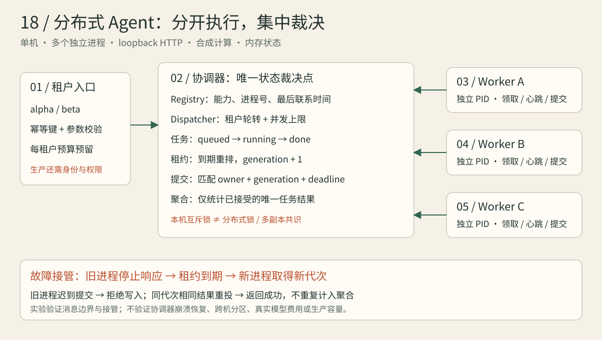
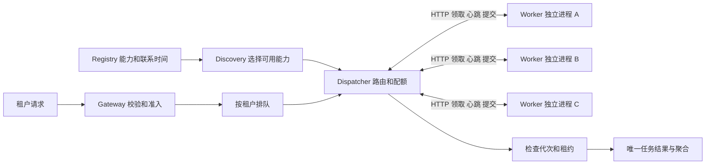
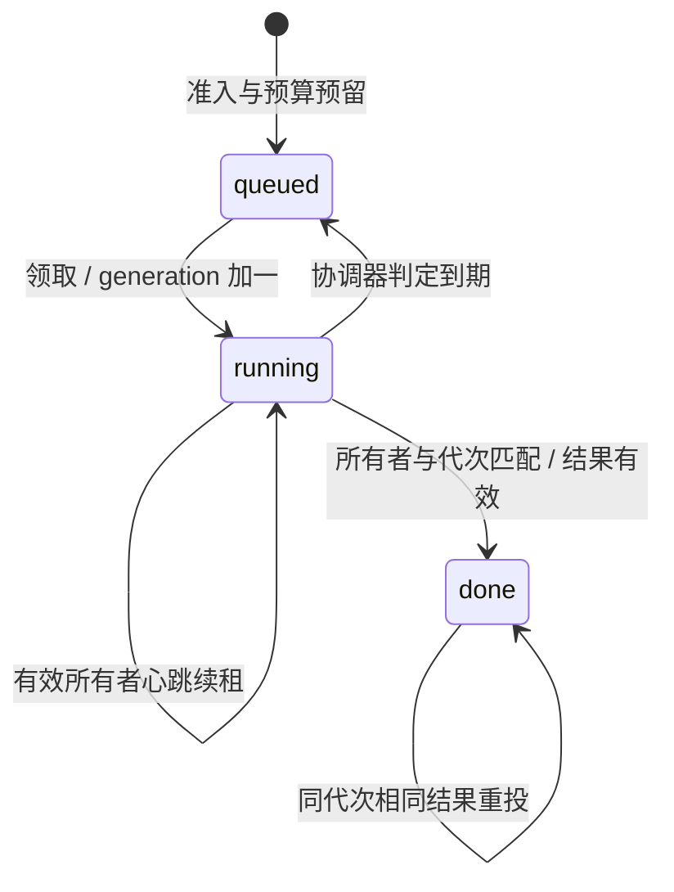
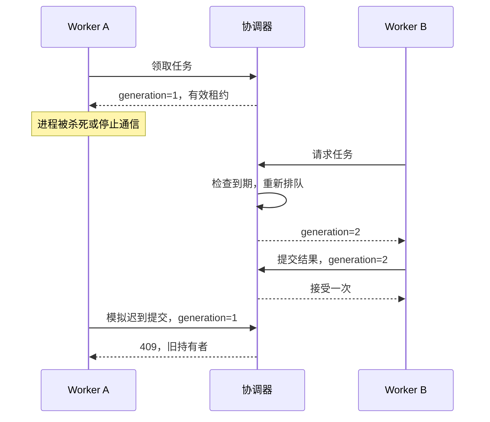

# 第 18 章｜分布式 Agent 系统

> **本章目标**：把任务交给多个独立 Worker，通过网络消息分发、续租、接管和聚合，并用证据解释重复执行与公平性的边界。  
> **难度**：L3。**预计时间**：阅读 60 分钟，实验与练习 60–90 分钟。  
> **前置**：会运行 Python 3.11+，理解 HTTP 请求、进程、互斥锁；先读第 16 章的任务恢复与第 17 章的权限治理。  
> **范围**：完整讲解本章机制，提供单机多进程的工作实验；不是跨机生产部署，不实现真实模型、持久化协调器或高可用集群。  
> **学习成果**：能画出控制与执行边界，选择通信层，识别过期持有者，用实际 PID、事件与时间检查故障接管、资源限制和租户服务份额。

## 1. 先看结构：谁决定，谁执行





图中角色不要求分别部署服务。实验把入口、注册表和调度器放在同一个协调器内，降低运行门槛。Worker 必须独立：每个都有不同 PID，任务参数和结果只通过 HTTP JSON 传递。它们不共享任务字典，也不通过 Python 函数直接领取任务。

| 角色 | 要回答的问题 | 实验中的位置 | 生产中需要增加的内容 |
| --- | --- | --- | --- |
| Registry 注册表 | 有哪些执行者，能做什么 | `/register` 保存能力、PID、联系时间 | 身份校验、健康状态过期、能力版本 |
| Discovery 发现 | 这项能力可以去哪找 | 固定协调器地址；注册时只接受 `sum_squares` | 服务目录、地址缓存失效、区域和版本选择 |
| Gateway 入口 | 请求能否进入系统 | JSON、字段、范围和预算校验 | 认证、授权、租户身份绑定、请求限流 |
| Dispatcher 调度器 | 下一项任务给谁 | `/claim` 内按租户轮转，检查并发 | 优先级、权重、资源和数据位置 |
| Worker 执行者 | 如何完成确定的工作 | 独立 Python 子进程 | 沙箱、模型客户端、运行环境治理 |

可以把协调器理解成工作站的派工台。Worker 拿到带有效期的工单，完成后回报。类比的限制是：网络中“没有回应”不能证明执行者已停止。它可能只是在暂停或通信失败。可靠系统必须处理两份计算同时运行的情况。

## 2. 为什么不能只多开几个线程

假设一个文档处理服务收到两个租户的批量任务。大租户先提交 1 万项，小租户后提交 10 项。如果所有任务进入一个先来先服务队列，小租户可能等待很久。如果仅按 Worker 数量扩容，仍不能解决这个问题；扩容还可能放大模型费用和外部 API 限流。

线程池适合共享内存、单机失败可接受的短任务。独立进程能隔离解释器状态和部分故障，但同机掉电会一起失败。跨机部署还要处理分区、地址变化、证书、时钟和数据副本。本章先把消息边界与调度规则验证清楚，再说明跨机需要补上的保证。

第 16 章关注“一个任务如何在重启后继续”；本章关注“多个执行者如何共同工作”。本实验故意不重复实现持久化日志：协调器停止后，全部内存任务消失。不要把 Worker 接管测试读成协调器恢复测试。

## 3. 通信方式不在同一层

| 名称 | 主要层次与用途 | 能提供什么 | 不能自动提供什么 |
| --- | --- | --- | --- |
| HTTP | 请求与响应语义 | 状态码、方法、表示形式 | 业务幂等、后台任务恢复 |
| WebSocket | 双向持续连接与消息帧 | 双向推送，减少反复建连需求 | 断线期间持久队列、消费确认 |
| gRPC | RPC 接口与调用框架 | 服务方法、消息类型、单次与流式调用 | 跨服务事务、任务只执行一次 |
| MQ | 消息中间件类别，不是单一协议 | 产品相关的队列、确认、重投和流控 | 应用副作用的唯一性 |
| MCP | 模型应用与工具、资源等能力的交互协议 | 标准消息及能力交互；固定版本定义传输 | 租户公平调度、Worker 租约 |
| A2A | Agent 之间的任务和消息协作协议 | 能力描述、任务状态、消息与产物 | 内部 Worker 管理和共识存储 |

HTTP 的重试是否安全，必须结合方法和业务语义判断；本实验用 POST 接收幂等键，不因为使用 POST 就放弃业务去重。[RFC 9110](https://www.rfc-editor.org/rfc/rfc9110) 描述 HTTP 语义。[RFC 6455](https://www.rfc-editor.org/rfc/rfc6455) 描述 WebSocket 的握手与帧；双向连接并不等于持久任务队列。

[gRPC 官方概念文档](https://grpc.io/docs/what-is-grpc/core-concepts/) 区分单次调用与多种流式调用，提供 deadline 等调用机制。它不能替应用决定失败后是否重新执行业务。[RabbitMQ 4.4 的确认文档](https://www.rabbitmq.com/docs/confirms) 则区分发布确认和消费确认；确认链路不同，不能把发布成功当作消费完成。

[MCP 2025-06-18 传输规范](https://modelcontextprotocol.io/specification/2025-06-18/basic/transports) 定义 stdio 与 Streamable HTTP，并以 JSON-RPC 编码消息。本章只据此说明层次，不声称该版是最新版本。[A2A 官方规范](https://a2a-protocol.org/latest/specification/) 描述 Agent Card、任务、消息、产物及协议绑定；`latest` 是可变文档，工程接入需锁定实际兼容版本。本实验没有实现 MCP 或 A2A，普通 HTTP JSON 也不能被称为兼容实现。

选择顺序是：先确定业务交互和恢复要求，再选协议与中间件。单机实验用 HTTP，便于观察真实消息和错误码。需要跨组织 Agent 互操作时，可在入口提供 A2A；Worker 内调用工具时，可使用 MCP。二者仍需要内部调度和权限机制。

## 4. 工单不是所有权：租约与代次



任务的核心字段是 `id、tenant、spec、status、worker、generation、deadline`。`id` 由租户和业务幂等键组成。`generation` 是每次分配递增的代次，也叫 fencing token。Worker 只能在有效租期内提交自己持有的代次。

1. 提交任务时校验参数并预留租户额度。同租户、同键、同参数重投返回已有任务；同键不同参数返回冲突。
2. Worker 注册能力，然后主动领取。调度器限制每个 Worker 同时持有一项任务，并检查全局与租户并发。
3. 领取成功后记录所有者、递增代次，并用协调器的单调时钟设置到期时间。
4. 心跳必须同时匹配所有者和代次，而且租约尚未到期。不能用迟到心跳复活旧租约。
5. 到期任务重新排队。新 Worker 领取后获得更大的代次。迟到的旧结果不能覆盖新结果。
6. 同代次已完成结果再次提交，只确认已完成，不再计入聚合；不同结果返回冲突。



实验没有后台清扫线程。每次 HTTP 操作开始时检查租约，因此恢复时间包含租期、下一次轮询、进程启动和任务执行时间。心跳缺失只是触发接管的依据，不是证明旧进程死亡的依据。

这里的迁移是“换一个执行者重新计算”，不是迁移进程内存。带中间状态的任务要从已保存的检查点恢复；检查点与代码版本兼容属于第 16 章范围。任务级最长运行时间也不能等同于租期：持续发心跳的卡死任务仍需要绝对 deadline、最大尝试次数和人工处置。本实验只验证租约超时，没有这些终止策略。

## 5. 一致性、锁、幂等和补偿如何配合

| 机制 | 本章使用方式 | 保证边界 |
| --- | --- | --- |
| 本机互斥锁 | 串行修改协调器内存状态 | 只覆盖一个协调器进程 |
| 分布式锁 | 生产中协调多个状态修改者的候选方式 | 不能仅靠“拿到锁”阻止过期持有者写外部系统 |
| 代次校验 | 结果提交检查当前 owner 和 generation | 只保护实施该检查的写入点 |
| 业务幂等键 | 租户与键唯一，参数一致才复用 | 作用域和保留时间必须明确 |
| 事件 | 记录分配、续租、到期、接受和拒绝 | 实验日志不持久化，不是消息总线 |
| 补偿 | 生产案例中撤销可逆业务动作 | 不保证恢复到动作从未发生的世界 |

两个协调器若各有一份内存字典和互斥锁，都可能把同一任务发出去。扩成多副本时，应把状态变更放入受一致性保障的存储事务：例如按 `task_id + generation + status` 条件更新，并检查受影响行数。不能只在应用层“先读再写”。若用锁服务，还要明确租期和失败假设；[Chubby 原始论文](https://research.google/pubs/the-chubby-lock-service-for-loosely-coupled-distributed-systems/) 讨论松耦合系统中的锁服务及相应机制。[Redis 锁设计文档](https://redis.io/docs/latest/develop/clients/patterns/distributed-locks/) 也要求认真考虑安全性、活性与时序假设。这里没有实现或测量这两种产品。

代次不是秘密令牌，也不是身份凭证。Worker 如果能伪造另一个 Worker 的名称，实验中的逻辑检查不能阻止它。因此生产网关必须从认证身份推导 Worker 和租户，并由受保护的存储端执行条件写入。

事件驱动系统还存在双写问题：数据库写成功、发布完成事件失败，会让下游不知道任务已完成。常见设计是在同一事务写业务结果与 outbox，由发布器发送，再让消费者用 inbox 去重。外部付款或发邮件不能被本地事务回滚。付款用下游幂等键；发生部分成功时，记录可审计的补偿步骤。发出的邮件往往无法撤回，因此需要业务对账，而不是宣称 exactly-once。本实验只执行无害整数计算，没有外部副作用，故只能证明协调器内结果唯一接受。

## 6. 调度不只看队列长度

| 控制项 | 实验规则 | 为什么需要它 |
| --- | --- | --- |
| 总并发 | 最多 3 项 running | 限制总体执行压力 |
| 租户并发 | 每租户最多 2 项 running | 防止一个租户占满全部槽位 |
| 单 Worker 并发 | 最多 1 项 running | 不把单进程容量高估 |
| 合成 Token 预算 | 按租户准入预留；重复提交不再次扣除 | 验证额度隔离与重复计费边界 |
| 租户公平性 | 在可调度租户之间轮转 | 有积压的小租户也获得服务 |
| 背压 | 超预算返回 429 | 让拒绝可见，不无限接受请求 |

实验的 `cost=10` 是合成额度。没有模型，也没有 tokenizer；不能据此报告真实 Token 或费用。生产中通常先预留输入估算与输出上限，再按实际用量结算差额，并为重试单独设上限。模型已消耗的 Token 不能因为任务失败就自动当作没有花费。本实验在重试时不再次扣额度，是教学简化，不是生产成本保证。

任务数公平不等于计算成本公平。若 alpha 每项 10 秒而 beta 每项 0.1 秒，轮转给同样任务数仍会产生不同的资源占用。可按估算成本做加权公平排队或 deficit round robin；同时保留小任务的等待时间指标。优先级也需要防饥饿规则。

本实验只用同样的计算量和等待时间检查服务份额。先放入 alpha 的 36 项与 beta 的 12 项，再启动 Worker。观察两边都有积压时的分配前缀，不能只比较最终 36:12 的完成数量。beta 用完自己的队列后，alpha 获得剩余容量是正常行为。

## 7. 完整实现与运行

完整代码位于 [runtime.py](../labs/distributed_agents/runtime.py) 和 [test_runtime.py](../labs/distributed_agents/test_runtime.py)。没有隐藏服务或需要自行补齐的关键函数。

```text
labs/distributed_agents/
├── runtime.py          # Coordinator, HTTP protocol and Worker processes
├── test_runtime.py     # Offline integration tests and experiments
├── requirements.txt    # Standard library only
├── README.md
└── results/            # Measured events, PIDs and test output
```

```sh
python3.12 -m venv /tmp/leanagentbook-distributed-agents-venv
/tmp/leanagentbook-distributed-agents-venv/bin/python labs/distributed_agents/test_runtime.py
```

使用独立临时环境；不安装第三方包，不修改根 `.venv`。支持目标是 Python 3.11+，本次实测解释器版本以结果 JSON 为准。端口由 `127.0.0.1:0` 自动分配，Worker 使用当前解释器启动。测试可以离线运行。每次执行写入实验的 `output/` 目录；已发布 `results/` 不被覆盖。可用 `DISTRIBUTED_RESULTS_DIR` 指定另一输出目录。

| 关键实现 | 输入与输出 | 需要注意的细节 |
| --- | --- | --- |
| `State.dispatch` | 路径和 JSON → 状态码和 JSON | 状态变更受同一把锁保护 |
| `State.expire` | 单调时间 → 到期任务重新排队 | 只信协调器时钟，不比较 Worker 墙钟 |
| `coordinator` | 配置 → 临时 HTTP 地址 | 限制请求体大小，仅监听本机 |
| `worker` | 地址和名称 → 领取、心跳、结果 | 只运行固定的平方和运算，没有任意命令入口 |
| `workers` | 进程数量 → 独立子进程集合 | 退出时 terminate、wait，必要时 kill |
| `wait_for` | 状态条件 → 满足条件的快照 | 有等待上限，避免把永久挂起当作通过 |

这是便于阅读的扫描式队列。一次分配需要扫描任务，最坏约为 O(N)；事件保留量随心跳与尝试次数增长，内存不是固定上限。生产应按租户维护就绪队列、设置队列容量、归档事件，并针对查询与租约到期建立索引。HTTP 请求体限制也不等于完整的抗滥用网关。

## 8. 实测结果与证据

[原始测试输出](../labs/distributed_agents/results/tests.txt) 与 [实验说明](../labs/distributed_agents/README.md) 可直接查看。每条事件包含协调器启动后的单调时间；JSON 包含解释器、操作系统、Worker PID、全部任务、代次与事件。这里报告合成任务，不报告 Agent 推理效果。

本次环境：Python 3.12.14，macOS-26.3-arm64-arm-64bit。两组均为 48 项任务，每项 `n=1000`、人为等待 0.12 秒。计时从启动 Worker 前开始，直到全部任务完成，包含进程启动、HTTP 与轮询开销。

| 指标 | 单 Worker | 三 Worker |
| --- | --- | --- |
| 积压清空耗时 | 6.130 秒 | 2.578 秒 |
| 平均完成速率 | 7.83 项/秒 | 18.62 项/秒 |
| 前 24 次分配 alpha / beta | 12 / 12 | 12 / 12 |
| 最终完成 alpha / beta | 36 / 12 | 36 / 12 |
| alpha 结果总和 | 11,982,006,000 | 11,982,006,000 |
| beta 结果总和 | 3,994,002,000 | 3,994,002,000 |

三 Worker 在这次合成负载中更快，但不是三倍加速：当 beta 完成后，alpha 的租户并发上限仍为 2。人为等待、HTTP 和启动成本也影响结果。该数字不代表真实模型或 CPU 密集任务的扩展能力。

故障接管从杀死受害进程前到替代 Worker 完成并退出，用时 **0.595 秒**。这个口径包含替代进程清理开销。旧代次提交与心跳均返回 409；当前代次的相同结果重投返回 200，完成事件仍只有一条。四组测试全部通过，本次整合测试结果也计入全书验证记录。

故障实验先等待受害进程真实领取任务，再杀死该进程，启动两个替代 Worker。接管后由测试客户端重放原 Worker 的旧代次消息。这验证“旧凭据迟到”的协议处理；没有复活被杀死的操作系统进程，也没有制造真实跨机网络分区。

长任务实验让等待时间大于租期，检查多次心跳后仍以第一代完成。另一项检查让租约自然过期，再发心跳，必须被拒绝。输入测试通过真实 HTTP 检查畸形 JSON、缺少字段、未知路由、未注册 Worker、错误结果、预算不足和幂等键参数冲突。

本次没有验证：协调器崩溃后恢复、跨机通信、持久化提交、多个协调器一致性、模型费用、TLS、真实权限、外部补偿、持续到达流量、极限吞吐量。单机多个进程共享硬件和故障域，不能据此给出生产容量承诺。

## 9. 工程案例与取舍

企业文档流水线可以把“提取固定页段”作为任务，结果带文档版本、页范围和提取器版本；聚合器只接纳当前版本的唯一任务结果。租户预算防止大批文档挤占模型额度。实际文件内容和用户身份不应直接写入调度事件。

设备运维场景可以把历史数据分片统计交给多个 Worker，最终聚合诊断证据。这里可以重试只读计算；不要把同样的重试规则直接用于“启动电机”之类控制指令。控制动作需要设备侧幂等键、命令有效期和安全授权，并处理设备已执行但回应丢失的情况。

| 方案 | 优点 | 代价 | 适用边界 |
| --- | --- | --- | --- |
| 线程池 | 开销小，调用简单 | 共享故障与内存 | 单进程短任务 |
| 本章独立进程 + HTTP | 易检查消息和故障隔离 | 单协调器、内存状态 | 教学与原型 |
| 持久队列 + Worker | 缓冲积压，可重投 | 需运维中间件与去重 | 异步批处理 |
| 工作流引擎 | 管理长任务历史与恢复 | 增加运行与版本治理成本 | 跨步骤长任务 |
| 多区域平台 | 可按地域与容量路由 | 一致性、数据位置、成本复杂 | 具有明确跨区需求的服务 |

生产监控至少拆分：排队时间、执行时间、重试次数、旧代次拒绝次数、各租户分配份额、预算拒绝和 Worker 最后联系时间。旧代次拒绝增加不一定是攻击，也可能是停顿、超短租期或网络延迟。先看事件时间线，再改超时。

## 10. 动手练习与验收

**练习目标**：在不破坏结果唯一性的前提下，解释并改进不同成本租户的服务分配。

1. 运行原测试，检查三 Worker 记录有三个不同 PID，且不同于测试进程。对照 JSON 确认 48 项积压全部清空。
2. 找出故障记录的 `assigned → expired → assigned → completed`。写下两次分配的代次，检查旧提交返回 409。
3. 检查 `first24_assignments`，说明为什么它比最终任务数更适合观察租户是否被挤占。
4. 在实验副本中把 alpha 的等待时间改为 beta 的五倍。记录每租户排队时间和占用时间，解释任务轮转为何不是成本公平。
5. 扩展每租户带权队列。保留旧代次拒绝、重复结果唯一与并发限制测试，并记录新的原始结果。不要声称扩展练习已经在本章实现。

| 验收项目 | 通过条件 |
| --- | --- |
| 消息边界 | 独立 PID；通过 HTTP 注册、领取、续租、提交 |
| 正常负载 | 48 项任务完成；与平方和公式一致；按租户聚合 |
| 掉线接管 | 杀死持有者后由新 Worker 完成；代次增加 |
| 旧持有者 | 旧代次提交与续租均被拒绝 |
| 重复处理 | 重复任务不新增记录；重复结果不重复聚合 |
| 心跳与超时 | 长任务续租成功；到期心跳不能复活租约 |
| 资源隔离 | 全局与租户并发不超限；一方预算不足不影响另一方 |
| 公平性 | 两租户有积压时检查分配前缀，报告实际份额 |
| 可复现性 | 保存事件、PID、环境与实际计时；断言失败即退出非零 |

常见错误：只断言最终结果正确而不检查是谁执行；把线程当作独立 Worker；用固定睡眠猜测任务已领取；把返回 200 当作业务只执行一次；把任务重算称为检查点迁移；把合成 `cost` 写成真实 Token。出现失败时，先保留原始输出，再检查事件中的到期与代次，不要仅扩大超时掩盖错误。

## 11. 本章应带走的结论

分布式执行的第一步是明确消息与状态边界。注册说明能力，发现定位服务，入口控制准入，调度器决定分配，Worker 执行。租约允许接管，代次阻止旧结果写入，幂等键处理业务重复；它们承担不同职责。公平性要结合积压和服务成本测量。协议兼容、可靠调度和生产部署是不同的验收项。

读者完成本章实验后，已经能检查多个独立进程的调度和失联接管；仍需结合第 16 章的持久恢复、第 17 章的权限治理，以及后续边云协同章节，才能设计跨机系统。

## 12. 参考资料与核验范围

以下均为一手来源，核验日期为 **2026-11-20**。版本只约束对应支持结论；本实验没有安装或测试这些产品。

| 来源与版本 | 支持的正文结论 |
| --- | --- |
| [IETF RFC 9110，2022](https://www.rfc-editor.org/rfc/rfc9110) | HTTP 方法、响应与幂等语义，不能代替业务去重 |
| [IETF RFC 6455，2011](https://www.rfc-editor.org/rfc/rfc6455) | WebSocket 建连和双向消息机制 |
| [gRPC Core concepts，在线文档，未标固定 SDK 版](https://grpc.io/docs/what-is-grpc/core-concepts/) | RPC 调用类型、生命周期与 deadline |
| [RabbitMQ Consumer Acknowledgements and Publisher Confirms，页面显示 4.4](https://www.rabbitmq.com/docs/confirms) | 发布确认与消费确认分属不同环节；存在重新投递 |
| [MCP Transports，2025-06-18 固定规范](https://modelcontextprotocol.io/specification/2025-06-18/basic/transports) | JSON-RPC、stdio 与 Streamable HTTP 的层次 |
| [A2A 官方规范，latest 在线快照](https://a2a-protocol.org/latest/specification/) | Agent Card、任务、消息、产物及绑定；可变地址不作为固定兼容版本承诺 |
| [Mike Burrows，The Chubby lock service for loosely-coupled distributed systems，OSDI 2006](https://research.google/pubs/the-chubby-lock-service-for-loosely-coupled-distributed-systems/) | 分布式锁服务的设计背景与机制；不是本实验的实现证明 |
| [Redis Distributed Locks，在线设计文档](https://redis.io/docs/latest/develop/clients/patterns/distributed-locks/) | 锁方案需要明示安全性、活性和时间假设 |

实验结论来自本章代码和原始结果，不由外部论文背书。图为本章原创，可编辑 SVG 与 Mermaid 均保留文本源。
