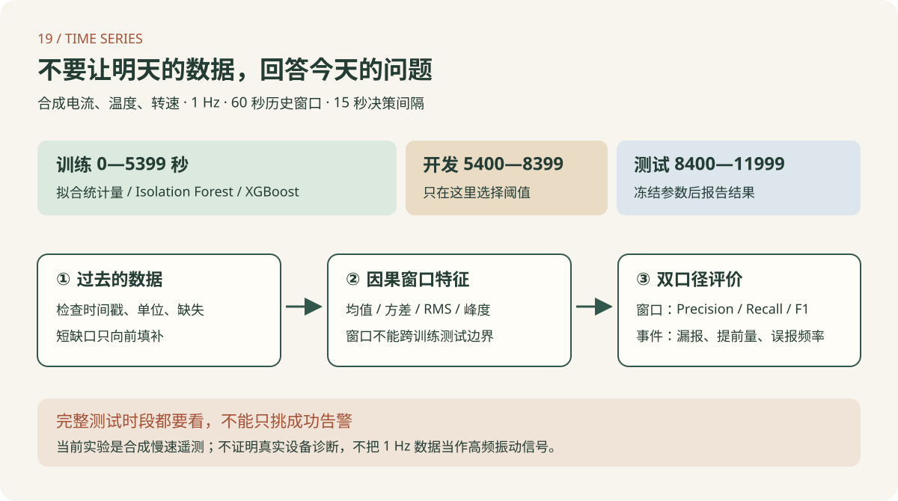
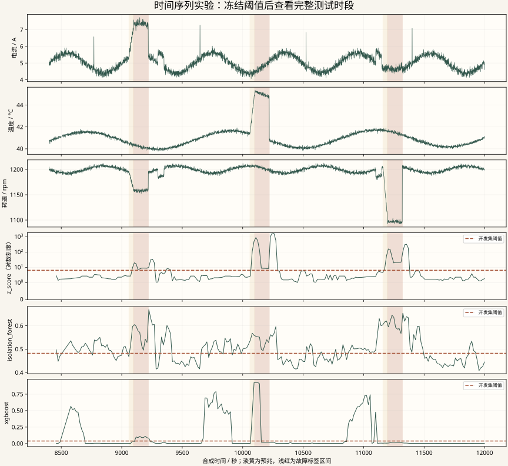

# 第 19 章 · Time Series AI 与工业异常检测



## 范围、前置与学习目标

本章使用合成电流、温度和转速数据，实际比较统计阈值、Isolation Forest 和 XGBoost。前置是 Python、均值和方差，以及 [数据流水线](12-data-engineering.md) 的时间与质量概念。阅读后应能检查采样条件、构造只依赖过去的窗口、选择检测任务，并解释误报、漏报和告警提前量。

实验是 1 Hz 慢速遥测，不是高频振动采集；没有真实设备、LSTM/Transformer 训练、剩余寿命预测或现场控制。它验证一条可复现的比较流程，不证明设备故障诊断有效。

## 1. 先确定在预测什么

| 任务 | 输入和输出 | 标签与验收 |
| --- | --- | --- |
| 异常检测 | 历史窗口 → 偏离程度或异常告警 | 正常范围、异常区间；误报漏报与响应时间 |
| 故障分类 | 历史窗口 → 故障类别 | 可信原因标签；各类混淆矩阵与未知类别拒答 |
| 数值预测 | 历史 → 未来数值或区间 | 固定预测跨度；误差、区间覆盖率与简单基线 |
| 剩余寿命 RUL | 退化历史 → 距失效时间 | 完整失效轨迹、删失与工况；时间误差与不确定性 |

“温度异常”不是“轴承已经损坏”。同一异常可能来自负载变化、传感器偏移或真实故障。把检测分数送给 Agent 解释时，应保留数据、时间和阈值证据，不能让语言模型补出未经验证的故障原因。

## 2. 采样决定了你能看见什么


| 问题 | 例子 | 本实验的处理与边界 |
| --- | --- | --- |
| 采样率 | 每秒一个温度点与每秒一万次振动不是同一数据 | 固定 1 Hz；不讨论从它恢复高频机械振动 |
| 时间戳 | 设备时钟跳变、重复、乱序、不同传感器不同步 | 秒级整数必须严格每次加 1，否则拒绝 |
| 短缺失 | 丢失 1–3 个点 | 每个窗口内只向前填补；保留缺失比例 |
| 长缺失或窗口首点缺失 | 没有足够的过去值 | 跳过窗口并记入质量统计，不默认正常 |
| 噪声与尖峰 | 测量抖动或单点毛刺 | 生成器加入噪声与脉冲；不直接删除难例 |
| 漂移 | 正常温度随时间缓慢变化 | 训练统计量冻结，不用测试均值纠偏 |
| 工况变化 | 正常负载切换也改变电流 | 保留非故障工况，检查是否误报 |

理想均匀采样的 Nyquist 上限是采样率的一半；实际采集还需要抗混叠、传感器带宽与同步设计。1 Hz 数据无法区分真实高频信号和混叠。多源重采样时应分别记录原始时间、对齐方法与最大允许时差，不能用未来测量插值出“实时可用”的过去值。

## 3. 时间域与频率域各回答什么

| 方法 | 回答的问题 | 代价与误用 |
| --- | --- | --- |
| 时间域曲线 | 什么时候跳变、漂移或出现缺口 | 长时段中局部振荡不易直接比较 |
| FFT 频谱 | 整个分析窗内有哪些频率成分 | 失去精确发生时刻；频率栅格约为采样率 / 点数 |
| STFT 时频图 | 不同时段的频谱如何变化 | 窗长决定时间与频率分辨率取舍 |
| 小波 | 不同尺度的局部变化与瞬态 | 母小波、尺度与边界处理影响结果 |

[NumPy FFT 文档](https://numpy.org/doc/2.2/reference/routines.fft.html)定义离散频谱及频率映射。[SciPy ShortTimeFFT](https://docs.scipy.org/doc/scipy/reference/generated/scipy.signal.ShortTimeFFT.html)通过滑动窗口计算连续的局部频谱；[PyWavelets CWT](https://pywavelets.readthedocs.io/en/latest/ref/cwt.html)提供尺度与时间上的表示。本实验训练特征只在时间域计算，未把这些频谱方法写成已验证的诊断能力。

分析频谱前明确采样间隔、去直流与窗函数。对缺失点直接补零会引入边缘和频率伪影。幅度谱、功率谱和功率谱密度也不是同一个量，必须写清归一化和单位。

## 4. 一组简单特征，先形成可解释基线

本实验每 15 秒用最近 60 秒构造一次决策。每个通道提取 7 个特征，共 21 维。标签是窗口结束时是否处于故障区间，不是“窗口碰到过异常就算异常”。

| 特征 | 定义 | 能反映什么 / 限制 |
| --- | --- | --- |
| Mean | `sum(x) / N` | 稳态水平；正负波动可能抵消 |
| Variance | `mean((x-mean(x))²)` | 波动强度；本实验用总体方差 |
| RMS | `sqrt(mean(x²))` | 含直流分量的幅值尺度，不等于标准差 |
| Peak | `max(abs(x))` | 极端幅值；容易受单点噪声影响 |
| Kurtosis | 四阶中心矩 / 方差平方 | 尾部与脉冲敏感；不是因果证据 |
| Slope | 对时间索引做最小二乘直线的斜率 | 趋势方向；单位为每秒变化量 |
| Missing fraction | 原始缺失点数 / 60 | 数据质量；填补后仍需保留 |

这里峰度不减 3。常数窗口的峰度数学上未定义，代码以 0 作为明确约定，不能解释成真实分布峰度为零。不同库可能使用样本修正或 excess kurtosis，比较前应核对定义。

## 5. 模型应按标签与数据量选择

| 方法 | 需要什么 | 优点与边界 | 本章运行 |
| --- | --- | --- | --- |
| Z-score | 训练正常段的均值与标准差 | 透明；多变量取最大值会放大误报，非高斯分数不是概率 | 是 |
| IQR | 正常数据的四分位数 | 对部分离群值稳健；阈值仍需按工况校准 | 否 |
| Isolation Forest | 训练正常或近似正常特征 | 随机划分下较易隔离的点更异常；异常分数不是故障概率 | 是 |
| One-Class SVM | 主要是正常样本，合适缩放与核参数 | 学习正常区域边界；对参数和规模敏感 | 否 |
| XGBoost | 正常/故障标签与窗口特征 | 适合表格特征；没见过的故障可能漏报 | 是 |
| LSTM / GRU | 足够的序列训练数据 | 通过递归状态与门处理历史；仍需因果输入与划分 | 否 |
| TCN | 序列与合适感受野 | 因果卷积、扩张卷积建模历史；感受野不是无限记忆 | 否 |
| Transformer | 序列、位置/时间信息与训练预算 | 建模跨时刻关系；不因名称而自动超过简单基线 | 否 |

Isolation Forest 的 `score_samples` 越低越异常，本实验取负号，让三种分数都按“越大越告警”处理，依据 [scikit-learn 1.6 文档](https://scikit-learn.org/1.6/modules/generated/sklearn.ensemble.IsolationForest.html)。One-Class SVM 的用途见[同版文档](https://scikit-learn.org/1.6/modules/generated/sklearn.svm.OneClassSVM.html)。XGBoost 是梯度提升树系统，依据[原始论文](https://arxiv.org/abs/1603.02754v3)，不是时序模型的自动替代品。

[TCN 比较论文](https://arxiv.org/abs/1803.01271v2)研究卷积与递归结构的序列建模；[Informer](https://arxiv.org/abs/2012.07436v3)研究长序列预测中的 Transformer 改进。这些论文说明设计方向，不能证明它们在本实验上更好。

对比学习先学习表示，再接分类、检测或预测头。[TS2Vec](https://arxiv.org/abs/2106.10466v4)利用增强上下文视图进行层次对比学习。工业数据增强必须保持任务含义：任意缩放可能改变真实过载幅值，乱序可能破坏故障演化。预训练表示也只能使用当时允许访问的数据；无标签不等于不会泄漏测试信息。本章没有训练这类表示。

## 6. 时间切分不是最后一步

```text
原始时间先切开
  train: [0, 5400)     → 拟合统计量和模型
  dev:   [5400, 8400)  → 选择一次阈值
  test:  [8400, 12000) → 冻结后评价

每个区间内部再建 60 秒窗口，不能跨界借数据。
```

若先建重叠窗口再随机划分，相邻的两条样本可能共享 45 秒原始数据。模型便能在训练与测试中看到几乎相同的片段。即使标签没有复制，结果仍会偏乐观。标准化、特征选择、缺失值统计和阈值同样不能看测试集。

[TimeSeriesSplit](https://scikit-learn.org/1.6/modules/generated/sklearn.model_selection.TimeSeriesSplit.html)提供顺序划分和 `gap` 参数，但具体间隔仍需按窗口跨度与预测标签范围决定。本实验直接在原始时间上划分，逐项检查窗口原始区间不相交。窗口相互之间仍有关联，因此不能把 229 个测试窗口当成 229 次独立设备试验。

三种方法共享同一批窗口和同一个开发集阈值目标。Z-score 与 Isolation Forest 只用训练中已知正常且不接触预兆的 297 个窗口；这是利用合成真值挑选正常段，不是无监督地自动识别干净数据。XGBoost 用训练集全部有标签窗口。这个比较包含监督信息差异，不能归因于算法名称本身。

阈值从开发分数中枚举，使开发 F1 最大；并列先选误报少，再选较高阈值。模型超参数在本次运行前固定，没有按测试表现调整。生产中可改为“每小时误报不超过预算时召回最高”，但也只能用开发集选择。

## 7. 不只报告一行 F1

| 指标 | 本章口径 | 不应误读为 |
| --- | --- | --- |
| Precision | 告警决策中，结束时处于故障的比例 | 每个告警都已确诊原因 |
| Recall | 故障决策中，被告警的比例 | 所有故障事件都及时处理 |
| F1 | Precision 与 Recall 的调和平均 | 已满足业务误报成本 |
| 误报率 | FP / 所有正常决策 | 每小时误报条数 |
| 事件检出 | 起点前 60 秒至故障结束，至少有一次告警 | 故障全程均被正确识别 |
| 提前量 | 故障起点 − 匹配区间内首次告警时刻 | 正数必然代表可靠预测 |
| 误报事件 / 小时 | 不匹配故障窗口的告警，按相邻 15 秒决策合并 | 已包含人工确认和抑制后的运维负担 |

提前量为负表示延迟，未检出写 null，不能从均值中静默丢弃。经常误报的模型也可能碰巧在故障前报警，所以提前量必须与误报一起看。实验人为在故障前 40 秒加入预兆；模型在更早的时刻报警尤其不能当成发现真实预兆的证据。

窗口口径把预兆告警计为正常时刻的 FP；事件口径允许起点前 60 秒的告警匹配事件。这是两种明确不同的任务定义。程序不会因为某个事件有一个命中，就把整段窗口的漏报改成正确，也就是不做 point adjustment。

## 8. 实测结果与失败解释

12,000 个秒级样本生成 353 个训练、195 个开发、229 个测试窗口；14 个窗口因缺失条件不满足而跳过。测试有 24 个阳性决策、205 个阴性决策，覆盖 1 小时。数据与标签均为课程原创合成，固定 seed=41。

| 方法 | Precision | Recall | F1 | FP / FN | 事件检出 | 误报事件 / 小时 |
| --- | --- | --- | --- | --- | --- | --- |
| 最大绝对 Z-score | 0.545 | 1.000 | 0.706 | 20 / 0 | 3/3 | 4 |
| Isolation Forest | 0.174 | 1.000 | 0.296 | 114 / 0 | 3/3 | 19 |
| XGBoost | 0.192 | 0.417 | 0.263 | 42 / 14 | 2/3 | 5 |

| 测试事件 | Z-score 提前量 | Isolation Forest 提前量 | XGBoost 提前量 |
| --- | --- | --- | --- |
| 负载异常，起点 9100 秒 | 11 秒 | 56 秒 | 11 秒 |
| 温度异常，起点 10100 秒 | 21 秒 | 51 秒 | 21 秒 |
| 未在训练中出现的掉速，起点 11200 秒 | 26 秒 | 56 秒 | 未检出 |



这组数据里，简单统计基线更好。Isolation Forest 的提前量看似更大，但其误报明显更多，且部分首次告警发生在生成器预兆之前。XGBoost 漏掉未见的掉速事件，说明监督分类器不自动具备开放集检测能力。缓慢漂移、工况变化和预兆标签边界也影响分数，不能只凭一张特征重要性图断言根因。

跳过窗口不是成功检出。当前 14 个跳过窗口必须单独监控；如果长缺口正好覆盖故障，现有结果只代表可评估时段，不能说故障仍被保护。只有 3 个测试事件和一条合成轨迹，结果不能推断真实设备性能或给出可靠置信区间。

## 9. 动手实践与验收

入口：[时间序列实验与数据卡](../labs/time_series/README.md)。

1. 先跑标准库检查，确认更改未来数据不会改变训练和开发特征。
2. 在独立环境实际训练两个模型，保存到新目录，核对全部 TP/FP/FN/TN。
3. 查看完整测试时间轴，解释 Isolation Forest 的高召回与高误报为何同时发生。
4. 将缺口移到故障附近，单独报告覆盖率；不要把被跳过的窗口当作正常。
5. 用新合成种子或新的设备记录建立下一份数据版本。仅在开发集选阈值，先冻结再查看测试结果。

验收标准：

- [ ] 原始时间区间不重叠，特征与填补只依赖决策时刻之前的数据。
- [ ] 三种方法共享评估窗口，记录各自训练标签条件和冻结阈值。
- [ ] 报告窗口 Precision/Recall/F1、误报漏报、事件检出、未检出和有符号提前量。
- [ ] 保留全部测试分数、数据哈希、配置和库版本；默认 14 项检查通过。
- [ ] 真实设备、更多事件、漂移监测与现场告警流程完成前，不声明生产有效。

线上部署还需要迟到政策、缺测告警、模型和阈值版本绑定、按设备/工况分层监控，以及人工反馈闭环。检测系统应先产生有证据的建议，后续动作仍经过 [权限与安全](17-security-governance.md) 的控制。

## 参考与核验日期

下列一手来源于 2026-11-20 核验。动态文档的页头版本可能变化，实际实验包版本以结果记录为准。

| 来源 | 支持的陈述 |
| --- | --- |
| [scikit-learn 1.6 IsolationForest](https://scikit-learn.org/1.6/modules/generated/sklearn.ensemble.IsolationForest.html) | 随机隔离方法及 score_samples 方向 |
| [scikit-learn 1.6 TimeSeriesSplit](https://scikit-learn.org/1.6/modules/generated/sklearn.model_selection.TimeSeriesSplit.html) | 顺序划分、gap 与时序评估限制 |
| [XGBoost v2.1.4 源码](https://github.com/dmlc/xgboost/blob/v2.1.4/python-package/xgboost/sklearn.py) | 本实验分类器接口与配置 |
| [NumPy 2.2 FFT](https://numpy.org/doc/2.2/reference/routines.fft.html) | 离散频谱与频率映射 |
| [SciPy ShortTimeFFT](https://docs.scipy.org/doc/scipy/reference/generated/scipy.signal.ShortTimeFFT.html) | 滑窗频谱及时间/频率分辨率 |
| [PyWavelets CWT](https://pywavelets.readthedocs.io/en/latest/ref/cwt.html) | 连续小波的时间与尺度表示 |
| [TCN 论文 v2](https://arxiv.org/abs/1803.01271v2)、[Informer v3](https://arxiv.org/abs/2012.07436v3)、[TS2Vec v4](https://arxiv.org/abs/2106.10466v4) | 序列模型和表示学习路线，不作为本实验效果证明 |

[返回首页](../README.md) · [完整进度](../ROADMAP.md)
