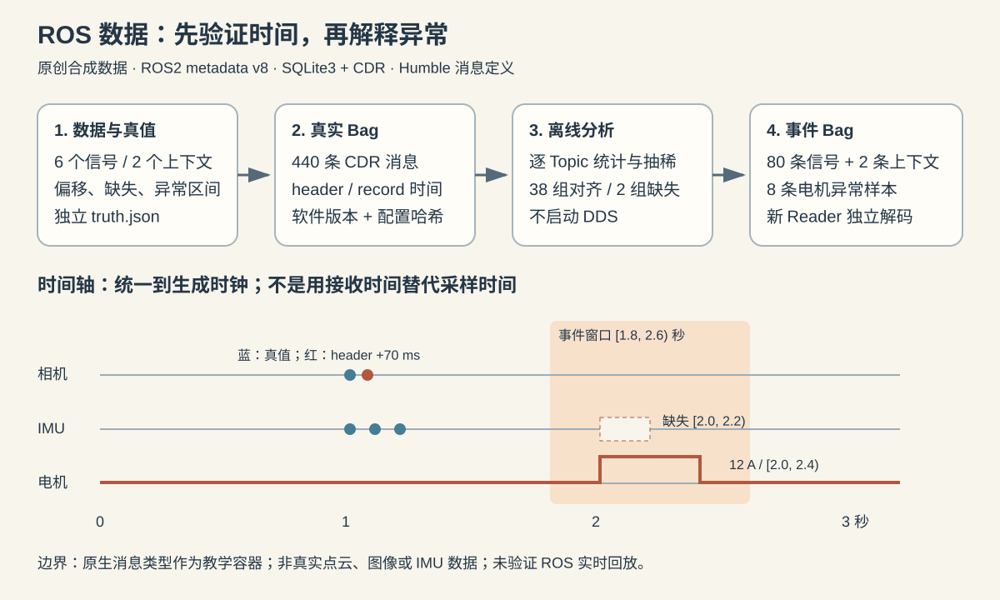
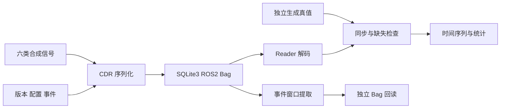
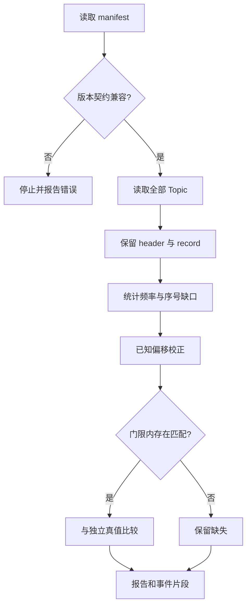
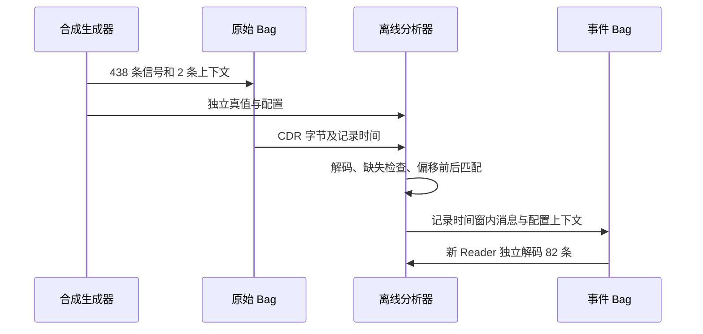

# 第 20 章｜Robotics AI 与 ROS 数据体系

> 本章目标：把 ROS 数据整理为可核查的设备分析证据，解释同步误差、缺失和格式兼容边界。
>
> 难度：L3。预计学习时间：3–4 小时。
>
> 前置：第 12 章数据工程、第 15 章可观测性、第 19 章时序分析；会运行 Python 和读取 CSV。
>
> 范围：讲解 ROS 1/ROS 2 通信；实际完成 ROS2 Bag 离线生成、解析、统计和片段提取。不启动机器人、不控制电机、不运行 DDS。
>
> 学习成果：区分采样和记录时间；定位缺失；用独立真值验证时间校正；输出可独立读取的事件 Bag。

## 1. 本章解决什么问题

“电机电流升高时，摄像头看到了什么？”这个问题需要同时拿到信号、时间、软件版本和配置。仅有日志中的一行报错，无法判断图像是否与电流属于同一时刻。仅有平均采样频率，也无法发现中间丢失的连续数据。

通用工程案例：移动设备在一次行驶任务中出现电流异常。分析人员从 Bag 中抽取异常前后的信号，再关联当时的控制软件、参数和事件。此案例完全合成，不代表任何公司的设备表现。替代方案是每个模块分别导出 CSV；这很轻量，但消息类型、坐标系、记录时间和配置容易丢失。本章保留 Bag 作为证据，CSV 用于分析。

## 2. 先用大白话理解

Node 像一个工作岗位，Topic 像持续广播的频道，Message 是频道中每次发送的表单。Service 像一次短问答；Action 像一张需要持续报告进展的任务单。Bag 像录音，但它保存的是结构化消息及时间，不只是声音。

这个类比有边界：Node 不一定等于一个操作系统进程；多个 Node 可以放在同一进程。Bag 也不是完整机器快照，它通常不包含所有内存状态、文件、外部服务和物理环境。重放同一批消息不保证得到同样的控制结果。

## 3. 核心术语与架构区别

| 术语 | 严格含义 | 选择示例 | 常见误解 |
|---|---|---|---|
| Node | ROS 通信图中的计算参与者 | 摄像头驱动、状态估计 | 一个 Node 必须一个进程 |
| Topic | 命名的发布/订阅通道 | IMU 持续输出 | Topic 名相同就一定能通信 |
| Message | 由接口定义描述的类型化字段 | Header、Point、Image | JSON 字典就是 ROS 序列化 |
| Service | 请求与响应接口 | 查询配置、短计算 | 长任务一直阻塞服务即可 |
| Action | 目标、反馈、结果，以及取消流程 | 导航到指定位置 | 取消请求保证设备立刻停止 |
| Bag | 带类型信息和记录时间的消息存储 | 故障留证、离线分析 | 是模型、录像或实时系统 |
| QoS | 通信质量策略集合 | 可靠性、深度、持久性 | reliable 可以修复采集前丢失 |
| Header 时间 | 通常由生产者填写的采样时间 | 图像曝光时刻 | 一定与记录机时钟一致 |
| Record 时间 | Bag 写入时指定的记录时间 | 收到消息的时间 | 一定等于采样时间 |

| 维度 | ROS 1 | 本章讨论的 ROS 2 Humble |
|---|---|---|
| 发现与通信 | Master 协助发现；节点间传输消息 | 经 RMW 接口使用中间件；常见部署为 DDS 分布式发现 |
| Topic | 发布/订阅，常见 TCPROS，也有其他传输 | 发布/订阅，按 QoS 协商兼容性 |
| Service | 请求/响应 | 请求/响应 |
| Action | 常用 actionlib，组合 Topic 实现目标、反馈等 | 原生 Action 接口，内部使用服务和 Topic |
| 消息定义 | `.msg`、`.srv` 等 | `.msg`、`.srv`、`.action` 等接口及类型支持 |
| Bag | rosbag v2 `.bag` 容器 | rosbag2 插件式存储；本实验 SQLite3 `.db3` + YAML |
| 序列化 | ROS 1 消息序列化 | 本实验 CDR；不能直接当 ROS 1 字节读取 |

这里的版本范围是 Humble 和 rosbags 0.10.11，不据此推断所有未来 ROS 2 发行版。Node、接口和 Action 定义见参考 1–3；ROS 1/2 早期架构差异见参考 7，旧设计文档里的平台列表与“尚未实现”标记不用于描述当前状态。

## 4. 工作原理：时间比数值更先需要核查

### 4.1 信号、单位与坐标系

| 来源 | 真实系统常见类型/内容 | 必须保留的语义 | 本实验处理 |
|---|---|---|---|
| LiDAR | `sensor_msgs/PointCloud2` 或 `LaserScan` | 米、frame、扫描起止和点内时间 | 10 Hz 标量代理，不生成点云 |
| Camera | `Image` / `CompressedImage` + `CameraInfo` | 编码、曝光、内外参 | 10 Hz 标量代理，不生成图像 |
| IMU | `sensor_msgs/Imu` | 加速度 m/s²、角速度 rad/s、协方差、frame | 50 Hz 代理，注入连续缺失 |
| Encoder | `JointState` 或驱动自定义消息 | tick 分辨率、轮径、方向、rad 或 m | 20 Hz 代理 |
| 电机 | 电流、转速、温度、状态码；常为自定义类型 | A、rpm、℃、采样位置 | 20 Hz，异常值 12 A |
| 电池 | `sensor_msgs/BatteryState` 或驱动消息 | V、A、荷电比例、告警 | 2 Hz 代理 |

真正做空间融合还要检查 TF 坐标变换、标定版本和变换时间。时间相同但 frame 不同，不能直接相加。本实验不验证标定、空间变换或物理单位精度；只有电机阈值用于演示事件筛选。

### 4.2 两个时间与一个真值

令生成真值为 `t`，相机 `header=t+70 ms`，其他信号 `header=t`。每条记录的 `record=t+5+(seq mod 3) ms`。基准是固定的合成时钟 `1700000000 s`，不依赖本机墙上时间。

因此相机的 `record-header` 为 −65 至 −63 ms。这不表示网络传输倒流，而是两个时钟的偏移。不能把此差直接叫网络时延。真实设备还可能存在时钟漂移、NTP 跳变、仿真 `/clock` 和暂停；应先确认时钟域及硬件同步/PTP 等条件，再估计偏移与漂移。

同步步骤：

1. 保留原始时间；按 Topic、序号查独立 `truth.json`。真值只用于本实验验收。
2. 以相机为锚，选择时间最近的 IMU；匹配门限为 10 ms，相同距离选较早的 IMU。
3. 先不校正，再减去已知 70 ms 偏移重复匹配。
4. 用匹配双方的**真实采样时间差**验收，不只看校正后的 header 差。
5. 找不到门限内样本就记录缺失，不补零、不强行插值。

这是已知偏移校正实验，不是从未知数据估计偏移的算法。真实环境没有真值时，可以用共同硬件触发或可核查的共同事件做基准；仅凭两条曲线相关不能证明时钟已同步。

### 4.3 统计、抽稀与窗口

频率采用 `(N−1)/(最后时间−最早时间)`，同时输出相邻间隔中位数、最大间隔和期望序号缺口。平均频率掩盖局部断流：IMU 中位间隔仍为 20 ms，但最大间隔为 220 ms。

抽稀对每 100 ms 桶保留首值、最小值和最大值，按序号去重。它保留幅值异常，不能代替抗混叠滤波；做频谱分析应先低通再重采样。抽稀只产生派生文件，原始 Bag 保持不变。

事件异常真值为 `[2.0, 2.4)` 秒；取记录时间窗 `[1.8, 2.6)`，包含前后上下文。由于网络延迟，记录时间窗与物理采样时间窗不同。真实设备应按校正后采样时间选业务窗口，再留足记录延迟余量。本实验明确采用记录时间选择，不掩盖这个区别。

## 5. 架构与流程



可编辑的架构源：







## 6. 工程实现

### 6.1 选择与边界

采用 Python 3.12、rosbags 0.10.11、`ROS2_HUMBLE` 类型库、metadata v8、SQLite3 存储、CDR 序列化、无压缩。依赖固定在 [requirements.txt](../labs/robotics_ros/requirements.txt)。rosbags 支持读取和写入 ROS Bag，但这里没有安装或启动 ROS 运行时。v8 容器选择与 Humble 类型库选择是两个独立维度；能识别容器不保证能解释任意自定义消息。

为让实验轻量，六个信号都用 `geometry_msgs/msg/PointStamped` 承载代理值。`header` 保留采样时间；`point.x` 是值，`point.y` 是序号，`point.z=0`。这借用了标准类型的结构，**不是标准几何语义**，不应把这些代理值传给真实几何或控制节点。`/context`、`/events` 用 `std_msgs/msg/String` 装载 JSON。JSON 只是 String 的负载；Bag 本身是可由 Reader 解码的二进制格式。

### 6.2 完整代码与文件

全部代码可下载，无关键步骤省略：

| 文件 | 职责 |
|---|---|
| [core.py](../labs/robotics_ros/core.py) | 标准库版本契约、缺失检查、最近邻匹配、保极值抽稀 |
| [bag_lab.py](../labs/robotics_ros/bag_lab.py) | 真 Bag 生成、CDR 解析、CSV 输出、事件 Bag 提取 |
| [test_core.py](../labs/robotics_ros/test_core.py) | 无第三方依赖的四项测试 |
| [verify_bag.py](../labs/robotics_ros/verify_bag.py) | 单独执行的真实格式集成检查 |
| [实验说明](../labs/robotics_ros/README.md) | 命令、字段、产物和证据入口 |

```text
labs/robotics_ros/
  core.py             bag_lab.py
  test_core.py        verify_bag.py
  requirements.txt    README.md
  results/            # Published evidence; do not overwrite
  output/             # New local runs
```

### 6.3 安装和运行

从仓库根目录运行。环境位于 `/tmp`，不修改根 `.venv`：

```sh
python3 -m unittest discover -s labs/robotics_ros -p 'test_*.py'
uv venv --python 3.12 /tmp/leanagentbook-robotics-ros-venv
uv pip install --python /tmp/leanagentbook-robotics-ros-venv/bin/python -r labs/robotics_ros/requirements.txt
/tmp/leanagentbook-robotics-ros-venv/bin/python labs/robotics_ros/verify_bag.py
/tmp/leanagentbook-robotics-ros-venv/bin/python labs/robotics_ros/bag_lab.py --out labs/robotics_ros/output/run-001
python3 scripts/check_book.py
```

每次使用新目录，已有目录会失败。生成器不删除旧数据。默认全书测试只发现 `test_*.py`，不会导入未安装的 rosbags。预期为标准库 4 项、集成 1 项通过，生成命令输出 438 条信号、事件窗 80 条信号及 2 条上下文。

### 6.4 关键函数与成本

`generate` 用整数纳秒构造稳定时间，按记录时间排序后写入消息；同时写独立真值。`read_rows` 先按连接的消息类型解码，再读取 Header；不猜测任意字节布局。`validate_manifest` 对不支持的 schema、类型库和容器版本立即报错。真实 Reader 另外负责拒绝不支持的 metadata 版本。

`extract` 复制原始 CDR 字节到新的 Bag，保留 Topic 名和类型，并补入窗口之前的 `/context`。提取后用新 Reader 对所有消息再次解码。事件 Bag 自带消息信息，独立解码无需原始 Bag；而带真值的教学统计仍需要外部 truth 文件。

此小实验在内存中存全部消息。生成排序为 `O(N log N)`；最近邻实现为 `O(C×I)`，其中 C、I 为相机和 IMU 数量。生产实现应按时间索引，用双指针或二分查找，并采用分块、流式处理。网络开销为零；大 Bag 的主要成本是磁盘吞吐、解压、解码和派生数据存储。

## 7. 工程案例与实际结果

首次证据生成日期为 2026-11-20，Python 3.12.14，rosbags 0.10.11。输入范围为真值时间 `[0,4)` 秒。全部 Topic 结果见 [report.json](../labs/robotics_ros/results/report.json)，全部信号见 [timeseries.csv](../labs/robotics_ros/results/timeseries.csv)，执行记录见 [核查记录](../labs/robotics_ros/verification.md)。

| Topic | 标称 Hz | 期望条数 | 实际条数 | 最大间隔 ms | 说明 |
|---|---:|---:|---:|---:|---|
| `/lidar` | 10 | 40 | 40 | 100 | 标量代理 |
| `/camera` | 10 | 40 | 40 | 100 | Header 偏移 +70 ms |
| `/imu` | 50 | 200 | 190 | 220 | 缺少序号 100–109 |
| `/encoder` | 20 | 80 | 80 | 50 | 标量代理 |
| `/motor` | 20 | 80 | 80 | 50 | 序号 40–47 为 12 A |
| `/battery` | 2 | 8 | 8 | 500 | 标量代理 |
| `/context` | 非周期 | 1 | 1 | 不适用 | 软件、配置、哈希 |
| `/events` | 非周期 | 1 | 1 | 不适用 | 异常事件与关联键 |

原始 Bag 共 440 条。SQLite 文件头与 `messages` 表行数均经过检查。未校正时存在至少 60 ms 的真实采样错配，即使匹配的 Header 差不超过 10 ms。减去已知偏移后，38 组成功匹配的真实时间差全部为 0；相机序号 20、21 因 IMU 缺失保持未匹配。不要把这 2 组排除后声称“所有数据零误差”。

事件 Bag 共 82 条，包含 80 条信号、1 条事件和 1 条配置上下文。集成检查核对了全部 8 个异常电机序号，并逐条独立解码片段。由于额外包含 0 秒的配置，片段 metadata 的总时长不是 0.8 秒。

`/events` 的 `event_id`、软件 `synthetic-controller-1.2.0` 和配置 SHA-256 关联到 `/context`，见 [context.json](../labs/robotics_ros/results/context.json)。这让分析人员能回答“哪个版本、哪份配置、哪个时间窗”。它不能证明异常由该版本造成；因果诊断在第 22 章展开。

## 8. 方案对比与设计取舍

| 方案 | 优点 | 代价 | 适用 | 不适用 |
|---|---|---|---|---|
| CSV | 易检查、标准库可读 | 丢失类型和复杂结构 | 派生统计 | 作为唯一原始证据 |
| ROS1 Bag | 适配 ROS 1 工具链 | 与 ROS 2 类型和序列化不同 | 既有 ROS 1 系统 | 直接当 rosbag2 打开 |
| rosbag2 SQLite3 | 真类型字节、可查询容器 | 大数据需测写盘能力 | 本实验、小型留证 | 未测试吞吐就用于高流量采集 |
| rosbag2 MCAP | 另一种插件化容器选择 | 需相应插件与版本验证 | 依项目工具链选择 | 仅改后缀完成转换 |
| 离线 rosbags | 无 ROS 运行时即可分析 | 不覆盖通信与调度 | 格式检查与分析 | 证明实时回放效果 |
| ROS 原生回放 | 消息重新发布到 ROS 图 | 依赖环境、QoS、时钟与节点状态 | 隔离环境端到端验证 | 直接向生产控制图回放 |

## 9. 生产环境注意事项

### 9.1 记录、回放和 QoS

ROS 1 常用 `rosbag record`、`rosbag info`、`rosbag play`；ROS 2 对应 `ros2 bag record`、`ros2 bag info`、`ros2 bag play`。这里是工具职责说明，本实验没有执行这些 ROS CLI。记录器本质上订阅选定 Topic；回放器重新发布消息。回放不是单纯遍历文件，涉及发现、QoS、发布速率和仿真时间。

| QoS 策略 | 需要检查的项 | 故障表现 |
|---|---|---|
| Reliability | publisher 提供与 subscriber 请求是否兼容 | best-effort 发布者不能满足 reliable 订阅者要求 |
| History / depth | 队列是否能覆盖突发与写盘阻塞 | 局部缺失或内存压力 |
| Durability | volatile / transient-local 是否匹配 | 晚加入的记录器拿不到旧状态 |
| Deadline / lifespan | 频率约束和消息有效期 | 超期或过期，不等于传感器故障 |

这些是 Humble QoS 文档支持的策略（参考 4）。本实验写入端未声明真实 DDS 的 offered QoS，不把空的 QoS 元数据解释为现场配置。合成缺失由生成器显式注入，不能用它证明网络丢包原因。

### 9.2 兼容、恢复与观测

容器版本、存储插件、序列化、消息定义、应用字段含义都要单独记录。自定义消息需保存 `.msg`/IDL 和包版本；不要仅凭相同类型名强行解码。保留类型哈希或定义、单位、frame 和标定版本。版本变更采用明确迁移，不静默丢字段。

采集时监控 Topic 计数、间隔、磁盘余量、写入队列、退出是否正常。异常中断后先复制原文件，再尝试恢复索引或元数据，不覆盖证据。设置文件轮转、保留期和容量预算。图像、定位、设备标识可能敏感，应在导出前执行访问控制和最小化。本实验只含原创合成信号，无个人数据。

缺失原因要分层排查：源端没发、QoS 不兼容、网络中断、记录器过载、过滤范围错误、解析失败。Bag 中没有消息只能证明“文件内缺少记录”，不能独立确定哪层故障。

## 10. 动手实践

### 目标与前置条件

复现真实 Bag 解析，并拒绝“时间差小就代表正确同步”的错误结论。标准库检查需要 Python 3.11+；完整实验使用 Python 3.12 和独立依赖环境，无设备要求。

### 实践步骤

1. 执行第 6 节命令，输出到一个新的 `output/run-*`。
2. 检查 `.db3` 的 SQLite 文件头、消息数和 metadata，不把文件名当格式证据。
3. 打开报告，核对所有 8 个 Topic；在 CSV 中检查相机两类时间。
4. 比较 `alignment_before` 和 `alignment_after`，使用 `true_error_ns` 而非只看 header。
5. 找出相机未匹配序号及 IMU 缺口，再查看事件片段中电机异常序号。
6. 通过 `verify_bag.py` 检查不兼容版本会失败，确认失败没有产生“看似成功”的统计。

### 验收标准

| 检查 | 通过条件 |
|---|---|
| 数据真实性 | SQLite 文件头正确，原始 Bag 440 条 CDR 消息可解码 |
| 完整统计 | 8 个 Topic 全部列出；438 条信号有时间序列 |
| 缺失 | IMU 缺少 100–109；最大间隔 220 ms |
| 同步真值 | 校正前存在真实错配；校正后 38 组零误差、2 组明确缺失 |
| 事件片段 | 82 条独立可读；异常电机序号恰为 40–47；保留版本配置 |
| 失败路径 | 未支持 manifest 和 metadata 版本被拒绝；空匹配保留为缺失 |
| 证据保护 | 新运行写 output 或临时目录，已发布 results 不被覆盖 |
| 边界说明 | 不声称启动 DDS、ROS 实时回放或实机同步已通过 |

### 常见错误

- 把 `record-header` 当传输延迟：先确认两者时钟域。
- 把缺失填 0：0 是测量值，不是缺失标志。
- 只看平均 Hz：同时看最大间隔和连续缺口。
- 用错误类型解码：停止解析，取得真实消息定义与版本。
- 复制部分 SQLite 行就认为完成片段：同时维护连接、类型、元数据并独立回读。
- 旧输出目录报错就删除 `results`：换一个新输出目录。

### 扩展挑战

把偏移改为随时间变化的漂移，增加独立同步脉冲，以训练区间估计偏移/漂移，并在后续区间验收。再加入一个真正的 `sensor_msgs/Imu` Topic，保留原代理实验便于比较。额外实验必须单独标注结果，不把本章已有的通过记录迁移过去。

## 11. 本章总结

1. Topic、Service、Action 分别适合流、短问答和有反馈的长任务。
2. Message 类型和 Bag 容器是不同层；改扩展名不能转换格式。
3. Header 和记录时间不一定来自同一时钟。
4. 匹配时间差小不代表真实采样对齐；需要独立基准。
5. 缺失是分析结果，不能隐藏在平均频率或插值中。
6. 事件片段要保留软件、配置和日志，并独立回读。
7. 离线格式通过不能替代 QoS、调度、ROS 回放和实机验收。

第 21 章继续讨论边云部署，第 22 章用这些证据提出故障假设，第 24 章把数据入口接入诊断平台。

## 12. 参考资料

访问与核查日期均为 **2026-11-20**。ROS 文档站本次返回访问限制，因此核查其官方仓库的 Humble 分支源文件。以下分支链接可能继续变化；实验依赖和消息类型库已经固定。

1. [ROS 2 Humble：Nodes 官方源文档](https://github.com/ros2/ros2_documentation/blob/humble/source/Concepts/Basic/About-Nodes.rst)：支持 Node、进程关系和分布式发现。
2. [ROS 2 Humble：Interfaces 官方源文档](https://github.com/ros2/ros2_documentation/blob/humble/source/Concepts/Basic/About-Interfaces.rst)：支持 msg、srv、action 结构。
3. [ROS 2 Humble：Actions 官方源文档](https://github.com/ros2/ros2_documentation/blob/humble/source/Concepts/Basic/About-Actions.rst)：支持目标、反馈、结果及取消能力。
4. [ROS 2 Humble：QoS 官方源文档](https://github.com/ros2/ros2_documentation/blob/humble/source/Concepts/Intermediate/About-Quality-of-Service-Settings.rst)：支持可靠性、持久性、历史深度与兼容性说明。
5. [ROS 2 Humble：记录与回放教程源文档](https://github.com/ros2/ros2_documentation/blob/humble/source/Tutorials/Beginner-CLI-Tools/Recording-And-Playing-Back-Data/Recording-And-Playing-Back-Data.rst)：支持 ros2 bag 的记录/回放职责；本章未执行其运行时教程。
6. [rosbags：rosbag2 文档](https://ternaris.gitlab.io/rosbags/topics/rosbag2.html) 与 [类型系统文档](https://ternaris.gitlab.io/rosbags/topics/typesys.html)：支持 SQLite3/CDR 读写和发行版类型库；本章实际锁定并测试 0.10.11，不把在线最新版等同于所测版本。
7. [ROS 官方：ROS 1 与 ROS 2 设计变化](https://design.ros2.org/articles/changes.html)：仅支持历史上的发现、传输与接口设计差异；不引用旧平台支持列表和未实现功能状态。
8. [common_interfaces Humble：PointStamped 定义](https://github.com/ros2/common_interfaces/blob/humble/geometry_msgs/msg/PointStamped.msg)：支持 Header 与 Point 字段结构；本章代理字段语义由实验自行约定。
