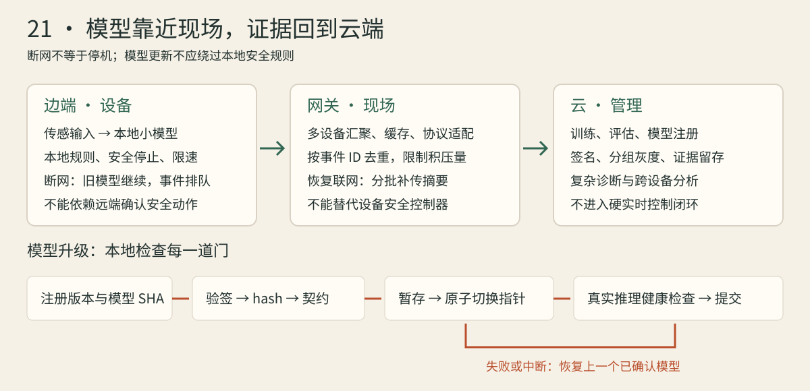
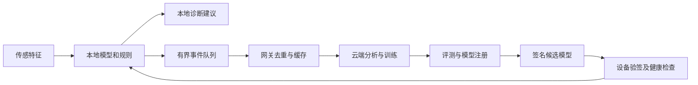
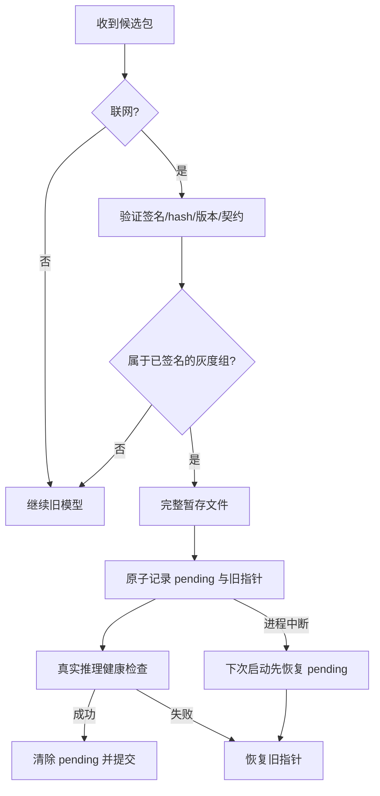
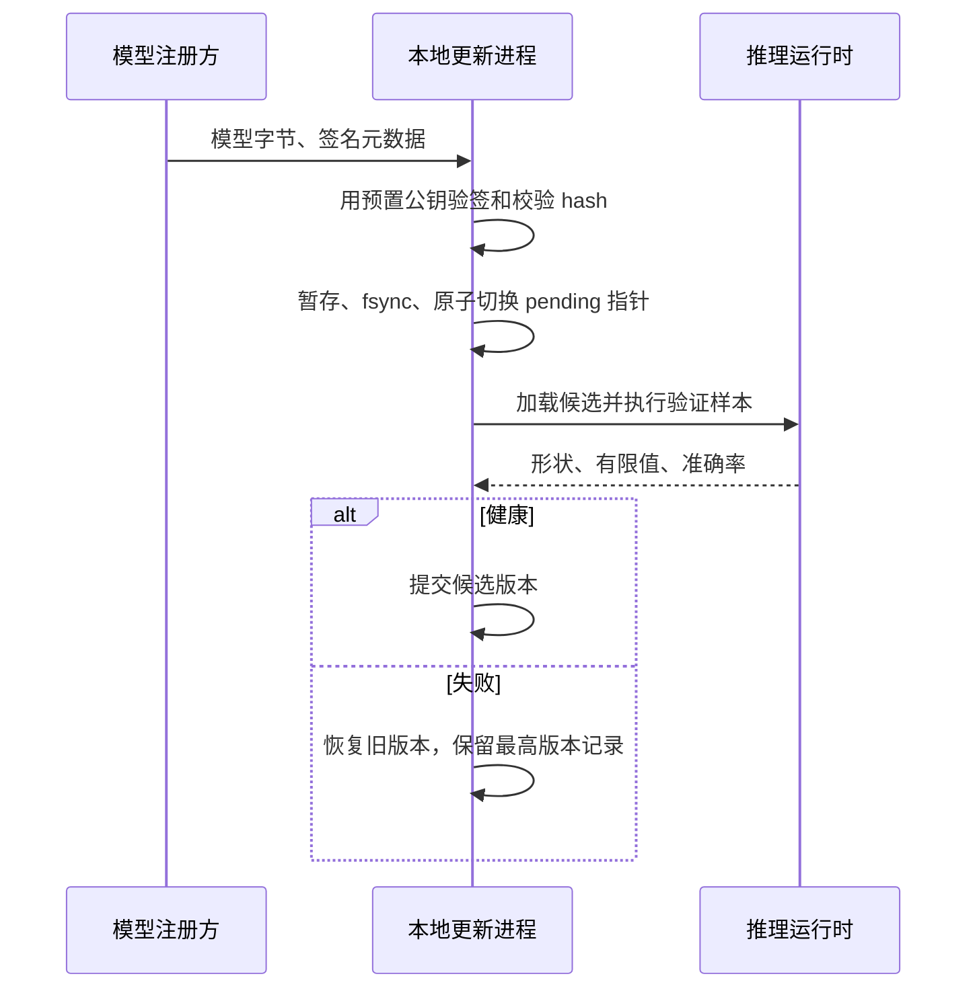
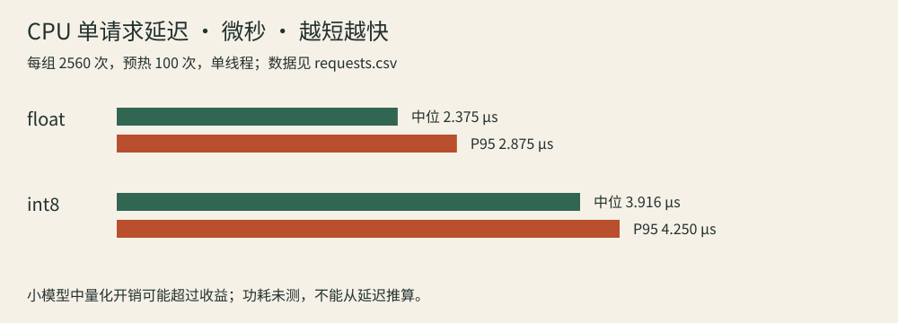

# 第 21 章｜Edge AI 与边云协同

> **本章目标：** 将一个可运行的模型放到设备侧，记录精度和资源成本，并验证升级失败后能恢复旧模型。  
> **难度：** L3；**预计时间：** 4–6 小时，不含目标硬件采购和系统适配。  
> **前置：** Python 3.12、矩阵和分类基础；第 06 章训练、第 07 章推理、第 14 章评测、第 17 章安全。  
> **范围：** 合成分类任务、真实 ONNX CPU 推理、INT8 量化、本地签名模型更新。不是大语言模型部署教程，不是机器人控制或固件 OTA 产品。  
> **学习目标：** 划分端网云职责；核对算子与运行时；用独立数据比较模型；验证签名、灰度、健康检查和回滚。  
> **交付状态：** 可运行实验与 M4 CPU 记录已提供。原任务要求先 x86 再目标设备；该顺序尚未完成。x86 CI 入口已准备，等待实际执行。功耗及其他 SoC 未验证。

## 1. 本章解决什么问题

工厂设备需要在网络不稳定时继续判断异常。把所有数据发到云端，会引入往返延迟、网络费用和可用性依赖。把所有模型塞到设备，则可能超出内存、散热和维护能力。

本章采用一个通用教学场景：设备读取 16 个特征，输出三个状态的分数。模型只产生诊断建议。独立的安全规则决定是否允许动作。数据与模型均为本书原创合成产物，不代表任何企业或真实设备效果。

替代方案是本地阈值规则加人工复核。规则容易审计，部署成本低，但复杂边界需要持续维护。模型只有在独立评测中显示收益，并能在设备预算内运行，才值得引入。

## 2. 先用大白话理解

边端像现场工作人员，网关像现场值班室，云像总部。工作人员必须会处理紧急情况，不能每次先等总部回复。总部负责长期分析和下发新方法。

严格地说，Edge 是靠近数据源执行计算的位置；Edge Gateway 是现场设备与上游服务之间的汇聚节点；Cloud 是提供集中计算和管理的服务。它们不由机器大小定义。一台现场服务器也可能是边缘节点。这个类比不表示网关或云天然可信。



| 任务 | 边端 | 网关 | 云 |
| --- | --- | --- | --- |
| 紧急停止、限速 | 独立安全规则，必须本地执行 | 只转发状态 | 不进入硬实时闭环 |
| 小模型推理 | 首选，使用已验证模型 | 资源足够时汇聚推理 | 不作为断网时的唯一路径 |
| 大模型诊断 | 可选，受资源约束 | 可选共享实例 | 可做复杂分析和人工协同 |
| 训练与注册 | 上报脱敏摘要 | 缓冲和去重 | 训练、评测、登记、签名 |
| 网络中断 | 保留旧模型，禁止半包激活 | 有界队列，保留重要事件 | 标记设备离线，不凭缺失数据判健康 |

## 3. 核心术语

| 术语 | 准确定义 | 容易混淆的地方 |
| --- | --- | --- |
| SoC | 集成 CPU、内存接口及其他计算单元的芯片 | SoC 型号不能代替驱动与 SDK 版本 |
| Execution Provider | ORT 将可支持的计算交给特定后端的接口 | 安装后端不表示全部算子都在后端执行 |
| 算子覆盖 | 目标后端对实际图、类型、形状和属性的支持范围 | 支持 MatMul 不等于支持任意量化 MatMul |
| QDQ | 用 QuantizeLinear/DequantizeLinear 表达量化边界 | 文件中存在 QDQ 不足以证明执行了整数内核 |
| 校准 | 用代表性输入估计静态量化参数 | 不应拿测试集校准后再报告独立测试准确率 |
| 模型契约 | 输入输出名称、形状、类型、语义与预处理约定 | 同样的 shape 也可能有不同特征顺序 |
| OTA | 通过远程分发更新软件或模型的流程 | 本章只演示本地模型更新状态机，不实现网络或固件升级 |
| 原子激活 | 读者看到完整旧状态或完整新状态 | 不等于可以抵抗任意硬件断电和文件系统损坏 |

## 4. 工作原理

### 4.1 输入、图与输出

实验输入是 `features: float32[1,16]`，来自固定种子的标准正态合成数据，无额外归一化。位置 0–15 的顺序就是契约的一部分。标签由固定非线性规则生成。网络结构为 `16 → 32 → 3`，隐藏层使用 ReLU，输出 `logits: float32[1,3]`。预测类别是最大分数的索引，不把 logits 当作校准后的概率。

训练 300 轮。训练、验证、测试分别是 2048、512、512 个样本，使用三个独立随机种子。初始化和批次顺序使用第四个种子。验证集记录训练过程，不用于挑选最佳轮数。静态量化只读取前 256 个训练样本。测试集只做最后比较。多数类基线的类别由训练标签决定。

模型每次前向主要计算两个矩阵乘法，乘加量随 `16×32 + 32×3` 增长。实际耗时还含调度、数据转换与 Python 调用，因此小图不能只按乘加次数推算延迟。量化使用近似关系 `x ≈ scale × (q - zero_point)`；超出整数范围的值会被截断，误差可能改变决策边界。

### 4.2 选择硬件前先检查图

| 单元 | 主要价值 | 必须检查 | 本次状态 |
| --- | --- | --- | --- |
| CPU | 通用、调试和回退路径简单 | 核数、线程、指令集、内存和调用开销 | M4 CPU 已测 |
| GPU | 较大并行任务吞吐 | 数据搬运、批量、显存、同步和驱动 | 未测 |
| NPU | 支持的模型上可提供专用加速 | 精度、布局、静态形状、算子限制、编译器及回退 | 未测 |

迁移检查顺序是：核对输入输出契约，检查 ONNX 图，运行目标转换器，查看不支持节点，再用真实输入执行并比对输出，最后用 profiler 确认执行位置。不能把“转换成功”写成“全图 NPU 加速成功”。ORT 的 provider 机制支持把图交给不同后端；实际覆盖需要运行记录证明。[ORT provider 文档](https://onnxruntime.ai/docs/execution-providers/)

## 5. 架构与流程

### 5.1 任务切分与断网



生产事件至少记录 `event_id`、采集时间、特征契约版本、模型 SHA 和预测。网关用事件 ID 去重。队列按条数与字节数设上限；低优先级摘要可以丢弃并记丢弃计数，安全事件必须另设持久化和告警路径。恢复联网后限速补传，不能让积压流量抢占本地推理。

本实验验证“断网不替换模型，旧模型仍能推理”，不实现这个完整队列系统。也不把异常标签直接转换成控制指令。工程中的“没有云端判断”应回到已定义的本地降级策略。

### 5.2 更新状态机



先验签和内容检查，再判断灰度组；未验签的灰度字段不可信。最高已接受版本与当前运行版本分开保存。回滚到本机已经确认过的旧模型，不等于允许网络重放任意旧版本。



## 6. 工程实现

### 6.1 运行时选型

| 运行时 | 定位 | 部署时的判断 |
| --- | --- | --- |
| ONNX Runtime | 执行 ONNX，通过 provider 对接不同计算后端 | 本实验固定 1.23.2 CPU；不能据此推断其他 provider 支持 |
| RKNN Toolkit2 / Runtime | Rockchip 平台的模型转换及目标端执行工具 | 按具体 SoC、Toolkit、Runtime、驱动组合核查；本实验未安装和验证 |
| TensorRT | NVIDIA GPU 推理优化与执行工具 | 核查 GPU、CUDA、TensorRT、精度及 engine 兼容条件；本实验未验证 |
| llama.cpp | 面向语言模型的 C/C++ 推理项目，支持量化及多种后端 | 适合相应模型格式与架构；不是本章任意 ONNX 分类器的替代加载器 |

选型依据见 [RKNN 官方仓库](https://github.com/airockchip/rknn-toolkit2)、[TensorRT 官方入门](https://docs.nvidia.com/deeplearning/tensorrt/latest/getting-started/quick-start-guide.html)、[llama.cpp 官方仓库](https://github.com/ggml-org/llama.cpp)。这些工具的定位不构成特定设备支持保证。

### 6.2 项目结构和完整代码

完整代码在实验目录，不用伪代码代替可运行实现：

```text
labs/edge_cloud/
  benchmark.py        # Train, export, quantize, benchmark and plot
  ota.py              # Signed local model update and crash recovery
  verify_ota.py       # Dependency-enabled acceptance tests
  test_edge_cloud.py  # Standard-library-only tests
  requirements.txt
  ci-job.yml          # Job example, inactive until integrated
  evidence/m4-20261120/
```

[真实训练与推理代码](../labs/edge_cloud/benchmark.py)使用 NumPy 训练，再用 ONNX helper 构建并检查模型。它不下载外部权重。模型用 opset 17、IR 10，静态 QDQ、INT8 激活、按通道 INT8 权重。预处理先推导图形状，不在量化前做融合。关于 QDQ、校准与精度损失的机制，见 [ORT 量化文档](https://onnxruntime.ai/docs/performance/model-optimizations/quantization.html)。

[升级实现](../labs/edge_cloud/ota.py)的 `install()` 先认证元数据，随后检查文件和版本；`atomic_json()` 对文件及目录执行同步；`recover()` 在启动时处理尚未确认的候选。它仅支持一个更新进程。独立运行服务必须先恢复，再从活动指针载入模型。

### 6.3 安装与运行

先运行不需要第三方包的检查：

```sh
python3 -m unittest labs.edge_cloud.test_edge_cloud -v
```

真实实验使用独立环境，不改变项目根环境：

```sh
python3.12 -m venv /tmp/leanagentbook-edge-env
/tmp/leanagentbook-edge-env/bin/python -m pip install -r labs/edge_cloud/requirements.txt
/tmp/leanagentbook-edge-env/bin/python -W error labs/edge_cloud/benchmark.py --output output/edge-cloud-run1
/tmp/leanagentbook-edge-env/bin/python labs/edge_cloud/verify_ota.py --models output/edge-cloud-run1 --report output/edge-cloud-run1/ota-tests.json
```

新输出目录必须不存在。默认验收要求浮点准确率至少 85%，INT8 相比浮点下降不超过 3 个百分点；不要求 INT8 更快。数据生成后保存独立分割和 hash，输出模型与数据均很小。详细重现说明见[实验说明](../labs/edge_cloud/README.md)。

原任务的 x86 验证入口是 [CI 作业示例](../labs/edge_cloud/ci-job.yml)。整合进实际 workflow 后运行，保留工作流 URL、提交 SHA 与 artifact。`--expect-arch x86_64` 防止把 ARM 机器误记成 x86。补完 x86 后，再按同样步骤复跑目标设备。

## 7. 工程案例与本次证据

### 7.1 测量条件

本次是 2026-11-20（America/Los_Angeles）的 Apple M4、arm64、macOS 26.3 实测；机器不是 RK3588 或 Jetson。运行 Python 3.12.14、NumPy 2.2.6、ONNX 1.19.1、ORT 1.23.2，显式只使用 `CPUExecutionProvider`。没有启用 Metal、CoreML 或 NPU。

每组独立子进程，单线程、批量 1，预热 100 次。512 个测试输入顺序执行 5 遍，共 2560 次。计时从真实 `session.run()` 前开始，在结果返回后结束；不包含载入、构造输入和 CSV 写入。载入时间另记。profiler 另建会话，避免影响计时。



| 指标 | 多数类基线 | 浮点 ONNX | INT8 QDQ ONNX |
| --- | ---: | ---: | ---: |
| 测试准确率 | 36.13% | 93.95% | 93.55% |
| 模型文件 | 不适用 | 3050 字节 | 3103 字节 |
| 中位延迟 | 未计时 | 2.375 μs | 3.916 μs |
| P95 延迟 | 未计时 | 2.875 μs | 4.250 μs |
| 独立进程 RSS 峰值 | 未测 | 66.06 MiB | 66.25 MiB |
| 功耗 | 未测 | 未测 | 未测 |

RSS 是整个测量进程的峰值，包含解释器、库、数据及会话，不是模型独占内存。微秒级测量会受系统调度、温度与调用成本影响；这里只展示一次本机运行，不是跨设备性能排行。没有功耗测量权限或仪器证据，因此不计算每次推理能耗，也不把芯片 TDP 当作功耗。

量化下降约 0.39 个百分点，延迟却增加。小模型的量化转换、额外图信息与调用开销可能超过整数计算收益。数据证明这个配置下量化没有带来文件和延迟收益，不能推广成“INT8 总是慢”。更大模型、不同算子和硬件需要重新测试。

原始图有 Add、MatMul、Relu；量化图新增 QuantizeLinear、DequantizeLinear。执行 profile 显示浮点用 CPU 的 FusedGemm/Gemm，INT8 用 CPU 的 QLinearMatMul 和量化转换内核。这提供了整数路径真实执行的证据。导出模型与 NumPy 在 32 个验证输入上的最大绝对输出误差为 0；这只是选定样本上的数值对照。

完整 hash 与执行记录见[本次 summary](../labs/edge_cloud/evidence/m4-20261120/summary.json)，请求级原始计时见[浮点 CSV](../labs/edge_cloud/evidence/m4-20261120/float-requests.csv)和[INT8 CSV](../labs/edge_cloud/evidence/m4-20261120/int8-requests.csv)。本机模型 SHA：

```text
float 61cde670c0edddab83fe0071fc25f02723184e74879b33bf9548509cc7612673
int8  b0b499446405a443de33ad27edfc12876f344a58b5816103943f6c400a70637c
```

### 7.2 从合成案例迁移到设备

设备案例中，可以将振动、电流和温度窗口变成固定特征，由本地小模型先筛选异常，云端结合维修记录分析原因。但本实验的 16 维输入不对应真实传感单位，不能直接拿它控制设备。迁移时先定义采样、缺失值、归一化、特征单位与标签，再按时间或设备划分数据，避免同一故障片段同时出现在训练和测试中。

## 8. 方案对比与设计取舍

| 方法 | 改变什么 | 可能收益 | 主要代价 | 验证方式 |
| --- | --- | --- | --- | --- |
| 量化 | 权重或激活的表示精度 | 减少数据体积，利用整数内核 | 校准误差、转换成本、算子限制 | 比较独立集准确率、profile、内存和时延；本章实际执行 |
| 剪枝 | 删除连接或结构 | 降低实际计算或参数量 | 非结构化零值不一定被运行时利用 | 确认稀疏内核或结构缩小，再实测；本章仅设计讨论 |
| 蒸馏 | 用教师输出或中间表示训练学生 | 更小的学生网络 | 额外训练、教师偏差、数据要求 | 学生独立验收；不能只看拟合教师的损失；本章未训练蒸馏模型 |
| 云端推理 | 移动计算位置 | 减少本地模型负担 | 网络、隐私、成本与断网依赖 | 测端到端 P95 和离线降级 |
| 本地规则 | 用人工定义的边界判断 | 可解释、成本低 | 复杂模式覆盖有限 | 固定基线和误报漏报统计 |

精度、时延、内存和功耗必须分别约束。减少文件体积不一定减少进程内存；加速不一定降低整机能耗。生产预算应写成可测阈值，例如“目标设备上 P95 小于业务期限，稳定峰值内存低于可用上限，关键类别召回达到要求”。阈值由场景决定，不能沿用本章合成数据的 85%。

## 9. 生产环境注意事项

模型注册至少保存模型 hash、字节数、训练来源、数据契约、评测结果、目标运行时和批准版本。签名覆盖这些受保护字段。公钥必须来自可信安装或可信轮换流程，不能让下载包自带的公钥决定自己是否可信。本实验使用真实 Ed25519，临时教学私钥仅在内存中生成和使用。[Ed25519 官方 API](https://cryptography.io/en/latest/hazmat/primitives/asymmetric/ed25519/)

灰度采用稳定设备 ID 的 hash 分组。先小比例，再依据错误率、推理输出、加载失败和资源预算扩大比例。启动健康只证明“现在能运行”；生产还需要持续健康窗口。若延迟或准确率代理指标恶化，应冻结放量并恢复旧版本。

本实验测试损坏签名、篡改元数据、篡改模型、不兼容契约和运行时、版本重放、灰度排除、断网、下载中断、激活后重启及真实模型载入失败回滚。中断是异常注入，不是拔电测试。12 项结果见[升级验收记录](../labs/edge_cloud/evidence/m4-20261120/ota-tests.json)。

这里没有实现密钥撤销、轮换、可信时间与过期策略、门限签名、多角色元数据、并发更新锁和完整网络传输。它不是完整 TUF 实现。需要抵抗冻结、回滚、混搭元数据或签名密钥失陷时，应采用成熟更新框架并验证其威胁模型。[TUF 规范](https://theupdateframework.github.io/specification/latest/)

RK3588 验收表需加 Toolkit2、Runtime、驱动版本和算子转换报告；Jetson 表需加 JetPack、CUDA、TensorRT 和 engine 构建条件。设备上要记录温度、频率、稳定运行窗口及功耗测量方法。没有实机或测量工具的格子写“未验证”，不能填理论峰值。

## 10. 动手实践

### 目标与前置条件

准备 Python 3.12、独立环境与磁盘写入空间。先在 x86 Ubuntu CI 中运行，再在可访问目标设备重复。若仅有一种平台，明确登记缺口，不伪造第二种平台结果。

### 实践步骤

1. 运行标准库测试，确认默认测试不依赖第三方包。
2. 安装实验依赖，执行训练、ONNX 导出和量化。保存数据分割、版本与模型 hash。
3. 查看两组请求 CSV，重算中位数与 P95。核对不是只测空函数或模型载入。
4. 检查图算子和 profile provider，确认真正执行的内核。
5. 运行签名升级检查，确认断网后旧模型仍能执行推理，坏候选不能长期取代旧模型。
6. 整合 CI 示例，在真实 x86 runner 保存产物；随后复跑目标设备。
7. 记录功耗工具、测量窗口、空闲基线和负载条件。没有测量证据时保留“未测”。

### 验收标准

| 检查项 | 通过条件 | 本章交付状态 |
| --- | --- | --- |
| 数据与基线 | 固定种子、独立分割，测试集不用于校准 | 已验证 |
| 真实推理 | ONNX checker 通过，浮点与 INT8 均实际运行 | M4 CPU 已验证 |
| 量化质量 | 浮点准确率 ≥85%，INT8 下降 ≤3 个百分点 | 已验证，仅适用合成实验 |
| 资源证据 | 记录模型大小、请求级时延、内存、平台及 provider | 已验证 |
| 安全升级 | 真实签名和 12 项恢复/拒绝检查通过 | 已验证，本地教学范围 |
| x86 → 目标流程 | 真实 x86 成功记录，再复跑目标 | 待补 x86 CI 与后续目标复跑 |
| 功耗 | 实际测量及方法可复查 | 未测，完整硬件验收未完成 |
| RK3588/Jetson/NPU | 对应实机、SDK、算子与资源报告 | 未验证，不在本次设备声明中 |

### 常见错误与扩展挑战

常见错误包括把安装 provider 当作加速证据、把文件大小当作内存、混用毫秒和微秒、用测试集校准、只验 hash 不验签、发生健康失败后重试同一坏版本。另一个错误是在读取 pending 指针后直接提供推理服务；应先恢复。

扩展练习：放大网络，再比较量化开销与计算收益；用不同校准集观察精度变化；为模型契约加入真实特征单位；增加签名过期与密钥轮换；接入实际功耗仪。每个扩展都应单独保存结果，不能覆盖本章证据。

## 11. 本章总结

- 本地安全行为不能依赖网络可达。
- 硬件型号、运行时版本和实际算子覆盖必须一起记录。
- 独立测试集和简单基线让量化比较可解释。
- INT8 的收益需要实测；本次小图更慢且略大。
- 签名认证来源，hash 检查内容，两者不能互相替代。
- 健康检查应执行实际推理，失败和中断都应有恢复路径。
- 功耗未测就是证据缺口，不能由 TDP、延迟或文件大小推算。

结合第 14 章制定验收阈值、第 17 章定义信任边界，再将设备证据交给第 22 章诊断流程。边云协同只决定计算位置，不自动证明诊断因果关系。

## 12. 参考资料

以下一手资料于 **2026-11-20（America/Los_Angeles）** 核对。文档页面可能继续更新；本实验可执行版本固定在 requirements 中。

| 来源 | 支持的陈述 | 版本或边界 |
| --- | --- | --- |
| [ORT 量化](https://onnxruntime.ai/docs/performance/model-optimizations/quantization.html) | 静态校准、QDQ 表示、量化精度和性能需要检查 | 本实验 ORT 1.23.2，其他后端另测 |
| [ORT Execution Providers](https://onnxruntime.ai/docs/execution-providers/) | 通过 provider 执行不同后端计算 | 不保证任意图全部在目标加速器上执行 |
| [RKNN Toolkit2](https://github.com/airockchip/rknn-toolkit2) | Rockchip 模型转换与部署工具定位 | 未执行该 SDK，无特定 SoC 支持承诺 |
| [TensorRT 入门](https://docs.nvidia.com/deeplearning/tensorrt/latest/getting-started/quick-start-guide.html) | NVIDIA 推理工作流与 ONNX 部署入口 | 未执行 TensorRT，不声明 engine 跨设备可移植 |
| [llama.cpp](https://github.com/ggml-org/llama.cpp) | C/C++ 语言模型推理与量化后端定位 | 未执行该运行时 |
| [cryptography Ed25519](https://cryptography.io/en/latest/hazmat/primitives/asymmetric/ed25519/) | 真实签名、验签与失败异常 | 本实验 cryptography 46.0.3 |
| [TUF 规范](https://theupdateframework.github.io/specification/latest/) | 更新元数据、角色、回滚与冻结等威胁 | 核对页面版本 1.0.37；本实验不实现完整规范 |

本章图形、训练模型和合成数据均为原创。性能结论来自附带原始记录，不能作为其他设备或真实业务的性能承诺。
