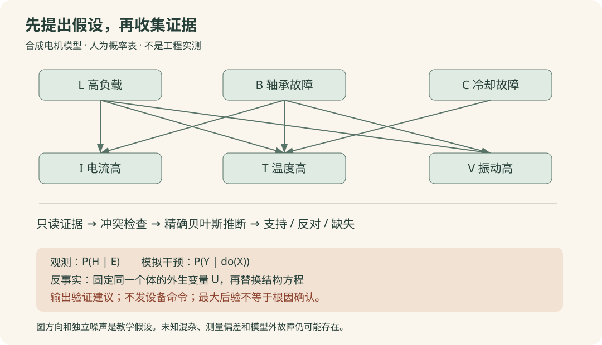
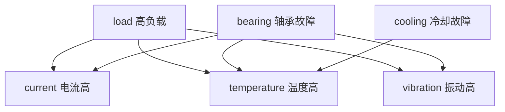
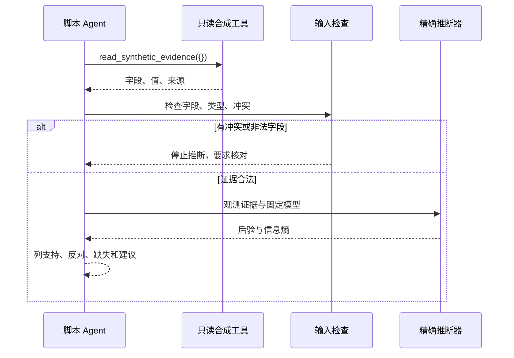

# 第 22 章 · Causal AI 与智能故障诊断

> 本章目标：从“找到相似案例”前进到“提出可检查的故障假设”。
>
> 难度：L3。建议时间：3 小时。前置：Python、条件概率、第 14 章评测、第 17 章安全边界及第 19 章异常检测。



## 1. 范围、前置与学习目标

本章解释相关与因果，比较故障树、FMEA、因果图、知识图谱和贝叶斯网络。实验用 Python 3.11+ 标准库实现电机结构因果模型、精确贝叶斯推断，以及只读取合成证据的脚本 Agent。无需真实 LLM，也不连接设备。

完成后，你应能区分观测、干预和反事实；写出模型假设；为每个诊断假设列出支持、反对和缺失证据；用独立校准集与测试集检查概率输出。合成实验完成不代表现场故障诊断系统完成，更不代表本书 24 章全部验收。

## 2. 先用大白话理解：看到一起发生，不等于知道改动后会怎样

维修记录中，风扇开启时电机更热。直接解释为“风扇导致过热”可能错了：高负载既让风扇开启，也让电机升温。只有明确共同原因，才能分析改变风扇状态的影响。

| 问题类型 | 表达式 | 问的是什么 | 需要什么 |
| --- | --- | --- | --- |
| 观测 | P(Y=1\|X=1) | 看到 X 时，Y 多常见 | 联合分布和采样范围 |
| 干预 | P(Y=1\|do(X=1)) | 外部固定 X 后，Y 怎样变化 | 因果图、识别假设或实验设计 |
| 反事实 | P(Yₓ=1\|E=e) | 已发生这次事件，若当时改了 X 会怎样 | 结构方程和同一个体的外生变量后验 |

本章约定“因果证据”包括符合识别假设的干预研究证据。单个异常读数是观测证据。模拟器内的 do 计算是模型推演，不是现场干预证据。[Pearl 的原始论文](https://ftp.cs.ucla.edu/pub/stat_ser/r350.pdf)建立了结构模型、干预替换与反事实分析的联系；结论依赖所声明的模型假设。

### 2.1 可计算的混杂反例

令 L 为高负载、X 为风扇开启、Y 为过热。设 P(L=1)=0.5；P(X=1\|L=1)=0.9，P(X=1\|L=0)=0.1；P(Y=1\|L,X)=0.2+0.6L−0.1X。这些数是教学假设。


| 算法结果 | X=0 | X=1 | 差值，1 减 0 |
| --- | --- | --- | --- |
| 观测 P(Y=1\|X) | 0.26 | 0.64 | +0.38 |
| 干预 P(Y=1\|do(X)) | 0.50 | 0.40 | −0.10 |

观测对 L 使用 P(L\|X) 加权；干预对 L 使用 P(L) 加权。调整式是 `Σ_l P(Y|X=x,L=l)P(L=l)`。在此人为模型中，已知负载阻断后门路径，且每个负载层都有两种风扇状态。若存在未测环境温度共同影响 X 和 Y，以上调整未必能识别效果。还需一致性、足够的状态覆盖和稳定机制。不可把观测条件筛选当作干预。

## 3. 核心术语与方案选择

| 方法 | 定义与方向 | 本例用途 | 不可替代的部分 |
| --- | --- | --- | --- |
| Fault Tree，故障树 | 从顶层失效向下分解 AND/OR 组合 | “过热停机”可能由哪些组合触发 | 逻辑门不是自动学出的概率；共因不能假装独立 |
| FMEA，失效模式与影响分析 | 从部件失效向上记录影响、检测和处置 | 为轴承、冷却建立检查清单 | 严重度、发生度和可探测性评分不是后验概率 |
| Causal Graph，因果图 | 有向边表示被假定的生成机制 | 表达负载、故障与症状 | 图方向不能只靠相似度或相关系数确认 |
| Knowledge Graph，知识图谱 | 实体与带类型的关系 | 电机属于哪台设备、手册有哪些检查项 | “关联到”不等于因果边；检索命中不证明原因 |
| Bayesian Network，贝叶斯网络 | DAG 与每个节点的条件概率表构成联合分布 | 根据症状更新故障概率 | 普通 BN 可仅表统计依赖，不自动具有干预语义 |
| SCM，结构因果模型 | 每个变量由父节点和外生变量通过方程生成 | 替换方程，计算模拟干预与反事实 | 同样的观测分布可能来自不同结构模型 |

[NASA 的故障树说明](https://s3vi.ndc.nasa.gov/ssri-kb/topics/16/)支持 FTA 自顶向下、FMEA 自底向上的区别。下面是作者为本实验设计的 FMEA 示意，未使用现场评级：

| 失效模式或工况 | 可能影响 | 可读取的证据 | 有限验证建议 |
| --- | --- | --- | --- |
| 高负载，可能正常 | 电流和温度升高 | 生产节拍与负载历史 | 先核对工况变化，不先判故障 |
| 轴承故障 | 振动、电流和温度异常 | 已有振动趋势与维修记录 | 请维护人员核对历史谱图和检修结果 |
| 冷却故障 | 温度升高 | 冷却状态记录 | 核对风道检查记录，不远程切换风扇 |

没有可靠发生率时，先维护可审查的清单比填一组看似精确的风险数字更好。

## 4. 电机模型：从条件概率到真正的计算



模型含六个二值节点，根节点 L/B/C 独立；可以同时有两种故障。症状在给定父节点后按各自独立噪声产生。完整联合分布为：

`P(L,B,C,I,T,V)=P(L)P(B)P(C)P(I|L,B)P(T|L,B,C)P(V|L,B)`。

| 节点 | 人为设定 P(节点=1\|父节点) |
| --- | --- |
| L / B / C | 0.40 / 0.12 / 0.15 |
| I | 0.05 + 0.55L + 0.25B |
| T | 0.05 + 0.35L + 0.25B + 0.30C |
| V | 0.05 + 0.70B + 0.10L |

这些公式定义全部 CPT 行，并不是用工程数据拟合的回归。每个概率均在 0 和 1 之间。

对每个节点取独立 `U_i ~ Uniform(0,1)`，定义 `X_i = 1[U_i < p_i(parents)]`。这是生成器的结构方程。`infer` 枚举 64 种状态，乘各节点因子，再按观测归一化，得到 `P(B|I,T,V)`。一般 n 个二值节点的枚举时间约为 O(n·2ⁿ)，单状态空间 O(n)。大图应采用变量消元等算法；本实验不假装枚举可以直接扩展到整个工厂。

模拟 `do(L=0)` 时，删除 L 的原概率因子并固定 L=0。保留其他机制。若同时输入“观察 L=1”和“干预 L=0”，接口拒绝这种不一致查询。它没有实现跨世界查询的通用语法。

### 4.1 为什么不能简单相乘三条证据

电流和温度有共同父节点。只知道 B 而不知道 L 时，两种症状仍可能相关。把三条单独的似然比直接相乘会重复利用信息。代码用完整联合分布一次更新。

报告里的“支持/反对”用单条证据引起的后验相对先验变化表示；这是解释线索，不是可加的贡献值，也不是独立因果证明。各故障后验不要求加起来等于 1，因为故障可以共存。

## 5. 同一个体反事实：先回推，再替换，再预测

已知一次合成个体的全部 U 时，两次运行必须用同一组 U。仅把负载方程替换为 0，再算温度。示例的 U_T=0.4：实际 L=1、B=1、C=0，因此温度阈值为 0.65，T=1。改为 L=0 后阈值变成 0.30，同一 U_T=0.4 得到 T=0。

更一般地，真实观察不能告诉我们确切 U。代码的 `counterfactual_temperature` 接收完整事实状态并解析回推：实际 T=1 时，U_T 在 `[0,0.65)` 内均匀分布；模拟负载为 0 后，过热条件是 U_T<0.30。因此条件反事实过热概率为 `0.30/0.65 ≈ 0.461538`。这与“已知 U=0.4 的个体必为 0”并不矛盾，输入信息不同。

该函数只支持完整事实状态和负载干预。部分证据时需要对未观测父节点和 U 的联合后验积分，不能套用该比例。它拒绝缺字段。重新抽一组独立噪声得到的是另一合成个体，不能冒充同一个体反事实。相同 CPT 本身也不足以确定跨世界关系；此处阈值方程明确增加了这种结构假设。

## 6. 架构与工程实现



```text
合成记录 --> [只读工具] --> [脚本 Agent] --> [可审查报告]
                               |
                               +--> 验证建议，不执行
[真实设备控制]                  无连接
```

完整实现保存在 [diagnosis.py](../labs/causal_diagnosis/diagnosis.py)，不是伪代码。测试在 [test_diagnosis.py](../labs/causal_diagnosis/test_diagnosis.py)，运行入口、结果与数据在 [实验目录](../labs/causal_diagnosis/README.md)。

```text
labs/causal_diagnosis/
  diagnosis.py
  test_diagnosis.py
  DATA_CARD.md
  README.md
  VALIDATION.md
  results/reference-v1/
    report.json
    calibration.json
    test.json
```

| 组件 | 实际职责 | 错误处理 |
| --- | --- | --- |
| probability / scm | 定义 CPT，按结构方程生成状态 | 未知节点、无效噪声和干预报错 |
| infer | 64 状态精确枚举与截断分解 | 非二值、未知字段和相矛盾查询报错 |
| ReadOnlyTools | 返回合成记录并记录成功读取 | 任意控制工具名或额外参数拒绝 |
| diagnose | 固定三个候选假设，检查并更新 | 矛盾时不计算；全缺失时标证据不足 |
| counterfactual_temperature | 固定 U 后验的解析积分 | 不支持的事实输入拒绝 |
| generate / score | 独立生成校准与测试数据，计算 Brier | 输出目录已存在则拒绝覆盖 |

假设生成在此是固定候选表，不是 LLM 开放式发现。加入真实 LLM 时，它可以整理证据和提出候选，但不得自行改图方向、补 CPT 或伪造缺失值。模型外的传感器偏移、供电问题仍可能是实际原因；系统应允许“现有模型不足”。

## 7. 工程案例：维修助手如何提出下一步

某产线电机三个症状都高。报告保留证据来源，对负载、轴承和冷却分别列出后验。最大后验只能让维护人员优先查看某项证据，不能触发“根因已确认”。

| 阶段 | 操作 | 证据类别与限制 |
| --- | --- | --- |
| 生成假设 | 从 FMEA 与本模型选三个候选 | 工程知识假设，不是已证实事实 |
| 收集证据 | 读取现有状态、日志与来源 | 观测，不改变设备 |
| 验证建议 | 请求已有负载、冷却和维修记录 | 可减少信息缺口，不直接控制 |
| 设计实验 | 合格人员另行设计隔离负载实验 | 仅干预建议，需要独立流程，不由 Agent 执行 |
| 更新结论 | 新证据通过检查后重算 | 仍受模型范围和质量约束 |

本实验每次最多输出两条固定建议，避免开放式循环不断要求操作设备。对矛盾读数停止推断并建议核对来源与时间；缺失状态在概率计算中被边缘化，不按 0 填充。所有正常报告中 `root_cause_confirmed=false`。

## 8. 校准：概率说得准不准

后验计算正确，不意味着模型符合真实世界。信息熵 `−p log₂p−(1−p)log₂(1−p)` 只描述该二元假设在当前模型内的不确定性。低熵可能来自错误且过于确定的 CPT，不能当作模型可靠的证据。

本实验校准任务只预测 B，输入 I/T/V。CPT 人为给定，所以没有训练集。分别用种子 2201 和 2202 生成 1000 行校准集和 1000 行测试集，保存全部行与 ID。

校准集在五个收缩系数中选择最小 Brier：`p'=(1−s)p+s·0.12`。冻结 s 后，在测试集报告 Brier 和五个概率箱的样本数、平均预测与实际标签频率。Brier 为 `mean((p−y)²)`，越小越好；这是概率损失，不是故障定位成功率。空箱为 null，不算完美。

基准选择 s=0，独立测试 Brier 约为 **0.061342**。这符合生成模型已知的实验设置，但有限样本有波动。不能据此宣称真实故障概率准确。真实应用需独立设备与时间段、维修确认标签、分工况检查、概率区间与漂移复评；不能用测试集选择变换或反复调图。

## 9. 方案取舍与生产边界

| 方案 | 优点 | 代价 | 适用范围 |
| --- | --- | --- | --- |
| 手册检索与规则 | 快，结果易追溯 | 难处理证据冲突和概率 | 先建立可靠检查清单 |
| BN 精确枚举 | 输出可核查，支持缺失边缘化 | 指数复杂度，CPT 维护成本 | 本章小图 |
| 因果图加 SCM | 可明确模拟动作和反事实 | 结构假设强，真实识别困难 | 已知机制、严谨研究 |
| LLM 自由解释 | 能组织自然语言与文档 | 容易编出因果和置信度 | 只能作受约束的说明层 |

生产需额外落实：读写凭证隔离、数据时间对齐、传感器质量、版本化图与 CPT、输入输出审计、模型回滚和模型外故障转人工。实验无网络成本，无模型调用费用；真实日志检索有存储、权限和超时成本。加载失败应返回不可用，不能退回随意猜测。

图方向必须由机制、时间顺序及研究支持；仅拟合观测分布不够。若未观测混杂影响故障与症状，当前图的结论可能错误。动态反馈需要时间展开或专门模型，本章静态 DAG 不表示完整电机物理过程。

工具白名单在此仅是应用接口约束，不是 Python 敌对代码沙箱。现场控制必须在独立授权、联锁和执行系统中，本书实验不提供控制能力。

## 10. 动手实践与验收

在仓库根目录运行；无需安装第三方依赖：

```sh
python3 -m unittest discover -s labs/causal_diagnosis -v
python3 labs/causal_diagnosis/diagnosis.py --output /tmp/causal-diagnosis-run-1
python3 scripts/check_book.py
```

输出目录必须不存在；重复运行换新目录，不覆盖 `results`。查看生成报告，并与 [保留报告](../labs/causal_diagnosis/results/reference-v1/report.json) 比较。

练习：输入电流高、振动低，找出对轴承假设的支持与反对项。再输入两条矛盾温度记录，确认系统停止。最后删除全部证据，确认输出证据不足而非“设备正常”。

| 验收项 | 可检查标准 |
| --- | --- |
| 混杂反例 | 观测差 +0.38，干预差 −0.10，说明调整条件 |
| 贝叶斯推断 | 单症状结果匹配手工 Bayes 解析式 |
| 反事实 | 同一 U 下温度从 1 变 0；部分未知 U 时得到 0.30/0.65 |
| 证据与不确定性 | 每个假设有支持、反对、缺失、后验、信息熵和观测类别 |
| 安全边界 | 控制工具与额外参数拒绝；建议不执行 |
| 输入质量 | 矛盾停止；缺失标记；未知字段与错误类型拒绝 |
| 校准 | 校准和测试 ID 分离；参数只在校准集选择；保存分箱样本数 |
| 可复现性 | 11 项测试通过；完整结果与数据卡可查；新运行目录不覆盖保留结果 |

常见错误包括把正常高负载叫故障、把后验最大叫确定根因、把熵当置信区间、把缺失补为正常、把知识关系当因果方向、对同一个体重抽噪声。扩展练习可加入传感器偏移节点并比较后验变化；必须重新声明图和 CPT 假设，再建立独立测试集，不可只修改期望答案。

## 11. 本章总结

- 异常是观察到的现象，故障原因需要更多证据。
- 条件筛选与替换生成机制是不同计算。
- 因果图需要外部假设；普通 BN 不自动回答干预。
- 同一个体反事实必须保留外生变量或其条件后验。
- 后验、反证与缺失项应一起交付，不用一个最大分数代替诊断。
- 校准和测试必须分开；同生成器评测不能证明现场有效。
- Agent 可协助收集证据和提出建议，设备动作需要独立系统。

第 19 章提供异常信号，第 17 章提供权限边界，第 24 章将诊断接入更完整的业务流程。本章仍是可运行教学模型，不是生产安全认证。

## 12. 参考资料与支持范围

以下来源于 2026-11-20 核对。模型数字、图和代码由本章作者设计，并非以下资料给出的工程测量值。

| 一手来源 | 版本或年份 | 支持的正文陈述 |
| --- | --- | --- |
| [Pearl, Causal inference in statistics: An overview](https://ftp.cs.ucla.edu/pub/stat_ser/r350.pdf) | Statistics Surveys 3，2009 | 结构模型、干预替换、识别假设和反事实语义；不支持本章 CPT 数值 |
| [NASA SSRI, Mechanical Fault Tree Analysis](https://s3vi.ndc.nasa.gov/ssri-kb/topics/16/) | 页面列示 2021 更新 | FTA 自顶向下与 FMEA 自底向上的区别；不为本电机模型背书 |

实验具体假设见 [数据卡](../labs/causal_diagnosis/DATA_CARD.md)，实际执行结果见 [验证记录](../labs/causal_diagnosis/VALIDATION.md)。
