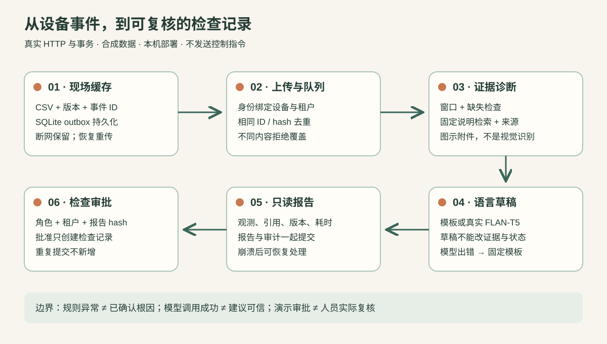
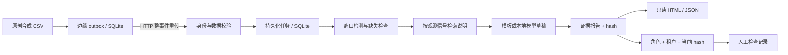
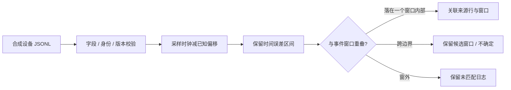
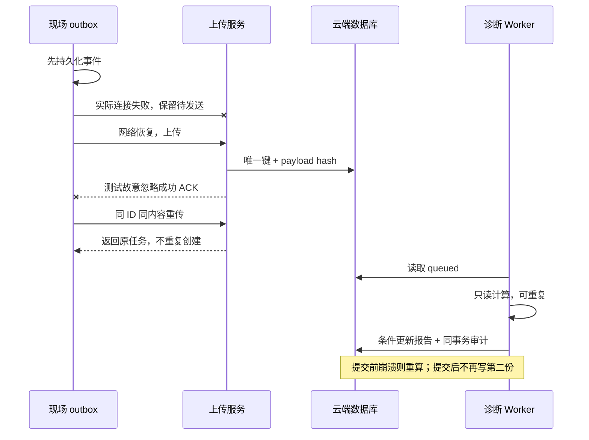

# 第 24 章｜机器人智能诊断平台综合实战

> **范围：** 用合成数据完成现场缓存 → HTTP 上传 → 持久化诊断 → 证据阅读 → 检查审批。核心流程可无模型运行，也有真实本地语言模型的运行记录。云服务位于本机；无实机控制。
>
> **前置条件：** Python 3.11+；读过 16–22 章的恢复、权限、时序与设备数据概念。默认实验只用标准库。
>
> **学习目标：** 能解释业务角色、数据版本、重传去重、崩溃恢复、证据与草稿的区别，并用测试证明批准不能越权。
>
> **交付状态：** 端到端教学原型；真实 Bag、训练、图像检索在前序章节分别实跑，本章尚未把这些依赖全部接入同一在线任务。

## 1. 从业务问题开始

机器人出现抖动，现场人员需要知道“哪段记录值得看、依据是什么、还缺什么”。异常分数只能帮助筛选，不能直接确认电机损坏。设备安全控制、数据分析与人工处理必须有明确职责。



| 角色 | 输入与输出 | 本原型的实现 |
|---|---|---|
| 操作员 | 记录现象、工况、时间 | 用合成事件代替现场填报 |
| 设备采集端 | 传感器记录、固件与配置版本 | 本地 CSV → 持久化 outbox |
| 现场工程师 | 上传最小事件，查看证据 | 实际 HTTP 与只读报告页 |
| 诊断服务 | 校验、规则检测、检索、草稿 | SQLite 队列、确定性工具、可选真实模型 |
| 审批人员 | 选择当前报告，批准建立检查记录 | 服务端权限检查；demo 脚本扮演该角色 |
| 模型维护人员 | 审核标签、训练、评测与发布 | 本章定义接口，训练与升级见 19/21 章 |

业务指标应是误报导致的复核时间、漏报事件和修复后的复验结果。本实验没有真实维修人员参与，不能报告停机改善或人工效率提升。

## 2. 先看运行效果

```text
机器人诊断 · 证据与复核
┌──────────────────────────────────────────────┐
│ tenant-a:robot-a:abnormal                     │
│ 观测异常，待复核                             │
│ 电流超限 → 检查负载与传感器，不能确认损坏     │
│ 语言建议：须核对                             │
│ ▸ 查看原始证据、版本与耗时                    │
└──────────────────────────────────────────────┘
检查审批记录：1（演示脚本模拟人员提交）
```

[打开已运行的报告](../labs/robot_platform/results/model-report.html) · [机器可读结果](../labs/robot_platform/results/model-report.json) · [完整实验指南](../labs/robot_platform/README.md)。在线页面是静态结果，展开内容即可阅读；不会运行 Python，也不会提交审批。

从仓库根目录执行：

```sh
python3 labs/robot_platform/demo.py --output /tmp/robot-platform-run-1
python3 -m unittest discover -s labs/robot_platform -p 'test_*.py' -v
python3 labs/robot_platform/platform_app.py --database /tmp/robot-platform-run-1/cloud.sqlite --serve
```

第三条命令打印本地 URL；打开可看刚产生的结果，Ctrl-C 停止服务。输出目录已存在时 demo 停止，避免覆盖旧证据。没有机器人或模型密钥也能跑完整链路。

## 3. 技术架构与数据流



这是本机两份数据库和一个 HTTP 服务，不是已部署的跨机平台。检索按固定信号匹配三条原创说明，是受限的结构化检索；没有向量数据库。图像附件为原创电机示意 SVG，记录 SHA-256，**没有图像识别**。模型仅生成辅助草稿，不能写入诊断状态或触发工具。

| 能力 | 本章实际接通 | 前序独立实验与接入约束 |
|---|---|---|
| 数据与事件 | CSV、输入 hash、5 秒窗口、缺失提示 | [20 章](20-robotics-ros.md)真实 Bag 解码；必须显式映射 topic、单位和时间，不能把代理信号当振动速度 |
| 特征与训练 | 规则基线，训练不在在线请求中 | [19 章](19-time-series.md)独立时间切分和三模型训练；上线需固定特征契约与阈值 |
| RAG | 观测信号 → 原创检查说明及版本 | [10 章](10-rag-pipeline.md)摄取与引用；知识更新要新版本，不能静默改历史报告 |
| 多模态 | 带来源的合成图示与摘要 | [11 章](11-multimodal-rag.md)真实 CLIP 检索；尚未接入本章，不把图示当现场照片 |
| LLM | 固定版本 FLAN-T5-small 可选真实推理 | 输入不超过 256 token、输出最多 32 token；无硬实时超时保证 |
| Runtime | 固定四步、事务提交、可恢复处理 | [16 章](16-durable-execution.md)进一步解释租约和副作用；本章只读计算可重复 |
| 升级 | 固定软件/配置/知识/策略版本校验 | [21 章](21-edge-cloud.md)真实签名与回滚；本章未接入自动远程升级 |

## 4. 数据契约：先锁定“这是谁的数据”

| 字段 | 校验 | 作用 |
|---|---|---|
| tenant / device | 先匹配服务端教学身份 | 请求体不能自己声明访问权限 |
| event_id | 1–80 个受限字符 | 与租户、设备组成唯一键 |
| schema / synthetic | 固定版本，必须声明合成 | 不接收未验证的现场数据 |
| software / config | 固定演示版本 | 防止混用单位或参数 |
| knowledge / policy | 固定 hash 或版本 | 复现当时依据与审批规则 |
| csv | UTF-8，最多 16 KiB | 界定单事件资源成本 |
| image_id | 固定原创图示 ID | 保留来源；不是视觉诊断证据 |

CSV 列为 `time_s,motor_current_a,vibration_mm_s`，时间必须是 0–3599 的递增整数，预期每秒一行。电流 ≥8 A 或振动教学标量 ≥6 mm/s，在同一 5 秒窗口内分别至少两次，才标异常。空值和缺行保留为缺失；异常与缺失可以共存。这里的阈值没有厂商依据，振动值也没有频带定义。详细规则和边界见 [基础检测实验](../labs/robot_diagnosis/GUIDE.md)。

HTTP JSON 另限 32 KiB，因为封装有额外开销。输入 hash 检查内容一致，不证明数据来自可信设备。固件版本字符串也不是远程证明。

### 设备日志：先关联时间，再解释现象

设备日志与应用审计不是同一类数据。设备日志记录“当时设备报告了什么”；应用审计记录“哪个身份请求了什么”。[日志关联实验](../labs/robot_platform/device_logs.py)读取 5 行原创 JSONL，绑定 tenant/device/event_id、固件和配置版本，关联既有传感器报告；不把设备日志里的 ERROR 当作根因标签。



| 字段 | 本例契约 | 不能据此推断 |
|---|---|---|
| sequence | 严格递增，重复拒绝 | 序号连续不能证明日志完整 |
| device_time_ms | 相同录制起点后的整数毫秒 | 不是 UTC，也不是接收时间 |
| clock_offset_ms | 人为已知设备快 100 ms，校正时减去 | 不是从现场数据估计出的偏移 |
| uncertainty_ms | 每条日志保留 ±20 ms 区间 | 不能因校正后数值整齐就忽略误差 |
| level / code | 固定等级与受限事件码 | 不接受自由消息字段，避免直接收集敏感原文 |
| source_line / hash | 原日志行号、原文 hash、传感器 hash | 内容一致不证明设备身份真实 |

在合成数据中，`MOTOR_CURRENT_LIMIT` 的设备时间 6300 ms 校正为 6200 ms，误差区间完全落在异常窗口 `[5,10)` 秒内。这支持“同一时段出现相关设备报码”，不能确认电机损坏。`LOAD_CHANGED` 校正为 5000 ms，±20 ms 跨越两个窗口，保留两个候选；校正为 10000 ms 的会话结束日志也标明边界不确定。12000 ms 的上传准备日志在传感器观测范围外，保留为未匹配，不能延长诊断窗口掩盖缺测。

```sh
python3 labs/robot_platform/device_logs.py --output /tmp/robot-device-log-run-1.json
python3 -m unittest discover -s labs/robot_platform -p 'test_device_logs.py' -v
```

[实际关联结果](../labs/robot_platform/results/device-log-report.json)及[源文件摘要](../labs/robot_platform/results/device-log-manifest.json)保留所有五条日志。5 项测试覆盖时间边界、身份/版本不符、重复序号、输入限额与传感器来源不符。该入口是诊断后的本地证据补充，不是新 HTTP 上传接口；实时日志流、重启时钟和未知偏移估计仍需新契约。

## 5. 弱网与崩溃：结果不能因重试变成两份



| 故障注入 | 实际处理 | 未证明的范围 |
|---|---|---|
| 监听端口不可连接 | outbox 保留，下一次 sync 可恢复 | 非真实移动网络 |
| 成功响应被客户端忽略 | 云端同 ID 同 hash 返回已有任务 | 模拟 ACK 丢失，不是网络抓包丢包 |
| 同 ID 不同内容 | 返回 409，禁止替换原证据 | 不自动合并版本 |
| 提交前 `os._exit(71)` | 事务回滚，重启可重算 | 不等于物理断电与磁盘损坏 |
| 提交后 `os._exit(72)` | 已提交报告保留，恢复不重写 | 模型调用可能已重复发生 |
| 多 worker 并发 | 条件更新，只提交一个报告与审计 | 非跨主机共识协议 |
| 模型抛错 | 退回固定模板，保留错误类型 | 运行挂死没有进程级期限保护 |

outbox 当前不自动退避、清理或限制总磁盘占用。大 Bag 应使用独立对象存储、分块上传、校验清单与事件引用；不能解除本例限额后直接上线。

## 6. 权限与人工审批

设备身份只上传自身事件；查看者只读同租户；审批者只能为**当前报告 hash**建立检查记录。设备不能读取报告，查看者不能批准，其他租户报告返回不存在。动作是白名单 `create_inspection_record`，没有电机启动、改速或关闭联锁接口。

默认 HTTP 身份映射是公开的 `demo-*` 教学值。首页不登录，仅绑定本机并固定展示合成租户 A。这适合可复现实验，不能充当生产认证方案。生产应分别接入设备证书和用户身份，并增加 TLS、撤销、会话、限流与审计保留。

审批演示是脚本提交 API，不代表真实人员已经核对。人工复核应检查：时间与单位、缺失样本、支持证据、相反证据、工况、维修记录。报告中的 `root_cause_confirmed=false` 和 `automatic_control=false` 不受语言模型输出影响。

## 7. 实际评测：规则覆盖与模型质量分开

| 项目 | 无模型模板 | 本地 FLAN-T5-small |
|---|---:|---:|
| 三种样例状态符合预期 | 3/3 | 3/3 |
| 去重后的任务数 | 3 | 3 |
| 查看者批准请求 | 403 | 403 |
| 重复批准新增记录 | 0 | 0 |
| 完整 demo 耗时，不含模型载入 | 0.578 秒 | 1.147 秒 |
| 外部付费 API 调用 | 0 | 0 |

本次是真实本机 HTTP，单次运行且只有三个固定样例。耗时包含本地服务收尾，不能作为稳定的在线 P95。3/3 是正常、异常、缺失三条分支的契约覆盖，不是工业准确率。没有计量电费、人工成本或模型下载费用。

真实模型对异常输入输出了泛泛的 `Observe the evidence.`；对缺失输入生成了无依据且拼写异常的句子；对正常输入只输出句点。因此本次结果**不支持放开模型建议**。保留输出是为了教读者区分“调用成功”和“有用且可信”。引用和规则证据由程序产生，不从这段文字倒推。

每项实际输出、token 数、推理时间、源文件 hash 与模型文件 hash 均见 [验证记录](../labs/robot_platform/VALIDATION.md)。后续离线评测应使用独立、人工标注的事件集，统计漏报、误报、数据不足、引用正确性；在线先影子运行，再测复核耗时、人工推翻率和任务恢复率。

## 8. 部署、回滚与风险

| 边界 | 当前部署方式 | 扩展前的验收要求 |
|---|---|---|
| 设备/现场 | 两份本地 SQLite，独立输出目录 | 空间配额、磁盘故障、数据导出授权 |
| 云端 | 本机 ThreadingHTTPServer | 生产服务、TLS、身份、容量与限流 |
| Worker | 每次处理一项，调用方循环 | 模型超时隔离、工作队列、租约与监控 |
| 模型/知识 | 固定版本；错误回模板 | 版本签名、评测门禁、灰度与撤销 |
| App | 静态只读 HTML 与 JSON | 可访问性、登录与真实人工审批流程 |
| 设备控制 | 无接口 | 保持底层安全控制独立，不能把诊断建议直接接执行器 |

备份时应先停止写入或使用数据库备份接口，不复制半写入数据库。回滚诊断代码后，不能无条件接收旧知识版本的事件。应建立可回放版本清单，必要时生成新报告，保留旧报告与审批关联。

## 9. 动手实践与验收

**练习目标：** 用证据说明重传、崩溃和越权都不会产生第二份有效检查记录。

1. 在新输出目录运行 demo，查看正常、异常、缺失三个报告。
2. 运行测试，阅读真实子进程崩溃与并发重传的断言。
3. 修改输入副本，让异常窗口同时有缺失；确认异常依据和缺失提示同时存在。
4. 使用相同 event_id 上传不同内容，确认拒绝覆盖；换新 ID 后才形成新事件。
5. 可选运行真实模型，逐条评估语言质量，不把流程测试通过当回答正确。

| 验收项 | 证据 |
|---|---|
| 端到端可运行 | 新目录内 report.json、report.html、两份数据库 |
| 数据可追踪 | 输入摘要、固定版本、观测窗口、引用来源 |
| 断网可恢复 | outbox 未丢数据；丢 ACK 后重传仍只有三个任务 |
| 崩溃可恢复 | 提交前后真实子进程退出测试；审计只提交一次 |
| 权限受限 | 租户隔离、403、过期 hash、动作白名单测试 |
| 模型失效可降级 | 固定模板，结构化证据不变；模型草稿不可执行 |
| 结果可读 | 中文只读报告；原始证据可展开 |

本章交付了本机端到端原型、架构/数据流/时序图、代码、测试、运行报告与部署风险说明。原始任务中的 Bag、训练、多模态和模型管理目前是跨章节独立实验，仍需进一步整合与整体评测，不能把本章称为完整现场诊断系统。

## 10. 参考资料

访问日期 **2026-11-20**。来源支持机制说明；教学阈值、流程与所有合成数据由本书定义。

- [Python sqlite3](https://docs.python.org/3/library/sqlite3.html)：事务与连接上下文；本例显式关闭连接、原子提交结果与审计。
- [Python http.server](https://docs.python.org/3/library/http.server.html)：线程 HTTP 服务与请求处理；官方明确它不适合作为生产服务器。
- [Google FLAN-T5-small 模型卡](https://huggingface.co/google/flan-t5-small)：模型身份、用途与限制；本次固定 revision 为 `0fc9ddf78a1e988dac52e2dac162b0ede4fd74ab`，实测输出另行记录。
