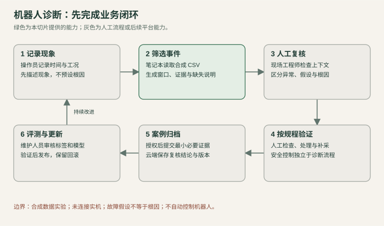
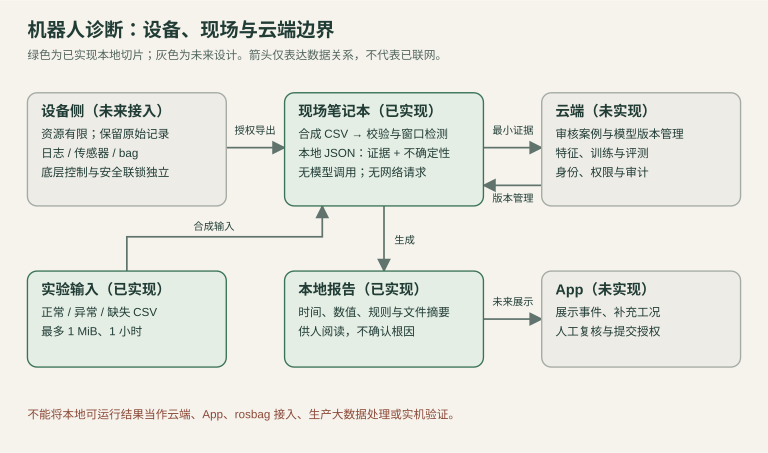
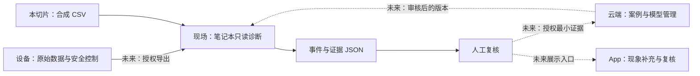
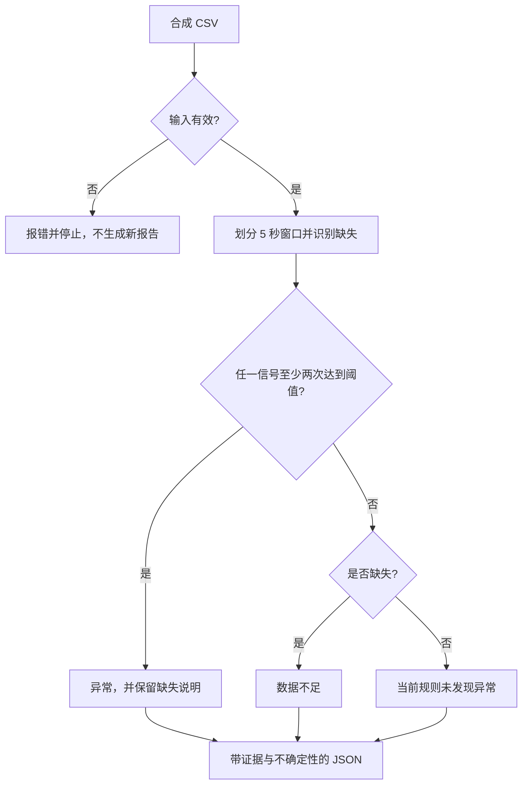
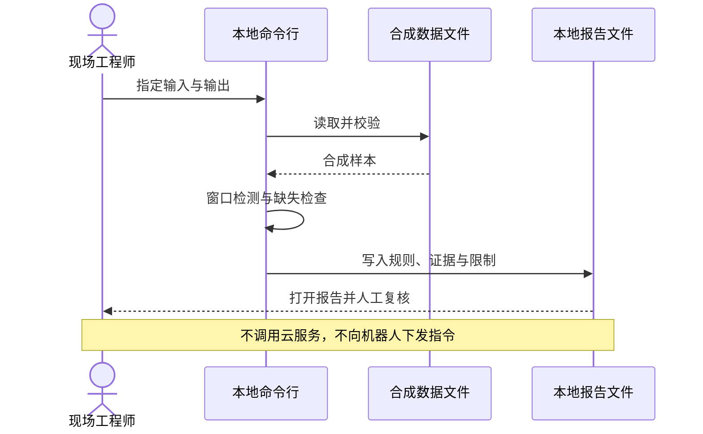

# 第 24 章｜机器人智能诊断平台综合实战

> 本章目标：先把一段合成传感器数据变成可人工复核的事件报告，再理解设备、现场工具和云端的分工。  
> 难度等级：本切片 L1–L3；生产设计讨论 L4–L5。  
> 预计学习时间：60–90 分钟（教学估计）。  
> 前置章节：时序数据、边缘智能、安全与评测相关章节；运行实验只需基础 Python。  
> **交付状态：这是综合实战的首个可运行切片，并非全章完成。** 仅实现本地合成 CSV → 事件窗口 → 证据 JSON。没有 rosbag 解析、实机连接、App、云服务、模型训练或自动控制。

## 1. 本章解决什么问题

机器人自身的计算和存储资源有限。现场日志和传感器数据量大，网络也可能不稳定。把全部原始数据上传云端，再等待云端判断，会让诊断流程依赖网络。这里采用一种待实际验证的设计：设备保留必要记录；现场笔记本先筛选事件；App 展示证据并让人员补充工况；云端管理经过审核的案例和模型版本。

业务目标是缩小排查范围，让维修人员知道“哪段数据值得检查、依据是什么、还缺什么”。本切片不证明停机时间缩短，也不证明故障诊断准确率提高。

### 先看业务闭环



1. 操作员记录现象和发生时间，不先写死根因。
2. 现场工程师读取授权数据，在笔记本上找到事件窗口。
3. 工程师结合负载、环境和维修记录，复核异常及缺失信息。
4. 按现有安全规程检查、处理、补采并验证。诊断程序不发控制指令。
5. 经授权把最小必要证据和人工结论归档到云端案例库。
6. 模型维护人员使用已审核标签做评测，再决定是否发布新版本。

后四步是业务设计，尚未实现。替代办法是人工浏览全部记录：实现门槛低，但工作量随数据增长，复核依据也容易遗漏。

## 2. 先用大白话理解

这像翻一本很厚的设备日记：先贴出值得查看的页签，再由人阅读上下文。页签不能代替维修结论。

严格地说，**事件窗口（event window）**是按时间范围组织的一组观测值。本实验把时间划成不重叠的 5 秒窗口，每个信号在同一窗口内至少两次达到教学阈值，才记为异常。这个方法只是规则检测，不是故障分类器，也不是因果推断。

类比的局限是：日记可能漏页，传感器可能漂移，规则可能漏掉其他故障。“没有标记”只表示该规则没有触发。

## 3. 核心术语

| 术语 | 中文解释与严格边界 | 容易混淆的概念 |
|---|---|---|
| 异常检测（anomaly detection） | 根据预先定义的规则发现偏离；这里仅检查两个信号的阈值 | 根因定位 |
| 证据（evidence） | 输入文件摘要、窗口范围、采样时间、观测值和规则版本 | 没有来源的模型描述 |
| 故障假设（fault hypothesis） | 与证据相容、仍需验证的解释 | 已确认根因 |
| 不确定性（uncertainty） | 缺失观测、规则未校准等结论限制 | 可以随意填写的置信度百分比 |
| 边云协同（edge-cloud collaboration） | 现场先处理，云端管理审核案例与模型的职责划分 | 所有原始数据必须上云 |
| 数据质量（data quality） | 采样完整性、格式和取值是否满足输入约定 | 设备是否健康 |

## 4. 工作原理

输入是人工编写的合成 CSV，列顺序固定为 `time_s,motor_current_a,vibration_mm_s`。时间从实验起点 0 开始，每秒预期一行；电流单位 A，振动单位 mm/s。振动值只是教学标量，未规定真实传感器的频带、方向或统计方式，不能与设备限值直接比较。

处理步骤如下：

1. 检查表头、列数、时间单调性和数值格式。时间必须是 0–3599 的整数。重复和乱序时间会失败，不静默修正。
2. 按 `[0,5)`、`[5,10)` 等窗口分组。窗口左端包含、右端不包含。
3. 空单元格和缺失行都算缺失。首个样本晚于 0 时，之前的预期样本也算缺失。最后不足 5 秒的窗口仍按完整 5 秒检查，所以会报告缺失；最后一个窗口之后的采集停顿无法由本格式判断。
4. 对每个信号分别计数：电流 ≥ 8 A，或振动 ≥ 6 mm/s，在窗口内至少出现两次，窗口就标为 `abnormal`。两次无需连续。两个信号各超一次不满足规则。
5. 未触发且有缺失则标为 `insufficient_data`；未触发且完整才标为 `normal`。异常与缺失可以同时存在，缺失不会抹掉已观测异常。
6. 输出证据、未确认假设、限制和人工复核建议。不输出故障概率，不输出控制命令。

这些阈值完全是教学设定。一次尖峰不会触发当前规则；跨窗口的两次超限也不会合并。这些是明确的检测盲区。

当前实现只处理小文件，最多读取 1 MiB、覆盖 1 小时。输入读入内存，结果也在内存构建。若输入字节数为 B，预期秒数为 T，时间和空间均为 O(B + T)；信号数固定为 2。实验不联网，网络传输量为 0。生产大文件需要流式解码、受限缓存和事件索引，本切片没有实现这些能力。

## 5. 架构与流程

### 技术架构：实线说明数据流，灰色区域表示后续能力









未来 App 的概念示意如下，**不是已实现的界面**：

```text
+------------------------------------------+
| 事件 5–10 秒             待人工复核       |
| 观测：电流 9 / 10 A；振动 7 / 8 mm/s     |
| 依据：两个信号均达到教学规则              |
| 假设：负载变化或传感器偏差，尚未确认      |
| 缺失：无     根因：未确认                 |
| [查看证据] [补充工况] [记录复核结论]      |
+------------------------------------------+
```

## 6. 工程实现

### 6.1 技术选型

使用 Python 3 标准库的 `csv`、`json`、`hashlib` 和 `unittest`，无需模型密钥或第三方包。本课程统一使用 Python 3.11+；实际验证版本见实验记录。选择规则基线是为了让证据可检查，不意味着所有机器人问题都适合阈值检测。

### 6.2 项目结构与完整代码

```text
labs/robot_diagnosis/
  detector.py
  test_detector.py
  GUIDE.md
  VALIDATION.md
  data/
    normal.csv
    abnormal.csv
    missing.csv
```

完整实现位于 [detector.py](../labs/robot_diagnosis/detector.py)，测试位于 [test_detector.py](../labs/robot_diagnosis/test_detector.py)。这里引用可运行源码，不另贴一份容易失效的代码副本。

### 6.3 安装和运行

在仓库根目录执行：

```sh
python3 labs/robot_diagnosis/detector.py labs/robot_diagnosis/data/abnormal.csv --output /tmp/robot-abnormal.json
python3 -m json.tool /tmp/robot-abnormal.json
python3 -m unittest discover -s labs/robot_diagnosis -p 'test_*.py'
```

预期有两个窗口：`[0,5)` 为 `normal`，`[5,10)` 为 `abnormal`。第二个窗口的电流证据为第 6 秒 9 A、第 7 秒 10 A。`root_cause_confirmed` 和 `automatic_control` 均为 `false`。

### 6.4 关键实现与异常处理

`analyze()` 校验输入并生成报告。每个证据项包含阈值、有效样本数量、最大值和带时间的超限样本。`source.sha256` 用于比对原始文件内容，不是数字签名，也不证明数据真实。`synthetic: true` 是本实验范围声明，不是自动识别合成数据的结果；禁止将真实 CSV 冒充本实验输入。

输入格式错误时命令退出码为 2。已有输出文件不会因输入校验错误而更新，使用者需检查退出码，不能把旧文件误当新结果。写入失败也返回错误；当前输出未采用原子替换，不能用作生产任务的提交协议。

## 7. 工程案例

一个通用的设备运维团队收到“机器人运行时抖动”的现场描述。工程师先记录发生时间和负载，再使用本实验中的异常样例学习如何定位窗口。第 6、7 秒出现电流与振动超限，支持“值得进一步查看该时段”，不能支持“电机已经损坏”。

若换成缺失样例，第 1 秒电流为空且第 2 秒整行缺失，首个窗口只能标为数据不足。工程师需要区分采集问题和设备问题。以上是教学情景，不是真实客户案例或实机结果。

## 8. 方案对比与设计取舍

| 方案 | 优点 | 缺点 | 适用与不适用范围 |
|---|---|---|---|
| 人工查日志 | 上手直接，能结合工况 | 大量数据复核慢 | 少量记录；不适合持续海量筛查 |
| 本地规则窗口 | 断网可运行，依据清楚 | 阈值和窗口有盲区 | 教学基线；不承担未知故障根因判断 |
| 时序模型 | 可学习更复杂的变化 | 需要标签、评测与漂移管理 | 有可靠数据时再验证；本切片未实现 |
| 云端检索与语言模型解释 | 可组织案例和说明 | 需要权限、来源和错误约束 | 人工辅助说明；不得替代实时安全控制 |

## 9. 生产环境注意事项与未完成项

下表是后续设计检查项，不是已交付功能。

| 范围 | 后续需要验证的工作 |
|---|---|
| 数据接入 | rosbag/日志解码、时间同步、单位、设备版本和采样频率；不能直接把 bag 文件传给本程序 |
| 大数据与断网 | 流式窗口、磁盘配额、缓存清理、断点续传、幂等键与重试；避免默认上传原始视频和全量记录 |
| 模型与 Agent | 特征与训练集版本、异常模型、RAG 来源、多模态对齐、只读工具权限、运行超时和降级 |
| 身份与安全 | 设备身份与用户身份分离；租户权限；上传授权、最小化与脱敏；保留审计和人工批准 |
| 任务恢复 | 持久化任务状态、原子输出、重复执行去重、输入及规则版本锁定；当前可重复结果不等于持久化执行 |
| 评测 | 由人工标注事件；按设备和时间分离训练与测试；统计事件漏报、误报、数据不足率和人工介入 |
| 运维与成本 | 测量目标笔记本内存、耗时、上传字节数和人工复核时间；签名版本、灰度发布与回滚 |
| 安全控制 | 诊断结果只能辅助人；机器人底层控制和安全联锁独立运行，不接受本程序指令 |

本切片没有真实延迟、准确率、误报率或成本报告。单元测试验证规则行为，不能替代真实分布评测。

## 10. 动手实践

**目标：** 运行三种输入，解释证据和结论边界。

**前置条件：** Python 3.11+，能在仓库根目录执行命令；不需要机器人、网络或账号。

**步骤：** 按 [实验指南](../labs/robot_diagnosis/GUIDE.md) 运行正常、异常和缺失样例，再运行测试。修改副本中的第 7 秒电流与振动为正常值，观察“两次超限”条件不再满足。不要修改原始样例后仍引用原来的文件摘要。

**验收标准：** 正常样例两个窗口均为正常；异常样例只有第二个窗口异常；缺失样例首个窗口数据不足。JSON 有输入摘要、规则版本、时间与数值证据、不确定性，并明确没有根因确认和自动控制。

**常见错误：** 把 `normal` 当设备健康证明；把假设当根因；将缺失填 0；给教学阈值附上虚构置信度；将命令成功当成实机验证。

**扩展挑战：** 为跨窗口事件设计合并规则，先列出会改变的输出和评测方法，再编码。若加入真实设备数据，必须先定义新的数据契约、权限和验证流程。

## 11. 本章总结

- 先定义人工复核闭环，再决定设备、现场和云端的职责。
- 本地事件筛选可以先于云端案例管理交付。
- 异常证据、故障假设和已确认根因必须分开。
- 缺失数据是单独的信息，不能当正常数据处理。
- 当前规则只覆盖明确定义的合成窗口，不证明真实设备性能。
- 完整平台仍需接入、模型、可靠性、安全、部署和真实评测工作。

下一步应结合时序数据、边缘智能及评测章节，先补数据契约和有人工标签的评测集，再考虑模型与 Agent。

## 12. 参考资料

以下官方文档访问日期为 **2026-11-20**；访问的是 Python 3 在线文档滚动版本，实际运行版本另见验证记录。教学阈值和业务图为本书原创设定，不来自设备厂商规范。

- [Python `csv` 官方文档](https://docs.python.org/3/library/csv.html)：支持使用 `DictReader` 读取表头字段、显式数值转换和 `newline=''` 的文件处理约定。
- [Python `json` 官方文档](https://docs.python.org/3/library/json.html)：支持 JSON 编解码及 `allow_nan=False` 的严格数值输出选择。
