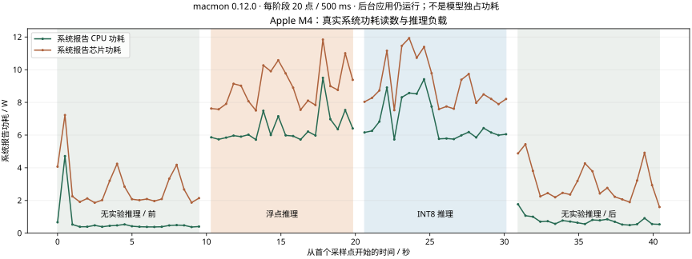

# M4 系统报告功耗：实际采样

2026-11-20（洛杉矶），使用 macmon 0.12.0，在普通用户权限下读取系统计数器。原 powermetrics 入口需要管理员密码的失败记录仍保留；本次没有使用该入口，也没有提权或安装后台服务。

## 工具与来源

- [官方 v0.12.0 发布](https://github.com/vladkens/macmon/releases/tag/v0.12.0)，MIT 许可；使用官方 ARM64 压缩包，程序只放在临时目录，未纳入本书。
- 压缩包 SHA-256：`cd5a701f8537072aee93eba686bc582897bd00d826f62146b32c8a8d2654641a`，下载后与 GitHub release asset digest 核对一致。
- [固定版本说明](https://github.com/vladkens/macmon/blob/v0.12.0/readme.md)：支持无 sudo 的 IOReport/SMC/CLPC 数据读取；JSON 的 cpu_power、chip_power、sys_power 单位为 W。它依赖非公开系统接口，系统升级可能改变支持情况。访问日期：2026-11-20。
- [采样脚本](../../capture_power.py)；[原始报告](report.json)保留实际版本、可执行文件摘要、脚本摘要、模型及数据摘要、时间戳和全部读数。

## 方法

Apple M4、macOS 26.3、arm64、Python 3.12.14、ORT 1.23.2、NumPy 2.2.6；模型和测试数据直接使用已验证的 x86 artifact。实际 CPU provider，批量 1，intra/inter-op 各 1 线程。每个模型预热 100 次，然后按“无实验推理 → 浮点 → INT8 → 无实验推理”固定顺序各采样 20 点，间隔 500 ms；每阶段进程墙钟约 10.3 秒，共 80 点。

推理阶段持续调用真实 `session.run` 并检查输出有限。浮点阶段共 2,970,814 次，INT8 阶段共 1,988,411 次；计数窗口包括监测工具启动与退出，不用于计算单次能耗。无实验推理阶段仍保留模型内存、监测工具与其他后台应用。没有关闭用户应用，也没有控制温度或随机交换测试次序。

| 阶段 | CPU 均值 W | 芯片均值 W | 系统读数均值 W |
|---|---:|---:|---:|
| 无实验推理 / 前 | 0.661 | 2.810 | 8.060 |
| 浮点推理 | 6.416 | 8.987 | 15.715 |
| INT8 推理 | 6.821 | 9.094 | 17.952 |
| 无实验推理 / 后 | 0.763 | 3.058 | 9.882 |



这是系统报告的主机读数，包含后台工作；不是进程独占功耗，不是外接功率计校准值，不是模型能耗排名。前后基线不同也说明背景和热状态在变化。不能由这一次固定顺序实验断言“INT8 必然更耗电”，也不能用功耗差除以请求数声称精确单次推理能耗。未测其他 SoC、NPU、Jetson 或 RK3588。

## 复现

下载并校验上述固定版本到自己的临时目录。使用独立的第 21 章 Python 环境，在仓库根目录执行：

```sh
/tmp/leanagentbook-ch21-env/bin/python labs/edge_cloud/capture_power.py --monitor /tmp/leanagentbook-macmon-v012/macmon --models labs/edge_cloud/evidence/x86-20261120 --output /tmp/edge-power-new-run
```

更换路径和新输出目录；若不是 Apple Silicon、工具版本不符、读数缺失/不变、样本不足或模型报错，脚本停止，不填估算数据。普通机器不运行这个可选硬件实验。原始报告可独立复算均值，无需设备或模型。

图表由 [plot_power.py](../../plot_power.py)直接读取报告生成，需要可选 matplotlib 3.10.1；当前中文字体为 macOS Arial Unicode MS，其他系统需安装可显示中文的字体。本图是采样展示，不替代原推理延迟报告。
