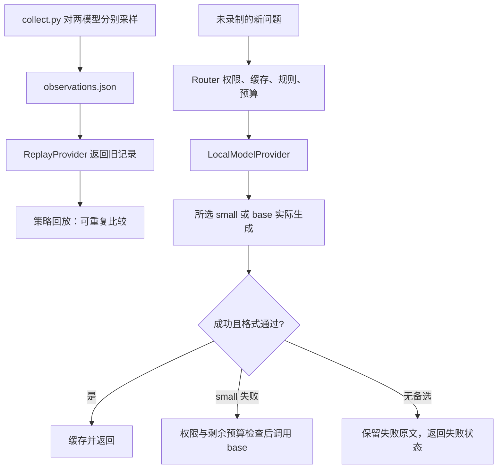

# 第08章：由 Router 触发真实模型生成

本批是 v0.7 之后的独立补齐，未替换旧的回放结果。执行日期：2026-11-20。只使用已存在的 Python 3.12.14 环境、torch 2.6.0、Transformers 4.48.3，未安装或升级依赖。

## 两条路径回答不同问题



```text
旧：先让每个模型答完题 --> 保存记录 --> 回放不同策略
新：收到问题 --> Router 选模型 --> 当场生成 --> 判断是否回退
```

真实入口不从观测表查答案。读取旧观测只用来断言三个新问题从未录入；期望答案只在路由返回后评分，不进入后端。规则仍用词数作教学代理：超过 16 个空白分词走 base，否则走 small。base 只是参数更多的候选，本实验没有证明它更强，也不把词数当真实难度分类器。

## 复现

从仓库根目录运行。已有环境和两份固定快照必须存在；程序不下载模型，不修改依赖。新输出目录必须不存在。

```sh
PYTHONDONTWRITEBYTECODE=1 python3 -m unittest discover -s labs/model_routing -p 'test_*.py' -v
HF_HUB_OFFLINE=1 TRANSFORMERS_OFFLINE=1 TOKENIZERS_PARALLELISM=false \
  /tmp/leanagentbook-routing-py312/bin/python labs/model_routing/run_live.py \
  --hub /tmp/leanagentbook-routing-models/hub \
  --output /tmp/routing-live-new-run
python3 scripts/check_book.py
```

其他机器可使用已有匹配环境，更换解释器与 `--hub`。Hub 目录需要有 `models--google--flan-t5-small/snapshots/0fc9ddf78a1e988dac52e2dac162b0ede4fd74ab` 和 `models--google--flan-t5-base/snapshots/7bcac572ce56db69c1ea7c8af255c5d7c9672fc2`。代码按完整 revision 定位本地目录，`local_files_only=True`；缺失则报错，不回退到录制答案或别的模型。

[LocalModelProvider](live_provider.py) 可传给同一个 `Router`，接收不在旧观测表里的新问题。导入这个模块不会导入 torch；只有构造真实后端时才加载依赖。默认 `test_*.py` 全部仍可在标准库环境运行。

## 已保留的真实轨迹

[完整报告](results/live-v1/report.json)保留三个新问题、期望答案、全部实际输出、每次尝试、模型 revision、输入输出 token、耗时、合成积分与源码哈希。

| 场景 | 实际行为 | 新后端调用数 | Router 耗时 / ms | 新增合成积分 |
| --- | --- | ---: | ---: | ---: |
| 简单新题：23 + 19 | small 输出 0，错误但格式通过 | 1 | 33.790 | 0.016 |
| 重复简单题 | 命中缓存，仍返回错误的 0 | 0 | 0.036 | 0 |
| 长题：20 箱加 7 再减 9 | base 返回错误解释，格式不合格 | 1 | 1895.472 | 0.432 |
| 重复长题 | 失败未缓存，再次实际调用 base | 1 | 448.865 | 0.432 |
| 撤销权限后读取已缓存短题 | forbidden，无答案 | 0 | 0.005 | 0 |
| 未授权身份 | forbidden | 0 | 0.001 | 0 |
| 总预算只有 1 token | budget_exhausted | 0 | 0.138 | 0 |
| 只有 small 权限却选到 base | forbidden，不越权调用 | 0 | 0.012 | 0 |
| small 一次可控失败，问企鹅是否鸟类 | small 报错；base 实际生成 yes | 2 | 50.569 | 0.080 |

长题期望值为 18；base 实际原文保留在 `attempts` 中，包含错误的中间算式，生成到 32 token 上限。Router 最终答案为空，不能只看最终空串就丢失失败证据。重复失败耗时明显不同，因首次模型执行有额外初始化等影响；这里只有单次轨迹，不作稳定速度比较。

冷热专指**答案缓存**：两个模型在请求开始前已加载，但没有提前预热生成。模型加载时间单列为 small 333.361 ms、base 479.200 ms。CPU、FP32、两线程。`end_to_end_ms` 实测 `Router.run`，含权限、缓存与 token 预估；不含模型载入。兼容字段 `recorded_backend_ms` 在真实路径中累计当次后端实测耗时，在旧回放中才是历史记录耗时。两个口径不能混为一个实验。

积分是假设价格：每千输入 token small/base 分别 1/4，输出权重为 2。不是实际账单或电费。故障在 small 开始生成前注入，消耗模型 token 为 0；备选 base 消耗输入 16、输出 2 token。没有模拟部分生成后断流，也没有声称完成真实网络故障演练。

## 授权与失败边界

`allowed_models(scope)` 是由可信调用方提供的授权函数，真实入口用静态内部权限表演示；它不是登录系统。缺少授权的请求在缓存读取和 token 预估之前返回拒绝。每次备选调用前再次检查可用模型范围；缓存已命中也必须确认缓存结果所属模型仍有权限。旧回放未提供该函数，保持原有内部可信调用约定。

已实现的可控失败是一次标准化 `error` 返回，随后走 Router 原有回退逻辑。真实后端出现未处理运行时异常时，实验直接报错，不猜测已消耗 token，也不声称自动完成所有异常恢复。超预算用保守预留的输入 token 加最大输出 token 判断。

21 项离线测试通过，保留原 17 项并增加权限撤销、所选/备选模型权限、缓存模型权限与无 torch 导入测试。实跑入口另有断言，检查新问题、选路、缓存零调用、权限/预算零调用，以及注入失败后备选的真实生成。格式不合格或内容错误作为教学结果保留，不修改答案来通过质量指标。

## 来源核验

2026-11-20 核对以下一手来源：

- [small 固定快照](https://huggingface.co/google/flan-t5-small/tree/0fc9ddf78a1e988dac52e2dac162b0ede4fd74ab)、[base 固定快照](https://huggingface.co/google/flan-t5-base/tree/7bcac572ce56db69c1ea7c8af255c5d7c9672fc2)：确认模型身份、revision、Safetensors 文件及 Apache-2.0 标注，不据此推断本任务质量。
- [Transformers v4.48.3 模型加载源码](https://github.com/huggingface/transformers/blob/v4.48.3/src/transformers/modeling_utils.py)：结合本地同版本源码核对 `from_pretrained` 本地目录与 `local_files_only` 行为。网页文档入口不可用时没有将其当作已读证据。

本实验完成本地实时路由集成，不代表生产质量、服务容量或真实身份系统验收；新问题是功能验证集，不是新的独立模型能力排行榜。
